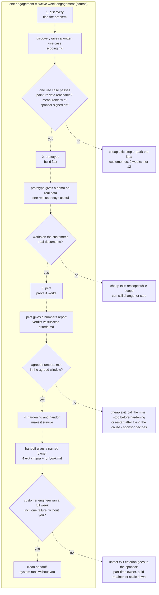

# The engagement lifecycle

Every Hadavin client project and every Hadavin demo uses this lifecycle. It is the course's lifecycle (Topics 01, 02, 37–41, with the arc in 44). Each stage is kept, with its exit artifact and its cheap exit point. Hadavin shortens the calendar but never skips a stage (Topic 02, Hadavin practice).

- **Authority:** the images win for the flow. The `.md` notes win for everything else. Each topic file has its own diagrams and rules: `topics/NN-*.md`.
- **The mapping (Topic 1 image 175112 and Topic 2 image 175554):** find the problem → build fast → prove it works → make it survive. That is discovery → prototype → pilot → hardening and handoff.
- **Exit artifacts (Topic 2 image 175604):** discovery gives a written use case. Prototype gives a demo on real data. Pilot gives a numbers report. Handoff gives a named owner.
- **When someone pushes to skip ahead (02 L2):** "Happy to move on once we have X."
- **The engagement arc (44):** scope → build → prove → price → hand off. Scope is stage 1, build is stage 2, prove and price are stage 3, and hand off is stage 4.

## The whole flow

Diagram vs images: the backbone of four stages and four artifacts, drawn with dashed arrows, is the images (Topic 1 image 175112, Topic 2 images 175554 and 175604). The images draw no branches. The gates and exits come from the text: 02 L1/L2, 37 L1, 38 L1, 40 Q2 and 41 Q1. "Sponsor signed off?" in the first gate is [Hadavin practice]; the course gate says only that the use case is written down. The fourth gate shows the course's four exit criteria; Hadavin adds a fifth of its own in Stage 4 (its access closed, evidence filed).

---

## Stage 1 — Discovery and scoping (find the problem)

**Goal:** turn a wish list of about 15 ideas into **one** use case that can visibly win in weeks, and decline bad fits without losing the sponsor (37). Write no code (02 L1).

**Entry condition:** a sponsor with a request. Save the brief verbatim (`brief.txt` in 37 T1, `customer-brief.md` in 44 T1).

**Steps:**
1. **Collect the wish list.** Ask what they want the AI to do; expect about 15 ideas within an hour (37 L1). Turn "AI everywhere" into one painful, measurable problem (01 Q1).
2. **Filter each idea with the three questions, in order:** painful? → data reachable? → measurable win? (37 L1, image 182710). Passing all three makes an idea a candidate. Failing even one sends it to the **parking lot**, politely, with a reason.
3. **Prefer the boring idea.** Boring, reachable and measurable beats flashy in a first engagement (37 L1).
4. **Screen out bad fits.** The four shapes are: no tolerance for error, no data, no measurable outcome, and cheaper without AI. A fifth form of the first shape (supplement, changed 2026-11-01): an autonomous action whose wrong output cannot be reversed and has no human gate (R28, R293). Licensed or regulated work stays declined under the studio positioning; the book's patterns only help reshape a request. Decline with the **three-move "no"**: name the risk, reshape so a human keeps the decision, and offer a path back (37 L2).
4a. **Narrow the intervention and set the ceiling** (supplement, changed 2026-11-01; RULES R294 to R298). Write the outcome before the system, paired with a ceiling number on the worst failure, fixed first with the sponsor. Narrow the AI to one pattern, one workflow and a human who disposes. Ask the design-changing questions, including which domain constraint turns an optional component into a wall, and list the data assumptions. Check the three scoping traps.
5. **Map the data.** Ask "where is the knowledge?" and map each source to one of the four homes; start with the smallest useful source (24 L1). Ask for real sample documents in week one (16 L3). Ask about source permissions in week one (19 L1). Classify the data classes for the security review: PII, secrets, regulated data, trade secrets (36 L1–L2). Find out where the data lives and who grants access, on day one (37 L1).
5a. **Run the trifecta check** (supplement, changed 2026-11-01, R306), now that the data map exists: untrusted content, private data and the power to act must never share one ungated path. Record the answer under `## Risks`.
6. **Set expectations about the model.** It does not know their systems and does not learn from use (03). Requests to "fine-tune on our data" are knowledge problems, which RAG solves (30 L2).
6a. **Profile the workload and choose chain or agent** [Hadavin practice]: difficulty, whether a human waits, calls per day, per route, and a first cost envelope per tier (R278, R209; 07 L2, 04 L3); chain or agent per use case (R99; 20 L2).
7. **Agree the eval contract** in week 1–2: the golden questions, the grading rule, and the threshold (25 L2).
7a. **Freeze the test sets** with the eval contract [Hadavin practice, pricing-plan §3.2.5]: a tuning set (Hadavin sees the answers; the CI golden gate) and a sealed scoring set (the client keeps the answers; Hadavin never sees them before a scoring run's outputs are locked by checksum). Items, answers, scoring script and checksums are frozen. Superseded by this text on 2026-11-01: any single frozen set whose answers Hadavin agrees.
8. **Write the handoff exit criteria** in week one: named owner, runbook, customer has operated it, monitoring runs without you (41 L1). [Hadavin practice] Add the fifth, Hadavin's own: its access closed and the evidence filed. Name a deputy for the operator and the owner, or record that none exists.
9. **Write `scoping.md`** (37 T1) and get sponsor sign-off.

**Topics:** 37 (main), 01, 02, 03, 16 L3, 19 L1, 24 L1, 25 L2, 30, 36 L1–L2, 41 L1.

**Exit artifact(s):**
- **`scoping.md`**, the "written use case" (02 image). It has two course forms:
  - Topic 37 T1, with these 4 H2s, spelled exactly: `## Use case`, `## Out of scope` (at least 2 rejected ideas, each with a reason), `## Success metric` (a concrete number from the brief), `## Risks`. Each section is in real sentences.
  - Topic 44 T1, 4 H2s: `## Problem`, `## Users`, `## Success criteria` (each one a number), `## Risks`.
  - Both must cover the Topic 2 L2 one-pager: the problem, who has it, where the data lives, and the success number.
  - Supplement (changed 2026-11-01, R294, R297): `scoping.md` also gets `## Assumptions about the data` and `## Success metric and ceiling`, the ceiling's one home (the course `## Success metric` stays as is; Stage 3 `success-criteria.md` copies the ceiling from here and does not re-decide it). The worst failure is named under `## Risks`, with the trifecta check (R306), the starting autonomy level and one `verify_check` per fix type (R305, R307). For the incident-response pilot shape the ceiling is copied into `baseline.yaml` (kernel PR K0, `templates\project\`).
  - Hadavin practice (R35): carry both forms, every course H2 spelled exactly: `## Problem`, `## Users`, `## Use case`, `## Out of scope`, `## Success metric`, `## Success criteria`, `## Risks`. Add data sources with owners and access, target cloud, the calendar, the pilot plan and sponsor sign-off (37 and 44 real world; 44 table). Extra H2s still meet the course. Template: `..\templates\project\scoping.md`.
- The parking lot: every idea with pass/fail per filter and a reason (37, Hadavin practice: a written list).
- The eval contract (25 L2) and the four exit criteria (41 L1) plus Hadavin's fifth, all in writing.
- [Hadavin practice] The frozen tuning set and sealed scoring set with checksums; decision records for the cloud route, the deployment by data class, chain vs agent, and the workload profiles (`[ARCH]` and `[MLE]`).
- [Hadavin practice] A "how it breaks" section in `scoping.md` `## Risks` (mechanism, blast radius, human checkpoint) and the four architecture questions (what the system must know, may do, must remember, and how its parts coordinate); if the honest answer is a smaller scope or a decline, it says so in writing.

**Exit test (02 L2):** the use case is written down, on one page, with a success number. No success number means discovery is not done. (Supplement, changed 2026-11-01: write the ceiling as one line next to the success number, R294. This is advice for a PoC or pilot under US$5k and expected at hardening or enterprise tier.)

**Exit / kill decision:**
- **Go:** exactly one use case passes all three filters, and its data access is confirmed.
- **Kill or reshape:** no idea passes, or the sponsor's favourite is a bad fit. Stop, or switch openly to the idea the evidence supports (02 Q2). Killing a bad use case in week two is a success: the customer lost two weeks, not twelve (02 L1).

**Who decides:** the FDE recommends and declines bad fits; the **sponsor** signs off `scoping.md`. Hadavin roles: see ROLES.md.

---

## Stage 2 — Prototype (build fast)

**Goal:** a proof of concept in days. It proves the risky part on the customer's **own data** and gives people something real to react to (02 L1, 38 L1).

**Entry condition:**
- `scoping.md` is signed off;
- data access is proven (a sample export or a credential in hand, not a promise; 37 Hadavin practice);
- the sample documents have arrived (16).

**Steps:**
1. **Pick the risky part.** For a handbook assistant that is retrieval plus grounded, cited answers. Nobody doubts the login page (38 L1).
2. **Build the core only, in this order:** customer docs → embed and store → retrieve → cited answer (38 L1, image 182748). Build-topic map:
   - API calls: 06;
   - prompts: 08, 09;
   - structured output: 10;
   - conversation state: 12;
   - documents: embeddings 13, vector store 14, RAG 15, chunking 16, hybrid search and reranking 17, citations and grounding 18, permissions 19;
   - actions: tools 11, chain vs agent 20, multi-step 21, MCP 22, customer APIs 23, connectors and ingest 24.
2a. **State the prototype's autonomy level** (supplement, changed 2026-11-01, R305): start with the most constrained version (a human on every output) and write what evidence would justify raising it.
3. **Run it from a terminal or a plain script.** Leave the web UI, auth and deployment for later (38 L1, image).
4. **Choose the model per workload.** Try the cheapest viable tier on 20 real examples; upgrade only on side-by-side evidence (07). Measure real `usage` and estimate the monthly cost early (04 L3).
5. **Demo by about day four** (38 L1). Prepare like a pilot, not like a magician (39 L1):
   - real data, live;
   - rehearsed questions on the same data, the same day;
   - show one limit on purpose;
   - narrate the mechanism;
   - state the boundary as a feature.

   If an answer fails live: thank the person, open the cited source, explain why citations exist, and log the question for the eval set (39 Q1).
6. **Collect feedback** and note where retrieval fails on the messy documents. This early truth arrives while scope can still change (38 L1).
7. **If the customer wants to ship the PoC as is:** yes to the goal, no to the timeline. Propose a named hardening plan and a small, logged pilot group (38 Q2).

**Topics:** 38 (main); Build 06–24; 04, 05, 07; 39 L1 and Q1 for the demo. Capstone templates: 42 (docs Q&A), 43 (tool assistant), 44 (both, routed).

**Exit artifact(s):**
- **A demo on real data** (02 image), meaning a cited answer over their documents, run from a script (38).
- Course files:
  - PoC (38 T1): `store.json` (`[{id, text, embedding}]`) and `answer.txt` (cites the source filename).
  - Docs Q&A (42 T1): `chunks.json`, `store.json`, `ask.py`, `answer-expenses.txt` (covered) and `answer-trap.txt` (refusal).
  - Tool assistant (43/44): `assistant.py`.
- Hadavin practice: a recorded demo on the client's real data, plus the user's sign-off (02).

**Exit test (02 L2):** real documents from the customer's systems went in, and **one real user** watched it answer and said "yes, this is useful". A prototype that ran on your own sample documents never counts.

**Studio demo (pre-sales), not Stage 2 proper:** a demo on synthetic data (for example the ask-your-data spike) is a pre-sales asset and a deliberate exception to "use real customer data, live" (R236, owner 2026-11-01). Its exit artifact is a recording labelled "Staged on synthetic data" plus a green PR; it makes no accuracy claim and never counts as the Stage 2 exit. Stage 2 proper starts with a prospect's signed `scoping.md` and real data.

**Exit / kill decision:**
- **Go to pilot:** the exit test is met.
- **Rescope or stop:** retrieval fails on their real documents (38 L1).
- **Never** roll a prototype out to all users (38 Q2).

**Who decides:** a real user's "useful" plus the **sponsor's** go to pilot. The FDE reports the early truth either way.

---

## Stage 3 — Pilot (prove it works)

**Goal:**
- (Client documents call this the **user pilot**. The first paid phase is "Week 1 (target setting)", not this stage. See PROJECT-PLAYBOOK.)
- a small group of real users (maybe ten) uses it in daily work;
- measure everything: how often answers are right, where it fails, whether users come back (02 L1);
- produce the numbers that justify going further, and a verdict.

**Entry condition:**
- the prototype exit is met;
- `success-criteria.md` was **agreed with the sponsor before the pilot starts** (40 L1);
- baseline numbers were captured before day 1 (40 L1, 39 L2);
- the contract has no "100%" clause (39 Q2);
- baseline weeks (median), the written "normal" rule, excluded weeks with reasons, the hard-week definition in numbers, the maximum extension, the buyer-chosen fallback and the pass bar parts (zero harmful actions, speed on the lower bound, false-abstain ceiling, shadow mode) are signed with `success-criteria.md` (studio addition 2026-11-02, R413 to R415, method not measured);
- the baseline is agreed, and the ceiling from `scoping.md` `## Success metric and ceiling` is carried into `success-criteria.md` `## Metrics` without being re-decided (supplement, changed 2026-11-01, R294, R242; advice for PoC and pilot under US$5k). `success-criteria.md` keeps its four course H2s.

**Steps:**
1. **Set the baseline**, in this order: current process today → pilot target number → shared test set → fair judgment of the pilot (39 L2, image 182825). Never invent today's numbers; estimate them with the customer. [Hadavin practice] Where history exists, score the baseline on the same test set (past human answers marked by the same reviewer), not a spot-check estimate, and state which baseline the target compares against.
2. **Write the success criteria.** Use 2 or 3 criteria (one quality, one usage or time, maybe one satisfaction). Each has four parts: metric → target number → how measured → time window. Get them agreed with the sponsor, so the review meeting can reach a verdict (40 L1, image 182857). [Hadavin practice] The accuracy criterion is the contract number on the frozen set (R180), copied and not re-decided; the usage and time criteria are the user pilot's own. The sponsor also signs the zones with the target at the end of week 1 of the build (R361): the stage-1 size (50 answered items), the target, the zones as counts of wrong answers and the one-extension rule (a fresh locked set by change order); they govern the "demonstrated" word, not payment.
3. **Build the proof** (Prove = 25–29):
   - golden set from real traffic, with easy, hard and trap questions and SME-owned answers (26);
   - grading by string checks or an LLM judge with a rubric (27);
   - an eval runner and an exit-code gate in CI (28);
   - retrieval hit rate and faithfulness measured separately (29);
   - the abstain rate on a trap set (32);
   - supplement (changed 2026-11-01): pass^k for agents, the two error types reported separately for decision systems, an exact 95% interval and a gating set of 50+ items, a judge calibration record, and 2 or 3 metrics per component chosen from its failure modes (R322 to R326).
4. **Run the weekly loop:** capture the question, answer and signal → review thumbs-down → fix the cluster → tell the users, then repeat (40 L2). Every fixed thumbs-down becomes an eval candidate. Supplement (changed 2026-11-01, R328): also sample implicit signals (rephrasing, retries, abandonment, overrides, reopened items) and name any unmeasured dimension they reveal.
5. **Count human-in-the-loop signals** (sent unchanged, edited, discarded, escalated) in the feedback log every week (40 L3). **Escalation rule:** a thumbs-down on a safety-related answer, or 3 on the same question, goes straight to a place checked daily.
6. **Tell the customer the refusal trade-off** in plain words (32). Consider fine-tuning only when evals prove prompting has plateaued (30).
7. **Price it:** real `usage` tokens per question × volume from the brief × the price sheet, naming the models priced (44 T1, 04 L3, 33).
8. **Hold the review meeting** on the agreed window and give a verdict against the agreed numbers (40 L1):
   - score normal weeks against the written baseline and flagged hard weeks separately (harm and hand-back only); where load or stakes vary by week (otherwise "not applicable", with the reason, signed), and with no hard week the verdict says "met on normal weeks, hard weeks untested" (the report line is "not tested on hard weeks") and applies the signed fallback (going live with the limit written does not raise the autonomy level): hard-week definition in numbers, maximum extension (priced change order, R253, R254) and the buyer-chosen "go live with the limit written" or "quiet weeks only" (R414, studio addition 2026-11-02);
   - a miss is a miss: separate the verdict from the diagnosis, and give the sponsor options (40 Q2);
   - high usage with a high thumbs-down rate is not success (40 Q1).

Order: doing Build after the PoC exit, and Prove plus Price (steps 3 and 7) before the pilot group goes live, is [Hadavin practice] (pricing-plan §3.2, §3.5), supported by R161, 43 T1 and 38 Q2. Steps 1–2 (baseline, success criteria) still finish before pilot day 1. The final payment falls due at the acceptance run in step 3 (Net 14, decisions 2026-11-01 evening item 5), so after the user pilot the exits are the sponsor's options (R262), not a refund; the SOW says so. Exception: Incident Response watch-only read-only use is allowed before the final payment (pricing-plan §3.2.5). Minimum length of the user pilot: 3 weeks (week 1 teething, then a final window of at least 2 weeks that excludes week 1, R253).

**Topics:** 40 (main); 39 L2 and Q2; Prove 25–29; 30; 32; price 04, 33; capstones 43 and 44 (eval and gate).

**Exit artifact(s):**
- **A numbers report** (02 image and L2): how many users, how many real questions, percent correct, and the worst failures listed honestly, compared with the discovery success number. Supplement (changed 2026-11-01): also pass@1 and pass^k for agents, the ceiling metric's value, the 95% interval, and unit cost per resolved task.
- **The review-meeting verdict** (40).
- Course files:
  - `success-criteria.md`, with these 4 H2s, spelled exactly: `## Metrics`, `## Baseline`, `## Measurement`, `## Review date` (40 T1);
  - `golden.jsonl` (43, 44);
  - `scores.json` (43) or `eval-report.json` (44), each with `results` and `pass_rate`;
  - `gate.sh` (43);
  - `feedback.jsonl` and `escalations.txt` (40 T2);
  - `cost-estimate.md` (44).

**Exit / kill decision:**
- **Go to hardening:** the agreed numbers were met in the agreed window.
- **Stop before hardening:** the numbers are bad (02 L1).
- **Restart after fixing the root cause** (40 Q2), for example after a documentation effort.
- [Hadavin practice] A score near the target is never settled by a rerun until it is green: payment follows the frozen-set count in the contract, and the zones the sponsor signed with the target at the end of week 1 of the build (R361) govern only the "demonstrated" word.
- **Never** lower the bar, extend without a fix, or reframe a miss as a win (40 Q2).

**Who decides:** the FDE gives the honest verdict; the **sponsor** decides between continue, close and restart (40 Q2).

---

## Stage 4 — Hardening and handoff (make it survive)

**Goal:**
- add the boring parts that make it safe to leave: cost limits, logging, guardrails, documentation;
- train the customer's engineers until they run it without you (02 L1).

**Entry condition:**
- the pilot verdict is "go";
- the exit criteria from week one are in hand (41 L1).
- If pushed to roll out wide now: stage the rollout while hardening happens (02 Q1).

**Steps:**
1. **Harden** (Harden = 31–36):
   - guardrails: input filter, output filter, injection defense (31);
   - hallucination controls (32);
   - cost: cache, then classify-first router (R213), plus a hard daily budget from the first live call (33);
   - streaming, timeouts and a fallback model for transport errors only (R219) (34);
   - log every call and trace every request (35);
   - data flow, deployment by data class, and redaction with proof (36).

   Also:
   - replace the snapshot export with sync before production (24 L2);
   - permission-filter any non-all-staff sources (19);
   - pin model ids, and make prompt and model changes go through the eval gate (09, 28).

   Supplement (changed 2026-11-01), as hardening exit evidence [at hardening]:
   - the audit chain anchored outside the application's write access (R330);
   - the seven design-review questions answered in the runbook (R331) and a scale review naming the first bottleneck (R334);
   - a sandbox for any agent that executes code (R316), and the trifecta check re-run after any new tool or connector (R306);
   - deletable prompt rules paired with evals (R332).
2. **Shift responsibility one duty at a time**, starting about 4 weeks before the end: you do, they watch → they do, you watch → they do alone, you review (the last two weeks) (41 L2, image 183007).
3. **Train the three roles**, each with its own session and runbook section: operator (the engineer), reviewer (support lead or domain expert), owner (the manager) (41 L2).
4. **Write the runbook** (41 T1). Commands go in fenced blocks. Never swap the model without running evals.
5. **Wire monitoring to their people:** the eval suite on a schedule, a weekly thumbs-down review, and an alert on accuracy or cost drift (41 L1).
6. **Raise any unmet exit criterion** (for example, no owner) with the sponsor, with options, before your last week (41 Q1).

**Topics:** 41 (main); Harden 31–36; 09, 19, 24 L2, 28; capstone 44 (handoff).

**Exit artifact(s):**
- **A named owner** (02 image), and all four **exit criteria** met → a clean handoff (41 L1, image 183000):
  1. named owner;
  2. runbook written;
  3. customer has operated it;
  4. monitoring runs without you.
- [Hadavin practice, owner 2026-11-01] **A fifth exit criterion, Hadavin's own**: every credential, role, service account, webhook, deploy key and repo or console access Hadavin held is listed and, the working day the counts show the target is met, removed by Hadavin where it controls it and requested in writing from the client for the rest (Part 1, the only access condition on the final invoice). Later access is a time-limited Grant. Part 2 is signed at hand-over. It is Hadavin's obligation, not the client's. The open point on the final invoice is closed.
- A trained three-role team (41 L2), each role with a named deputy [Hadavin practice]; if no deputy exists, that is an open exit criterion for the sponsor.
- Supplement (changed 2026-11-01, R313): any multi-agent split was triggered by traces, not by design preference.
- Supplement (changed 2026-11-01) [at hardening]: the hardening exit evidence from Step 1 is ticked with proof (audit anchor, seven design-review questions in the runbook, scale review, sandbox, trifecta re-check, deletable prompt rules; R306, R316, R330 to R332, R334).
- Course files:
  - `runbook.md`, with these 4 H2s, spelled exactly: `## Owner`, `## Routine operations`, `## Known failure modes`, `## Escalation` (41 T1).
  - `handoff-runbook.md`, 4 H2s: `## How to run`, `## Monitoring`, `## Known limitations`, `## Escalation` (44 T1).
  - Hadavin practice: one runbook in the client repo with both sets of headings, plus re-index, secret rotation, model-id pin and upgrade, dashboards and alarms, on-call contacts, and rollback (44 table).
  - Hadavin practice: `## Known limitations` (44 T1) lists only the inherent boundaries of the system as designed (for example "static documents need re-indexing"). An unfixed bug, gap or failing check is never listed there; it is fixed before handoff (owner rule "fix, don't defer", root `CLAUDE.md`). The same holds for the README's "known limitations".
- `README.md` (Hadavin practice; not in the course) with these sections:
  - what it does;
  - architecture sketch;
  - setup;
  - run;
  - evals;
  - config keys;
  - links to the runbook and `scoping.md`.

  Add from 42/43 as relevant: sources covered, how to re-index, how to read citations, tools and their permissions, the gate threshold and why, known limitations.
- Hadavin practice: a recorded demo or walkthrough against the success criteria (44 table), and the owner entered in the agent registry (41).

**Exit test (02 L2):** "handoff is done when you are not needed":
- the customer's engineer handles a full week, including one failure, without messaging you;
- documentation exists;
- limits are set;
- someone on the customer side owns the system by name;
- if no real failure occurs that week, a drill agreed in advance by the sponsor and the owner's manager (for example a stale index or an expired test key in the test environment) is fixed by the operator using only the runbook, and logged [Hadavin practice];
- Hadavin's access is closed and the evidence filed [Hadavin practice, owner 2026-11-01];
- at hardening or enterprise tier: the supplement evidence above is in place (changed 2026-11-01).

**Exit / kill decision:** an unmet criterion is a sponsor-level decision (41 Q1). The options are:
- assign and train a part-time owner;
- buy a paid support retainer;
- scale down to a minimal footprint.

Never hand off to a group ("the IT team"), and never give quiet free support.

**Who decides:**
- the **sponsor** decides on unmet criteria;
- the owner is named in writing and **agreed by the owner's manager** (41 L1);
- handoff ends when the exit test passes.

---

## Course calendar

**Course calendar** (Topic 02, twelve-week telecom example). These are not Hadavin dates.

| Stage | Course weeks | Timing anchors from the topics |
|---|---|---|
| 1 Discovery | weeks 1–2 | sample docs and permissions in week one (16, 19); eval contract in week 1–2 (25); exit criteria in week one (41) |
| 2 Prototype | weeks 3–5 | PoC demo by about day four (38) |
| 3 Pilot | weeks 6–9 | criteria judged over the final two weeks of the pilot (40 L1) |
| 4 Hardening and handoff | weeks 10–12 | handoff training starts about 4 weeks before the end (41 L2), so about week 9, overlapping the pilot; the customer runs reviews alone in the last two weeks |

Other example lengths in the course: a 6-week build (37 Q1, T1) and 6–8-week pilots (40 T1, Q2).
Do not rush discovery or hardening. Everyone loves prototype week (02 L1).

Hadavin compressed calendar: see TIMELINES.md (its user pilot is at least 3 weeks). The step-by-step procedure for a new project, with templates: see PROJECT-PLAYBOOK.md.

## Studio addition 2026-11-02: extra exit checks (TRIAL, advisory; unverified source, adopt after own test)

- Stage 1 (scoping): recipient test (R419), delegation test (R426), what the client must own (R431), front-desk person named (R437), evals defined in the first call (R439).
- Stage 2 (prototype): graduation bar and production owner, written in scoping and checked here (R421); reward source named (R432); builder and reviewer separate (R428).
- Stage 3 (pilot): front-desk step checked (R437); time-to-trusted-answer (R443); failure layer per failure (R427).
- Stage 4 (hardening and handoff): owner, watcher, rollback (R418); reclassification triggers written in scoping and re-run here on any change (R423); locked core proved after the N tasks written in scoping (R425); definitions, permissions, audit carried (R422); durable work record (R444).

Source: Idea from public LinkedIn posts by Moonveil AI quoting others; unverified; we adopt only after our own test.
