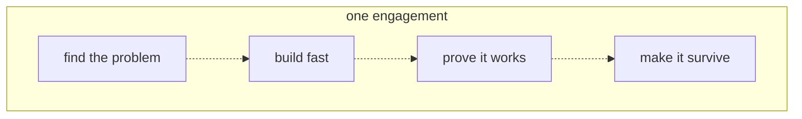
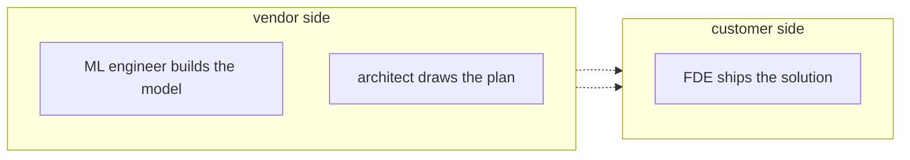
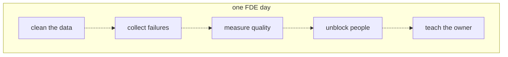

# 01 — What an FDE does
Source: notes lines 8–201; images: `Topic 1/Screenshot 2026-10-29 175112.png`, `Topic 1/Screenshot 2026-10-29 175120.png`, `Topic 1/Screenshot 2026-10-29 175134.png`

## Why it matters
- A model alone is not a solution. Data sits in many systems, half of it is scanned PDFs, compliance blocks data leaving, and nobody on staff has called an AI API. The FDE closes that gap.
- The FDE goes "forward" into one customer's world and builds there, with their data and next to their people.
- The FDE is measured on one thing: does the customer have a working solution?
- Same model underneath, a completely different problem each engagement (L1).

## Process / steps
The four primary responsibilities, in course order (one engagement):
1. **Find the right problem.** Sit with the customer and pick a use case where AI actually helps. Saying no to bad ideas is a big part of this.
2. **Build fast.** Connect the model to the customer's documents and APIs. Get a working version in front of real users in days, not months.
3. **Prove it works.** "It looks good" is not proof. Build tests that measure how often answers are right, and show the numbers to the customer.
4. **Make it survive.** Add cost limits, safety rules and logging. Then teach the customer's team to run it after you leave.

One FDE day (L3 example, week three, logistics support assistant):
1. Clean the data (09:00: about a quarter of the wiki-export pages are empty templates; filter them out).
2. Collect failures (10:30: a team lead's trick question gets a confident wrong rule; write it down).
3. Measure quality (13:00: add failures to the test set, now 40 questions; 33 right, up from 29 last week).
4. Unblock people (15:00: walk the security engineer through the request flow; agree to add logging she can inspect).
5. Teach the owner (16:30: pair with Priya, the future owner; she writes the code, you watch and answer).

## Diagrams
**`Topic 1/Screenshot 2026-10-29 175112.png`**

Teaches: the four responsibilities run in this order inside every engagement.

**`Topic 1/Screenshot 2026-10-29 175120.png`**

Teaches: the ML engineer and the architect work on the vendor side; only the FDE ships at the customer. (The image draws two dashed arrows from the vendor box to the customer box.)

**`Topic 1/Screenshot 2026-10-29 175134.png`**

Teaches: most of an FDE day is data, measurement and people; model work comes in short bursts between them.

## Rules and numbers
- Only one of the four responsibilities is "write code that calls a model". The rest is data plumbing, measurement and working with people. (L1)
- Get a working version in front of real users in days, not months. (L1)
- Never accept "it looks good" as proof. Show measured numbers. (L1)
- Before you leave: cost limits, safety rules, logging, and a trained customer team. (L1)
- Tell the roles apart by question. Who wrote the deployed code at the customer? The FDE. Who decided the model's training data? The ML engineer. Who recommended the overall shape? The architect. (L2)
- At small vendors one person may wear two hats. The roles still split cleanly: advise, build the model, or ship the solution. (L2)
- The solutions architect draws the plan and leaves; they rarely open a terminal at the customer site. (L2)
- The ML engineer trains, tunes and makes the model faster and cheaper, for all customers at once. The customer's scanned PDFs are not their layer. (L2)
- Data cleaning decides the quality of every answer the assistant will ever give. Do it. (L3)
- Write down every failing question. "That list is gold." Add it to the test set. (L3)
- Show the test-set number, not a demo, at the review (L3 example: 40 questions, 33 right, up from 29).
- Get the security engineer's approval early. Without it nothing ships. (L3)
- Let the future owner write the code while you watch. It is slower, and that is the point. (L3)
- Map each activity to a responsibility: cleaning data = build fast; test set = prove it works; teaching the owner = make it survive. (L3)

## Decision rules from quizzes
- **Q1. The VP says "add AI to everything, start this week".** Right move: pick one painful, measurable problem first, and offer short team interviews this week to find it. Why: "AI everywhere" is a wish, not a use case. One concrete problem with a success measure can be built, proved and expanded. The interviews show progress this week and keep trust high. Traps: wiring the model into all four systems in parallel just to show activity; asking the VP for a requirements document listing every AI feature and waiting for it (stalling); telling the VP that most of these systems do not need AI and that the request shows they do not understand the technology (lecturing the sponsor).
- **Q2. The model struggles with one rare policy type, even with good context. The customer asks "can you fix the model?"** Right move: improve what you control first (retrieval and instructions for that policy type). Report the remaining model weakness to your ML team with concrete failing examples. Why: the solution layer (context, instructions, data) is yours and often closes most of the gap. The model layer is the ML team's, and field examples are what they need. Traps: retraining the model yourself over the weekend as a quick fix for a field complaint (fine-tuning is a separate decision, made only under the topic 30 tree, R11); telling the customer the model is what it is and this policy type is out of scope; escalating to the ML team and pausing work on that policy type until they respond.
- **Q3. A vendor engineer spends three months at a hospital: interviews, picks one use case, builds on hospital data, measures accuracy, trains IT staff. Which role?** FDE. Why: they were deployed forward into one customer and owned the full path from problem selection to a working, measured, handed-over solution. An architect would stop at recommendations. An ML engineer improves the model for all customers.

## Tasks
None in this topic.

## Course → real world
- **Role split at Hadavin:** Claude covers all three hats: FDE, architect and ML engineer. The L2 split still applies, so each piece of work should say which hat it is: advise (architecture doc), model layer (model choice or tuning decision) or ship (deployed code at the client). (Hadavin practice)
- **Model layer:** Hadavin does not train base models. The L2 "report to the ML team" loop becomes: improve retrieval and prompts first; then try a stronger tier (Haiku 5.5 → Sonnet 5.5 → Opus 5.5, tier per R278/R279) through the client's cloud (Claude on Amazon Bedrock recommended for AWS clients, after the client has chosen, R446; Microsoft Foundry on Azure; Vertex AI on GCP; direct Claude API only on request). Keep the failing examples as eval cases. Model ids are pinned in config, never written as literals in code. (Hadavin practice)
- **Model is a kind (no single dependency):** `ModelBackend` interface; Claude is the recommended default, offered as an option the client chooses (R446); tier set in config; alternatives are another vendor's model on the same cloud, or an open-weight model self-hosted (outlined with its trigger: client policy, outage, price change, or an eval showing parity). Swapping needs only a config change plus a green golden-set run (R178/R179). (Hadavin practice, owner rule 2026-10-31)
- **"Build fast":** real connectors to the client's systems (REST/GraphQL SaaS, databases, file drops), using least-privilege service accounts. Secrets come through the secrets kind (named lookup). Backends: AWS SSM/Secrets Manager, Azure Key Vault, GCP Secret Manager, or a self-hosted vault. (Hadavin practice)
- **"Prove it works":** the failure list from L3 goes straight into a versioned golden set. CI gates run it on every PR. (Hadavin practice)
- **"Make it survive":** typed Python package (uv, ruff, pytest) with structured logs and OpenTelemetry traces. There is a named client owner, and the agent registry lists owner, tools and permissions. (Hadavin practice)
- **Security engineer meeting:** have a request-flow diagram and a "what data leaves your network" sheet ready on day one. With Claude in the client's own cloud the answer is usually "nothing leaves your account". (Hadavin practice)
- **Freshness:** Names, ids and prices below were taken from the audit of 2026-11-01 and are not re-verified by this edit; re-verify live before any client document (next check due before the next client doc). (Hadavin practice)
- **Agents:** governed actions only. Each tool has an allowlist and schema, risky actions need human approval, and every action is audited. (Hadavin practice)

## Checklist
- [ ] One use case is chosen; "AI everywhere" requests were turned into one measurable problem.
- [ ] A failure log exists and feeds the test set.
- [ ] A measured pass number (not a demo) is ready for the next review.
- [ ] The client security/compliance contact has seen the data flow and agreed to it.
- [ ] A named client owner is pairing on the code.
- [ ] Model-layer weaknesses are recorded with concrete failing examples, separate from solution-layer fixes.
