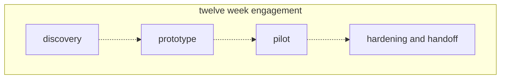
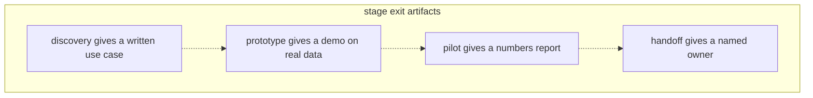

# 02 — The engagement lifecycle
Source: notes lines 202–357; images: `Topic 2/Screenshot 2026-10-29 175554.png`, `Topic 2/Screenshot 2026-10-29 175604.png`

## Why it matters
- The engagement puts the four FDE responsibilities in time order: a schedule you can plan around.
- Each stage is a cheap exit point. Bad discovery costs two weeks, not twelve.
- The most common engagement failure is not bad code. It is moving on before the previous stage is really done. "Feelings do not survive week nine. Artifacts do."

## Process / steps
The four stages (example: a twelve week telecom engagement):
1. **Discovery (weeks 1–2).** Interview support agents, read real tickets, look at what data exists. Output: one chosen use case, written down with a success measure (e.g. "answer agents' questions about tariff rules, target 85 percent correct answers"). No code.
2. **Prototype (weeks 3–5).** Build the smallest version that works on real data. Ugly is fine. Goal: learn whether the idea survives the customer's actual documents, and give people something real to react to.
3. **Pilot (weeks 6–9).** A small group of real users (maybe ten support agents) uses it in daily work. Measure everything: how often answers are right, where it fails, whether agents come back to it. Output: the numbers that justify going further.
4. **Hardening and handoff (weeks 10–12).** Add cost limits, logging, guardrails and documentation. Train the customer's engineers until they run it without you.

Exit test per stage (L2):
1. Discovery is done when the use case is **written down**: the problem, who has it, where the data lives, and a number that defines success. One page is enough. No success number means discovery is not done.
2. Prototype is done when it **works on real customer data**: real documents from the customer's systems go in, and a real user has watched it answer and said "yes, this is useful". One user is enough.
3. Pilot is done when you **have the numbers**: a defensible report with how many users, how many real questions, percent answered correctly, and the worst failures listed honestly. Compare it against the discovery success number.
4. Handoff is done when **you are not needed**: the customer's engineer handles a full week, including one failure, without messaging you. Documentation exists, limits are set, and someone on the customer side owns the system by name.

## Diagrams
**`Topic 2/Screenshot 2026-10-29 175554.png`**

Teaches: every engagement moves through the four stages in this fixed order.

**`Topic 2/Screenshot 2026-10-29 175604.png`**

Teaches: each stage ends with a thing you can point at: a page, a demo on real data, a report, a named owner.

## Rules and numbers
- Twelve-week split: discovery weeks 1–2, prototype weeks 3–5, pilot weeks 6–9, hardening and handoff weeks 10–12. (L1)
- Discovery output is a use case plus a success measure, not code. Example target: 85 percent correct answers. (L1)
- Prototype on real data. Ugly is fine. (L1)
- Pilot with a small group of real users, e.g. ten agents. (L1)
- Stages are exit points. No good use case → stop after two weeks. Bad pilot numbers → stop before hardening. (L1)
- Don't rush discovery or hardening. Real value is locked in there, and they are the two stages people most want to rush. Everyone loves prototype week. (L1)
- A discovery page is one page: problem, who has it, where the data lives, success number. (L2)
- Never count a prototype that ran on your own sample documents. (L2)
- One real user saying "useful" is enough to exit the prototype. (L2)
- Pilot report contents: user count, real-question count, percent correct, worst failures listed honestly, comparison with the discovery number. (L2)
- Handoff test: one full week, including one failure, with no messages to you; documentation exists; limits are set; a named owner. (L2)
- When pushed to skip ahead, answer: "Happy to move on once we have X." (L2)

## Decision rules from quizzes
- **Q1. Week 9 of 12: the pilot is strong, and the director wants to skip hardening, roll out to all 400 agents on Monday and start a second use case.** Right move: explain what breaks at 400 users without cost limits, logging and a trained owner. Propose a middle path, such as a staged rollout while hardening happens. Why: forty times more users means forty times the cost, more strange inputs, and failures nobody can debug without logging. Staging keeps his momentum and gives the system its safety layer. Traps: rigidly refusing ("the plan is fixed"), simply agreeing, or asking your own manager to make the call and pausing until you hear back.
- **Q2. Week 2 discovery: the CEO wants machine-failure prediction, but the sensor data barely exists. Three teams say finding anything in the 4,000 page maintenance manual takes hours.** Right move: on Friday, present the data findings honestly, show why prediction cannot work yet, and propose the manual assistant using what the three teams said. Why: you trade a use case that will fail for one his own teams asked for, backed by his company's evidence. Killing a bad use case in week two is a success. Traps: switching quietly without telling him; building the doomed idea anyway; reporting that the engagement should end because the requested use case is not feasible.
- **Q3. A polished prototype on self-written sample docs, never seen by a real user, no success number. The team wants to start the pilot.** Missing: both the discovery exit and the prototype exit. Why: polish is not the test. A pilot now would give numbers nobody agreed how to judge, on a system that may collapse on real documents.

## Tasks
None in this topic.

## Course → real world
- **Compressed calendar, same stages:** Hadavin runs discovery → prototype → pilot → hardening and handoff on a compressed calendar (days instead of weeks), with several deals in parallel. No stage is skipped, and each keeps its exit artifact. (Hadavin practice)
- **Exit artifacts as files** in the client repo or deal folder (Hadavin practice):
  - discovery → `use-case.md` (one page with the success number);
  - prototype → a recorded demo on the client's real data, plus the user's sign-off;
  - pilot → a numbers report generated from the eval harness and pilot logs;
  - handoff → a runbook plus a named owner in the agent registry.
- **Fixed-price contracts:** Each exit is a go/no-go point; payments follow the order's payment terms (pricing-plan §3.5). The cheap-exit logic is written into the proposal. (Hadavin practice)
- **Who bears a failed exit (fixed price inverts the course's cheap exit, because the studio has already built):** a no-go ends the engagement at the price paid so far. Owner decision 2026-11-01 evening, item 5: one schedule 40/30/30, Net 14; the Week-1 Fee must buy a deliverable the client keeps (frozen test set, baseline report, proposed target); if Hadavin stops because the target is infeasible it keeps only 10 percent and returns the rest. The proposal states this. Contract wording goes through EGM first and carries "not reviewed by counsel" until a lawyer exists (decision 9). See `egm/pricing/pilot-fee-recommendation-2026-11-01.md`. (Hadavin practice)
- **Freshness:** Names, ids and prices below were taken from the audit of 2026-11-01 and are not re-verified by this edit; re-verify live before any client document (next check due before the next client doc). (Hadavin practice)
- **Staged rollout (Q1):** a feature flag or user allowlist. Per-user and per-day budgets on the client's model endpoint (e.g. Bedrock), plus OpenTelemetry traces, must be live before the user count grows. (Hadavin practice)
- **Hardening scope:** budgets, structured logs/traces, guardrails (injection screen: neutral default is a Haiku-class or self-hosted classifier screen; managed products are swappable alternatives: Bedrock Guardrails, Azure Prompt Shields, Model Armor; regex PII redaction always on), docs, and CI gates on every PR. (Hadavin practice)

## Checklist
- [ ] Discovery: a one-page use case with problem, who, data location and success number is signed off by the client.
- [ ] Prototype: it has run on real client documents, and one real user said "useful".
- [ ] Pilot: the numbers report (users, questions, % correct, worst failures) is compared with the discovery number.
- [ ] Handoff: the client engineer ran one full week, including one failure, without help; docs exist; limits are set; there is a named owner.
- [ ] No stage was skipped under pressure. Any staged-rollout compromise is written down.
