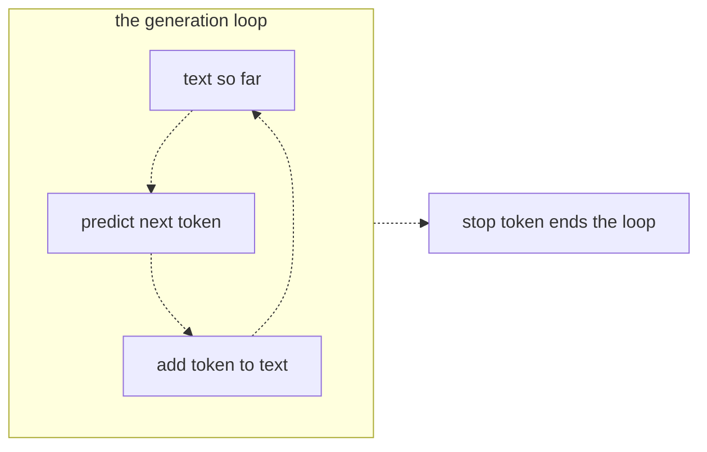
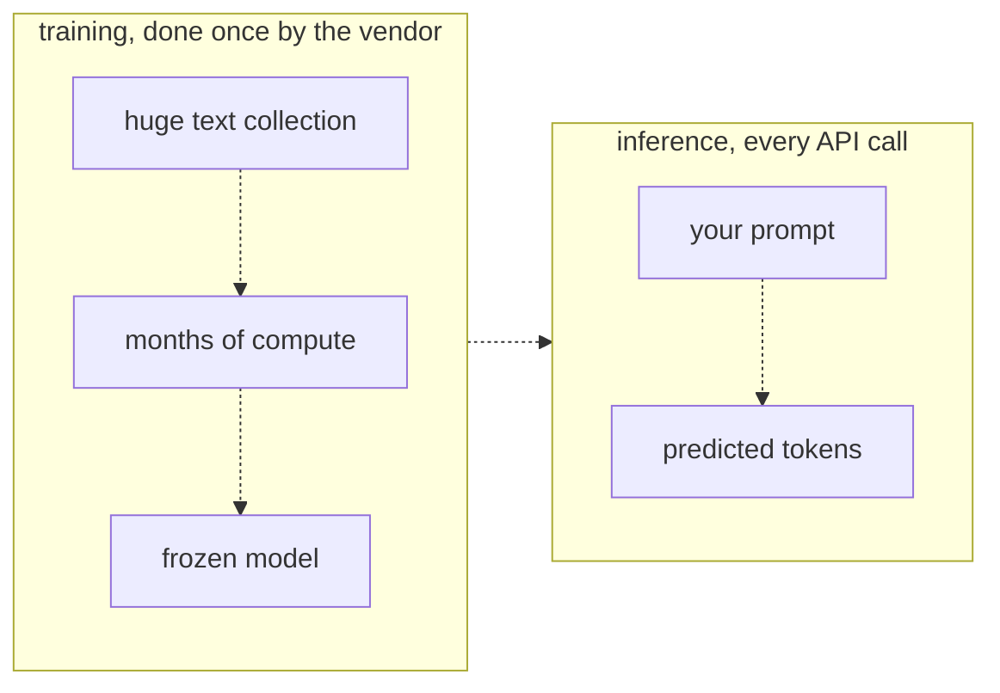
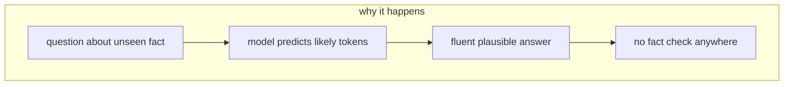

# 03 — How LLMs work
Source: notes lines 358–591; images: `Topic 3/Screenshot 2026-10-29 175637.png`, `Topic 3/Screenshot 2026-10-29 175646.png`

## Why it matters
- Phone keyboard: type "see you next" and it offers "week". An LLM is that, scaled up (L1).
- One mechanism explains all model behavior: given this text, what usually comes next? It has no plan, no database of facts, and no idea whether it is right.
- The model is frozen at training time. It knows nothing about the customer's systems unless you put that knowledge in the prompt at inference. That is most of the build work.
- Hallucination is the natural result of this mechanism, and it is the number one risk in customer projects.

## Process / steps
1. **Next-token prediction (L1).** The model reads the text so far and predicts the most likely next token (roughly a short word or part of a word).
2. **Generation loop (L1).** Add the token to the text, then predict again from the longer text. Repeat hundreds of times. A stop token ends the loop. The model never plans a whole answer.
3. **Training (L2).** Done once by the vendor: a huge text collection plus months of compute, at a cost of millions, gives a frozen model. Like printing an encyclopedia: finished on a date, it does not change afterwards.
4. **Inference (L2).** Every API call: your prompt in, predicted tokens out. It costs a fraction of a cent and takes seconds. It changes nothing; the model does not remember or learn from the call.
5. **Knowledge cutoff (L2).** Knowledge ends on the training date. The customer's new products and internal policies are unknown, so bring them into the prompt at inference time.
6. **Hallucination (L3).** A question about an unseen fact → the model predicts likely tokens → a fluent, plausible answer → no fact check anywhere.
7. **Defenses, previewed (L3):** give correct facts in the prompt, make the model cite sources, and measure how often it is wrong.

## Diagrams
**`Topic 3/Screenshot 2026-10-29 175637.png`**

Teaches: the model builds output one token at a time by feeding its own output back in, until a stop token.

**`Topic 3/Screenshot 2026-10-29 175646.png`**

Teaches: training produces a frozen model once; every API call is inference against that same frozen model.

**Text-only diagram (no image): "why it happens" (L3, notes lines 509–527)**

Teaches: a hallucination is the prediction mechanism working as designed on a fact it never saw.

Text vs image: the L1 page (image 175637 and notes line 382) says "Set [max_tokens] to 1, and you get a single prediction". The paragraph after it (line 394) says not to cap `deepseek-v4-flash`, because it is a reasoning model and a cap of 1 returns null content; ask for one word instead. Follow line 394. The diagrams themselves match the ASCII.

## Rules and numbers
- A token is roughly a short word or part of a word. (L1)
- Do not set `max_tokens: 1` on a reasoning model (deepseek-v4-flash). The budget goes to private thinking and content comes back null. Ask for "one word" in the prompt instead. (L1, T1)
- Keep this sentence: "given this text, what usually comes next?" Half of the skill follows from it. (L1)
- Training takes months and costs millions. Inference costs a fraction of a cent and takes seconds. (L2)
- Inference changes nothing. Each request starts from the same frozen model with no memory of earlier calls. (L2)
- When the customer says "the AI will know our systems", answer honestly: not by itself. Bring the knowledge into the prompt at inference time. (L2)
- A hallucination is a confident, fluent, wrong answer (fake flag, fake paper, a policy the customer never had). (L3)
- The mechanism has no "I don't know". It is predicting text and succeeding, not checking facts and failing. (L3)
- Confidence is the danger. Unsure-sounding wrong answers get checked; fluent wrong answers get trusted. (L3)
- Never judge an answer by how confident it sounds. (L3)
- Never promise a customer a system that cannot be wrong. (L3)
- A simple instruction ("if you are not certain this exists, say you do not know") can change the behavior. Test it; don't assume it. (T2)

## Decision rules from quizzes
- **Q1. The assistant confidently described a refund policy the company never had. Why?** The model predicts likely next tokens, so a plausible-sounding policy is a successful prediction even when no such policy exists. Why: there is no database lookup and no fact-check step in the loop, and the model does not learn during inference. Traps: "a bug in the fact-checking module", "it learned the wrong policy from earlier questions", "an outdated database entry".

## Tasks
- **T1. Watch a model complete text step by step.** Goal: be the generation loop by hand. Method:
  1. Start from an unfinished sentence (e.g. "The three most popular Linux distributions are"). Line 1 of `steps.txt` is the starting sentence; each later line adds one token.
  2. Call `deepseek-v4-flash` asking for "the next word only, no punctuation, no other output", with no `max_tokens`.
  3. Append the word to the sentence and write the grown sentence as a new line of `/root/how-llms/steps.txt`.
  4. Feed it back; at least 4 rounds. A shell loop takes the first word and strips punctuation, and stops if the reply is empty or `null`.
  Done: the file reads like a time-lapse. Each line is one word (roughly one token) longer than the line above.
- **T2. Trigger and observe a hallucination.** Goal: see confident fabrication, then see an instruction change the tone. Method:
  1. Invent a plausible fake (e.g. `--preserve-snapshots` flag for `kubectl drain`). Ask `deepseek-v4-flash` as if it is real. Save only the reply text (jq) to `/root/how-llms/hallucination.txt`.
  2. Repeat with "If you are not certain this flag exists, say you do not know" appended. Save to `/root/how-llms/careful.txt`.
  3. No `max_tokens` on either call.
  4. If the first answer is honest, try a more plausible fake; the hunt teaches which questions invite hallucination.
  Done: both files are saved, and the tone difference is visible.

## Course → real world
- **Models:** the course's `deepseek-v4-flash` reasoning model maps to Claude through the client's cloud (Claude on Amazon Bedrock recommended for AWS clients, after the client has chosen, R446; Microsoft Foundry on Azure; Vertex AI on GCP; direct Claude API only on request). Tiers: Haiku 5.5 (cheap and fast), Sonnet 5.5 (the usual result for hard work; tier per R278/R279), Opus 5.5 (hardest). Model ids are pinned in config, never literals in code. (Hadavin practice)
- **Model is a kind (no single dependency):** `ModelBackend` interface; Claude is the recommended default, offered as an option the client chooses (R446); tier set in config; alternatives are another vendor's model on the same cloud, or an open-weight model self-hosted (outlined with its trigger: client policy, outage, price change, or an eval showing parity). Swapping needs only a config change plus a green golden-set run (R178/R179). (Hadavin practice, owner rule 2026-10-31)
- **Reasoning budget trap:** the same lesson applies to Claude's extended thinking. `max_tokens` is required on Claude calls and thinking tokens count against it, so set it with room for thinking plus the visible answer, and check the stop reason (`max_tokens`) before trusting empty content. On current Claude models depth is set by adaptive thinking and an effort setting, not a token budget (see topic 06). (Hadavin practice; [research 2026-11-01: platform.claude.com extended-thinking page, per audit B3, re-verify])
- **Knowledge cutoff in client builds:** every factual answer is grounded in retrieved client data (retrieval is a kind: default pgvector, self-hostable on any cloud; alternatives Bedrock Knowledge Bases, Azure AI Search, Vertex Vector Search; records keep id + text + vector + metadata so a rebuild is a re-embed, not a rewrite), with citations. Never rely on what the model "knows" about the client. (Hadavin practice)
- **Hallucination defense from day one:** the system prompt has an "unsure → say you don't know" rule; a golden set includes fake-entity probe questions (the T2 pattern) and checks that refusals happen; the failure rate is reported to the client as a number. (Hadavin practice)
- **Freshness:** Names, ids and prices below were taken from the audit of 2026-11-01 and are not re-verified by this edit; re-verify live before any client document (next check due before the next client doc). (Hadavin practice)
- **Client messaging:** in the kickoff deck, state plainly that the model is frozen, does not learn from use, and can be wrong; quality comes from grounding plus evals. (Hadavin practice)

## Checklist
- [ ] Client stakeholders were told: the model does not know their systems and does not learn from use.
- [ ] Every factual path is grounded in client data, not model memory.
- [ ] The system prompt includes an explicit "say you don't know" rule.
- [ ] The eval set includes fake-entity / unseen-fact probes, with the refusal rate measured.
- [ ] Output caps are sized for reasoning/thinking tokens, and empty content with a length stop is handled.
