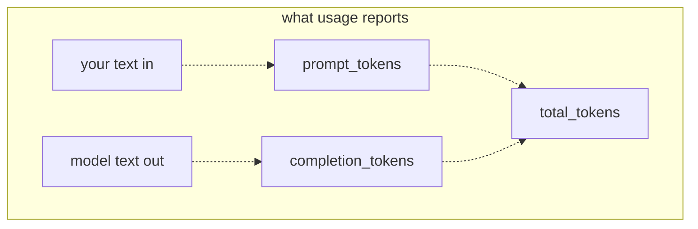
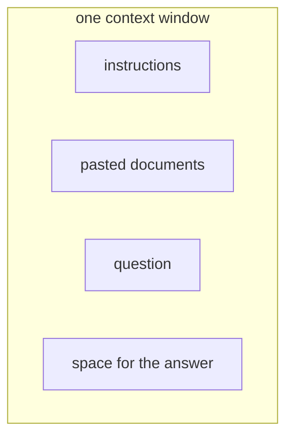
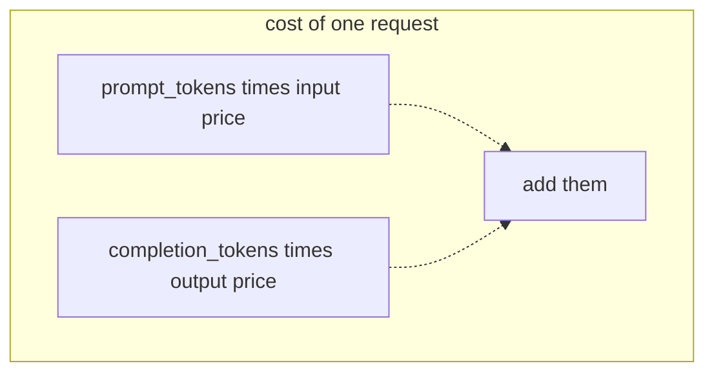

# 04 — Tokens, context, and cost
Source: notes lines 592–1005; images: `Topic 4/Screenshot 2026-10-29 175717.png`, `Topic 4/Screenshot 2026-10-29 175727.png`, `Topic 4/Screenshot 2026-10-29 175743.png`

## Why it matters
- Tokens are the unit for everything an FDE budgets: the input limit, the price and the speed. Customers ask about pages and words; the bill arrives in tokens.
- The context window is a hard limit that kills "paste everything into the prompt". It is why retrieval (RAG) and conversation management exist.
- Finance will ask "what will this cost?". Answer with a number before they find it on an invoice.

## Process / steps
1. **Translate to tokens (L1).** Rough rule: 1 token ≈ 4 characters; 100 tokens ≈ 75 words. Get exact counts from the response's `usage` block: `prompt_tokens` (everything sent in), `completion_tokens` (everything generated), `total_tokens` (the sum, and the basis of the bill). These are the course gateway's (OpenAI-compatible) names; Claude and Bedrock use different field names (see Course to real world: normalized `Usage`).
2. **Fit the context window (L2).** Instructions + pasted documents + question + space for the answer must all fit in one shared budget. Exceeding it is a hard error: the whole request is refused.
3. **Select what goes in (L2).** Send only the relevant pieces (retrieval). Drop or summarize old messages in long conversations.
4. **Cost one request (L3).** Course formula: cost = prompt_tokens / 1,000,000 × input_price + completion_tokens / 1,000,000 × output_price. For Claude add the cache terms; thinking is already inside the output count, so it is never added again (Course to real world; R208).
5. **Scale to volume (L3).** Measure a typical request's usage early, multiply by realistic volume, and put the monthly number in front of the customer.

## Diagrams
**`Topic 4/Screenshot 2026-10-29 175717.png`**

Teaches: input becomes prompt_tokens, output becomes completion_tokens, and both add up to total_tokens.

**`Topic 4/Screenshot 2026-10-29 175727.png`**

Teaches: all four parts share one fixed budget; there is no second board. (The image stacks the boxes with no arrows.)

**`Topic 4/Screenshot 2026-10-29 175743.png`**

Teaches: request cost is two multiplications added together.

Text vs image: the diagrams match the ASCII. The L3 scale sentence is garbled in both the notes (line 911) and the image ("264monthly.Stillfine.Moveittodeepseek−v4−pro…": a math renderer ate the `$` signs). The intended text is: "about **$264** monthly. Still fine. Move it to deepseek-v4-pro without thinking, and it is over **$3,000**." Check: 264,000 × $0.0010 = $264; on pro: 8,000×1.20/1M + 500×4.80/1M = $0.012 × 264,000 = $3,168.

## Rules and numbers
- "the", "cat", "run" are 1 token each. "unbelievable" might be 3 pieces ("un", "believ", "able"). (L1)
- 1 token ≈ 4 characters; 100 tokens ≈ 75 words. Use it for estimates only; use `usage` for real counts. (L1)
- The estimate assumes English prose. Code, JSON, tables, OCR output and other languages tokenize worse: count real tokens with the provider's count endpoint on a sample before quoting (verify the endpoint exists on each backend). (Hadavin practice)
- When a customer asks "how big" or "how much", translate to tokens first. (L1)
- On reasoning models (deepseek-v4-flash), reasoning tokens count in `completion_tokens`, and a small cap is used up before the answer appears. For measured short replies use a non-reasoning model (gpt-4.1-nano). (L1, T1)
- Lab sample: "Say hello." with gpt-4.1-nano → prompt 10, completion 3, total 13, cost $0.0000022. (L1)
- The context window = input + output, one shared budget. A 128,000 token window ≈ 200 pages of text in and out combined. (L2)
- Exceeding the window is a hard error, not slow degradation. Nothing is generated, and the error states the limit and what you sent. (L2)
- One contract can be 50 pages. A ticket history can be thousands of messages. "Paste everything" dies immediately. (L2)
- Even within the window, more tokens mean more money and slower answers, and models pay less attention to the middle of 200 pages. Small and relevant beats big and complete. (L2)
- Prices are per token, separate for input and output, usually per 1M tokens. (L3)
- Example price sheet: deepseek-v4-flash $0.10 in / $0.40 out; deepseek-v4-pro $1.20 in / $4.80 out (per 1M). (L3)
- Output costs several times more than input. Cheap and strong models often differ 10× or more. Model choice is a cost decision, not only a quality one. (L3)
- Worked example: 8,000 prompt + 500 completion on flash = $0.0008 + $0.0002 = $0.0010 (a tenth of a cent). (L3)
- Scale trap: 300 agents × 40/day × 22 days = 264,000 requests ≈ $264/month on flash, over $3,000 on pro. (L3)
- Measure early, multiply by realistic volume, show the number before the invoice does. (L3)

## Decision rules from quizzes
- **Q1. The assistant pastes a full 300 page manual into every request. It is slow, expensive, and some requests fail with an API error. Which explanation covers all three?** Every request pays for and processes hundreds of thousands of prompt tokens, and the largest exceed the context window, which the API rejects with a hard error. Fix: send only the relevant pieces (retrieval). Traps: "the output price is too high so the provider throttles big answers" (price does not block requests); "the model gets tired" (no fatigue, no learning between calls); "send the manual as completion tokens" (completion tokens are what the model generates; you cannot choose them).

## Tasks
- **T1. Count the tokens in real prompts.** Goal: a feel for token sizes. Method:
  1. Send 3 calls to `gpt-4.1-nano` (non-reasoning) with tiny, normal and long prompts, `max_tokens` ≤ 150.
  2. Append each `usage` block (jq `.usage`) to `/root/tokens-cost/usage.txt`.
  3. Check that prompt_tokens grows with prompt length and that completion_tokens depends on the answer, not the question size.
  Done: the file holds 3 usage blocks. Lab result: prompt 13/20/36. All three completions hit the 150 cap, so the cap can hide the "depends on the answer" point; use a looser cap or shorter answers to see it.
- **T2. Hit the context limit on purpose.** Goal: meet the overflow error before production does. Method:
  1. Generate the multi-million-character input with the given command into `/root/tokens-cost/big-input.txt`: `python3 -c "print('server log line: request handled ok. ' * 80000)" > /root/tokens-cost/big-input.txt`.
  2. Send it in one user message to `deepseek-v4-flash`, using a small script because shell quoting is awkward. Catch the HTTP error and save its body to `/root/tokens-cost/limit-error.json`.
  3. Find where the error states the limit and the amount sent.
  4. If the error is about auth or invalid JSON, it is a different failure; fix the request until the error is about size.
  Snippet that is the lesson, as described: on `HTTPError`, read and save `e.read()` instead of crashing.
  Done: `big-input.txt` and `limit-error.json` both exist, and the saved error body is about size. Lab note: the recorded run got a **429 throttling error** ("Limit type: tokens. Current limit: 500000"), a gateway rate limit and not the context-window error. By the task's own rule that capture is the wrong failure.
- **T3. Estimate a monthly cost for a customer workload.** Goal: a number finance can sign. Method:
  1. Save the price sheet to `/root/tokens-cost/prices.txt`.
  2. Apply the formula to 20,000 requests/month × 800 prompt + 300 completion tokens on flash.
  3. Write three lines to `/root/tokens-cost/estimate.txt`.
  Done: `input_cost=$1.60`, `output_cost=$2.40`, `total_cost=$4.00` (16M × $0.10/1M; 6M × $0.40/1M).

## Course → real world
- **Normalized usage (required):** the model kind returns one `Usage` (input, output, cache_read, cache_write, reasoning/thinking tokens: the share of output that was thinking, kept for visibility; on a backend that reports thinking outside output the adapter adds it to output once, R208). Vendor field names (Anthropic `input_tokens`/`output_tokens`/`cache_creation_input_tokens`/`cache_read_input_tokens`; Bedrock Converse `inputTokens`/`outputTokens`/`totalTokens`) are mapped inside the kind module only. A test fails if any of the five fields is missing from a recorded response of each backend. (Hadavin practice; field names from audit A2, re-verify live)
- **Cost formula for Claude:** cost = input/1M x in_price + cache_write/1M x write_price + cache_read/1M x read_price + output/1M x out_price, where output already includes thinking tokens (the thinking count is reported for visibility; adding it again counts it twice). In multi-turn runs on Claude Opus 4.5 and models numbered 4.6 and higher, earlier turns' thinking blocks stay in context and are billed again as input. Haiku 5.5 has higher prices for prompts over 100,000 tokens (cache reads and writes count toward the length), and US-only inference adds 1.1x on every token class (Claude 4.6 and later). Prices come from config, re-verified live and dated at estimate time. (Hadavin practice; facts checked 2026-11-04 on the platform.claude.com extended-thinking and pricing pages; re-check before relying)
- **Haiku price tier and window:** [research 2026-11-01, per audit M6/M29: pricing page] Haiku 5.5 is $0.10/$0.50 per 1M for prompts up to 100K tokens and $0.50/$2.50 above (cache reads count toward the 100K), so cost models must branch on prompt length. Current Claude tiers list a 1M-token window; the course's 128K is course-era. The rule (overflow is a hard error; small and relevant beats big) is unchanged. Re-verify live.
- **Real prices and tiers:** the course price sheet becomes the client cloud's current per-1M prices for Haiku 5.5 / Sonnet 5.5 / Opus 5.5 (Bedrock for AWS clients; Foundry/Vertex otherwise). Look prices up live at estimate time; never quote from memory. Price table and model ids live in config, not code literals. (Hadavin practice)
- **Cost estimate in every proposal:** measure a typical request on the client's real data in discovery or prototype, multiply by their volume (users × requests/day × working days), and show it for at least two tiers. That is the T3 sheet, delivered as part of the pilot sign-off. (Hadavin practice)
- **Cost visibility in code:** log `usage` (input, output, cache and reasoning tokens) on every call as structured logs plus OpenTelemetry span attributes. Compute cost per request; enforce per-user, per-day and per-tenant budgets. (Hadavin practice)
- **Context discipline:** retrieval instead of whole documents (retrieval is a kind: default pgvector, self-hostable; alternatives Bedrock Knowledge Bases, Azure AI Search, Vertex Vector Search; records keep id + text + vector + metadata). Trim or summarize history. Count tokens before sending, and handle context-length errors and 429 throttling as separate, explicit error paths. (Hadavin practice)
- **Caching:** use prompt caching for long stable system prompts and context to cut input cost. Set the cache TTL explicitly (5-minute and 1-hour writes are priced differently) rather than relying on a default, and check the default against the live docs. (Hadavin practice; [research 2026-11-01: per audit M30, TTL default change unverified])
- **Freshness:** Names, ids and prices below were taken from the audit of 2026-11-01 and are not re-verified by this edit; re-verify live before any client document (next check due before the next client doc). (Hadavin practice)

## Checklist
- [ ] Typical request usage was measured on real client data, not estimated from word counts.
- [ ] A monthly cost estimate (volume × per-request cost, at least two model tiers) is in front of the client.
- [ ] The worst-case request size fits the context window with room for the answer.
- [ ] Usage and cost are logged per request; budgets and limits are configured.
- [ ] Context-overflow and rate-limit (429) errors are handled as separate cases.
- [ ] No "paste the whole document" paths remain; retrieval or trimming is in place.
