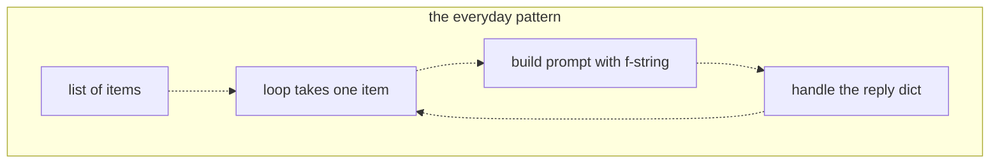
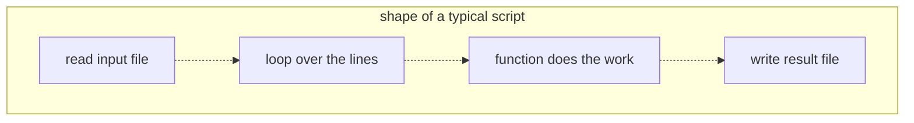

# 05 — Just enough Python
Source: notes lines 1006–1398; images: `Topic 5/Screenshot 2026-10-29 175814.png`, `Topic 5/Screenshot 2026-10-29 175822.png`

## Why it matters
- From here on, models are called from scripts, not hand-typed curl. A script can retry, loop over 500 tickets and save results.
- A prompt is just a string, built from a fixed template plus per-request data. That pattern is the heart of every AI script.
- Every AI API speaks JSON, and JSON maps directly to Python dicts and lists.

## Process / steps
1. **Variables, strings, f-strings (L1).** Name = value. Strings in quotes, numbers bare. `+` joins strings and `*` repeats them. An f-string fills `{name}` with its value. Triple quotes make multi-line prompts. (At the interactive `python3` prompt every example can be typed directly; `print()` shows a value, `len()` counts a list, `exit()` leaves.)
2. **Template plus data (L1).** `prompt = f"You are a support assistant for {customer}. Answer this question: {question}"`. Change the data and you get a new prompt.
3. **Lists and dicts (L2).** A list is ordered and indexed from 0 (`tickets[0]`, `len(tickets)`). A dict holds labeled values looked up by key (`ticket["priority"]`). A JSON object becomes a dict; a JSON array becomes a list.
4. **Walk the reply (L2).** `reply["choices"][0]["message"]["content"]`, the same path as jq `.choices[0].message.content`.
5. **Loop (L2).** `for item in items:` with an indented body. Indentation is the loop body, not decoration.
6. **Functions (L3).** `def name(inputs): return result`. Wrap lines that would repeat (e.g. `build_prompt(customer, question)`).
7. **Files (L3).** Read with `open(path).read()`; `text.splitlines()` gives a list of lines. Write with `with open(path, "w") as f: f.write(...)`; `"w"` creates or overwrites.
8. **Run scripts (L3).** `python3 /root/myscript.py` runs top to bottom. Write once, run like any command line tool.

## Diagrams
**`Topic 5/Screenshot 2026-10-29 175814.png`**

Teaches: most AI scripts loop over data, build one prompt per item, and dig the answer out of each reply dict.

Text vs image: the ASCII (lines 1154–1171) draws a plain line from "loop takes one item" down to "handle the reply dict" and shows no clear return arrow. The image draws a cycle: loop → build prompt → handle reply → back to loop takes one item. The image wins; it is a per-item cycle.

**`Topic 5/Screenshot 2026-10-29 175822.png`**

Teaches: the standard script shape is read file → loop lines → function per item → write result file.

## Rules and numbers
- Python is for scripts that retry, loop (e.g. 500 tickets) and save results. Learn just enough. (L1)
- Build prompts from a template plus data with f-strings; never type the finished sentence. (L1, T1)
- Use triple-quoted f-strings for multi-line prompts. (L1)
- List indexes count from zero. (L2)
- Look up dicts by key, lists by position. (L2)
- Follow the nesting one step at a time: `reply["choices"]` is a list, `[0]` is a dict, and so on. (L2)
- Keep loop and function bodies indented and aligned. (L2, L3)
- Wrap repeated lines in a function with `def` … `return`. (L3)
- `"w"` creates or overwrites a file. (L3)
- The whole toolkit is variables, f-strings, lists, dicts, loops, functions and files. Anything extra is introduced where needed. (L3)
- Values must come out of the data, never typed in by hand (T2, T3 rule: "the numbers must be counted, not typed").

## Decision rules from quizzes
- **Q1. `print(reply["choices"]["message"]["content"])` crashes on `{"choices": [{"message": {"content": "done"}}]}`. Why?** `choices` holds a list, so take its first item with `[0]` before using the `message` key: `reply["choices"][0]["message"]["content"]`. Traps: "dicts can't nest in lists" (that is exactly how API replies are shaped); "print can't show dict values"; "keys must be read in reverse order starting from content" (the path goes outer to inner).

## Tasks
- **T1. Build a prompt string from pieces.** Goal: practise template plus data. Method: in `/root/python-toolkit/prompt.py`, put "Nordic Freight" and "Why was my shipment delayed?" in two variables. Combine them with an f-string into a support prompt and print it. Done: the printed line contains both values and is built from the variables ("You are a support assistant for Nordic Freight. Answer this question: Why was my shipment delayed?").
- **T2. Walk a dict shaped like an API reply.** Goal: dig values out of a nested reply. Method: in `/root/python-toolkit/walk.py`, paste the given reply dict exactly (seed data: notes lines 1183–1195). Print `choices[0].message.content` via keys and indexes. Print the total computed as `usage.prompt_tokens + usage.completion_tokens`. Done: prints "Restart the nightly backup job on server db-02." and `203`, with neither value typed by hand.
- **T3. Read a file and print a summary line.** Goal: the read → loop → write script shape. Method:
  1. Create `/root/python-toolkit/tickets.txt` with the 5 given lines.
  2. `summarize.py` reads the file, takes `splitlines()`, counts the total, and counts lines containing "high" in a loop. (The course uses a substring test; on real data match the priority field by splitting the line or a regex word boundary, because "highlight" would also match.)
  3. It builds the line with an f-string, prints it, and writes it to `/root/python-toolkit/summary.txt`.
  Done: the file holds `5 tickets, 2 high priority`, computed rather than typed.

## Course → real world
- **No loose scripts in client builds:** Hadavin ships typed Python packages (uv for env and lock, ruff for lint/format, pytest for tests) with clear modules: config, adapters (one interface plus backends), core logic, evals, and a CLI or API. The "read → loop → function → write" shape becomes adapter (read) → core (per item) → adapter (write). (Hadavin practice)
- **Prompts as templates in config/files**, versioned, filled with typed inputs. No secrets or env/region/account literals in code. Model ids are pinned in config. (Hadavin practice)
- **Typed reply access:** use our own Pydantic types for replies and usage, not raw dict chains. The vendor SDK's typed objects may be used only inside the model-kind module and are converted to our types at its boundary. Validate before indexing, so an empty `choices` or a missing field fails loudly and is logged. (Hadavin practice)
- **Data in and out:** files become real connectors (S3 / file drops, client DBs, SaaS APIs) through least-privilege service accounts. Secrets come through the secrets kind (named lookup). Backends: AWS SSM/Secrets Manager, Azure Key Vault, GCP Secret Manager, or a self-hosted vault. (Hadavin practice)
- **Each module has tests**, structured logs and OpenTelemetry traces. CI runs ruff + pytest + evals on every PR. (Hadavin practice)

## Checklist
- [ ] Prompts are built from templates plus data; no hand-typed finished prompts or answers.
- [ ] Reply parsing indexes lists correctly and fails loudly on missing fields.
- [ ] Code is a typed package (uv, ruff, pytest), not a loose script.
- [ ] Inputs and outputs go through adapters, with secrets from the client's secret store.
- [ ] Tests exist for the per-item function and the reply parsing.
