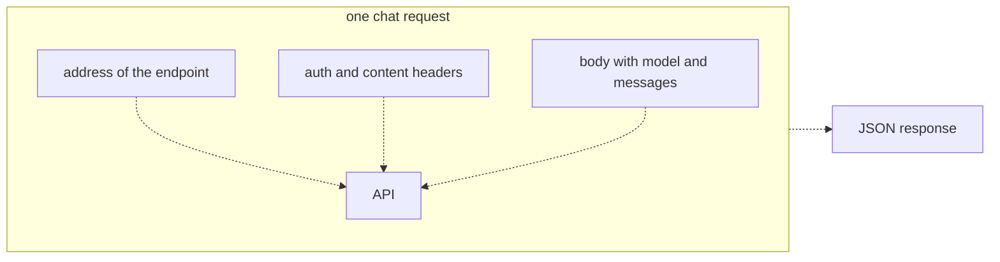
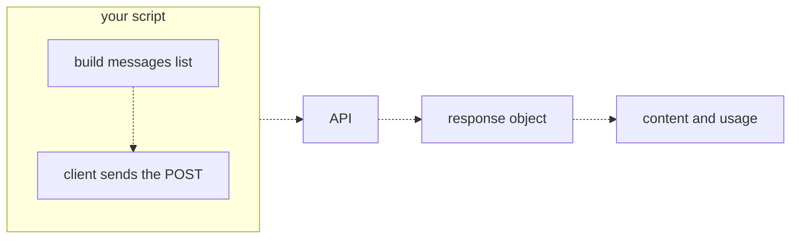
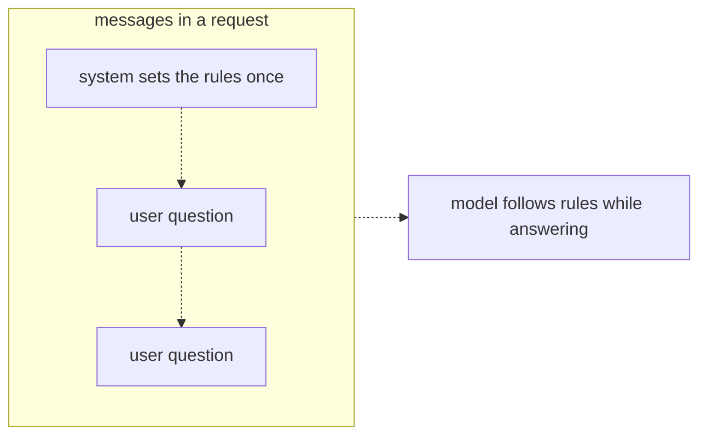

# 06 — Calling LLMs over an API
Source: notes lines 1399–1800; images: `Topic 6/Screenshot 2026-10-29 175856.png`, `Topic 6/Screenshot 2026-10-29 175907.png`, `Topic 6/Screenshot 2026-10-29 175916.png`

## Why it matters
- The chat request (address, headers, JSON body of model plus messages) is the whole contract. It barely changes across providers, so know it cold.
- The model keeps no memory between calls, so everything it should know, including the full conversation history, must be in each request.
- The system message is the single most powerful line of configuration in a customer assistant: identity, scope, tone, refusal rules and format.

## Process / steps
1. **Build the request (L1).** HTTP POST to `$OPENAI_BASE_URL` + `/v1/chat/completions`.
   - Header `Authorization: Bearer $OPENAI_API_KEY` (who you are).
   - Header `Content-Type: application/json`.
   - JSON body: `model`, `messages`, and optionally `max_tokens`.
2. **Messages are a list with roles (L1).**
   - `system`: standing developer rules, first in the list.
   - `user`: the person your app serves.
   - `assistant`: the model's earlier replies.
   - Send the whole history on every call.
3. **Read the response (L1).** Answer at `choices[0].message.content`; token counts in `usage`; check `finish_reason`.
4. **Same call from Python (L2).** `client = OpenAI()` reads the base URL and key from the environment and builds the headers; no key in code. `client.chat.completions.create(model=..., messages=[...])` is the POST. The response object uses dots: `response.choices[0].message.content`, `response.usage.total_tokens`.
5. **Wrap it (L2).** Put the call in a function, feed it f-string prompts, loop it over a file of questions, and save results.
6. **Add a system message (L3).** Put the identity and guardrails (company name, allowed topics, tone, refusal rules such as "if you are not sure, say so", output format) in one system message at the start. User questions flow past it.

## Diagrams
**`Topic 6/Screenshot 2026-10-29 175856.png`**

Teaches: the three parts of a request go to the API together, and a JSON response comes back.

**`Topic 6/Screenshot 2026-10-29 175907.png`**

Teaches: the Python client sends the same POST; you read content and usage off a response object.

**`Topic 6/Screenshot 2026-10-29 175916.png`**

Teaches: one system message sets the rules once, ahead of every user question, and the model follows them while answering.

Text vs image: no differences; the ASCII matches all three images.

## Rules and numbers
- The endpoint is the base URL + `/v1/chat/completions`, with two headers: Bearer auth and JSON content type. (L1)
- `max_tokens` is a seatbelt against runaway output. (L1)
- On `deepseek-v4-flash` (reasoning), reasoning tokens count against the cap. A cap of a few hundred is spent before the visible reply, `finish_reason` is `length`, and content is empty. Leave the cap out or set it in the thousands. (This is the course lab's behaviour; it does not carry over to Claude, see Course to real world.) (L1, L2, T1–T3)
- For a genuinely short capped reply, use `gpt-4.1-nano` (no reasoning): `"max_tokens": 200` gives a real 200-token answer. (L1)
- Send the whole conversation history each call; the model keeps no memory. (L1)
- If the saved file holds an error, read it; it almost always names the broken part (a header, the JSON body, the model name). (T1)
- Never put a key in code. Let the client read it from the environment. (L2)
- A Python loop makes spending money fast as easy as one keystroke. Stick to the cheap model while learning. (L2)
- Developer rules go in the system message, never mixed into user text. The user types anything; models give the system message more authority; one system message stays constant across hundreds of user messages. (L3)
- Pasting rules into each user message is fine for a quick test and falls apart in a real application. (L3)
- A system message is strong guidance, not an unbreakable law. Users can sometimes talk a model out of its rules; guardrails handle that later. (L3)
- Refine the system message in every engagement. (L3)
- Lab sample: a ticket-summary call used prompt 98, completion 75 (of which reasoning 61), total 173, cost $0.00011483. (T1)

## Decision rules from quizzes
- **Q1. "Never discuss competitor products" must apply to every conversation, whatever users type. Where does it go?** In a system message at the start of the messages list. Why: it is developer-set standing behavior; models treat it as more authoritative than user text; it stays in one place while user messages flow past. Traps: appending it to every user message (works sort of, fragile and messy at scale); an assistant message (that holds earlier replies); `max_tokens` (caps length, not topics).

## Tasks
- **T1. Your first API call with curl.** Goal: type every part of a request so the shape sticks. Method:
  1. Write curl with the base URL + path, both headers, and a body with `deepseek-v4-flash` and one real user question; no `max_tokens`.
  2. Redirect the raw JSON to `/root/calling-llms/first-reply.json`.
  3. Use jq on the saved file to print the answer text and the usage block. If the file holds an error, read it and fix the named part.
  Done: the saved response holds a real reply.
- **T2. A Python script that answers a question.** Goal: turn the call into a small tool that saves its work. Method: `/root/calling-llms/ask.py` holds the question in a variable and calls `deepseek-v4-flash` through the OpenAI client with no cap. It writes only the content to `answer.txt` and `usage.total_tokens` to `tokens.txt`. Done: both files are written (lab: a 3-sentence container-vs-VM answer, 181 tokens).
- **T3. Change behavior with a system message.** Goal: see the system message work. Method: send the same user question ("My package has not arrived. What should I do?") twice on `deepseek-v4-flash` with no cap. Call 1 has the user message only → `plain.txt`. Call 2 adds a system message first: Nordic Freight support assistant, always name Nordic Freight, two sentences or less, ask for the tracking number → `steered.txt`. Compare them. Done: both are saved. Lab: the plain reply was a long 7-step generic list; the steered reply was 2 sentences naming Nordic Freight and asking for the tracking number.

## Course → real world
- **Client and endpoint:** the course's OpenAI-compatible gateway (`$OPENAI_BASE_URL`, `$OPENAI_API_KEY`, `OpenAI()`) becomes Claude through the client's own cloud. Use Claude on Bedrock (recommended for AWS clients once the client has chosen, R446) (route: see the Bedrock bullet below), Microsoft Foundry on Azure, Vertex AI on GCP, and the direct Claude API only on request. Auth is the workload's IAM role / managed identity, not a static key; Secrets are fetched through the secrets kind (named lookup); SSM, Secrets Manager, Key Vault, Secret Manager or a self-hosted vault sit behind it. (Hadavin practice)
- **Contract differences to remember:** Claude's API takes the system prompt as a top-level `system` field, not a `system` role message. The answer is in content blocks; `stop_reason` replaces `finish_reason` (`max_tokens` = truncated). Hide this behind one adapter interface (`chat(messages, system, model_tier) -> Reply`) with a backend per cloud, so core logic never touches provider shapes. (Hadavin practice)
- **Models:** tiers Haiku 5.5 / Sonnet 5.5 (the usual result for hard work; tier per R278/R279) / Opus 5.5; ids pinned in config; no literals in code. (Hadavin practice)
- **Model is a kind (no single dependency):** `ModelBackend` interface; Claude is the recommended default, offered as an option the client chooses (R446); tier set in config; the `chat()` adapter ships with the client-cloud Claude backend plus one alternative, at minimum outlined with its trigger (provider outage, deprecation with no acceptable successor, price change, client policy, or an eval showing parity): another vendor's model on the same cloud, or an open-weight model self-hosted. The alternative counts only after the eval gate (R78) passes on it. Vendor SDK imports stay inside the backend module. (Hadavin practice, owner rule 2026-10-31)
- **Bedrock route and access:** [research 2026-11-01: per audit M1/M2, platform.claude.com Claude-in-Bedrock pages; re-verify] for Opus 4.7 and later (so the 5.5 tiers) the documented Bedrock route is the Messages-API endpoint (Anthropic SDK class `AnthropicBedrockMantle`, ids like `anthropic.claude-sonnet-5-5`); Converse/InvokeModel are not listed on the 5.5 pages (the docs document them under "Opus 4.6 and earlier"), and Converse support for the 5.5 ids is [unverified 2026-11-01]. The Bedrock backend has two code paths (`anthropic_messages` and `bedrock_converse`) behind the neutral adapter, so either is a config switch; test the pinned id live before relying on it. Message Batches is not available on this endpoint: no batch discount for Bedrock clients [research 2026-11-01: platform.claude.com/docs/en/build-with-claude/claude-in-amazon-bedrock]. Confirm Bedrock model access for the pinned ids in the client account before the pilot starts (Sonnet 5.5, Opus 5.5 and Haiku 5.5 showed per-model access criteria on 2026-11-01) and keep a fallback id in config.
- **`max_tokens` and thinking on Claude:** [research 2026-11-01: per audit B2/B3, platform.claude.com; re-verify] the Claude Messages API requires `max_tokens` on every call (Bedrock Converse `inferenceConfig.maxTokens` is optional and falls back to a model default; check live). Set it per workload in config, sized for thinking plus answer; thinking tokens count against it, so a cap that is too small leaves no room for the visible reply. Reasoning depth on current models is set by `thinking: {type: adaptive}` plus `output_config.effort`; the old `budget_tokens` form returns 400 on 4.7 and later. Pin effort per workload in config and record it with the model id in the decision record (R290); effort changes cost, latency and cache hits, so it is part of the eval comparison. Use the cheap tier without thinking (Haiku class) for a short capped reply, which is the course's `gpt-4.1-nano` role.
- **Stop reasons:** the adapter maps every provider stop reason to its own enum (done, truncated, tool_call, blocked, other) and treats an unknown value as an error, so truncation (`stop_reason == max_tokens`) and blocked output are never mistaken for an empty answer. Exact names differ between the Claude API and Bedrock; verify live. (Hadavin practice)
- **Freshness:** Names, ids and prices were taken from the audit of 2026-11-01 and are not re-verified by this edit; re-verify live before any client document. (Hadavin practice)
- **Wrapper essentials (L2 "wrap it"):** timeouts, retries with backoff on throttling, structured logs plus OpenTelemetry spans with usage and cost, and budgets. Unit tests run with a fake backend; CI runs ruff + pytest + evals on every PR. (Hadavin practice)
- **System prompt as configuration:** versioned file per client; identity, allowed topics, tone, refusal rule, output format. Changes go through eval regression in CI. It is backed by guards because a system prompt is not law: an injection screen (neutral default: Haiku-class or self-hosted classifier screen; swappable managed alternatives: Bedrock Guardrails / Azure Prompt Shields / Model Armor) and regex PII redaction, always on. (Hadavin practice)
- **History:** the app owns the conversation store and sends the needed history each call, trimmed to the context budget. (Hadavin practice)

## Checklist
- [ ] Model calls go through one adapter with a backend for the client's cloud; no provider shapes in core logic.
- [ ] No keys in code; auth uses the cloud identity or the secret store.
- [ ] `max_tokens` is set per workload (required on Claude) and sized for thinking plus answer; truncation (`stop_reason`/`finish_reason`) is detected and handled; unknown stop reasons fail closed.
- [ ] A tested alternative model backend exists (or is outlined with its trigger) behind the adapter.
- [ ] Bedrock model access for the pinned ids was confirmed in the client account.
- [ ] The system prompt is versioned, holds identity/scope/tone/refusal/format, and is covered by evals.
- [ ] Guardrails back the system prompt (injection screen, PII redaction).
- [ ] Every call logs usage, cost, latency and a trace id.
