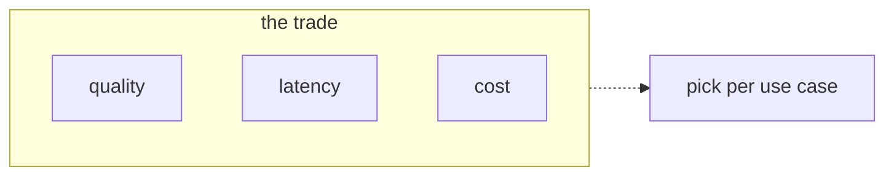
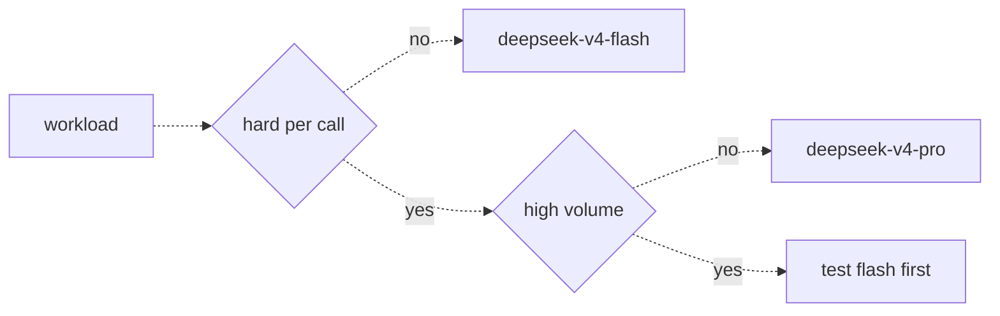

# 07 — Choosing a model
Source: notes lines 1801–2075; images: Topic 7/Screenshot 2026-10-29 175945.png, Topic 7/Screenshot 2026-10-29 175955.png

## Why it matters
The customer sees only quality. The FDE also sees latency and cost. Pick on quality alone and you get "perfect answers, wrong model": 4 s per call at 80,000 messages a month. Model choice is a per-workload decision, made with evidence from the customer's own data.

## Process / steps
1. Start from the task, not the model (L1).
2. For each workload ask three questions (L2):
   1. How hard is one call?
   2. Is a human waiting?
   3. How many calls per day?
3. Route it (L2 diagram). Not hard per call → small fast model (deepseek-v4-flash). Hard and not high volume → big model (deepseek-v4-pro). Hard and high volume → test flash first.
4. Start cheap where the chart allows (easy, high volume or a person waiting, N:1958; and 'test flash first' for hard and high volume, L2 image): run 20 real examples through deepseek-v4-flash. If they are good enough, stop (L2). Hard and low-volume work goes straight to the big model on the chart (L2 image; Task 2 contracts); a cheap-model test there is optional.
5. If not good enough, upgrade to deepseek-v4-pro and run the same 20 examples. Show the customer the measured quality difference (L2).
6. Use different models per workload in the same project when the profiles differ (L2).
7. Measure the difference yourself (latency, usage fields) rather than taking it on faith (L1, Task 1).

## Diagrams
**Image:** `../../Geeta or Bible for claude FDE/fde-diagrams-workflows images/Topic 7/Screenshot 2026-10-29 175945.png`

Teaches: every model trades quality, latency and cost; you can't max all three, so pick per use case.

**Image:** `../../Geeta or Bible for claude FDE/fde-diagrams-workflows images/Topic 7/Screenshot 2026-10-29 175955.png`

Teaches: a two-question decision tree (difficulty, then volume) that maps a workload to a model.

The ASCII versions in the notes match both images, except that decisions are diamonds in the images (ours follow the images).

## Rules and numbers
- Never pick a model on quality alone. Weigh quality, latency and cost (L1).
- Quality = reasoning depth, accuracy on hard questions, instruction following. Latency = time per call. Cost = price per token (L1).
- Bigger model: better answers, slower, more per token. Small model: fast and cheap, struggles on hard problems (L1).
- A simple task that runs 80,000 times wants a fast, cheap model. A hard task that runs 40 times a day can afford the big one (L1).
- Lab models: deepseek-v4-flash (fast, cheap, default), deepseek-v4-pro (deeper reasoning, slower, more expensive), plus glm-5.2, gpt-oss-120b, minimax-m3 (L1).
- A chat assistant needs an answer in a second or two. A nightly batch job doesn't care (L2).
- At 10 calls/day cost is almost irrelevant. At 100,000 calls/day cost is the main factor (L2).
- Easy, high volume, or a human waiting → small fast model. Hard and low volume → big model (L2). A hard task with a human waiting is a gap the source leaves open: measure a p95 latency budget before choosing the big model (Hadavin practice).
- Default: try flash first on 20 real examples; upgrade only with evidence (L2).
- Start cheap because "downgrade later" rarely happens. Once the expensive model is live, nobody touches it (L2).
- Mixing models in one project is normal: classifier on flash, report writer on pro (L2).
- "Fine" is often all you need. Speed and cost decide the rest (L2).
- Lab measurement (Task 1, same prompt): flash 1.825 s, 246 total tokens (50 reasoning), cost 0.00006865. Pro 1.174 s, 284 total tokens (91 reasoning), cost 0.00021571. Pro cost about 3× more on this call. Single-call timings vary, so measure; don't assume. The lesson text says flash "came back faster", but the lab output shows pro faster (1.174 s vs 1.825 s). One call proves nothing: measure p50/p95 over the golden set.

## Decision rules from quizzes
- **Q1: the customer wants the biggest model for everything.** Insurance pilot: 40,000/month easy claim classifications and 200/month hard settlement letters. The head of claims wants gpt-oss-120b everywhere. **Move:** split. Run the classifier on deepseek-v4-flash and the letters on the big model. Show 20 real classification examples where both models agree. **Why:** the workload profile decides the model, and evidence from the customer's own data beats opinion. **Traps:** obeying wastes money for identical results. Putting everything on cheap risks quality where it matters. A triangle lecture with no data is opinion vs opinion.
- **Q2: a nightly batch of 25,000 log lines.** Flash got all 20 sample labels right. **Move:** ship on deepseek-v4-flash, because the task is easy, high volume and nobody waits. **Trap:** running all 25,000 lines through both models "to compare" spends the money you were trying to save.

## Tasks
- **Task 1, race two models.** Goal: measure latency and token use for flash vs pro on one identical prompt ("Explain in 3 short bullet points why a web server returns 502 when its backend is down."). Method: race.sh sends the prompt to both models with curl, wraps each call in `time`, saves the full JSON responses to flash.json and pro.json, then prints `.usage` with jq. Files: `/root/fde-choosing-a-model/{race.sh,flash.json,pro.json}`. Done: both response files exist, and the two times and usage blocks are compared.
- **Task 2, pick models for three workloads.** Goal: apply the checklist. Method: classify each workload by difficulty, waiting, and volume. Write `/root/fde-choosing-a-model/choices.txt` in the exact `name: model` format (one line per workload), using only model names that exist in this lab. Done: choices.txt holds exactly `alerts: deepseek-v4-flash` (easy, 90,000/day, cost dominates), `contracts: deepseek-v4-pro` (hard legal, 30/week, accuracy first) and `chat: deepseek-v4-flash` (simple, humans waiting, low latency).

## Course → real world
- Course flash/pro maps to the Claude tiers in the client's cloud: Haiku 5.5 (cheap and fast, for classifiers, triage and high-volume extraction), Sonnet 5.5 (the usual result for hard work; the default is the tier the workload chart gives, R278, R279) and Opus 5.5 (the hardest low-volume work, such as complex report drafting or contract-risk triage for a human reviewer). Default to Claude on Amazon Bedrock for AWS clients, Microsoft Foundry on Azure and Vertex AI on GCP. Use the direct Claude API only on request.
- Hadavin practice: "start cheap" means start on the cheapest tier that could work, usually Haiku 5.5 for easy calls and Sonnet 5.5 for the rest. Run 20 real client examples. Escalate one tier at a time with the eval result in hand. This is a design-time choice per workload, not run-time behaviour: there is no "cheap model first, retry on the strong one" cascade in the course (R280, R290). Write the cost of a wrong answer in the profile too; the course shows it in its examples (the lawyer-signed summary, the contracts workload), not as a fourth question (R278).
- Hadavin practice: **Model is a kind (no single dependency):** `ModelBackend` interface; default Claude (tier set in config); the `chat()` adapter ships with the client-cloud Claude backend plus one alternative, at minimum outlined with its trigger (provider outage, deprecation with no acceptable successor, price change, client policy, or an eval showing parity): another vendor's model on the same cloud, or an open-weight model self-hosted. The alternative counts only after the eval gate (R78) passes on it. Vendor SDK imports stay inside the backend module. (Hadavin practice, owner rule 2026-10-31)
- Hadavin practice: confirm Bedrock model access for the pinned ids in the client account before the pilot starts, and keep a fallback id in config; open to all Bedrock customers on 2026-11-01: Sonnet 5, Opus 4.8, Haiku 4.5, Fable 5 and 5.1 (Opus 5 is not open) [research 2026-11-01: platform.claude.com/docs/en/build-with-claude/claude-in-amazon-bedrock, "open to all Amazon Bedrock customers"; re-verify]. Haiku 5.5 is $0.10/$0.50 per 1M up to 100K prompt tokens and $0.50/$2.50 above [research 2026-11-01: per audit M6; re-verify], so price Haiku workloads by prompt length. Names, ids and prices were taken from the audit of 2026-11-01 and are not re-verified by this edit; re-verify live before any client document.
- Hadavin practice: the model id per workload lives in config, pinned to an exact version and never written as a literal in code. A router module maps workload name to model id.
- Hadavin practice: the race becomes an eval script in the repo. It runs the golden set on two candidate model ids and records latency p50/p95, tokens and cost per call from the response usage into the decision record shown to the client.
- Hadavin practice: price the monthly cost per workload as calls/day × tokens/call × price before choosing, and put it in the proposal.

## Checklist
- [ ] Each workload has a difficulty, waiting, volume and cost-of-a-wrong-answer profile written down.
- [ ] Each workload was tried on the cheapest viable tier with 20 real examples.
- [ ] Any upgrade is backed by a side-by-side result on the same 20 examples.
- [ ] Latency, tokens and cost per call are measured, not assumed.
- [ ] Model ids are pinned in config per workload, with no literals in code.
- [ ] The client has seen the evidence for each model choice.
