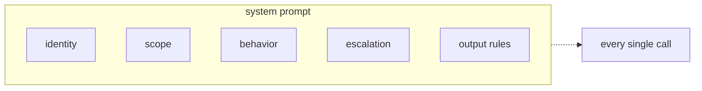
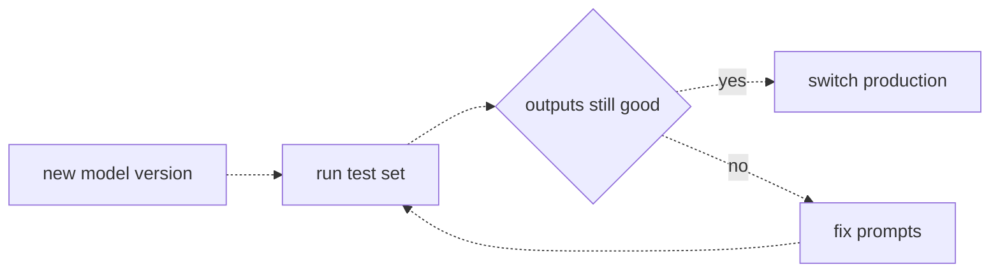

# 09 — Prompts in production
Source: notes lines 2473–2851; images: Topic 9/Screenshot 2026-10-29 180109.png, Topic 9/Screenshot 2026-10-29 180123.png

## Why it matters
In a customer deployment the system prompt is the most important file in the project. It decides tone, scope, refusals and escalation on every call. Prompt edits are production changes with no compiler, and model versions change under you. Versioning, review and a rehearsed upgrade keep the assistant stable.

## Process / steps
1. Draft the system prompt with five sections: identity, scope, behavior rules, refusals and escalation, output rules (L1).
2. Get the policy answers from the customer (support lead, legal, brand team): what the bot may promise, when it hands off to a human, and which topics are off limits. The FDE asks the questions and turns the answers into precise prompt text (L1).
3. Treat the prompt as a product surface: draft → customer review → test against nasty inputs → ship (L1).
4. Store each prompt in its own text file in a git repo. Code reads the file and never contains the text (L2).
5. Change prompts like production code: one change at a time, a commit message that says why, and tests against the nasty inputs before merge (L2).
6. Survive model updates (L3):
   1. Pin the exact versioned model name and never use a moving alias.
   2. Keep a test set of 20–50 real inputs with known good outputs in the prompt repo.
   3. When a new version appears, run the test set, diff the outputs, fix the prompts, and only then switch production.

## Diagrams
**Image:** `../../Geeta or Bible for claude FDE/fde-diagrams-workflows images/Topic 9/Screenshot 2026-10-29 180109.png`

Teaches: the five sections of a production system prompt, which apply to every single call.

**Image:** `../../Geeta or Bible for claude FDE/fde-diagrams-workflows images/Topic 9/Screenshot 2026-10-29 180123.png`

Teaches: the upgrade rehearsal loop. Test, fix and retest until outputs are good, then switch.

Text vs image: the notes' ASCII draws "outputs still good" as a plain box. The image draws it as a decision diamond. Same flow otherwise; the image wins.

## Rules and numbers
- A one-line "You are a helpful assistant." is not a production system prompt (L1).
- Identity: who the assistant is and who it works for. Scope: what it does and doesn't answer. Behavior: tone, length, language. Refusals/escalation: what to do at the edges (e.g. on cancel, don't argue; give the link and offer a human). Output rules: format requirements (L1).
- Half of the five sections aren't yours to invent. Get the policy from the customer (L1).
- Test the prompt against nasty inputs (off-topic, angry refund) before shipping (L1, Task 1).
- Never keep a prompt as a code string edited over SSH. Keep each prompt in its own file under git (L2).
- Every prompt change is a commit. `git log` shows who and when, `git diff` shows the exact sentence, and a revert is one command (L2).
- Make one change at a time, so a regression points to one edit (L2).
- The commit message says why and who asked, e.g. "Make bot decline competitor questions, requested by legal on Mar 3" (L2).
- Test before merge with the nasty inputs (L2).
- Prompt files are reviewable by the customer's support lead. Python strings with escaped quotes are not (L2).
- New model versions are better on average but shift format habits (markdown appears), tone (warm → formal) and edge cases (refusal 99% → 92%). None of it is in the provider's announcement (L3).
- Pin the version. You decide when to upgrade, not the provider (L3).
- Keep a test set of 20 to 50 real inputs with known good outputs, permanently in the prompt repo (L3).
- Rehearse the upgrade before switching. A 90-day retirement notice is time to find the prompts that need rewording. Switching blind means you find them from customer complaints (L3).
- Rehearsal only works if prompts live in files with history (L3).

## Decision rules from quizzes
- **Q1: provider deprecates the pilot's model.** Week 4 of 8, with a pinned version, prompts in git and a 30-item test set. The version retires in 60 days, after the pilot but before launch. **Move:** keep the pilot on the pinned version. Run the 30-item test set against the new version this week, fix drifting prompts, and schedule the switch before retirement. **Why:** a deprecation becomes a scheduled task, not an emergency. **Traps:** switching now spends pilot trust for nothing; waiting throws away the margin; changing providers turns a small planned migration into a giant unplanned one (a routine deprecation is not a reason to change provider, but the tested alternative backend stays ready, see topic 07).
- **Q2: the bot started giving legal advice.** The prompt is a string in Python code, and three people edited the server this month. **Move:** keep the system prompt in a file under git, so every change has an author, a date and a diff. **Why:** it answers what changed, who changed it, and what it said before, and revert is one commit. **Trap:** a bigger model, a code comment or a shorter prompt don't tell you what changed.

## Tasks
- **Task 1, a support bot system prompt (FerryWise).** Goal: a system prompt that covers identity, scope (bookings, schedules, tickets, onboard services only), behavior (brief, friendly, the customer's language, never invent times or prices) and escalation (no refunds; hand refunds and cancellations to a human). Method: write system-prompt.txt in labelled sections. Send two nasty inputs as the user message with the file as the system message on flash. Files under `/root/fde-production-prompting/` (`system-prompt.txt`, `offtopic-reply.txt`, `refund-reply.txt`, each reply saved as text). Test inputs: "Can you give me a good recipe for pasta carbonara?" (→ `offtopic-reply.txt`) and "Your ferry was cancelled and I want my money back right now!" (→ `refund-reply.txt`). Done: offtopic-reply.txt declines the carbonara recipe and redirects. refund-reply.txt apologises, says it can't approve refunds and offers a human agent.
- **Task 2, version prompts in files.** Goal: a git repo `promptrepo` with `prompts/tagger.txt` and `tag.py`. Method: commit 1 adds the tagger prompt (one line `Category=billing|login|other`, extras forbidden) and tag.py, which reads the file relative to its own path, with no prompt text in Python. Commit 2 edits only the prompt to add a second line `Urgent=yes` when the customer is blocked right now. Its commit message says why and who asked. Repo at `/root/fde-production-prompting/promptrepo`. Done: the git log shows both prompt versions (two commits), `git diff HEAD~1 HEAD` shows only the prompt change, and the test prints `Category=login` / `Urgent=yes`.

## Course → real world
- Course flash maps to Claude in the client's cloud (Bedrock recommended for AWS after the client has chosen (R446); Foundry/Vertex otherwise). Hadavin practice: pin the exact versioned model id (e.g. a dated Bedrock model id or inference profile) in config and never use a "latest" alias. Upgrades are explicit PRs.
- Hadavin practice: prompts live in `prompts/*.txt` (or .md) in the client repo and are loaded by a config/prompt module. Two tiers (replaces the earlier line that ran live cases in every PR, which broke the no-spend and client-data rules): every PR runs the test set against a recorded or fake backend (offline, free) to check format, parser and routing; a live run of the 20-50 redacted cases is triggered only on a change to a prompt file or model id, executes in the client's own CI and account with their credentials, has a per-run spend cap set in config, and its result is attached to the PR. The test set lives in the client's repo, redacted, never in the studio root. A live run in a studio-paid account needs the owner's yes with numbers. Gate the merge on the pass rate.
- Hadavin practice: commit messages for prompt changes name the reason and the client stakeholder who asked. The prompt diff is sent to the client owner for sign-off.
- Hadavin practice: on a provider deprecation notice, open a migration ticket, run the test set on the new id in a branch, diff the outputs, fix the prompts, and switch on a scheduled date before retirement. Record the evidence for the client. Record each pinned model id with its provider-published retirement date in the runbook, and subscribe the client owner and the studio to the provider's deprecation notices. Schedule the rehearsal at notice plus 1 week and switch at least 2 weeks before retirement. Notice periods vary; verify the provider's stated policy live [unverified 2026-11-01].
- Hadavin practice: escalation in the system prompt is backed by a real handoff action (ticket or human queue) with an audit log, not just text that says "a human will help".

## Checklist
- [ ] The system prompt has identity, scope, behavior, escalation and output rules.
- [ ] The scope, refusal and escalation policy came from named customer stakeholders and was reviewed by them.
- [ ] The prompt was tested against nasty inputs (off-topic, refund/cancel, abuse) before shipping.
- [ ] Prompts are files in git, loaded by code, with one change per commit and a "why" in the message.
- [ ] The model version is pinned in config, not an alias.
- [ ] A 20–50 item real test set with known good outputs lives in the prompt repo and runs before any merge or model switch.
