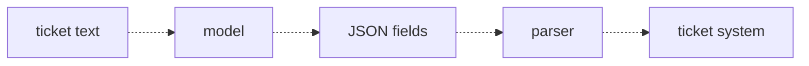
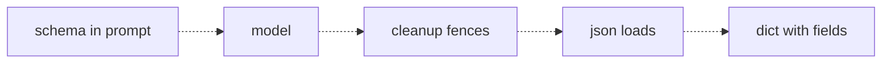
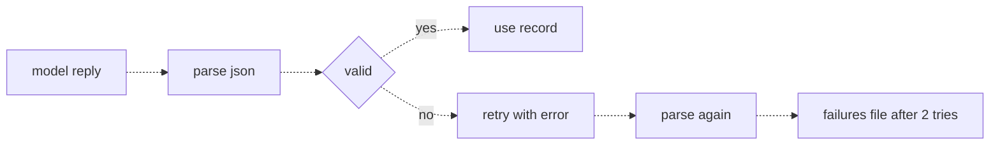

# 10 — Structured output
Source: notes lines 2852–3357; images: Topic 10/Screenshot 2026-10-29 180204.png, Topic 10/Screenshot 2026-10-29 180218.png, Topic 10/Screenshot 2026-10-29 180229.png

## Why it matters
Free text needs a human at the other end. Structured output can flow into databases, dashboards and scripts with nobody watching. That is the line between a demo and a system. At 99% success, 1,000 tickets a day means ten broken records or a 2 a.m. crash, so parse, validate and retry is mandatory.

## Process / steps
1. Ask for data, not prose. The model does the understanding and delivers JSON fields (L1).
2. Show the exact schema in the prompt, with every key named, the allowed values listed and the null case decided (L2).
3. Forbid everything that isn't JSON: no explanation before or after, no markdown, no code fences (L2).
4. Defend in code: strip a leading code fence (and a `json` tag) before `json.loads` (L2).
5. Keep the temperature low or at default for extraction (L2).
6. Validate the parsed data in plain code against your rules: required keys present, values in the allowed lists (L3).
7. On a parse or validation failure, retry once with the named error in the message: "Your previous reply was invalid: <error>. Reply again with only the corrected JSON object." (L3)
8. Cap it at 2 attempts. After that, write the input to a failures file for human review. Never loop forever (L3).

## Diagrams
**Image:** `../../Geeta or Bible for claude FDE/fde-diagrams-workflows images/Topic 10/Screenshot 2026-10-29 180204.png`

Teaches: structured output lets model results flow straight into a downstream system.

**Image:** `../../Geeta or Bible for claude FDE/fde-diagrams-workflows images/Topic 10/Screenshot 2026-10-29 180218.png`

Teaches: the reliable-JSON stack is a schema in the prompt, then fence cleanup, then parse.

**Image:** `../../Geeta or Bible for claude FDE/fde-diagrams-workflows images/Topic 10/Screenshot 2026-10-29 180229.png`

Teaches: the standard parse, validate, retry loop with a hard cap and a failures file.

The ASCII versions in the notes match all three images, except that decisions are diamonds in the images (ours follow the images). Both the image and the text draw "parse again → failures file after 2 tries" with no line back to "valid". The lesson text and Task 3 make clear that the retried reply is validated again and used if valid. The drawing is a simplification, not a different flow.

## Rules and numbers
- Prose answers can't be parsed reliably, and every new phrasing breaks a guess (L1, Task 1).
- Use JSON: every language parses it, jq inspects it, and Python makes a dict in one call (L1).
- Show the schema, don't describe it. Use placeholders that list the options, e.g. `"category": "billing | login | bug | other"`, `"priority": "high | medium | low"`, `"customer": "name or null if not given"`, `"summary": "one sentence"` (L2). The course's own prompts disagree on `customer` (L2 allows null, Task 2 says "name or email or null", Task 3 "name or email" with no null case): pick one wording per schema, keep null allowed, and test an input with no customer. The source output blocks for Task 2 ticket 2 and Task 3 are cut or garbled; values here come from the readable lines.
- Decide the null case in advance (L2).
- Say "Output only the JSON object. No explanation before or after it. No markdown, no code fences." (L2)
- Politeness and code fences both break `json.load` (L2).
- The prompt gets you to ~95%. A three-line fence cleanup converts most of the rest for free (L2).
- Keep the temperature low or at default for extraction jobs (L2). With thinking on, check live which sampling parameters the model accepts; do not assume temperature can be set (Hadavin practice, [unverified 2026-11-01]).
- 99% success on 1,000 tickets = ~10 broken records per day. Unacceptable both as silent bad data and as a crash (L3).
- Validate in plain code, with no model involved. Your code is the only part that is right 100% of the time (L3).
- On failure, don't give up and don't guess a fix. Re-ask with the named error (L3).
- One retry resolves most failures. Cap at 2 attempts total (L3).
- After 2 failed attempts, write the input to a failures file for a human (L3).
- Never loop forever. Retries cost tokens and time, and an input that fails twice usually has a real problem (L3).
- Parse, validate, retry is the standard shape for every structured output pipeline (L3).
- Extra defense from Task 3: slice from the first `{` to the last `}` before parsing (Task 3).

Validation loop (the snippet is the lesson):
```python
def validate(data):
    errors = []
    for key in ["category", "priority", "customer", "summary"]:
        if key not in data:
            errors.append("missing field " + key)
    if data.get("priority") not in ["high", "medium", "low"]:
        errors.append("bad priority value")
    return errors
```

## Decision rules from quizzes
- **Q1: 5,000 documents per night, ~1% invalid replies despite the schema.** **Move:** validate every parsed reply in code, retry failures once with the error message, and log what still fails for human review. **Why:** no prompt reaches zero, and models fix named mistakes well. **Traps:** try/skip silently loses data; prompting until zero never ends; an uncapped retry loop burns tokens on inputs that will never parse.

## Tasks
- **Task 1, parse a prose reply and watch it fail.** Goal: prove prose isn't data. Method: send the Maria Santos ticket to flash with exactly this prose prompt in front of it: "Read this support ticket and tell me the category, the priority, the customer, and a one-sentence summary." Save the reply text to `/root/fde-structured-output/prose-reply.txt`, try `json.loads` on it, catch the error, and write one line containing "failed" plus the error to `/root/fde-structured-output/parse-result.txt`. Done: parse-result.txt reads like `JSON parse failed: Expecting value: line 1 column 1 (char 0)`. The lab reply was markdown bullets.
- **Task 2, extract ticket fields into valid JSON.** Goal: two tickets → ticket1.json and ticket2.json with category, priority, customer and summary. Method: all files under `/root/fde-structured-output/` (`tickets.txt`, `extract.py`, `ticket1.json`, `ticket2.json`). Save the fixture to `tickets.txt` exactly as given (seed data: notes lines 3034–3041) and split on `---TICKET `. Requirements: category ∈ billing/login/bug/other, priority ∈ high/medium/low. A system prompt shows the schema and forbids non-JSON. Each ticket goes to flash as the user message, then fence cleanup, `json.loads` and `json.dump`. Done: jq accepts both files (billing/high and bug/medium in the lab).
- **Task 3, schema validation and a retry loop.** Goal: pipeline.py around one ticket (the Brightlane admin portal lockout). Method: a schema prompt, then validate() checks all four keys plus allowed category and priority values. Up to 2 attempts. On a parse or validation error, rebuild the prompt as the base prompt plus "Your previous reply was invalid: <errors>. Reply again with only the corrected JSON object." Clean fences, slice `{…}`, parse, validate. Files: `/root/fde-structured-output/{pipeline.py,record.json,failures.txt}` (`failures.txt` opened in append mode). Done: record.json holds a valid record (login/high in the lab). If both attempts fail, the ticket is appended to failures.txt instead.

## Course → real world
- Course flash maps to Claude in the client's cloud. Hadavin practice: use the platform's structured-output features where available (tool/function schema with a forced tool choice, or JSON schema output on Bedrock/Claude) **and** still validate in code. A schema feature doesn't remove validation. Structured outputs are listed as supported on the Bedrock Messages endpoint [research 2026-11-01: platform.claude.com/docs/en/build-with-claude/claude-in-amazon-bedrock]; Foundry is [unverified 2026-11-01]. The thinking page states the forced-tool-choice limit for manual extended thinking only (`tool_choice` auto or none) [partly verified 2026-11-01: platform.claude.com/docs/en/build-with-claude/thinking]; behaviour with adaptive thinking: test live.
- Hadavin practice: validation is a typed model (e.g. Pydantic) in a `core/schemas` module, with enums for allowed values and explicit Optional/null fields. The retry gets only a sanitized error: the field path and error type (e.g. `priority: not one of high|medium|low`), never the offending value or raw library text, because typed validators often echo the input and that would carry untrusted or personal text back into the model call and the trace.
- Hadavin practice: validate with a typed model or JSON Schema, not hand-written key checks. The first check is that the parsed value is an object: valid JSON that is a list, string, number or null is a validation error, not an exception (the course's `data.get("priority")` snippet would crash on it). Every enum field is checked, `category` as well as `priority`.
- Hadavin practice: the 2-attempt cap counts validation or parse attempts only. Transport retries (throttling, timeouts) have their own backoff and cap in the adapter (topic 06) and do not consume it.
- Hadavin practice: the failures file becomes a dead-letter store (e.g. an S3 prefix or DB table) with the input, both raw replies and the validation errors. An alert fires when the rate passes a threshold, and a human review queue is part of the runbook.
- Hadavin practice: log the parse-failure, validation-failure and retry-success rates as metrics with OpenTelemetry traces per record. CI evals assert the schema pass rate on the golden set.
- Hadavin practice: in invoice/PO automation, a record that fails twice never writes to the ERP. It waits for human approval.

## Checklist
- [ ] The prompt shows the exact JSON schema with allowed values and the null case.
- [ ] The prompt forbids prose, markdown and code fences, and the code strips fences anyway.
- [ ] Every parsed record is validated in code (keys, enums, types) before use.
- [ ] There is one retry carrying the named error, with a hard cap of 2 attempts.
- [ ] Inputs that fail twice go to a failures store for human review, never silently dropped.
- [ ] Failure and retry rates are measured and visible.
