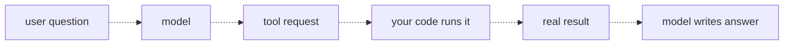
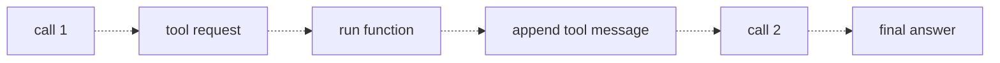

# 11 — Tool calling
Source: notes lines 3358–3867; images: Topic 11/Screenshot 2026-10-29 180304.png, Topic 11/Screenshot 2026-10-29 180318.png

## Why it matters
The model only knows what's in the prompt and its training, so it can't see live outage status, orders or tickets. Tool calling lets the model decide *when* a real system is needed and *what arguments* to use, while your code stays in full control of what actually runs. It turns a talker into an assistant that acts.

## Process / steps
1. Tell the model which functions your code offers, as tool definitions (L1).
2. Define each tool with a name, a description that says what it does and when to use it, and a parameters schema with types, required fields and per-parameter descriptions with example values (L2).
3. Pass the list via `tools=` in the API call (L2).
4. Run the tool loop (L3):
   1. Call 1. Check the reply kind: a tool request (`tool_calls` set, content empty in the course gateway) or a normal text answer. On Claude, detect a tool request by `stop_reason == tool_use` (Converse: `stopReason == 'tool_use'`) or by the tool-use blocks, never by empty text (see Course to real world).
   2. Parse the `arguments` JSON string.
   3. Run the real function in your code.
   4. Append the assistant's tool-request message, then a `role: "tool"` message with the matching `tool_call_id` and the JSON result.
   5. Call 2, with the same `tools=` again (the model may need another tool; some providers require it when the history holds tool blocks). If the reply is again a tool request, repeat in a bounded loop (topics 20, 21). The model writes the final answer from the real data.
5. With several tools, offer them all and let the model route each question by description (Task 3).

## Diagrams
**Image:** `../../Geeta or Bible for claude FDE/fde-diagrams-workflows images/Topic 11/Screenshot 2026-10-29 180304.png`

Teaches: the division of labor. The model asks, your code runs, and the model answers from the real result.

**Image:** `../../Geeta or Bible for claude FDE/fde-diagrams-workflows images/Topic 11/Screenshot 2026-10-29 180318.png`

Teaches: the tool loop is two API calls with your function run between them.

The ASCII versions in the notes match both images.

## Rules and numbers
- A tool request is data, not action. The model can't reach APIs, the network or anything else. It only names a function and fills in arguments (L1, Quiz).
- Your code decides whether to execute, runs the function, and returns the result (L1, Quiz).
- The model picks tools only from their descriptions. Vague descriptions produce wrong tool choices (L1, L2).
- A tool definition is `type: "function"`, then `function.name`, `function.description`, and `function.parameters` (JSON Schema: `type: object`, `properties`, `required`) (L2).
- The model never sees your Python, only the definition. Write the description like an instruction to a new colleague: what it does and when to use it. "Check outage status" is weak; "Use when the customer asks about connection problems in a specific place" is strong (L2).
- Types and the required list define a valid call. Per-parameter descriptions shape extraction (L2).
- Put example values in parameter descriptions ("City name, for example Rotterdam") to prevent malformed arguments (L2).
- Keep tools small and single-purpose. Never build one giant tool with a mode argument (L2).
- Arguments arrive as a JSON string. `json.loads` them first (L3).
- `tool_call_id` must match the request's id. Forgetting it is the most common beginner error (L3).
- Append two messages before call 2: the assistant's tool request (`msg`), then the tool result message (L3).
- The model doesn't always request a tool ("what is a router?" → plain content, empty `tool_calls`). Check which kind of reply you got before acting (L3).
- Optional parameters go in `properties` but not in `required` (Task 3).
- The model may fill optional parameters the user never gave: Task 3 produced `priority: medium` from a question that named no priority. Validate arguments, and for state-changing tools require the gate or a human to confirm any value that is not in the user's words [Hadavin practice].
- The course loop reads `tool_calls[0]` only. A reply can hold several tool calls: loop over every one, answer each id in order, treat unparseable `arguments` as a tool error result (R105) instead of a crash, and cap iterations (R102) [Hadavin practice].

## Decision rules from quizzes
- **Q1: the model returns `tool_calls` for restart_service("payments").** What happened to payments? **Answer:** nothing. The model produced a structured request, and the service is untouched until your code decides to run the function. **Why:** tool calls are data. The course adds that this makes tool calling safe for actions like restarts; that holds only because your code is the gate. A loop that executes every request blindly hands the model your permissions (see governed actions below). **Traps:** "the model restarted it", "the provider queued it", and "it ran because the parameter is required" are all false.

## Tasks
All tasks use `deepseek-v4-flash` in `/root/fde-tool-calling/`, with scripts `weather-tool.py` (T1), `loop.py` (T2) and `dispatcher.py` (T3).
- **Task 1, define a weather lookup tool.** Goal: prove the model requests a tool correctly. Method: define `get_weather` with a required string `city`, a when-to-use description and an example value. Send "Should I take an umbrella in Amsterdam today?" with `tools=`. Take `tool_calls[0]` and write `{name, arguments}`, with arguments kept as the raw string. Done: tool-call.json shows `get_weather` with `"{\"city\": \"Amsterdam\"}"`.
- **Task 2, run the full tool loop.** Goal: an end-to-end loop around a fake `get_server_status(server)` (api-eu-2 → degraded, api-us-1 → healthy, else unknown). Method: define the tool. Call 1 with "Is api-eu-2 doing okay right now?", parse the args, run the function, append `msg` and the tool message with `tool_call_id=call.id`, then call 2. Done: loop-result.json has `tool_called` = get_server_status, `tool_result` = {server: api-eu-2, status: degraded}, and a `final_answer` that states degraded.
- **Task 3, two tools, the model picks.** Goal: prove routing by description. Method: offer `get_server_status` (required `server`) and `create_ticket` (required `title`, optional `priority`) together. Send each question in its own call and capture only the first tool request. Done: pick-status.json → get_server_status {server: db-eu-1}; pick-ticket.json → create_ticket {title: "Nightly backup failed", priority: medium}.

## Course → real world
- Course flash and the OpenAI `tools=` format map to Claude in the client's cloud. Hadavin practice: use the Claude Messages `tools` with `input_schema`, with the same name, description and schema discipline. On Bedrock the route for the 5.x models is the Messages-API endpoint (SDK class `AnthropicBedrockMantle`); Converse and InvokeModel are not listed on the 5.5 pages (documented under "Opus 4.6 and earlier"), so Converse `toolConfig` on 5.5 ids is [unverified 2026-11-01] and needs a live test against the pinned model [research 2026-11-01: platform.claude.com/docs/en/build-with-claude/claude-in-amazon-bedrock]. Confirm Bedrock model access for the pinned ids in the client account before the pilot (Sonnet 5.5, Opus 5.5 and Haiku 5.5 had per-model access criteria on 2026-11-01, audit M2) and keep a fallback id in config.
- Claude differences, hidden in the R61 adapter: detect a tool request by `stop_reason` or tool-use blocks (a reply can hold a text block such as "I'll check that" plus a `tool_use` block, so "content empty" misses it); `input` arrives as a parsed object (no `json.loads`); results go back as `tool_result` blocks in the next **user** message, all parallel results in one message; keep sending `tools` on call 2 [Hadavin practice, C-02].
- Hadavin practice, governed actions: each agent has an allowlist of tools, and each tool has a strict input schema validated in code before execution. Read-only tools run directly. Risky or state-changing tools (restart, refund, create PO) need a human approval step, and every execution is audited (who, what, args, result).
- Hadavin practice: tools sit behind one adapter interface with real backends (REST/GraphQL SaaS, DB, queue) using least-privilege service accounts. Secrets come only through the secrets kind (named lookup), backed by the client cloud's store or a self-hostable one.
- Hadavin practice: every agent is registered in the agent registry (owner, tools, permissions). Executions get scorecards (tool-choice accuracy, arg validity, success). Context comes from the client's "context lake".
- Hadavin practice: evals include a tool-routing set (question → expected tool + args) run in CI, like Task 3 at scale. Code always handles the "no tool requested" branch and caps loop iterations. The routing set also checks for no invented optional arguments.
- Hadavin practice: tool results are an injection channel (R198): put them in delimited data blocks and never treat them as instructions. Write tools take an idempotency key and have a timeout (R110). Eval routing sets can use `tool_choice` (auto, required, forced) to isolate routing from the answer. Log every tool call (name, args hash, result size, latency) in the same JSONL path as R221.

## Checklist
- [ ] Each tool is small and single-purpose, with a "what + when to use" description and example values.
- [ ] Parameters have types and a correct required list, and args are validated in code before running.
- [ ] The loop handles both reply kinds, every tool call in a reply, parses args (bad JSON becomes an error result), matches `tool_call_id`, appends request then result, and resends `tools` on call 2.
- [ ] Optional arguments the user never gave are validated or confirmed before state-changing tools run.
- [ ] Tools are allowlisted per agent, risky actions need human approval, and every call is audited.
- [ ] A tool-routing eval set passes in CI.
- [ ] Credentials for tool backends are least-privilege and held in the client's secret store.
