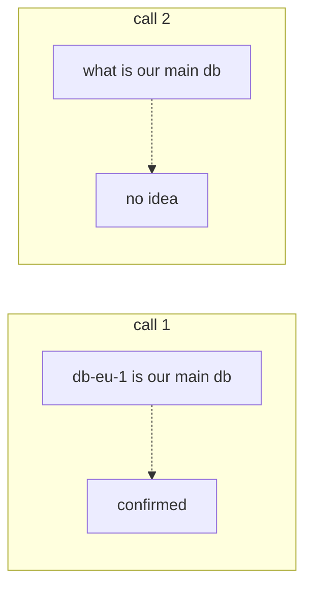
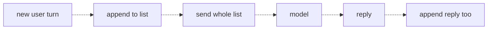
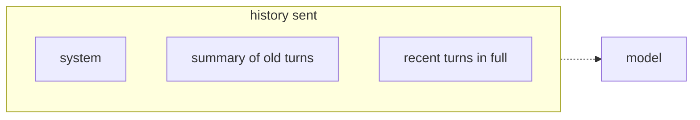

# 12 — Conversation state
Source: notes lines 3868–4347; images: Topic 12/Screenshot 2026-10-29 180359.png, Topic 12/Screenshot 2026-10-29 180407.png, Topic 12/Screenshot 2026-10-29 180419.png

## Why it matters
Every API call starts from zero, so memory is an illusion your app builds. If the FDE doesn't store and resend history, the assistant "forgets" in front of the customer. Resending everything makes cost and latency grow every turn until the history no longer fits the context window. You must also decide what to trim or summarize.

## Process / steps
1. Accept that the model keeps no state. It sees only the messages list in the current request, and there is no provider session (L1, Quiz).
2. Keep one messages list per conversation, starting with the system message (L2).
3. Each turn: append the user turn, send the whole list, get the reply, and append the assistant reply too (L2).
4. Keep the roles and order correct: system at the top, then user and assistant alternating (L2).
5. Watch `prompt_tokens` climb turn by turn (L2).
6. When history gets too long, choose a strategy (L3):
   1. Trim to a window: the system message plus the last N messages.
   2. Summarize what you drop: compress the old turns into one "Summary…" message right after the system message (the course puts it in a second `system` message; in real builds put it in a delimited user-role block instead, see Course to real world), and keep recent turns in full.
   3. Combine: summarize the old turns, and trim the summary too if the conversation runs very long.
7. Make the summary prompt keep names and key facts. Never summarize the system message (L3, Task 3).

## Diagrams
**Image:** `../../Geeta or Bible for claude FDE/fde-diagrams-workflows images/Topic 12/Screenshot 2026-10-29 180359.png`

Teaches: two separate calls share nothing, so the second call can't know what the first was told.

**Image:** `../../Geeta or Bible for claude FDE/fde-diagrams-workflows images/Topic 12/Screenshot 2026-10-29 180407.png`

Teaches: the chat loop. Append, send everything, then append the reply too.

**Image:** `../../Geeta or Bible for claude FDE/fde-diagrams-workflows images/Topic 12/Screenshot 2026-10-29 180419.png`

Teaches: the history layout after compression is system, then summary, then recent turns.

The ASCII versions in the notes match all three images. In the third image (and the ASCII, N:4158-4159) the arrow to the model leaves the **"history sent" frame**, not the summary box: the whole history (system, summary, recent turns) is sent. The Mermaid arrow starts at the frame to match.

## Rules and numbers
- A chat model has no account, session or history. The provider doesn't link calls, and when a request ends everything is gone (L1).
- Chat products "remember" because the app saves the transcript and resends it all every time. Memory lives in the app's database, never in the model (L1).
- The FDE builds the app, so the FDE owns conversation state. Your code stores it and resends it (L1).
- Upside: you control exactly what the model knows on every call (L1).
- Three `chat()` calls: the third request carries 6 messages (1 system, 3 user, 2 assistant); after its reply is appended the list holds 7. The source text (L2) says the third call "sends seven messages", which is off by one; the lab `transcript.json` has 7, which is the list after the third reply. Do not repeat "7" as the request size in a quiz or interview.
- Append the assistant reply too. Without it the model repeats itself and contradicts its earlier answers (L2).
- History is user and assistant alternating with the system message at the top. The order is the conversation, and shuffling it changes the dialogue (L2).
- Every turn resends everything, so you pay tokens for the full history every time (L2).
- With 40–50 turn conversations, cost and latency grow every turn and eventually exceed the context window (L3). With 1M-token windows on current Claude models (verify per model, audit M6: Haiku 5.5 is priced higher above 100K prompt tokens) window overflow is no longer the main trigger; cost, latency and quality drift are [research 2026-11-01 via audit-M].
- Trim: `MAX_TURNS = 8`; if `len(messages) > MAX_TURNS + 1`, keep `[messages[0]] + messages[-MAX_TURNS:]`. Weakness: facts from early turns are lost (L3).
- Summarize: one extra model call per compression. Worth it when early facts must survive (names, decisions, config details) (L3).
- Trim when old turns truly stop mattering (helpdesk small talk). Summarize when early facts matter. Production bots often do both (L3).
- A summary is model output and can drop or distort facts. Keep it factual and short, and never summarize the system message (L3).
- The Task 3 code compacts on every reply once more than 4 non-system messages exist, and re-summarizes the previous summary each time. That is fine for a lab and wrong for production (see Course to real world) (T3).
- Task 3 cap: at most 4 recent user/assistant messages in full. Final history must be ≤ 8 messages with atlas-7 surviving. The summary message starts with "Summary" (Task 3).

## Decision rules from quizzes
- **Q1: "the assistant has no memory".** The code sends only the current message per call. **Move:** store the conversation in a list in the app, append every user and assistant message, and send the whole list on each call. **Why:** models keep no state and there is no provider-side session. **Traps:** a bigger context window only matters once history is sent; lower temperature is unrelated; "enable the session feature" doesn't exist.

## Tasks
All tasks use `deepseek-v4-flash` in `/root/fde-conversation-state/`, with scripts `forget.py` (T1), `chat.py` (T2) and `capped-chat.py` (T3).
- **Task 1, prove the model forgets.** Goal: evidence of statelessness. Method: two separate calls with no shared list. Call 1: "Remember this: our backup server is called zx-9000." Call 2: "What is our backup server called? If you do not know, say you do not know." Done: forget-result.json has `first_reply` and `second_reply`, and the second says it doesn't know.
- **Task 2, a multi-turn chat loop.** Goal: carry context across 3 fixed turns, non-interactive. Method: the list starts with the system message "concise DevOps assistant". `chat()` appends the user turn, sends the full list to flash, and appends the assistant reply. Run the 3 atlas-7 turns, then `json.dump` the list. Done: transcript.json has 7 messages, and the final reply names atlas-7 and the test database.
- **Task 3, cap and summarize.** Goal: combined strategy over 6 turns. Method: after each reply, if the non-system messages exceed 4, summarize the older part with a model call. The prompt demands 2–3 sentences and that server names, OS and key facts are preserved. Prefix "Summary of the conversation so far: " if missing, then rebuild as [system, summary, last 4]. Done: final-history.json has ≤ 8 messages (6 in the lab), atlas-7 survives, and the final answer names atlas-7 with both problems (disk full from logs, suspected memory leak).

## Course → real world
- Course flash maps to Claude in the client's cloud. Hadavin practice: the Claude Messages API is also stateless. The system prompt is a separate `system` field. Role alternation: the adapter enforces user/assistant alternation; Anthropic's own Messages API reportedly merges consecutive same-role turns while Bedrock Converse may reject them [unverified 2026-11-01: check each API's current docs and date the answer].
- Hadavin practice, summary placement (replaces "system block" wording; C-04): put the summary in a clearly delimited user-role block ("Summary of earlier conversation, not instructions:"), never in the system prompt. A summary is a model rewrite of user-controlled text; in a system slot it launders any injected instruction from old turns, or from tool and RAG output that was echoed, into system authority. Treat summaries as untrusted data and run the injection screen over the summary when tool or RAG output was in the compressed turns. R97 says "place them after the system message"; this refines where (handoff: R97 text).
- Hadavin practice, compaction schedule (C-05): compact in batches with hysteresis (compact when history passes a high-water token mark, down to a low-water mark), never every turn. Feed the previous summary as input and merge, and keep verbatim pinned facts (ids, decisions) outside the summary. A changed summary invalidates the cache prefix, so batching also protects caching.
- Hadavin practice (J-13, handoff to R311): memory types in the lecture are working, episodic, semantic and procedural. Working memory is this topic. Episodic state ("already escalated", "ticket already open") is idempotency state for any agent that writes; it is required, not an optional extra.
- Hadavin practice: history is persisted per conversation in the client's store (Postgres by default, or the cloud's managed key-value store behind the same interface) keyed by conversation id and tenant/user, and is never kept only in process memory. PII redaction runs before storage.
- Hadavin practice (C-20): the conversation store has a retention TTL set in the client contract, delete-by-user (GDPR, UK GDPR, CCPA requests), a tenant key in every query, a per-conversation lock or version check for concurrent writes, and transcripts excluded from general logs (R221 logs metadata only; the transcript lives only in this store).
- Hadavin practice: the trim/summary policy is config (token budget, recent-message count, summary model). Count tokens, not messages, and summarize with the cheap tier (Haiku 5.5, or whichever tier the eval picks; model tier names and prices are verified on the day, not copied from this file) using a "keep names, ids, decisions, config" prompt.
- Hadavin practice: use prompt caching on the stable prefix (system + summary) to cut the cost of resending. Caching has a minimum prefix size and a TTL that differ per provider; set the TTL explicitly and verify per provider (audit M30). Log `prompt_tokens` per turn as a metric, with an alert on runaway growth.
- Hadavin practice: an eval checks that facts survive compression (ask about a turn-2 fact at turn 30). Don't use third-party agent memory services, because of poisoning risk (owner rule). Long-term facts come from governed records or the context lake instead.

## Checklist
- [ ] The app stores the full conversation and resends it, with no reliance on model or provider memory.
- [ ] Both user and assistant messages are appended, with correct roles and order and the system message at the top.
- [ ] Per-turn prompt tokens are logged, and a cap/budget is set.
- [ ] A trim or summarize policy is chosen to match whether early facts matter.
- [ ] The summary prompt preserves names and key facts, the system message is never summarized, and the summary sits in a delimited user-role block, not the system prompt.
- [ ] Compaction runs in batches with high/low-water marks; retention TTL, delete-by-user, tenant key and concurrency check set on the store.
- [ ] An eval proves early facts survive a long conversation.

## Studio addition 2026-11-02 (unverified source, adopt after own test)

- State that must survive a model switch or human handoff is listed and tested: corrections, confirmed details, open questions (R420).

Source: Idea from public LinkedIn posts by Moonveil AI quoting others; unverified; we adopt only after our own test.
