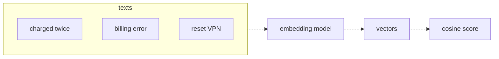
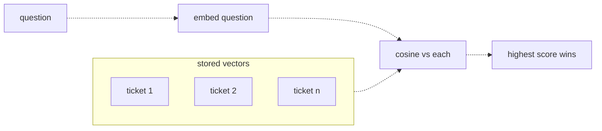

# 13 — Embeddings
Source: notes lines 4348–4652; images: Topic 13/Screenshot 2026-10-29 180447.png, Topic 13/Screenshot 2026-10-29 180457.png

## Why it matters
Every "chat with our documents" project starts with embeddings, and customers ask for that constantly. Keyword search misses tickets that mean the same thing in different words ("charged twice" vs "billing error"). Embeddings turn meaning into numbers you can compare.

## Process / steps
1. Send text to the embeddings endpoint (`/v1/embeddings`, not `/v1/chat/completions`). Get back a vector (1536 numbers for `text-embedding-3-small`).
2. Compare two vectors with cosine similarity. Near 1 = near-identical text; paraphrases with no shared words score about 0.6 in the lab; near 0 = unrelated. Scales differ per model (see Rules).
3. To search: embed every document/ticket **once**, ahead of time, and keep the vectors.
4. When a question arrives, embed only the question.
5. Compute cosine between the question vector and every stored vector.
6. The highest score wins. It is the closest match, not a guaranteed correct answer.

## Diagrams
**Topic 13/Screenshot 2026-10-29 180447.png** (Lesson 1 "Meaning as numbers")

Teaches: texts go through an embedding model, come out as vectors, and a cosine score measures their closeness.

**Topic 13/Screenshot 2026-10-29 180457.png** (Lesson 2 "The similarity search idea")

Teaches: stored vectors are made ahead of time; only the question is embedded at search time; the highest cosine wins.

## Rules and numbers
- Use the embeddings endpoint `/v1/embeddings`. It works like chat, just with a different path. (L1)
- An embedding model never answers questions. Text in, numbers out. (L1)
- `text-embedding-3-small` returns 1536 numbers per input. (L1)
- Measure closeness with cosine similarity: dot / (norm_a × norm_b). The source says "near 1 means very similar", but its own lab gives 0.606 for the same meaning and 0.108 for different meaning (T1); the T14 threshold example is 0.35. "Near 1" is true only for near-duplicate text. (L1)
- Score scales differ per embedding model and per input type. Never carry a threshold or a "good score" between models, corpora or after a model change (R130); re-tune on the golden set [Hadavin practice, C-07].
- Embed the corpus once and store the vectors. Embed only the question at search time. Never re-embed the corpus per search: that is slow and pays the cost thousands of times. (L2, Q1)
- For small sets a plain Python loop is enough: `max(tickets, key=lambda t: cosine(q_vec, t["vector"]))`. No special database is needed. (L2)
- Every vector database does the same comparison, just faster. There is no magic inside. (L2)
- Something always wins, even when nothing is related. The winner is the least unrelated item, not a correct answer. (L2)
- Batch inputs: embed many texts in one API call (a list as `input`). (T1, T2)
- Lab reference scores: same meaning 0.606 vs different meaning 0.108. (T1)

## Decision rules from quizzes
- **Q1:** A junior engineer plans to re-embed 30,000 wiki pages on every search. → Embed the pages once, store the vectors, and embed only the question at search time. Document vectors don't change between searches. Traps: cosine works on vectors, not raw strings; chat models don't produce embeddings.

## Tasks
- **T1, Embed two sentences and compare them.** Goal: prove with numbers that two refund sentences with no shared words mean the same thing. Method: script `/root/fde-embeddings/compare.py` embeds 3 sentences (2 refund, 1 deploy) in one call with `text-embedding-3-small`. Compute cosine for refund-vs-refund and refund-vs-deploy. Save `{same_meaning, different_meaning}` to `result.json`. Done: `same_meaning` is clearly higher (lab: 0.606 vs 0.108).
- **T2, Find the nearest sentence among ten.** Goal: search 10 insurance tickets with a query that shares almost no words with the right ticket. Method: first create `/root/fde-embeddings/tickets.txt` with the exact 10 tickets, one per line (Submit checks for it). Seed data: notes lines 4539–4548. Script `/root/fde-embeddings/search.py` embeds the 10 tickets plus the query in one call with `text-embedding-3-small`, scores each ticket with cosine, and writes the top ticket text to `/root/fde-embeddings/nearest.txt`. Done: the query "charged two times for one payment" returns "I was billed twice for the same invoice this month".

## Course → real world
- **Embeddings:** `embedder` is a pluggable kind (no single dependency). Hadavin practice: the default is whatever the client's own cloud offers (e.g. Cohere Embed v4 or Titan on Bedrock; Azure and GCP equivalents), with a self-hostable open-weights multilingual embedder (served by TEI or sentence-transformers) as the swappable fallback, so a client with a data-residency problem or a provider outage is not blocked. The course used `text-embedding-3-small`. Keep the model id AND the dimension pinned in config, never as a literal, and record both in the index manifest (`built_at`, model, dimension). Re-embed everything if the embedding model changes, because vectors from different models are not comparable (Hadavin practice). Model names, prices and availability are verified on the day, not copied from here [unverified 2026-11-01].
- **Storage:** vectors are built once in an ingestion job and stored behind the `VectorStore` kind: default pgvector (self-hostable, no new vendor), alternatives Bedrock Knowledge Bases on S3 Vectors, Azure AI Search, Vertex Vector Search, or a JSON file for pilots (see topic 14). Records keep the course shape: id + text + vector + metadata.
- **Code:** a typed `embeddings` adapter (one interface with backends) plus batched calls, structured logs and an OTel span per embed call. The adapter takes `kind: document|query` (maps to Cohere's `input_type`; embedding documents and queries the same way silently hurts retrieval), `dimensions`, `normalize` where the model has it (Titan v2), and a max-input-length guard. Its test asserts dimension, vector norm, query-vs-document asymmetry and the cosine helper (C-08).
- **Demo proof:** reproduce T1 on the client's own tickets in discovery week to show semantic match vs their keyword search (Hadavin practice).

## Checklist
- [ ] Embedding model chosen in the client's cloud and pinned in config (id and dimension), with a self-hostable fallback named.
- [ ] Corpus embedded once in a build/ingest step; only queries embedded at runtime.
- [ ] Batch embedding calls; no per-item calls in loops.
- [ ] Same-meaning vs different-meaning sanity check run on client samples, scores recorded.
- [ ] Team knows "top match ≠ correct answer" (threshold/grounding comes later), and no threshold is copied between models.
