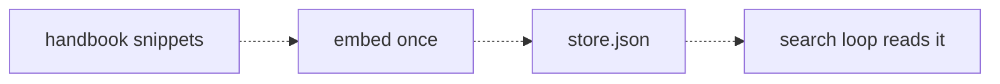
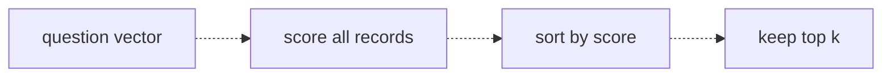

# 14 — Vector search
Source: notes lines 4653–5008; images: Topic 14/Screenshot 2026-10-29 180534.png, Topic 14/Screenshot 2026-10-29 180546.png

## Why it matters
"Keep the vectors" needs a place to keep them. A vector store is just records with vectors attached, and a JSON file is enough to start. Customers judge search on its first demo questions, so return a ranked top-k and know that a high rank ≠ relevant.

## Process / steps
1. Build the store with a script (never by hand): one record per text with `id`, `text`, `vector`.
2. Embed all snippets in one call and write `store.json`. Rerun the script whenever the source changes.
3. At query time, embed the question and score all records with cosine.
4. Sort by score, highest first, and keep the top k (3–5 to start).
5. Keep the scores visible with each result while developing.
6. Guard against weak results: if the best score is below a tuned threshold, say "no confident match".
7. Later, pass the results to a chat model told to say "not in the sources" when they don't answer.

## Diagrams
**Topic 14/Screenshot 2026-10-29 180534.png** (Lesson 1 "Vector store basics")

Teaches: embedding is a build step that writes a store file; the search loop only reads it.

**Topic 14/Screenshot 2026-10-29 180546.png** (Lesson 2 "Top-k queries")

Teaches: return a ranked list of k, not a single winner.

## Rules and numbers
- A record needs three fields: `id` (short name), `text` (the original text; a vector alone tells a human nothing) and `vector`. (L1)
- A real vector has 1536 numbers. (L1)
- Don't add a vector DB on day two. A JSON file plus a linear scan handles thousands of records, with no setup and no security approval. (L1)
- A new database can take weeks to get approved inside an enterprise. A file needs no approval. (L1)
- Vector DBs (Chroma, Pinecone, pgvector) exist for scale and speed at millions of vectors. Their input and output are the same: records in, closest records out. (L1)
- Write the store with a script, never by hand. Embedding is a build step. (L1)
- Return the top k, not one winner. A single winner hides the other relevant rules. (L2)
- k = 3 to 5 is a sensible default for small stores. Too small misses parts of the answer; too large drags junk into the chat model. (L2)
- Keep scores visible. They tell you whether the right record was close behind (rank 4 when k is 3) or nowhere near. Those need different fixes. (L2)
- Scores are only comparable within one query. 0.52 is not "good" or "bad" on its own; look at the gap. (L2)
- Similar ≠ relevant. There is always a top result, even when the answer isn't in the store. (L3)
- Failure shapes: answer not in store; similar topic, wrong detail; vocabulary mismatch (exact codes treated as noise). (L3)
- Score threshold example: `if top[0]["score"] < 0.35: "no confident match found"`. Thresholds are rough; tune them per customer on real queries. (L3)
- Deeper fix: a chat model judges the candidates and says "not in the sources". Search finds candidates; something smarter judges them. (L3)
- Tell every customer early that a high rank means most similar, never guaranteed relevant. (L3)
- Three kickoff-ready demo examples from the source (L2, L3) to show a customer: "what are the rules for new drivers?" (needs top-k: two rules apply and a single winner hides one); "how much notice before quitting?" (no answer in the store, yet the overtime snippet ranks first); "fuel card PINs" (similar topic, wrong detail). They are the proof for "most similar is not relevant" (R248) [C-12].
- Ids come from the source document id plus the chunk index, zero-padded (`{idx:03d}`), and stay stable across rebuilds so idempotent ingestion by id works. The course's `f"hb-0{idx}"` breaks at ten records (`hb-010`) [Hadavin practice, C-13].

## Decision rules from quizzes
- **Q1:** A question the handbook doesn't cover → plain top-k returns the k least irrelevant records, ranked and looking normal. Cosine always scores every record, so there is always a top k. Hence the threshold or a chat-model judge. Trap: expecting an empty list or an error.

## Tasks
- **T1, Build a tiny vector store in a JSON file.** Goal: a store file from 8 logistics handbook snippets. Method: first create `/root/fde-vector-search/snippets.txt` with the exact 8 snippets, one per line (seed data: notes lines 4706–4713). Script `/root/fde-vector-search/build_store.py` reads it, embeds all 8 in one call with `text-embedding-3-small`, and writes `/root/fde-vector-search/store.json` as an array of `{id: hb-01..hb-08, text, vector}`. Done: 8 records, each vector length 1536.
- **T2, Query the store and inspect the top-k.** Goal: a ranked top 3 for "can a driver work extra hours this week". Method: script `/root/fde-vector-search/query.py` (rebuild `store.json` with `build_store.py` first if it is missing) embeds the query with `text-embedding-3-small`, runs cosine against every record, sorts descending, and writes the top 3 `{id, score, text}` to `/root/fde-vector-search/results.json`; then print and read it. Done: the file exists, sorted high→low. Lab result: hb-03 overtime (0.5126), hb-07 (0.4987), hb-01 (0.4457). Check whether it matches what you'd pick by hand.

## Course → real world
- **Store:** `VectorStore` is a pluggable kind (no single dependency). Hadavin practice, default: pgvector (self-hostable, no new vendor to approve, same reasoning as the course's "a file needs no approval"), with Postgres full-text beside it for the keyword lane (topic 17). Alternatives behind the same interface: Bedrock Knowledge Bases on S3 Vectors, Azure AI Search, Vertex Vector Search, OpenSearch, or a JSON file for pilots. Keep the record shape id + text + vector + metadata. Check each managed store's hybrid, filter and distance semantics live before choosing it [research 2026-11-01 via audit-M: S3 Vectors GA 2025-12-02; keyword and hybrid support unverified].
- **Exact codes:** the course names exact-code misses (vocabulary mismatch) as a standard failure shape, and ROLES.md records that S3 Vectors has no native keyword or hybrid search. If queries contain ids, codes, SKUs or names, a vector-only store is the wrong default: use pgvector plus full-text (hybrid, topic 17) or add a keyword lane. Run an "exact code" probe set before choosing the store (C-10).
- **Score semantics:** check whether the backend returns similarity or distance (pgvector `<=>` returns cosine distance, 1 minus similarity; S3 Vectors returns distance) and whether the index is approximate (IVFFlat and HNSW give recall below 100%). The adapter always returns similarity in [-1, 1], so the R134 threshold (course example 0.35) is applied on one scale. Test the adapter against a brute-force scan on a sample as a recall check (C-11).
- **Build step:** ingestion is a CLI/job in the typed package, run in CI or on a schedule, never by hand. It is idempotent per id.
- **Top-k and threshold:** both live in config, not code. The threshold is tuned per client on a golden set of real questions (Hadavin practice). Log the top-k ids and scores in every trace.
- **Demo prep:** say "most similar ≠ relevant" in the kickoff; have no-match handling ready before the first demo.

## Checklist
- [ ] Store built by a script/job from source, re-runnable; record = id + text + vector + metadata.
- [ ] Store choice fits the client (default pgvector; managed alternatives behind the interface); no unapproved new DB; exact-code probe set run if ids matter.
- [ ] Adapter returns similarity (not distance); recall checked against a brute-force scan; chunk ids stable and zero-padded.
- [ ] top-k in config (start 3–5); scores logged with results.
- [ ] Score threshold tuned on real client queries; "no confident match" path tested.
- [ ] Out-of-scope questions tried and their behaviour shown to the customer.
