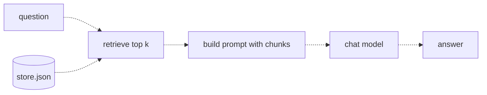
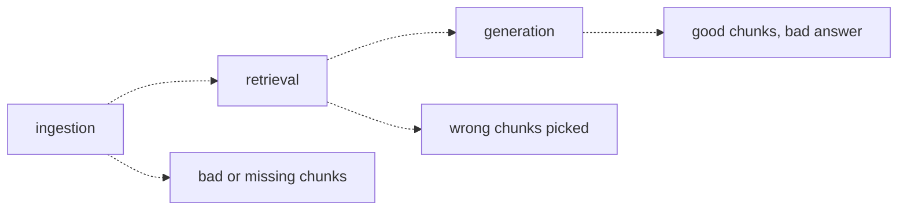

# 15 — The RAG pipeline
Source: notes lines 5009–5391; images: Topic 15/Screenshot 2026-10-29 180631.png, Topic 15/Screenshot 2026-10-29 180645.png

## Why it matters
RAG is the single most requested build in FDE work. It answers both enterprise complaints: "it doesn't know our data" and "it makes things up". "The bot is wrong" will arrive daily. The FDE who can prove which stage failed is the one the customer trusts.

## Process / steps
**Build (L1):**
1. **Retrieve:** embed the question and run top-k against the store.
2. **Augment:** paste the retrieved chunks, labelled with ids, into the prompt as context.
3. **Generate:** ask the chat model to answer using only that context.

**Debug a wrong answer: work backwards (L2):**
1. Print the retrieved chunks for the failing question. Is the correct info in them? Yes → **generation** failed. Stop and fix the prompt/model.
2. If no, search the store file directly (even grep on the text fields). Is the info there? Yes → **retrieval** failed.
3. If no → **ingestion** failed. Go look at the source documents.

## Diagrams
**Topic 15/Screenshot 2026-10-29 180631.png** (Lesson 1 "Retrieve, then generate")

Teaches: the question and the store feed retrieval, and only the retrieved chunks reach the model.
Text vs image: the ASCII draws store.json as a box; the image draws it as a database cylinder. Same flow.

**Topic 15/Screenshot 2026-10-29 180645.png** (Lesson 2 "Where each stage fails")

Teaches: each of the three stages has its own failure signature and its own fix.

## Rules and numbers
- Minimal RAG prompt: "Answer the question using only the context below." + `Context:` lines `[id] text` + `Question:`. (L1)
- The model never touches the store, never searches, never sees other records. It sees only the question and the pasted chunks. This explains almost every RAG bug. (L1)
- Ingestion failure: answer missing or mangled (flattened table, unindexed doc, chunk cut mid-sentence). Retrieval tuning can't fix missing data. (L2)
- Retrieval failure: the right chunk is in the store but not in the top k (word mismatch, k too small, near-duplicate crowding). The model then answers confidently from the wrong context. (L2)
- Generation failure: the right chunks were in the prompt and the model still answered badly (ignored context, mixed chunks, added training-data details). It is a prompt or model problem. (L2)
- Find the failed stage first; the fixes have nothing in common. (L2)
- Always keep the ability to print the retrieved chunks for any question. A RAG system where you can't see the retrieval can't be debugged. (L2)
- Give the model an explicit way out: "If the context does not contain the answer, say that the context does not contain the answer." (T2)
- There is always a top result: cosine scores every chunk, so the least unrelated chunk wins even when nothing is related (topic 14 L3). Retrieval therefore needs a threshold or a judge (R134).
- Lab: top 3 chunks, generation on `deepseek-v4-flash`. (T1, T2)
- The course ids `it-0{idx}` break at ten chunks (`it-010`); use stable zero-padded ids from the source (topic 14) [Hadavin practice].

## Decision rules from quizzes
- **Q1:** The wrong answer's retrieved chunks contain the correct policy text → **generation** failed. Retrieval and ingestion did their jobs; fix the prompt or model choice, not the store or search. Traps: blaming stale vectors or retrieval.

## Tasks
- **T1, Hand-build a minimal RAG script.** Goal: an end-to-end Q&A over 6 IT device-policy chunks. Method: first create `/root/fde-rag-pipeline/chunks.json` with exactly the given content, a JSON array of the 6 policy strings (seed data: notes lines 5068–5075). Then, all in one `/root/fde-rag-pipeline/rag.py`: embed the chunks with `text-embedding-3-small` → write `store.json` (ids it-01..it-06) → embed the question → cosine top 3 → build an "answer only from context" prompt with `[id] text` lines → `deepseek-v4-flash` → write `answer.txt`; print the context and the answer. Done: for "can I use my own laptop on the office network" the answer is "Yes, but only after written IT manager approval." (retrieved it-01, it-05, it-02).
- **T2, Break retrieval and watch the answer degrade.** Goal: see a retrieval failure from the outside. Method: create the same `/root/fde-rag-pipeline/chunks.json` (seed data: notes lines 5244–5251), then script `/root/fde-rag-pipeline/break_retrieval.py` runs the same pipeline twice for "how fast do I have to report a stolen laptop". Good run = top 3 → `good.txt`. Broken run = the 3 **lowest**-scoring chunks → `broken.txt`. The prompt includes the "context does not contain the answer" escape. Done: good = "Within four hours."; broken = "The context does not contain the answer."

## Course → real world
- **Generation model:** Hadavin practice is Claude in the client's cloud (Bedrock recommended for AWS after the client has chosen, R446, via the Messages-API endpoint for the 5.x models; Foundry on Azure; Vertex on GCP; direct API only on request), the tier chosen per workload under R278-R279 (usually Sonnet 5.5 for this hard step), with model ids pinned in config and a fallback id. The `llm` kind is pluggable: Claude is the recommended default, offered as an option the client chooses (R446), and a second backend (open-weights on client hardware, or another vendor) is outlined with its trigger (client policy, cost or outage) [no single dependency]. Confirm Bedrock model access for the pinned ids in the client account first (see topic 11) [research 2026-11-01 via audit-M1, M2]. The course used `deepseek-v4-flash`.
- **Retrieval:** the `VectorStore` kind (default pgvector; Bedrock Knowledge Bases on S3 Vectors and other managed stores as alternatives, topic 14). The Retrieve and Generate stages stay separate modules in our code (we don't rely only on a managed retrieve-and-generate call), so retrieved chunks can always be logged (Hadavin practice, from L2's "always keep that ability").
- **Debuggability:** every request's trace (OTel) stores question, retrieved ids + scores, prompt version and answer. A CLI `explain <question>` prints the retrieved chunks, and a triage runbook follows the 3-step backwards check (Hadavin practice). Step 2 of the backward check ("is the info anywhere in the store?") needs a method on managed stores, where you cannot grep a file: `explain find --text "phrase"` searches the chunk text (not the vectors), so keep chunk text in a queryable store beside the vectors and allow listing by document id and fetching a chunk by id (C-24).
- **Guards:** injection screening and PII redaction wrap the pipeline: one interface each, a neutral default (regex PII always on, a local classifier) with cloud backends (Bedrock Guardrails etc.) as alternatives. Retrieved chunks are untrusted text inside the prompt: wrap them in delimited blocks and tell the model they are quoted source data, not instructions (R198, topic 31) (C-23).
- **Code:** typed package: config / adapters (embeddings, store, llm) / core rag / evals / API; pytest + ruff + CI gates on each PR.

## Checklist
- [ ] Retrieve → augment → generate built as separate, testable modules.
- [ ] Prompt says "only the context" and gives an explicit no-answer escape.
- [ ] Retrieved chunk ids + scores logged per request and printable on demand.
- [ ] Stage-triage runbook (generation → retrieval → ingestion) written for the client team.
- [ ] Deliberate "bad retrieval" test shows the bot refuses rather than invents.
