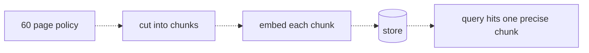
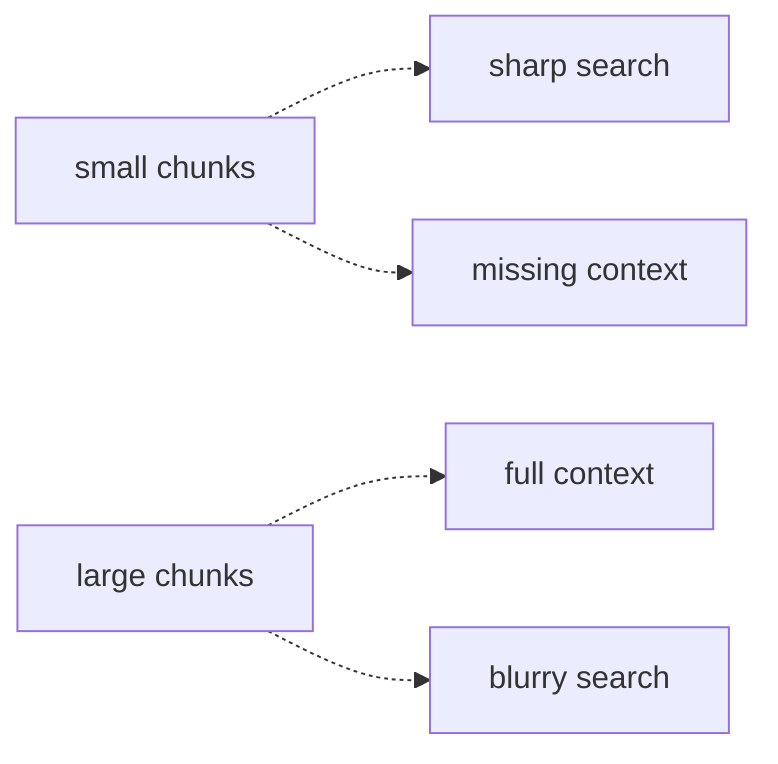

# 16 — Chunking enterprise documents
Source: notes lines 5392–5923; images: Topic 16/Screenshot 2026-10-29 180719.png, Topic 16/Screenshot 2026-10-29 180730.png, Topic 16/Screenshot 2026-10-29 180740.png

## Why it matters
Real customers hand over 60-page policies, 200-page manuals and wiki exports, not one-line snippets. One vector per document is a blurry average that matches nothing. Messy exports poison both retrieval and answers. A large part of real engagement time goes into cleaning and chunking.

## Process / steps
1. Ask for real sample documents in week one, always.
2. **Clean first:** strip breadcrumbs, "Edit | History" toolbars, page headers/footers/numbers and repeated boilerplate (confidentiality banners). Rejoin wrapped lines and collapse repeated blank lines.
3. Convert important tables row by row into full sentences.
4. **Chunk:** cut where the author already did: section headings, paragraph breaks, numbered clauses. Never every N characters.
5. Give each chunk an id and record its source document and section. Attach the section heading to the chunk text.
6. Start at one paragraph to half a page per chunk, along the document's structure.
7. Embed each chunk on its own and store it.
8. Run real questions, look at what retrieval returns, and adjust the size:
   - fragments missing context → chunks too small → merge neighbours or attach headings;
   - right chunk losing to vaguely related ones → chunks too big → cut at paragraph breaks.

## Diagrams
**Topic 16/Screenshot 2026-10-29 180719.png** (Lesson 1 "Why documents get cut")

Teaches: cut first, embed the pieces, so a query lands on one precise chunk.
Text vs image: the ASCII draws store as a box; the image draws a cylinder. Same flow.

**Topic 16/Screenshot 2026-10-29 180730.png** (Lesson 2 "Chunk size trade-offs")

Teaches: small chunks give sharp search but missing context; large chunks give full context but blurry search.
Text vs image: the ASCII labels the second root box "sharp search" (a copy error). The image labels it **large chunks**. The image wins.

**Topic 16/Screenshot 2026-10-29 180740.png** (Lesson 3 "Messy formats: PDF exports, wiki dumps, tables")

Teaches: clean first, chunk second, then embed.

## Rules and numbers
- Don't embed a whole document as one vector. It becomes a blurry average: every query matches it weakly, none strongly. (L1) The source says it is technically possible; the hard limit it leaves out is the embedding model's maximum input length, past which whole-document embedding fails or silently truncates [Hadavin practice, D-15].
- Whole-document context burns tokens, costs money and buries the 2 relevant sentences under 59 pages of noise. (L1)
- Cut where the author already did: section headings, paragraph breaks, numbered clauses. One section = about one thing = a sharp embedding. (L1)
- Avoid arbitrary cuts such as "every 500 characters". They slice sentences and glue unrelated sections. (L1)
- From day one, give every chunk an id plus its source document and section. Citations and permissions depend on it, and adding it later is painful. (L1)
- Small chunks (a sentence or two): precise search, but they arrive stripped of context ("the limit is 50 euros", for what?). (L2)
- Large chunks (several pages): full context, but blurry search, and each one drags a page of noise into the prompt. (L2)
- Default: one paragraph to half a page per chunk, cut along the document's structure. (L2)
- Missing surrounding detail → too small → merge tiny neighbouring sections or attach the section heading. (L2)
- Right chunk keeps losing to vaguely related ones → too big → cut long sections at paragraph breaks. (L2)
- Habit: store chunks as "Heading: text" (e.g. "Expenses: receipts over 50 euros must be attached"). It embeds and reads better. (L2, T3)
- There is no universal best chunk size. Try it on real docs with real questions and look at the retrieval. (L2)
- Junk in a chunk pulls the vector toward noise and may be quoted back to users. A "CONFIDENTIAL - Internal use only" line inside a bot answer is a real incident. Clean first, chunk second. (L3)
- Strip: breadcrumbs and Edit|History toolbars; page headers, footers, page numbers; repeated boilerplate; broken line wrapping. Plain Python string work is enough. (L3)
- Tables: turn each row into a full sentence ("The limit for the EMEA region is 5000 euros, approved by the finance lead"). Scattered cell values embed badly. (L3)
- Ask for real sample documents in week one, always. The sales demo never shows the messy files. (L3)
- Lab numbers: paragraph chunk 0.538 vs whole manual 0.289 for the same question. (T2)

## Decision rules from quizzes
- **Q1:** The bot answers with fragments like "the limit is 50 euros" with no topic, while retrieval scores look fine → **chunks too small**. Merge neighbours or attach section headings. Traps: "too large" causes blurry/wrong matches and "top-k too high" causes noisy prompts; neither causes orphaned fragments.

## Tasks
All files live in `/root/fde-chunking-enterprise-docs/`. Each task first creates its input file with exactly the given content (Submit checks for it).
- **T1, Chunk a policy document by sections.** Goal: one chunk per `##` section of the office security policy markdown. Method: create `policy.md` (seed data: notes lines 5430–5450), then split on `\n## `, skip the preamble, and take the first line as the heading and the rest as the body. Write `chunks.json` as `[{id: sec-01.., section, text}]`. Done: 5 chunks (Badges, Visitors, Passwords, Backups, Incidents). Code bugs in the course version, not to copy: `f"sec-0{idx}"` yields `sec-010` from the tenth section (zero-pad with `f"sec-{idx:02d}"`), and `split("\n## ")` drops the first section when the file starts with `## ` and mis-splits `##` inside code blocks; real builds use a markdown parser [Hadavin practice, D-16].
- **T2, Compare small vs large chunks on one question.** Goal: show the customer, with numbers, why cutting matters. Method: create `manual.txt` with exactly the given content, blank lines included (5 paragraphs; seed data: notes lines 5607–5620). Script `compare_chunks.py` splits the manual at blank lines (5 paragraphs) and embeds them, plus the whole manual as one chunk and the question, in one call with `text-embedding-3-small`. Take the top paragraph score vs the whole-manual score and write `comparison.json` (`small_top_score`, `small_top_text`, `large_top_score`, `large_top_text`). Done: the small top is the travel-expense paragraph at 0.538; the large scores 0.289.
- **T3, Clean and chunk an ugly export.** Goal: turn a wiki export with breadcrumbs, toolbars, page footers and wrapped lines into 3 clean section chunks. Method: create `export.txt` (seed data: notes lines 5777–5794); script `clean_export.py` walks the lines: drop junk lines (breadcrumb/Edit toolbar, `Page `/`CONFIDENTIAL`); on a known heading start a new section; otherwise append to the body. Join the body with spaces into "Heading: text". Write `clean.txt` (sections separated by blank lines) and `export-chunks.json` (array of strings). Done: 3 chunks: VPN Access, Software Requests, Guest WiFi, each prefixed by its heading, with no junk. The course junk filter drops any line containing `CONFIDENTIAL` or starting with `Page `; on a real policy that deletes legitimate content (a section about confidential data, "Page layout rules"). See the real-world junk-filter bullet.

## Course → real world
- **Inputs:** real client sources (SharePoint/Confluence/Drive exports, PDFs) come through connectors with least-privilege service accounts. Request samples in discovery week, as the course says. Retrieved and ingested documents are untrusted input: a chunk can carry instructions (indirect prompt injection) that reach the grounded prompt, the reranker prompt and the agent loop. Put retrieved text in a delimited data block, never in the system message, and re-check injection handling (topic 31) [Hadavin practice, D-23].
- **Parsing:** parsing is a pluggable `doc_parser` kind (no single dependency). Neutral default [Hadavin practice]: self-hosted open-source structure-aware parsers (markdown and HTML heading parsers, a PDF text-and-layout library, an OCR engine for scans) run inside the client's boundary. Managed alternatives per cloud where tables and scans matter: Bedrock Data Automation or Textract (AWS), Document Intelligence (Azure), Document AI (GCP). Pick per client in config and record the choice in the scoping doc [unverified 2026-11-01: product names and availability, verify live]. Then a client-specific junk filter (rules in config, tested with fixtures from their real exports).
- **Junk filters:** use anchored patterns plus repeated-line detection (a line repeated on many pages is boilerplate), not bare substring tests. Every cleaning run writes a report of removed lines (count per pattern, sample) that a human reviews on the first pass for each source; a spike in removed lines on a re-run raises an alert (D-14).
- **Sizes and ids:** chunk size is in tokens and below the embedding model's input limit (config). Chunk ids are stable (document id plus section path, zero-padded) so citations and golden items survive re-ingestion. The index records the chunker and embedding-model version; changing either triggers a full re-embed. Source deletions and ACL removals propagate to the store within the sync window (R155) (D-15).
- **Chunk record:** id + text ("Heading: body") + vector + metadata {doc_id, section, source_url, `allowed_principals` (users and groups; the course's toy field is `allowed_users`, topic 19), updated_at}. The metadata feeds citations (T18) and permissions (T19).
- **Size tuning:** chunk size and strategy are config. Compare sizes on the client's golden questions, as in T2, and keep the numbers as evidence (Hadavin practice).
- **Managed KB option:** managed knowledge-base products (e.g. Bedrock Knowledge Bases) support custom chunking (hierarchical/semantic or a Lambda). Prefer our own cleaning plus heading-based chunking before ingestion so behaviour stays testable (Hadavin practice).
- **Safety:** the PII redaction regex runs at ingestion too, so junk or PII never reaches the store (Hadavin practice).

## Checklist
- [ ] Real sample documents received in week one, all formats seen.
- [ ] Junk filter written and tested on real exports (breadcrumbs, footers, banners, wraps); tables → sentences; anchored patterns, a removed-lines report reviewed by a human.
- [ ] Chunks cut on document structure; heading attached; no fixed-character cuts.
- [ ] Every chunk has a stable id + doc + section + `allowed_principals` metadata; chunk size is below the embedding model's input limit.
- [ ] Chunk size compared on real questions; numbers recorded.
- [ ] Spot-check: no "CONFIDENTIAL"/page-number junk in the store.
