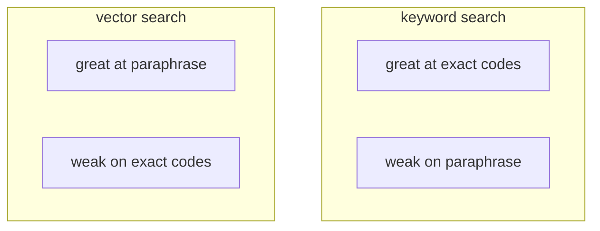
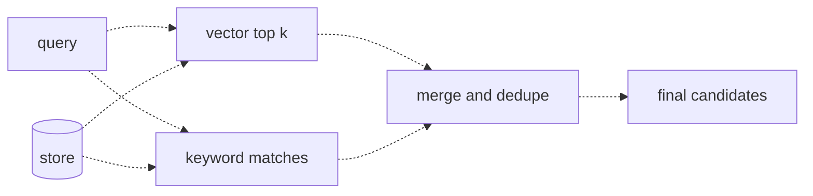
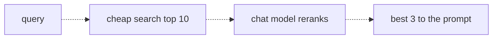

# 17 — Retrieval quality
Source: notes lines 5924–6482; images: Topic 17/Screenshot 2026-10-29 180907.png, Topic 17/Screenshot 2026-10-29 180917.png, Topic 17/Screenshot 2026-10-29 180929.png

## Why it matters
Enterprises are full of exact identifiers (error codes, ticket ids, SKUs). Vector search can rank generic prose above them, and users complain that "Ctrl+F finds it, your bot doesn't". Hybrid search fixes exact-term misses. Reranking fixes "on topic but not the answer". These are the two retrieval upgrades every enterprise search needs.

## Process / steps
1. **Measure before arguing:** for the failing query, print the correct chunk's rank and scores and compare its rank with the top-k cutoff.
2. **Hybrid search:** for every query, run two lanes:
   - keyword lane: pull the distinctive tokens (codes, ids, anything with digits or unusual casing) and match the chunks that contain them (case-insensitive);
   - vector lane: the usual embed + cosine top-k.
3. **Merge:** keyword hits first, then fill the remaining slots with vector results, skipping duplicates. No rare tokens means pure vector search.
4. **Rerank:** retrieve a wider candidate list (e.g. top 10) with cheap vector/hybrid search.
5. Show the candidates plus the question to a cheap chat model and ask for JSON `{"ranked_ids": [...]}` only.
6. Validate the ids (drop any not in the candidate list, dedupe) and keep the top 3 for the prompt. In real builds also append any candidate the reranker omitted after its ranked ids (original retrieval order), and fall back to retrieval order on parse error, timeout or empty result, logging the fallback (see Course to real world).

## Diagrams
**Topic 17/Screenshot 2026-10-29 180907.png** (Lesson 1 "When top-k misses: vocabulary mismatch")

Teaches: keyword and vector search have opposite strengths; neither is simply better.

**Topic 17/Screenshot 2026-10-29 180917.png** (Lesson 2 "Hybrid search: keyword plus vector")

Teaches: run both lanes against the store, then merge and dedupe into one candidate list.

**Topic 17/Screenshot 2026-10-29 180929.png** (Lesson 3 "Reranking")

Teaches: fast search narrows thousands to ten; a smart judge narrows ten to three.

## Rules and numbers
- Embeddings compare meaning, not exact matches. An identifier gives no reliable ranking boost. (L1)
- A short, code-first chunk can rank first; the same code buried in a long maintenance note can lose to generic "how do I fix" prose. (L1)
- Lab (scores measured with `text-embedding-3-small`): the ERR-4092 chunk ranked 2nd, 0.398 vs 0.404 for generic rb-01. It made the top 3 but missed top-1. With top-k = 1 the answer never reaches the prompt. (L1, T1)
- Even wins are fragile: 4 look-alike codes left ERR-4092 first at only 0.561 vs 0.550. Ranking alone is no guarantee. (L1)
- Watch for these tokens: error codes/event ids (ERR-4092, E11000), ticket/policy numbers (INC-88231, P-113), SKUs, hostnames, internal project names. (L1)
- Symptom: the right chunk is in the store, the query shares an exact rare token with it, and it still ranks below generic prose ("search can't find what Ctrl+F finds"). (L1)
- Spot it by printing the correct chunk's rank and scores against the top-k cutoff. Rank 2 misses top-1 but reaches top-3. (L1)
- Record what you actually measure, even if the target wins. A measurement is what you show the customer. (T1)
- Don't choose between keyword and vector. Run both. (L2)
- Keyword lane: match only distinctive tokens (rare, with digits or unusual casing), never common words ("how", "do", "fix"). The rarity is the signal. (L2)
- Real systems score the keyword lane with BM25; fancier merges use reciprocal rank fusion. For a few hundred chunks, substring match plus a simple merge gives most of the benefit. (L2)
- Merge: keyword hits first, then vector top-k, no duplicates. No rare tokens → pure vector, nothing lost. (L2)
- Hybrid is the default for enterprise document search. (L2)
- Cosine gets the topic right but can miss intent ("VPN, VPN, VPN" outweighs "contractors"). (L3)
- Don't run a chat model over the whole store; it is too slow and expensive. Rerank only a wider shortlist (top 10) and keep the top 3. (L3)
- Ask the reranker for JSON only: `{"ranked_ids": [...]}`. (L3)
- Always validate the returned ids against the candidate list. Drop invented ids; never crash. (L3) The course code (`json.loads(reply)`) does crash on malformed JSON and silently drops candidates the model failed to list, so a wrong ranker can remove the right chunk. Extended in real builds below (R145, D-12).
- The course keyword lane (`[c for c in store if ...]`, T2 `hybrid.py`) scans the whole store with no user. Combined with topic 19 it re-opens the leak topic 19 closes: the keyword lane, any reranker candidate source and any cache must run inside the same user-visible set (see topic 19, D-01).
- Use a cheap model for reranking (`deepseek-v4-flash` in the lab). The task is easy and runs on every query. (L3)
- Reranking can't rescue a chunk that never made the candidate list. Breadth first (retrieval), precision second (rerank). (L3, Q1)

## Decision rules from quizzes
- **Q1:** Searching for INC-88231 returns generic incident-process chunks while paraphrases work → **add a keyword lane for rare tokens, merged with vector results**. Traps: raising k may include the chunk but doesn't fix its rank; a bigger embedding model gives no exact-match guarantee; a reranker only reorders what retrieval already found.

## Tasks
All files live in `/root/fde-retrieval-quality/`. Each task first creates its input file with exactly the given content.
- **T1, Reproduce a keyword miss.** Goal: measure, before arguing, whether search misses ERR-4092. Method: create `runbook.json`, 8 records rb-01..rb-08 where rb-06 is the long maintenance note (seed data: notes lines 5981–5990). Script `rank_check.py` embeds the 8 runbook chunks plus "how do I fix ERR-4092", cosine-ranks them, finds the rank of target rb-06, and writes `miss_report.json` {query, target_id, rank, top3}. Print the full ranking. Done: the report exists. Lab: rank 2, top3 = rb-01, rb-06, rb-03.
- **T2, Add a keyword fallback and fix the miss.** Goal: put ERR-4092 first through an exact match. Method: create the same `runbook.json` (seed data: notes lines 6161–6170); script `hybrid.py`. Rare tokens = query tokens containing digits. Keyword hits = chunks containing them (case-insensitive). Vector lane = full cosine ranking. Merge keyword hits first, then vector, deduped, 3 total. Write `hybrid_results.json` as `[{id, source: keyword|vector}]`. Done: rb-06 (keyword), rb-01 (vector), rb-03 (vector).
- **T3, Rerank candidates with the model.** Goal: lift the contractor chunk above generic VPN prose. Method: create `candidates.json`, 6 vpn records vpn-1..vpn-6 (seed data: notes lines 6339–6346). Script `rerank.py` sends the question and 6 `[id] text` candidates to `deepseek-v4-flash`, asking for JSON `ranked_ids` with all ids and no fences. Strip any fences/extra text, parse, keep only valid ids in order without duplicates, and write `reranked.json`. Done: vpn-3 (contractors) ranks #1.
  The validation loop is the lesson:
  ```python
  ranked_ids = []
  for cid in data.get("ranked_ids", []):
      if cid in valid_ids and cid not in ranked_ids:
          ranked_ids.append(cid)
  ```

## Course → real world
- **Hybrid:** Hadavin practice, neutral default: pgvector + Postgres full-text (BM25-like `ts_rank`), or OpenSearch. Exact distinctive-token hits stay pinned first (the course rule, N:6145); rank fusion (RRF) orders the rest, and is adopted only after the golden set and the exact-code probe set show no loss (R144, R320). Alternative: a managed knowledge-base hybrid search (e.g. Bedrock Knowledge Bases) only where the vector store supports keyword plus vector; S3 Vectors keyword/hybrid support is unverified, so do not assume it [unverified 2026-11-01, D-05]. Keep the course's rule: exact-token hits first.
- **Rare-token extractor:** a tested function with client-specific patterns (their ticket/SKU/error-code formats) kept in config. The course extractor (`any(ch.isdigit() for ch in tok)` over `query.split()`) breaks on punctuation ("ERR-4092?"), on spacing and hyphen variants ("ERR 4092", "err4092"), and matches ordinary numbers ("30", "2024"), which explodes the keyword lane. Test cases: trailing punctuation, case, hyphen/space/no-separator variants of one id, plain numbers and years (must not trigger), several ids in one query, ids inside quotes. Normalise query and chunk text with the same function before matching (D-13).
- **Reranking:** `reranker` is a pluggable kind. Hadavin practice, neutral default: a self-hosted cross-encoder reranker (open weights). Alternatives: a managed reranker in the client's cloud (e.g. Cohere Rerank or Amazon Rerank on Bedrock) and an LLM-JSON reranker (a cheap Claude tier with JSON output), which is also the fallback when the others are unavailable. Validate ids every time; append omitted candidates in retrieval order; on parse error, timeout or empty result fall back to retrieval order and log it; never return fewer candidates than the reranker was given. Rerank depth (10 → 3) lives in config [unverified 2026-11-01: product names and model tiers, verify live] (D-04, D-12).
- **Evidence:** keep per-query rank reports like T1 in the eval set. Retrieval hit@k on the golden dataset is a CI gate (see topics 26, 29).
- **Traces:** log both lanes' ids, merge source and reranker output per request (OTel).
- **Untrusted text:** retrieved chunks are untrusted data. Put them in a delimited data block, never in the system message, and re-check injection handling (topic 31) for the grounded prompt, the reranker prompt and tool outputs (D-23).
- **Other levers (J, optional):** query rewriting, multi-query and HyDE can be added one at a time, each gated by the golden-set eval (R320).

## Checklist
- [ ] Client's identifier formats listed (codes, tickets, SKUs) and tested in the keyword lane.
- [ ] Hybrid search on; merge puts exact hits first; dedupe verified.
- [ ] "Ctrl+F" complaints reproduced with a rank report before any fix.
- [ ] Reranker (self-hosted default, managed or cheap-model alternative); ids validated, omitted candidates appended, fallback to retrieval order tested; depth in config.
- [ ] Keyword lane and reranker input run inside the user-visible set (topic 19); rare-token extractor has the edge-case tests above.
- [ ] Retrieval hit@k measured on golden questions before and after each change.
