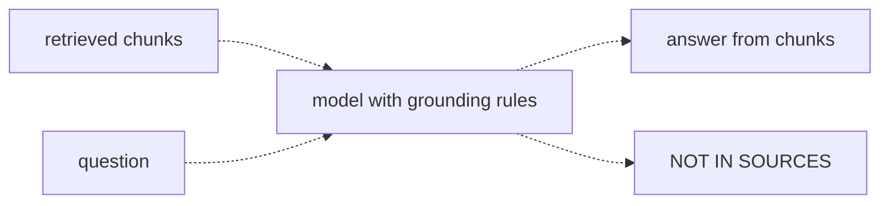
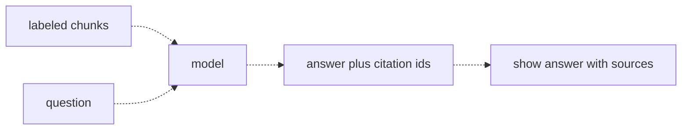

# 18 — Citations and grounding
Source: notes lines 6483–6828; images: Topic 18/Screenshot 2026-10-29 181026.png, Topic 18/Screenshot 2026-10-29 181034.png

## Why it matters
An invented policy answer ("10 paid sick days") is the number-one deal breaker for an enterprise bot: one catch and the customer trusts nothing. Grounding makes the model answer only from sources or refuse. Citations let users and legal check every claim in seconds. Together they unblock rollout.

## Process / steps
1. Label each chunk with its id in the context (`[pol-4] ...`).
2. In the **system message**, state the grounding rules: answer about company policy using ONLY the context; if the context lacks the answer, reply exactly `NOT IN SOURCES`; never use outside knowledge; never guess.
3. Detect refusals in code with an exact string match on `NOT IN SOURCES` (course). In real builds the refusal is a schema field (`status: answered | not_in_sources`) and the exact phrase is only the human-visible text plus a secondary check after trimming whitespace, markdown and trailing punctuation (see Course to real world).
4. Ask for JSON only: `{"answer": "...", "citations": ["pol-4"]}`, listing the id of every chunk used.
5. Parse the reply. Validate each cited id against the set of chunks actually sent and drop unknown ids.
6. If every citation is invalid or citations are empty → treat the answer as suspect (flag, refuse, or fall back to NOT IN SOURCES).
7. Render the answer, look up each cited id in the store, and show the original chunk text next to it.

## Diagrams
**Topic 18/Screenshot 2026-10-29 181026.png** (Lesson 1 "Answer only from the sources")

Teaches: a grounded model has exactly two allowed outcomes: an answer from the chunks, or the fixed refusal.

**Topic 18/Screenshot 2026-10-29 181034.png** (Lesson 2 "Showing citations")

Teaches: labelled chunks let the model return citation ids, which the app turns into visible sources.

## Rules and numbers
- A chat model always produces an answer and blends in training data when context is weak. For enterprise policy bots this is the number-one deal breaker. (L1)
- Enforce grounding in the system message, with explicit rules: ONLY the context; exact reply `NOT IN SOURCES` when the answer is missing; never use outside knowledge; never guess. (L1)
- Always define an exact escape phrase. Without one, the model treats "produce some answer" as the goal and guesses. (L1)
- A fixed refusal wording is machine-checkable: code and tests detect it with a string match. (L1) Collision to know about: the course JSON contract (`{"answer", "citations"}`, Q2: empty citations is suspect) and the exact-string refusal clash, because a correct refusal has empty citations by design, and an exact match breaks when the model returns `**NOT IN SOURCES**`, `NOT IN SOURCES.` or the phrase inside the JSON answer field (D-09).
- Add "Do not add any extra words before or after NOT IN SOURCES" so the match stays exact. (T1)
- Saying no is a feature. A wrong answer becomes a dispute; NOT IN SOURCES becomes a request to add the missing doc. Say this in the kickoff. (L1)
- Grounding by prompt isn't perfect (models slip; measured later), but it removes the large, obvious failures for about five lines of system message. (L1)
- Without citations, careful users re-search everything and the bot saves no time. (L2)
- Citations reuse what's already there: chunk ids from chunking + labelled context + structured output. (L2)
- Validate every cited id against the chunks actually sent. Drop unknown ids; if all are invalid, treat the answer as suspect. (L2)
- Rule: empty citations means no answer. An uncited answer has likely drifted off the sources. (L2, Q2) This applies to answers, not refusals: a refusal has empty citations by design.
- A citation is a claim, not a proof. Showing the cited text next to the answer is the right verifiability level: the human checks in seconds. (L2)
- Never fill in fake citations. Fake source links teach users to trust sources that were never real. (Q2)
- When parsing JSON replies, strip code fences/extra text before `json.loads`, and ask for "No markdown, no code fences". (T2)

## Decision rules from quizzes
- **Q1 (legal blocker):** Legal fears wrong answers with no traceable source → **ground to retrieved chunks with a defined refusal phrase, return chunk ids as citations, and show the cited text next to every answer.** This covers both halves: no invented policy, and every claim can be verified. Traps: grounding without citations; "use the strongest model"; a disclaimer.
- **Q2:** A fluent answer with an empty `citations` array → **treat it as suspect** (likely training data). Flag it, refuse it, or fall back to NOT IN SOURCES. Traps: showing it normally; filling in all retrieved ids; retrying with a bigger top-k.

## Tasks
All files live in `/root/fde-citations-grounding/`. The context is used exactly as given in the notes.
- **T1, A prompt that refuses off-source answers.** Goal: prove that the grounded prompt answers in-source questions and refuses traps. Method: script `grounded.py`; context = the fac-1..fac-3 lines verbatim (seed data: notes lines 6537–6539). Put the grounding rules (exact `NOT IN SOURCES`, no extra words) in a system message; the user message carries the 3 facilities chunks + the question. Ask `deepseek-v4-flash` "where can I park" → `answer_parking.txt` and "how many sick days do we get" → `answer_sickdays.txt`. Done: parking = "level P2, first come first served"; sick days = exactly `NOT IN SOURCES`.
- **T2, Return the answer with source chunk ids.** Goal: an answer plus valid citations for "who has to approve a 700 euro refund and how long does it take". Method: script `cite.py` asks `deepseek-v4-flash`; context = the ref-1..ref-4 lines verbatim (seed data: notes lines 6673–6676). The system prompt requires JSON only with `answer` and `citations`. Strip fences, parse, filter citations to ref-1..ref-4 and write `cited_answer.json`. Done: team lead approval + five working days, citations `["ref-2", "ref-3"]`.

## Course → real world
- **Model:** Claude in the client's cloud (recommended after the client has chosen, R446), usually Sonnet 5.5 for hard work (tier per R278/R279), with a versioned system prompt in config. Hadavin practice is structured output via tool/JSON schema plus a validation-and-retry loop (topic 10), not free-text parsing alone.
- **Native citations:** where the platform offers them (Claude citations on search-result/document blocks; Bedrock Knowledge Bases RetrieveAndGenerate citations), use them, but still run our own validation: cited ids ⊆ sent ids, empty → suspect (Hadavin practice).
- **Refusal:** [Hadavin practice, D-09] detect refusals from a schema field (`status: answered | not_in_sources`), not by string match alone. Keep the exact phrase `NOT IN SOURCES` (or a client-chosen phrase in config) as the human-visible text and as a secondary check after trimming whitespace, markdown and trailing punctuation. The R149 rule (empty or all-invalid citations make the answer suspect) applies only to `status: answered`. Handoff: R148 and R149 text, and the grounded-prompt template used by the demos. Every refusal is logged as a content-gap ticket for the client's doc owner (from L1's "becomes a request to add the policy").
- **UI:** each answer shows its cited chunk text plus source doc/section link from metadata (topic 16). Uncited answers are blocked or flagged. The citation render lookup uses the same user-scoped read as retrieval (it can only return chunks the user may see), so a guessed or injected id never shows restricted text and no trust in the model's ids is needed (D-11).
- **Citation support:** the course says a citation is "a claim, not a proof". Measure it: golden items include a check that each cited chunk contains the claimed fact (judge or quote-match), reported as citation precision and gated in CI at hardening (topics 27, 29, 32) (D-10).
- **Untrusted text:** retrieved chunks are untrusted data. Put them in a delimited data block, never in the system message, and re-check injection handling (topic 31) for the grounded prompt, the reranker prompt and tool outputs (D-23).
- **Evals:** golden set includes off-source trap questions (expect exact refusal) and citation-correctness checks; groundedness is measured later (topics 29, 32) and gated in CI.
- **Kickoff:** tell compliance/legal "it will say I don't know" up front; show the T1 trap demo.

## Checklist
- [ ] Grounding rules + exact refusal phrase in a versioned system prompt.
- [ ] Refusal detected from a schema status field, with the exact phrase as a trimmed secondary check; tested with off-source trap questions, including `**NOT IN SOURCES**` and trailing-punctuation variants.
- [ ] JSON answer + citations validated against the sent chunk ids; unknown ids dropped.
- [ ] Empty/all-invalid citations → flagged or refused; never auto-filled.
- [ ] UI shows the cited source text and doc/section next to every answer, read through the user-scoped lookup; citation precision measured on the golden set.
- [ ] Legal/compliance walked through how grounding and citations work.
