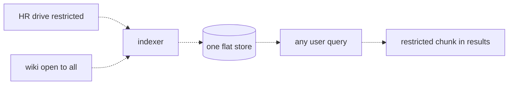
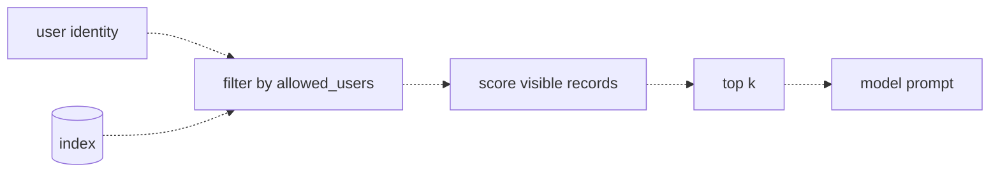

# 19 — Permissions-aware retrieval
Source: notes lines 6829–7365; images: Topic 19/Screenshot 2026-10-29 181109.png, Topic 19/Screenshot 2026-10-29 181117.png

## Why it matters
This is the most serious enterprise RAG failure: the vector store answers with documents the user was never allowed to read. That is a data breach, and your own pipeline delivers it. A vector store is a copy of the data without its locks. The FDE who builds the copy must rebuild the locks.

## Process / steps
1. In week one of any RAG engagement, before the first connector runs, ask about permissions. (L1)
2. At ingestion, the connector copies each document's access list along with the document. Every record carries `id`, `text`, `vector` **and** `allowed_users`. (L1)
3. Reproduce the leak first: run a permission-blind top-k search as a restricted user and confirm forbidden chunks come back. (T1)
4. Change the search signature from `search(query)` to `search(query, user)`. The user identity comes from the app's login session. (L2)
5. Filter first: drop every record the user may not see, and only then score. (L2)
6. Score the visible records only, take top k, and build the model prompt from those. (L2) Every lane runs inside the visible set: vector, keyword (topic 17), any reranker candidate source and every cache key (see Rules, D-01).
7. Resolve groups. The user's set of identities (user plus groups from the identity provider) must overlap the record's allowed set. (L2)
8. Re-sync access lists on a schedule, not once. (L2)
9. Prove both sides: the restricted user gets no restricted docs, and the allowed user still gets them for the same query. (T2)

## Diagrams
**Topic 19/Screenshot 2026-10-29 181109.png** (L1 "The leak")

Teaches: a restricted source and an open source go through one indexer into one flat store. Any user's query can then pull the restricted chunk.

**Topic 19/Screenshot 2026-10-29 181117.png** (L2 "Filtering by access at query time")

Teaches: the user identity and the index meet at the filter before any scoring. Only filtered records reach top k and the prompt.

## Rules and numbers
- Store who may see each record as an extra field (`allowed_users`) next to id, text and vector. This is the minimum viable defense. (L1)
- The connector that copies a document must also copy its access list. If it is lost at ingestion, no query-time cleverness can recover it. (L1)
- Cosine similarity does not read ACLs. Never assume the store inherits source permissions. (L1)
- Ask about permissions in week one, before the first connector runs. (L1)
- Filter before scoring, never after. Rank-then-remove can leave 1 or 0 results instead of 3, and lets forbidden data flow into prompts, logs and error messages. (L2)
- Take the user identity from the application's login session. Never take it from the query text or from model output. (L2)
- The model is not part of the security boundary. It sees only chunks that already passed the filter. (L2)
- Use groups (for example `["hr-team", "managers"]`) resolved from the identity provider. The check is "the user's identity set overlaps the record's allowed set". (L2)
- Query-time filtering is only as fresh as the metadata. Re-sync access lists on a schedule. (L2)
- Prompt instructions are not access control. (Q2)
- [Hadavin practice, D-01; handoff: new R153a] The ACL filter applies to every lane (vector, keyword, any rerank candidate source) and to every cache key: build the visible set first, then run all lanes inside it. The course keyword lane scans the whole store with no user, so hybrid search built as taught re-opens the leak this topic closes. The leak test must cover the keyword lane with a restricted rare token (e.g. a restricted chunk containing the code ERR-4092).
- [Hadavin practice, D-06; handoff: new R153b] Fail closed: a record with a missing or empty access list is invisible to everyone except a named admin path; if group resolution fails (IdP error or timeout) the request returns zero results and an error, never the unfiltered set. Tests: a null-ACL record, an IdP error.
- [Hadavin practice, D-02; handoff: R312 wording] The course says a forbidden chunk must never appear in a prompt, a log line or an error message. So log the permission decision as counts and opaque ids only (candidates, filtered, filter version); never log the text, title or source path of a filtered chunk. R312's "log what was filtered out" is read this way.
- [Hadavin practice, J-21; handoff: R312 clause] When the permitted set is empty, abstain with the same wording as a true miss; never say that something exists but is hidden.
- [Hadavin practice, D-08] Field name: the production field is `allowed_principals` (users and groups); the course's `allowed_users` is the toy name. R152 and the topic 16 chunk record are aligned to this (handoff for R152).
- Retrofitting access metadata after indexing means re-crawling every source. "Later" is slower, not faster. (Q1)

## Decision rules from quizzes
- **Q1. The sponsor wants to index every drive now and add permissions in phase two.** Capture access metadata at ingestion from day one, and launch first on sources readable by all employees. This keeps the speed without a breach, and restricted sources can be added later with filtering already in place. Traps: a system prompt saying "don't reveal HR info" is not a control. Delaying the whole project for a full enterprise permission model is overkill.
- **Q2. Is rank-then-remove the same as filter-first?** No. Filter before scoring, so forbidden chunks never enter the flow and top-k always comes from visible records. Scoring does not change vectors, and prompt instructions are not access control.

## Tasks
- **T1. Reproduce a cross-user leak.**
  - Goal: prove the leak exists.
  - Method: all files in `/root/fde-permissions-aware-retrieval/`. Create `docs.json` with exactly the given 6 docs (seed data: notes lines 6886–6893). `sal-1` and `sal-2` allow only `marco`; the rest allow `priya`, `marco` and `all-staff`. Script `leak.py` embeds all six texts with `text-embedding-3-small` and writes `index.json` with records holding id, text, allowed_users and vector. Search as `priya` with a plain top-3 cosine loop that ignores `allowed_users`, using the query "what is the salary band for senior engineers". Write `leak_results.json` as `{user, query, results:[{id, allowed_users}]}`.
  - Done: priya's top 3 contain `sal-1` and `sal-2`, which allow `["marco"]` only.
- **T2. Add user filtering and prove the leak is closed.**
  - Goal: make the search permissions-aware and test it from both sides.
  - Method: script `/root/fde-permissions-aware-retrieval/safe_search.py`; first rebuild `index.json` by running `leak.py` if it is missing. A search function takes the user name, filters the index to records whose `allowed_users` contains that user, then ranks by cosine and keeps the top 3. Run it as priya into `safe_priya.json` and as marco into `safe_marco.json`, same shape as T1.
  - Done: priya gets no `sal-` docs (she gets wiki-2, wiki-1, hb-1). Marco still gets `sal-1` as the top result. The lesson snippet:
    ```python
    visible = [d for d in index if user in d["allowed_users"]]
    ranked = sorted(visible, key=lambda d: cosine(q_vec, d["vector"]), reverse=True)
    ```

## Course → real world
- **Store:** `VectorStore` kind, default pgvector (self-hostable); alternatives Bedrock Knowledge Bases on S3 Vectors, Azure AI Search, Vertex Vector Search. Keep the record shape id + text + vector + metadata, with `allowed_principals` (users and groups) in the metadata. *Hadavin practice:* apply the filter as a pre-filter in the vector query (a pgvector `WHERE` clause on an array overlap, or a managed store's metadata filter). Never filter in Python after top-k.
- **Hybrid needs a store that supports it (D-05):** if the client needs hybrid search (identifier-heavy content, which is most enterprises) the store must support keyword plus vector with a metadata pre-filter (pgvector with full-text, or OpenSearch). Check the store's hybrid and filter support live before choosing it [unverified 2026-11-01: S3 Vectors keyword/hybrid and filter semantics].
- **Filter semantics (D-20):** verify that the store applies the filter before or during the nearest-neighbour search and still returns k visible results (a post-filter inside approximate search can return fewer than k). Test with a user who can see 3 of 1000 chunks. Also check metadata size limits [verify live per store].
- **Identity:** *Hadavin practice:* take the user from the app's verified session or JWT (Cognito, Entra ID or Google IdP). Resolve groups from the IdP on each request or from a short-TTL cache. Never accept a user id from the request body or the model.
- **Connectors:** each connector maps the source ACL (SharePoint, Confluence space or Drive permissions) into the metadata. It runs under a least-privilege service account whose secrets come only through the secrets kind (named lookup).
- **Connector ACL mapping spec (D-07):** written per source before the connector is built: inheritance, nested groups (flatten at sync, record a depth limit), deny entries (deny wins), link sharing (restricted unless the client states otherwise), external users. Each case gets a leak-test fixture.
- **Guard interface:** *Hadavin practice:* permission filtering is one guard interface with a backend per store. It always runs before retrieval scoring and is covered by a cross-user leak test in CI (the T1/T2 pair as a pytest).
- **Freshness:** *Hadavin practice:* run a scheduled ACL re-sync job, owned and alerted. Log ACL sync time per source.
- **Launch:** *Hadavin practice:* the first release covers all-staff sources only. Restricted sources are added once the filter and the leak test pass.
- **Models:** the course uses `text-embedding-3-small`. Real builds use the `embedder` kind (topic 13): the client cloud's embeddings with a self-hostable fallback, model id and dimension pinned in config.

## Checklist
- [ ] Asked about source permissions in week one, before any connector ran.
- [ ] Every indexed record carries its access list (users and groups).
- [ ] Search signature is `search(query, user)`, with the user taken from the login session only.
- [ ] Filter runs before scoring (pre-filter in the store query).
- [ ] Cross-user leak test (restricted user denied, allowed user served) passes in CI, including the keyword lane with a restricted rare token.
- [ ] Keyword lane and reranker input filtered by the same user filter; null-ACL and IdP-error tests pass (fail closed); logs hold counts and opaque ids only.
- [ ] Connector ACL mapping spec written per source.
- [ ] ACL re-sync is scheduled and monitored.
- [ ] First launch limited to all-staff sources until the above is green.
