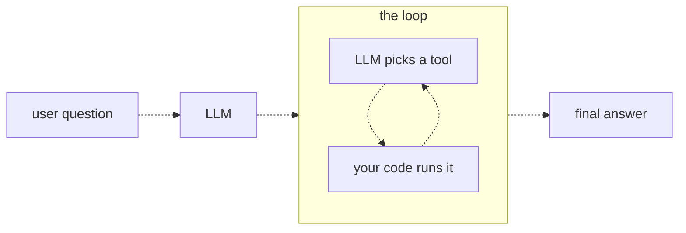
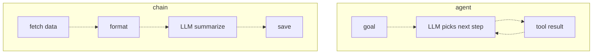

# 20 — Agents
Source: notes lines 7366–7690; images: Topic 20/Screenshot 2026-10-29 181215.png, Topic 20/Screenshot 2026-10-29 181234.png, Topic 20/Screenshot 2026-10-29 181248.png

## Why it matters
An agent is an LLM, a set of tools and a loop. The model chooses the next step until the job is done. The FDE has to know when a customer needs that loop and when a fixed chain is cheaper, faster and safer. Customers often ask for "an agent" when a chain fits.

## Process / steps
1. Start with the single tool call you already have (one question, one tool, one round trip). (L1)
2. Put the tool loop inside a `while`/`for` loop. Each pass: (L1)
   1. send the full message history to the model;
   2. if the reply has tool calls, run them, append the results to the history, and go around again;
   3. if the reply is plain text, the model is done; stop and return it.
3. Bound the loop with a hard max-steps limit. This is not optional. (L1)
4. Before choosing an agent, ask: do I know the steps in advance? Yes means chain; no means agent. (L2)
5. At a customer, assume a chain first. Upgrade to an agent only when you catch yourself writing `if` statements to cover every possible question. (L2)

## Diagrams
**Topic 20/Screenshot 2026-10-29 181215.png** (L1 "An agent is an LLM in a loop with tools")

Teaches: the agent is the loop. The LLM picks a tool, your code runs it, and the loop repeats until a final answer.

**Topic 20/Screenshot 2026-10-29 181234.png** and **Topic 20/Screenshot 2026-10-29 181248.png** (L2 "Agent vs simple chain"; the second is the scrolled continuation showing the full chain)

Teaches: in an agent the model picks the next step in a loop. In a chain the engineer fixes the steps, and the LLM fills one step.

## Rules and numbers
- An agent is the tool loop, repeated. There is no special "agent API". (L1)
- Every agent loop carries a hard limit on the number of passes. Not optional. (L1)
- A plain-text reply (no tool calls) is the natural stop. (L1)
- With a chain you write the plan. With an agent you write the tools and the goal, and the model writes the plan at run time. (L1)
- Use a chain when the steps are known in advance: it is cheaper (fewer model calls), faster, and fails in predictable places you can alert on. (L2)
- Use an agent when the steps vary per question (one lookup for one question, three plus math for another). (L2)
- Don't use an agent for everything. Each model decision costs money, is a chance to pick wrong, and must be debugged from logs instead of your code. (L2)
- Default to a chain. Switching to an agent is signalled by writing `if` statements for every possible question. (L2)
- Task default: `max_steps = 6` ("6 is plenty"). (T1) The course T1 code leaves `final_answer = ""` when the loop ends by exhaustion and writes a blank `answer.txt`: do not copy it. When the guard fires the run fails loudly (R103). The code also does not handle `json.loads` failure on tool arguments, tool exceptions, repeated identical calls or history growth (R105, R102) [Hadavin practice, D-17].

## Decision rules from quizzes
- **Q1. The CTO wants "an AI agent" for a returns desk with fixed steps (look up the order, check the 30-day window, give a yes/no plus one sentence).** Build a fixed chain (lookup, date check, one model call for the sentence) and explain to the CTO that it is more reliable and cheaper. Be straight about the word "agent", because it builds trust. Traps: labelling the chain an agent in the demo, or building the full loop because the customer said "agent".
- **Q2. A script handles one lookup but fails on two lookups plus a calculation.** Wrap the tool-call handling in a bounded loop, so the model decides after each result whether to call again or answer. Hard-coding the sequence is a chain and breaks on the next question shape. A bigger model still cannot see live data without tools.
- **Q1 option 2** (build the chain now and note that free-form questions later would need a real agent) is acceptable advice but not the best choice: the best choice states the reason to the CTO now (reliability and cost). The source gives no further reason why option 2 loses [D-22].

## Tasks
- **T1. Turn the tool loop into a multi-turn agent.**
  - Goal: answer "How many days of stock do we have left for part X-100?", which needs two lookups and a division.
  - Method: create `inventory.json` (X-100: stock 96, daily_usage 8; X-200: stock 40, daily_usage 10). Define two tool functions, `get_stock(part)` and `get_daily_usage(part)`, that read the file and return a JSON error for unknown parts. Send both tool schemas to the model. Run the loop: append each assistant message; for each tool call, dispatch through a name→function map (unknown tool returns an error JSON) and append a `role: tool` message with `tool_call_id`; stop on plain text. Bound the loop with `max_steps = 6`. Write the final text to `answer.txt`.
  - Done: `answer.txt` says 12 days (96 ÷ 8).

## Course → real world
- **Models:** the course uses `deepseek-v4-flash` through the OpenAI-compatible gateway. Real builds use Claude through the client's own cloud: Bedrock for AWS clients, Foundry on Azure, Vertex AI on GCP, and the direct API only on request. Model tier names, availability per cloud and the Azure product name are time-sensitive: write them only as config keys (`default_model`, `cheap_model`), with an example (Sonnet 5.5 as the usual result for hard work, tier per R278/R279; Haiku 5.5 for cheap routing steps, checked against Anthropic's models page on 2026-11-01 via audit M7) in a dated footnote, and re-verify before quoting [D-18]. The loop module's model kind has a Claude backend per cloud and at least one non-Claude backend outlined with its trigger (client policy, cost or outage) [no single dependency, D-19]. On Bedrock the route for 5.x models is the Messages-API endpoint; confirm model access for the pinned ids in the client account first (topic 11).
- **Chain-first:** *Hadavin practice:* the scoping doc records "chain or agent" per use case with the reason ("steps known in advance?"). Fixed workflows such as invoice/PO extraction or a morning summary ship as chains. Agents are kept for free-form questions.
- **Governed actions:** every tool has an allowlist entry and a JSON schema. Risky actions need a human approval step, and every action is audited. Each agent is registered in the agent registry with its owner, tools and permissions. Each run gets a scorecard.
- **Loop code:** *Hadavin practice:* one typed agent-loop module in the core package (adapters for each model backend). Max steps come from config, and each pass emits an OpenTelemetry span. No per-script copies of the loop.
- **Data:** inventory JSON files become real connectors to the client's systems, with one least-privilege identity per connector (R365: deny-all start, read-only unless a governed write is approved, short-lived credentials, never shared) and secrets only through the secrets kind (named lookup).
- **Untrusted text:** tool outputs and retrieved documents are untrusted data. Put them in delimited data blocks, never in the system message, and re-check injection handling (topic 31) for the loop (D-23).
- **Agent scope and masking (R365 to R367; owner hard rule 2026-11-01):** every agent has a manifest listing the only tools (a tool allowlist), tables and columns (a read-only database role with column grants and row filters), documents and hosts (an egress allowlist) its job needs. The agent never holds approver or executor credentials, cannot widen its own scope, cannot read secrets and cannot approve its own action. PII and secrets are masked before the model, the logs and the audit trail, and the masks are tested with canaries (fake seeded values that must not appear downstream). A negative test per agent shows that a tool, table, column or host outside its manifest is refused. [Hadavin practice, owner 2026-11-01, changing needs owner's yes]

## Checklist
- [ ] Answered "do I know the steps in advance?" and recorded chain or agent per use case.
- [ ] If agent: loop sends full history, runs tool calls, stops on plain text.
- [ ] Max-steps limit set from config; when it fires the run fails loudly (R103), never an empty or half-finished answer.
- [ ] Malformed tool arguments and tool exceptions return error tool results (R105); identical repeated calls trip the guard.
- [ ] Every tool has a clear description, a schema and an allowlist entry; risky tools need approval.
- [ ] Agent is in the registry with owner, tools and permissions.
- [ ] Agent manifest written (tool allowlist, read-only DB role with column and row grants, egress allowlist); no approver or executor credentials; negative test passes; masks canary-tested (R365 to R367).
- [ ] Told the customer plainly when a chain is the better build.

## Studio addition 2026-11-02 (unverified source, adopt after own test)

- Same-Job Ceiling: redesign the job around exceptions; the system gathers evidence and prior decisions before a person starts (R417).
- Name who owns the agent output, who watches it, who rolls it back (R418). Delegation test: reversibility, blast radius, verifiability, owner (R426).
- Each agent has its own scoped machine identity; never a borrowed human credential (R433).
- Knowledge agents show which source is current, its owner and its change date (R436).

Source: Idea from public LinkedIn posts by Moonveil AI quoting others; unverified; we adopt only after our own test.
