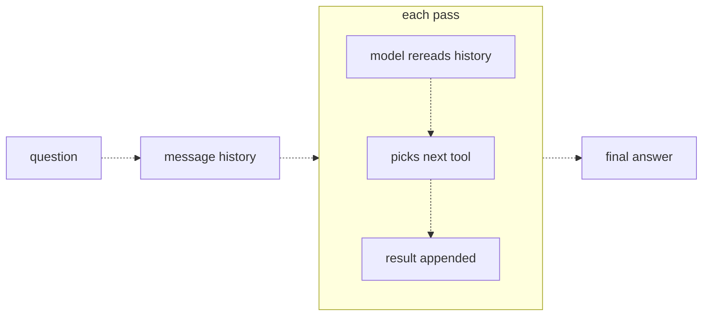
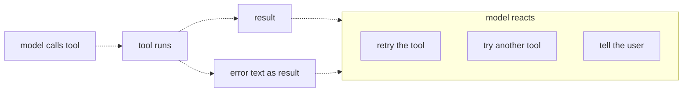
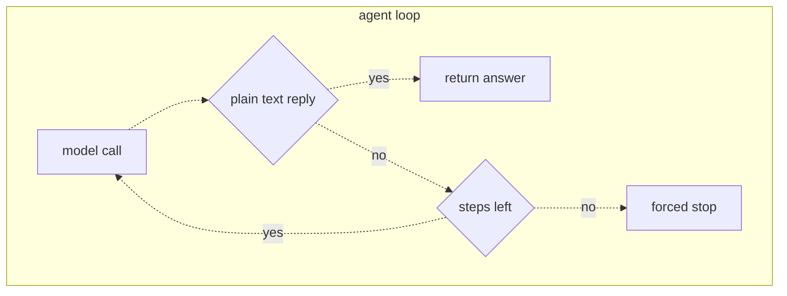

# 21 — Multi-step agents
Source: notes lines 7691–8328; images: Topic 21/Screenshot 2026-10-29 181313.png, Topic 21/Screenshot 2026-10-29 181327.png, Topic 21/Screenshot 2026-10-29 181338.png

## Why it matters
Real customer questions need several dependent tool calls, flaky backends and a guaranteed end. An FDE steers the model's plan through tool descriptions and the system prompt. Tool errors go back to the model as information, and a hard max-steps guard keeps a runaway loop from burning the pilot budget overnight.

## Process / steps
1. Let the plan live in the message history. Each pass, the model rereads the question, past tool calls and results, then picks the single next step. (L1)
2. Steer the plan through two levers: (L1)
   1. tool descriptions, which say what each tool returns (for example "returns the part number needed for stock checks");
   2. a system-prompt recipe for the common case (for example "Always look up the order before checking stock").
3. If a question a human solves in 3 steps takes the agent 8, fix the tool descriptions first. (L1)
4. Wrap each tool call in try/except. On an exception, send `"ERROR: <message>"` back as the tool result; never raise. (L2)
5. Write useful error text: what failed, and what a valid input looks like. (L2)
6. Add a max-steps guard the model cannot override. (L3)
7. When the guard fires, fail loudly with "Stopped after N steps without an answer." Never return half-finished text. (L3)
8. Log the step count per run, and investigate outliers against p95. (L3)
9. Test the failure paths on purpose: a flaky tool (first call fails) and a garbage tool (the guard must fire). (T2, T3)

## Diagrams
**Topic 21/Screenshot 2026-10-29 181313.png** (L1 "Planning multi-step work")

Teaches: the history is the plan. Each pass rereads it, picks one tool and appends the result.

**Topic 21/Screenshot 2026-10-29 181327.png** (L2 "Failure handling and retries")

Teaches: success and failure both come back as a result. The model then retries, tries another tool, or tells the user.

**Topic 21/Screenshot 2026-10-29 181338.png** (L3 "Stopping conditions and runaway loops")

Teaches: plain text returns the answer. Otherwise the loop continues only while steps remain, and then hits a forced stop.

## Rules and numbers
- The agent never writes a plan document. The message history is the plan. (L1)
- A step that depends on earlier data can only run once that result is in the history. (L1)
- The model picks tools by reading their descriptions, nothing else. Vague descriptions produce vague plans. (L1)
- Use the system prompt to hand over the recipe for the common case and leave the model free on others. (L1)
- More steps means more cost and more chances to go wrong. Excess steps usually point to the tool descriptions, not the model. (L1)
- A tool failure is information. Catch it and return the error text as the tool result; don't let the exception escape. (L2)
- Make errors useful. "ERROR: KeyError" is useless. "ERROR: order 9999 not found. Valid ids look like 4412." is useful. (L2)
- Retries are not free: each one is another pass, call and set of tokens. The max-steps guard bounds them. (L2)
- The natural stop (a plain-text reply) depends on the model and is not enough. Add a stop the model cannot override. (L3)
- Pick a small step limit: the steps a human needs for the hardest realistic question, plus a little room. Most lookup agents need **5 to 10, not 50**. (L3) This is a course heuristic, not a measurement: replace it with the measured p95 from the golden-set run once that exists (R102). [Hadavin practice]
- Fail loudly with "Stopped after 8 steps without an answer." Never pass off half-finished text as the answer. (L3)
- Log the step count of every run. If p95 is 3 and a run hits 8, that run is a bug report. (L3)
- A run that has looped 10 times almost never finishes at step 30. More steps only means paying more to stay stuck. (L3)
- Every agent has a max-steps guard, always. (L3)
- You can never validate away every failure in a customer environment. (Q1)

## Decision rules from quizzes
- **Q1. In a demo, a tool raises on a malformed order id and the whole agent crashes with a stack trace.** Catch the exception in the loop and return a clear error message as the tool result. The model can then retry, ask for a correct id, or explain. Traps: pre-validating every input (impossible at a customer), or removing the tool (it removes the feature). The max-steps guard bounds the retries.

## Tasks
- **T1. An agent that must chain two tool calls.**
  - Goal: answer "Is order 4412 delayed, and do we have stock of its part? Name the part number."
  - Method: fixtures are `orders.json` (4412: delayed, part P-77; 4413: shipped, part P-12) and `stock.json` (P-77: 15, P-12: 0). Write `get_order(order_id)` with the description "returns its status and the associated part number needed for stock checks", and `get_stock(part)`. Run the bounded loop (`max_steps = 6`) and write the answer to `answer.txt`.
  - Done: the answer says 4412 is delayed, names part P-77, and reports 15 units in stock. The model chained the calls on its own.
- **T2. Make a tool fail and let the agent recover.**
  - Goal: prove the agent survives a flaky backend.
  - Method: `lookup_price(part)` (P-77 costs 249) uses a call counter, so the first call raises a timeout message and later calls succeed. The loop catches exceptions and sends `ERROR: <msg>` as the tool result. Each tool call appends one line to `run.log` (`... error: <msg>` or `lookup_price ok -> 249`). The final answer goes to `answer2.txt`. The prompt says "Retry if a tool fails."
  - Done: `run.log` shows a failure line, then a success line, and the answer gives $249. The snippet *is* the lesson:
    ```python
    try:
        result = funcs[name](**args)
    except Exception as e:
        result = f"ERROR: {e}"
    ```
    *Hadavin practice (audit E8, 2026-11-01):* `f"ERROR: {e}"` is the course shortcut. Raw exception text from HTTP libraries often contains URLs with tokens or query keys, so in client builds map each exception to a short fixed message plus a code and log the full exception server-side with secrets redacted (proposed R105 addition).
- **T3. Add a max-steps guard.**
  - Goal: watch a runaway loop hit the wall.
  - Method: `check_health(service)` always returns garbage. The system prompt pushes the model to keep calling until it gets a readable status. Ask "Is the payments service healthy?" with `max_steps = 4`, counting passes. If no plain-text answer arrives, the output is `Stopped after 4 steps without an answer.`. Write the output plus `steps used: 4` to `guard_result.txt`.
  - Done: the file shows the stopped message and `steps used: 4`.

## Course → real world
- **Models:** the course uses `deepseek-v4-flash`. Real builds run Claude on the client cloud (Bedrock recommended for AWS after the client has chosen (R446)). Sonnet 5.5 usually runs the loop (tier per R278/R279) and Haiku 5.5 handles cheap screening. Ids are pinned in config. Model ids, tier availability and per-model access criteria change: verify live at project start and date the check (`[unverified 2026-11-01]`). [research 2026-11-01: Anthropic Bedrock docs, seen via audit M] On Bedrock the 5.5 models showed per-model access criteria, not open access: confirm model access in the client account before the pilot starts, and keep a fallback id in config. The Bedrock route for the 5.x models is the Messages-API endpoint; Converse and InvokeModel are not listed on the 5.5 pages and Converse on 5.5 ids is [unverified 2026-11-01], so adapter notes must not assume Converse (audit M1, M2). The `llm` kind needs a second backend or a written outline with a trigger (no single dependency; decisions 2026-11-01 item 7).
- **Errors:** *Hadavin practice:* tool adapters return typed error results with an actionable message and a `retryable` flag. Transport-level retries with backoff live in the adapter, so the model is not the retry engine for plain timeouts. Error text never includes secrets or stack traces, and raw `str(e)` is never passed to the model: map exceptions to a fixed message plus a code, log the full exception server-side with secrets redacted. *Hadavin practice (new rule proposed, audit E5):* adapters retry transient failures (timeouts, 429, 5xx) with bounded exponential backoff plus jitter, honour `Retry-After`, and open a circuit breaker after N failures so a down customer API does not burn every step. The model sees one final readable error, not each attempt. Read-only retries are safe; write retries need idempotency keys (R110).
- **Guard:** *Hadavin practice:* `max_steps` lives in config per agent (5–10 per the course). A forced stop returns an explicit "stopped" result. Run scorecards record step count, tokens and cost, with an alert when a run exceeds p95 by a set margin. Add a per-run token and cost budget beside the step limit.
- **Testing:** *Hadavin practice:* the flaky-tool and garbage-tool scenarios become pytest cases with stubbed adapters, run in CI on every PR. Each pass is traced with OpenTelemetry.
- **Memory:** *Hadavin practice (audit J-13):* for any agent that writes, an episodic record ("ticket already open", "already escalated") is idempotency state, not an optional extra. Memory derived from user, document, event or table content is untrusted input; state written by the system's own audited actions (consent, ledger, audit) is authoritative.
- **Governance:** governed actions only. Each tool is allowlisted with a schema, retries of write actions are idempotent or approval-gated, and every action is audited. The agent sits in the registry with owner, tools and permissions.
- **Per-agent scope in a multi-agent flow (R365, R366):** every sub-agent has its own manifest (tool allowlist, read-only role with column and row grants, egress allowlist) and its own identity; the approver and executor identities belong to no agent, and one agent's grant never widens another's. Passing data between agents keeps the masks of R367 (canary-tested), and a negative test per agent shows its denied tools are refused. [Hadavin practice, owner 2026-11-01, changing needs owner's yes]

## Checklist
- [ ] Tool descriptions state what each returns, including ids needed by the next tool.
- [ ] System prompt gives the recipe for the common case.
- [ ] Every tool call is wrapped; errors go back as readable results with what to fix.
- [ ] Max steps set small (5–10) in config; the forced stop returns an explicit message.
- [ ] Step count logged per run; p95 known and outliers alerted.
- [ ] Flaky-tool and runaway-loop tests pass in CI.
- [ ] No raw exception text reaches the model; adapters retry only transient errors, with backoff, `Retry-After` and a circuit breaker.

## Studio addition 2026-11-02 (unverified source, adopt after own test)

- List what must survive each handoff or escalation and test it with messy cases (R420). Pass the durable work record, not a summary (R444).
- Set a message budget and a rule for who verifies when agents disagree (R442).
- Name the failure layer (model, harness, environment, agent) in every failing case (R427).

Source: Idea from public LinkedIn posts by Moonveil AI quoting others; unverified; we adopt only after our own test.
