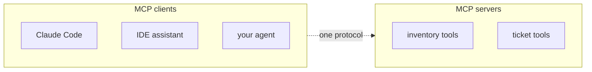
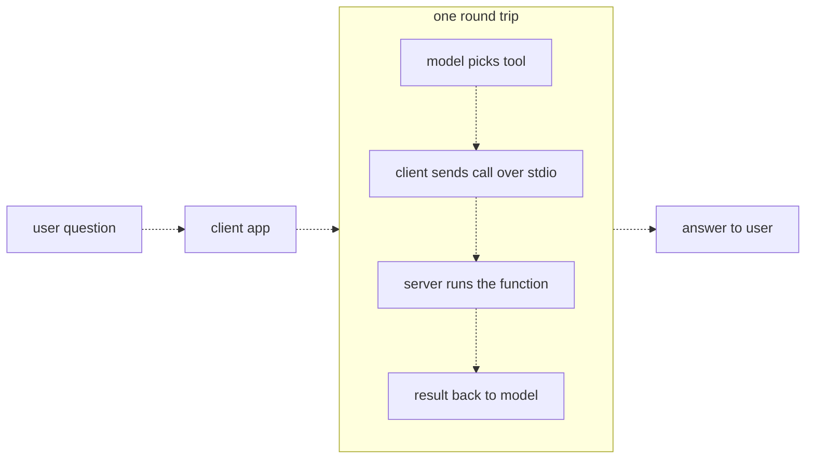
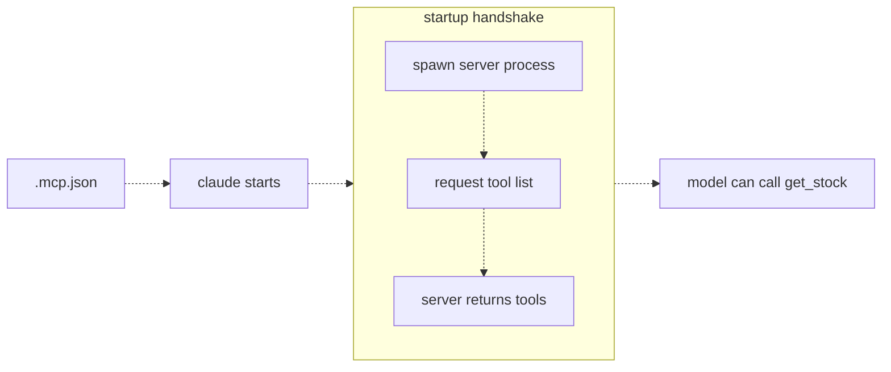

# 22 — MCP
Source: notes lines 8329–8697; images: Topic 22/Screenshot 2026-10-29 181422.png, Topic 22/Screenshot 2026-10-29 181429.png, Topic 22/Screenshot 2026-10-29 181448.png

## Why it matters
MCP (Model Context Protocol) is the standard socket for AI tools. A tool is written once as a server, and any MCP client (Claude Code, an IDE assistant, your own agent) can discover and call it. For an FDE that means reuse across a customer's apps and access to vendor servers (GitHub, Postgres, Slack), instead of weeks of integration. It does not mean safety. The course's own analogy: before socket standards every appliance needed its own wiring job; with a standard wall socket any appliance works in any building, and MCP is the socket shape for AI tools. The problem is the one the industry hit in 2024.

## Process / steps
1. Decide to move a tool into an MCP server when more than one AI app needs it. (L1)
2. Know the three parts: (L2)
   1. **server**: the program holding the tools; it does the real work and talks over stdin/stdout (stdio transport);
   2. **tool**: one function with a name, description, typed parameters and a return value; one server can expose many;
   3. **client**: the AI app, which starts the server as a child process, lists its tools and shows them to the model.
3. Build the server: install the SDK pinned to 1.x as the course does (`uv pip install "mcp<2"`; for client builds see "Course → real world" on 2.x). Create `FastMCP("<name>")` and expose functions with `@mcp.tool()`. The docstring becomes the tool description. Return readable messages, not exceptions. Run with `transport="stdio"`. (T1)
4. Don't run the server in a terminal to chat with it. It waits silently for a client. (T1)
5. Register the server with the client. For the claude CLI the shared, committed form is `.mcp.json` in the project directory (`mcpServers` → name → `command` + `args`), written by hand or with `claude mcp add --scope project <name> -- <command> <args>`. A plain `claude mcp add` uses local scope ("Local scope is the default") and writes the server into `~/.claude.json` under the project's path, not into `.mcp.json`. The course says both roads end in the same JSON (N:8537); that is wrong for the CLI as documented on 2026-11-04 (code.claude.com/docs/en/mcp). Check it at each project start: run a plain `claude mcp add` for a dummy server in a scratch folder, confirm no `.mcp.json` appears, then remove the server with `claude mcp remove <name>`. (L3) [live check 2026-11-04]
6. At startup the client reads `.mcp.json`, spawns each server, requests the tool list, and the server returns tools. The model can then call them. (L3)
7. Test end to end headless: `claude -p "use the get_stock tool to check part X-100"`. In headless runs, pass `--mcp-config`, `--strict-mcp-config` and `--allowedTools mcp__<server>__<tool>`. (L3, T2)
8. Decide which servers to trust. MCP doesn't make tools safe. (L1)

## Diagrams
**Topic 22/Screenshot 2026-10-29 181422.png** (L1 "What MCP is and why a standard matters")

Teaches: many clients reach many tool servers through one protocol.
Text vs image: the `.md` ASCII (lines 8342–8358) swaps the box titles. It labels the box holding Claude Code / IDE assistant / your agent as "MCP servers", and the box holding inventory/ticket tools as "MCP clients". The image is correct and wins: Claude Code, the IDE assistant and your agent are **clients**; inventory and ticket tools are **servers**. The lesson text agrees with the image.

**Topic 22/Screenshot 2026-10-29 181429.png** (L2 "Servers, tools, and the client")

Teaches: it is the same agent loop split in two, with the tool function in a separate process reached over stdio.

**Topic 22/Screenshot 2026-10-29 181448.png** (L3 "Registering a server with a client")

Teaches: registration in `.mcp.json` drives a startup handshake that makes the tool visible to the model.

## Rules and numbers
- MCP is an agreed message format. Clients discover and call tools that live in a separate program. Write the tool once, as a server. (L1)
- MCP standardizes how tools are called, not whether they are safe. A destructive server is one message away from any client. You still choose which servers to trust. (L1, Q1)
- Check for an official vendor MCP server (GitHub, Postgres, Slack and others) before building an integration. (L1)
- The stdio transport means the server runs on the same machine and talks over stdin/stdout. (L2)
- The client and the tool team share only a protocol, not code, language or company. (L2)
- The server author controls tool names, descriptions and parameter types. The description is the only documentation the model gets, and it matters more here because unseen clients use it. (L2, Q1)
- Pin `mcp<2`. mcp 2.x renamed FastMCP (`mcp.server.fastmcp` is gone); the course is written for the 1.x API. (T1) *Superseded for client builds by the revised R114 on 2026-11-01 (see real world below): the `<2` cap is a course-lab workaround, not a permanent rule.*
- A client cannot scan the disk for servers. You must register the command that starts each one. (L3)
- `claude -p` runs load `.mcp.json` too. A headless run is the cheapest end-to-end test of a server. (L3)
- Registration is per directory for `.mcp.json`: a project only gets the tools its own `.mcp.json` grants, which is a feature (L3). Local-scope and user-scope servers in `~/.claude.json` are loaded too, so in headless and CI runs pass `--mcp-config <file> --strict-mcp-config` to load only the named file (R350) [live check 2026-11-04].
- A headless run cannot stop to approve a tool call, so pre-allow the exact tool with `--allowedTools mcp__inventory__get_stock` and use `--strict-mcp-config`. (T2)
- MCP doesn't make code faster, and discovery doesn't write descriptions for you. (Q1)

## Decision rules from quizzes
- **Q1. A customer's order tools live in their Python agent, and they want them in Claude Code and an IDE assistant too.** Moving them into an MCP server makes them one separate process that any MCP client can start and call, so apps connect instead of reimplementing. Traps: thinking MCP removes the need for descriptions, makes tools safe, or makes them faster.

## Tasks
- **T1. Build a small MCP server with one tool.**
  - Goal: make the warehouse inventory reachable from any MCP client.
  - Method: install `mcp<2`. Create `inventory.json` (`{"X-100": 96, "X-200": 40, "X-300": 0}`). Write `inventory_server.py`: `FastMCP("inventory")`, a `@mcp.tool()` function `get_stock(part: str) -> str` with a docstring describing it, which returns the count as a string or a readable "not found" message. Run `mcp.run(transport="stdio")` under `__main__`. Verify by importing the module and calling the function directly, not over stdio.
  - Done: the server file parses, `get_stock("X-100")` gives 96, and an unknown part gives a readable message.
- **T2. Register the server and call the tool through claude.**
  - Goal: test end to end with the claude CLI as the client.
  - Method: in the project dir, write `.mcp.json` with an `mcpServers.inventory` entry (`command: python3`, `args: [<path to inventory_server.py>]`), or use `claude mcp add`. Make one headless call asking the model to use `get_stock` for X-100, with `--mcp-config <.mcp.json> --strict-mcp-config --allowedTools mcp__inventory__get_stock`, and save the output to `stock_check.txt`. Make one call only.
  - Done: `stock_check.txt` contains 96.

## Course → real world
- **Clients:** the course uses the `claude -p` CLI. Real clients are the client team's Claude Code, IDE assistants and the Hadavin agent, running on Claude through the client's own cloud (Bedrock recommended for AWS after the client has chosen (R446)). *Hadavin practice:* for remote shared servers, use the current MCP-spec remote transport behind the client's identity provider (OAuth 2.x / OIDC; cloud IAM-style auth only as an adapter) instead of local stdio. Remote auth and transport names have changed between spec revisions: re-verify the revision at each project start and record the date. [research 2026-11-01: modelcontextprotocol.io/specification/versioning, current protocol version 2026-07-28, stateless with the version carried per request; seen via audit M12] On Bedrock, the Anthropic MCP connector is not available, so MCP there is client-side only (audit M10). Spec 2026-07-28 deprecates Roots, Sampling and Logging (earliest removal on or after 2027-07-28), Dynamic Client Registration and HTTP+SSE; the MCP Registry is in preview and does not support private servers [research 2026-11-01: modelcontextprotocol.io/specification/2026-07-28/deprecated and /registry/about].
- **SDK version (supersedes the `mcp<2` pin for client builds, audit E1):** [research 2026-11-01: MCP Python SDK v2.0.0 stable released 2026-07-28; `FastMCP` renamed `MCPServer`; `pip install mcp` now installs 2.x; v1.x kept for security fixes; sources https://github.com/modelcontextprotocol/python-sdk/releases/tag/v2.0.0 and https://py.sdk.modelcontextprotocol.io/migration/ ; the migration guide and the "what's new" page disagree on the import path (`mcp.server.mcpserver` vs `mcp.server`), so check the installed package] Pin the exact version in the lockfile. New client builds use the current stable line after reading the live migration guide; keep `mcp<2` only for course-style code. Re-verify at each project start.
- **Trust:** *Hadavin practice:* an MCP server is a tool supplier, so it goes through the same governance as any tool. It needs an allowlist entry per tool, a schema, approval for risky tools and an audit log. It is registered in the agent registry with owner and permissions. Install only vendor or first-party servers that are fully legit; any doubt means don't install. Pin server versions.
- **MCP-specific threats (audit E4, proposed R116 extension):** *Hadavin practice:* treat MCP tool descriptions and results as untrusted input, because a malicious or compromised server can inject instructions through them (tool poisoning), and a description can change after approval (rug pull). Pin server versions and hash the tool list so a changed description fails CI. A stdio server is a local process with the user's full privileges: run it in a sandbox or container with least privilege. Review descriptions at install time and on every version bump. See also the lethal-trifecta rule (R306).
- **Least privilege:** each server runs with its own identity under R365 (deny-all start, read-only unless it writes, short-lived credentials, never shared), and is granted per agent, never fleet-wide (R366). Secrets come from the studio secrets kind (named lookup; default a self-hostable store or runtime-injected environment variables set by the deploy system; adapters for AWS SSM/Secrets Manager, Azure Key Vault, GCP Secret Manager) at start, never from `.mcp.json` committed to the repo.
- **Per-project scope:** keep `.mcp.json` per project and grant only the tools that project needs. In headless or CI runs, use `--strict-mcp-config` with explicit `--allowedTools`. Whatever the client, headless and CI runs deny by default and pre-allow exact tools; the claude CLI flags are the example, not a client-agnostic rule, and they were not re-verified live (`[unverified 2026-11-01]`, audit E18).
- **Engineering:** *Hadavin practice:* server code is a typed package (uv, ruff, pytest) whose tool functions are unit-tested directly (the T1 pattern). There is an end-to-end headless test (the T2 pattern) in CI, and every tool call is traced.
- **Per-agent MCP grants (R365, R366):** an MCP server is granted to the agents that need it, never fleet-wide, and each server has its own identity (read-only unless it writes, short-lived credentials, not shared with another server or agent). A server that holds a credential or reads a cluster is a named row in the identity table. A negative test shows an agent without the grant cannot call the server or its tools. [Hadavin practice, owner 2026-11-01, changing needs owner's yes]

## Checklist
- [ ] Confirmed more than one client needs the tool, or that an official vendor server exists.
- [ ] SDK version pinned exactly in the lockfile (current stable line for client builds, `<2` only for course-style code); server uses the stdio or HTTP transport as appropriate.
- [ ] Tool descriptions and results treated as untrusted; tool list hashed so a changed description fails CI; stdio servers sandboxed.
- [ ] Every tool has a clear docstring/description and typed params, and returns readable errors.
- [ ] Server registered per project; headless runs use strict config and explicit allowed tools.
- [ ] Server reviewed for trust: least-privilege account, allowlist, approval for risky tools, audit log.
- [ ] Each MCP server has its own identity row in the identity table, is granted per agent, and a negative test shows an ungranted agent is refused (R365, R366).
- [ ] End-to-end headless test passes.
