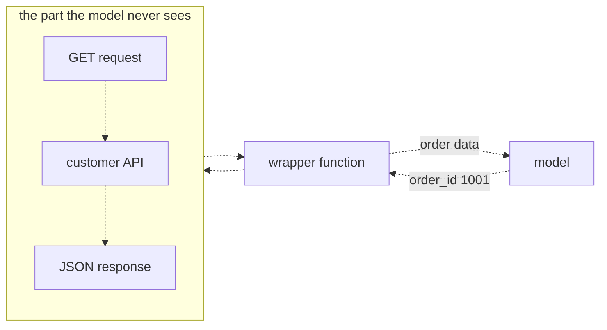
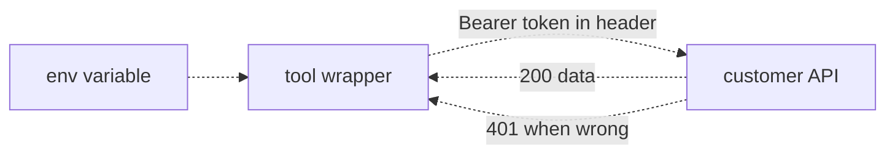

# 23 — Connecting to customer APIs
Source: notes lines 8698–9279; images: Topic 23/Screenshot 2026-10-29 181523.png, Topic 23/Screenshot 2026-10-29 181538.png

## Why it matters
Customer data lives behind HTTP APIs (orders, ticketing, CRM). The model never speaks HTTP; a small wrapper function does. The difference between a demo and a product is trimmed responses, readable errors, timeouts, secrets kept out of code and out of the model's view, and a scoped service account rather than someone's personal key.

## Process / steps
1. Write a wrapper: a function that takes clean params, makes the HTTP request and returns the useful part. Register it like any local tool. (L1)
2. Apply the three habits: (L1)
   1. return only the fields the model needs;
   2. turn HTTP errors into readable tool results (404 becomes "order 1001 not found");
   3. add a timeout (`urlopen(url, timeout=5)`).
3. Use stdlib `urllib`. At customer sites you often cannot install packages. (L1)
4. If the real API is unreachable, prototype against a local mock with the same response shape. (T1, Q1)
5. Authenticate: send a bearer token in the `Authorization: Bearer <token>` header on every request. (L2)
6. Keep the token out of code: read it from the environment with `os.environ`. (L2)
7. Ask "whose credentials?" Request a dedicated service account with the smallest permissions that make the demo work. (L2)
8. Keep secrets out of the model's view: never in a prompt or a tool result. (L2)
9. Turn 401 and 404 into readable errors. (T2)
10. *Hadavin practice (audit E3, E6):* treat every tool argument as untrusted input before it reaches a URL, path or SQL string (see "Course → real world").

## Diagrams
**Topic 23/Screenshot 2026-10-29 181523.png** (L1 "Wrapping a REST endpoint as a tool")

Teaches: the model passes a clean parameter and gets back order data. The HTTP request and the raw JSON stay inside the wrapper.
Text vs image: the ASCII (lines 8720–8736) draws the GET request → customer API → JSON response chain without arrowheads. The image shows it as directed downward. The image wins; otherwise they are the same.

**Topic 23/Screenshot 2026-10-29 181538.png** (L2 "Auth: keys, tokens, and whose credentials")

Teaches: the token comes from the environment and travels in the header. The API answers 200 with data or 401 when the token is wrong or missing.

## Rules and numbers
- The model never speaks HTTP; the wrapper does. From the model's side, a tool is a tool. (L1)
- Return only what the model needs. APIs often send 40 fields of internal ids and timestamps, and every field costs tokens on every call and buries the signal. (L1)
- Turn HTTP errors into readable tool results. This is the agents-topic failure rule applied to the network. (L1)
- Always set a timeout; `timeout=5` is the course value. A hanging API hangs the whole agent run. (L1)
- Prefer stdlib `urllib`; it is always there and does everything a wrapper needs. (L1)
- An unauthenticated request to a real API gets `401 Unauthorized`. (L2)
- Send the bearer token in the `Authorization` header, the same shape as `Bearer $OPENAI_API_KEY`. (L2)
- Never put the token in code. Use an environment variable read with `os.environ`. No exceptions at a customer site. (L2)
- Prefer a service account (dedicated, scoped, for example read-only on orders, revocable alone) over a person's token. A person's token gives the agent all their power and muddies the audit log. (L2)
- Ask for the smallest permissions that make the demo work. Customers respect the question. (L2)
- Never put a token in a prompt or a tool result; everything the model sees can end up in a reply or a log. (L2)
- The secret string must not appear anywhere in the agent file; the course checks this with a grep count of 0. (T2)
- Read-only tokens still leak real customer data, so they must not be committed either. (Q2)
- Gap in the course code (audit E3): `url = f"http://localhost:8080/orders/{order_id}"` interpolates a model-supplied value straight into the URL. A value such as `../admin` or `1001?x=` becomes path or query injection, and a tool that takes a whole URL becomes SSRF. The mock's `parts[1] in ORDERS` check hides the problem. [Hadavin practice]

## Decision rules from quizzes
- **Q1. The platform lead offers his personal admin key (read, write and delete everything) so the demo isn't delayed by a week of IT setup. The assistant only needs to read tickets.** Ask for a read-only service account now, and build against a local mock of the ticket API meanwhile so the demo date holds. Swap in the real endpoint when the scoped account arrives. Traps: "admin key for the demo only", "admin key in an env var with a TODO comment", and refusing outright and pushing the demo out a week. The course marks this one "Best choice" (a judgement call where several options are partly acceptable), not "Correct".
- **Q2. A bearer token is hard-coded in the Python file. Why is that a problem if it runs?** The file gets committed, shared and copied, leaking a credential to anyone who reads it, so the token belongs in an environment variable. Traps: the API can't tell where the token came from, there is no speed impact, and read-only tokens are not safe to commit.

## Tasks
- **T1. Wrap a local mock API as a tool.**
  - Goal: prototype against a customer orders API.
  - Method: save the mock exactly as `/root/customer-apis/mock_api.py` (seed data: notes lines 8759–8784) and run the stdlib `http.server` mock on 127.0.0.1:8080 in the background. It serves orders 1001 (shipped, 84.50), 1002 (processing, 12.99) and 1003 (cancelled, 230.00), and returns a 404 JSON otherwise. Write `get_order(order_id)` using `urllib.request.urlopen(url, timeout=5)`. It returns only id, status and total; 404 becomes `ERROR: order <id> not found`, other HTTP codes become `ERROR: HTTP <code>`, and other exceptions become `ERROR: <e>`. Run the bounded loop (`max_steps = 6`) with the question "What is the status of order 1001?" and write `answer.txt`.
  - Done: the answer says 1001 is shipped ($84.50) while the mock is still running.
- **T2. Add token auth to the tool wrapper.**
  - Goal: authenticate the right way.
  - Method: save the auth mock exactly as `/root/customer-apis/auth_api.py` (seed data: notes lines 9013–9043) and run it on port 8081 in the background. The mock's token is `demo-secret-123`, and it serves only orders 1001 and 1002. It returns 401 unless the header is exactly `Bearer <token>`. The wrapper `/root/customer-apis/auth_agent.py` reads `ORDERS_API_TOKEN` via `os.environ`, builds a `urllib.request.Request` with the Authorization header, and maps 401 and 404 to readable errors. Export the variable in the shell, run the loop with "What is the status of order 1002?", and write `auth_answer.txt`.
  - Done: the answer says 1002 is processing ($12.99), and `grep -c "demo-secret-123" /root/customer-apis/auth_agent.py` returns 0 (the string must not appear anywhere in that file).

## Course → real world
- **Connectors:** mock stdlib APIs become real connectors to the client's REST/GraphQL SaaS. *Hadavin practice:* one adapter interface per system with typed request and response models. Field trimming happens in the adapter. Timeouts, bounded retries with backoff, and readable typed errors are standard. Retries cover transient failures only (timeouts, 429, 5xx) with jitter, honour `Retry-After`, and open a circuit breaker after N failures; typed errors carry `retryable: bool`; the model sees one final readable error (proposed new rule, audit E5). List results are capped and paginated (max N items plus a "more available" flag) and trimmed with a field allowlist, never a denylist (extends R117). Adapters are tested against a recorded mock with the same shape, the course's mock-first pattern.
- **Secrets:** this does not contradict the course: the course's `os.environ` is runtime injection, and code never contains the token. Env FILES are never committed. Secrets sit behind the studio secrets kind (named lookup): the default is a self-hostable store or environment variables injected by the deploy system; adapters cover AWS SSM SecureString / Secrets Manager, Azure Key Vault and GCP Secret Manager, fetched at runtime by the workload's identity (proposed R15 wording, audit E2). CI scans for secrets on every PR. A token never enters a prompt, tool result, log line or trace attribute.
- **Credentials:** *Hadavin practice:* always a dedicated identity per system under R365 (deny-all start, read-only unless a governed write action is approved, exact resources and actions, short-lived credentials where the system allows, never shared), with its row in the identity table (read rights, write rights, justification, negative test). Its scope is recorded in the agent registry. Personal or admin keys are never accepted, even for a demo; build against a mock until the scoped account arrives.
- **Untrusted tool arguments (audit E3, proposed new rule):** *Hadavin practice, source: topic 23 L1 gap plus OWASP:* validate each argument against a schema or allowlist pattern (for example `^[0-9]{1,12}$`), URL-quote path segments (`urllib.parse.quote(x, safe='')`), fix host and scheme in config and never take them from model input, and use parameterised queries for SQL. Add a test with `../`, `?`, `#` and `%2f` payloads that must be rejected.
- **Actions:** writes through APIs are governed actions. Each one is allowlisted with a schema, needs human approval if risky, and is audited with the service-account identity, so agent actions are distinguishable from people's.
- **Models:** the course runs on `deepseek-v4-flash` via the gateway. Real builds use Claude on the client cloud with ids pinned in config.
- **Masking at the connector (R367):** fields that carry PII, secrets or identifiers are masked or tokenised at the connector, before the model, the logs and the audit trail; seed canary values in the mock and fail CI if one appears downstream. [Hadavin practice, owner 2026-11-01, changing needs owner's yes]

## Checklist
- [ ] Wrapper returns only needed fields and sets a timeout.
- [ ] 401, 404 and other HTTP errors map to readable tool results.
- [ ] Tool arguments validated against an allowlist, path segments quoted, host from config; injection payload test passes. List results capped and paginated.
- [ ] Token comes from the client's secret store; grep or secret scan finds no secret in the repo.
- [ ] No secret appears in prompts, tool results, logs or traces.
- [ ] Dedicated identity requested under R365, never a personal or admin key; its identity-table row (read, write, justification, negative test) is filled and the negative test passed; masks canary-tested (R367).
- [ ] Mock with the real response shape exists, so work isn't blocked on access.
