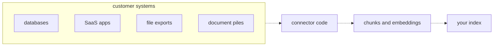
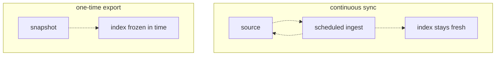
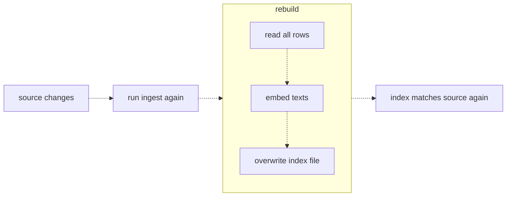

# 24 — Getting data out of customer systems
Source: notes lines 9280–9856; images: Topic 24/Screenshot 2026-10-29 181654.png, Topic 24/Screenshot 2026-10-29 181704.png, Topic 24/Screenshot 2026-10-29 181721.png

## Why it matters
Customer knowledge never arrives as clean text files. It sits in databases, SaaS apps, file exports and piles of documents. Every source needs a connector that the FDE usually writes. A one-time export goes stale silently, so freshness (sync or re-index, plus a build stamp) decides whether the assistant stays honest.

## Process / steps
1. In the first meeting, ask "Where is the knowledge your assistant should search?" and map each answer to one of four homes: databases, SaaS apps, file exports or document piles. (L1)
2. Ask for the smallest useful source first. For example, one CSV export of support tickets can power a prototype in a day; the Confluence integration can wait. (L1)
3. Write one connector per source as a new left side on the same pipeline: read, turn records into text, embed, store. The output shape stays the same. (L1)
4. Choose export or sync per source by asking two questions: (L2)
   1. how fast does it change?
   2. how bad is a stale answer?
5. For fast-changing data such as order status, use sync, or keep it out of the index and answer through a live API tool. (L2)
6. For a pilot, start with an export, and tell the customer it is a snapshot from a named date that will get a sync before production. (L2)
7. Design ingest to be re-runnable from day one by overwriting the output, never appending. (L2, L3)
8. When the source changes, re-run ingest with a full rebuild: read all rows, embed the texts, overwrite the index file. (L3)
9. Stamp the index with `built_at`. (L3)
10. Schedule ingest as often as staleness hurts. A nightly cron covers most pilots. (L3)
11. Switch to incremental updates (updated-at or text hash) only when the embedding bill demands it. (L3)

## Diagrams
**Topic 24/Screenshot 2026-10-29 181654.png** (L1 "Where enterprise data actually lives")

Teaches: nothing flows into the index by itself. Connector code is the bridge from the four homes into the pipeline you already have.

**Topic 24/Screenshot 2026-10-29 181704.png** (L2 "One-time export vs continuous sync")

Teaches: sync loops between the source and a scheduled ingest to keep the index fresh. An export is a one-way snapshot frozen in time.

**Topic 24/Screenshot 2026-10-29 181721.png** (L3 "Data freshness and re-indexing")

Teaches: the index is a build artifact. When the source changes, rebuild it fully and overwrite it.

## Rules and numbers
- Almost every source falls into four groups: databases (SQL, usually the freshest data), SaaS apps (vendor API and format), file exports (CSV and Excel on a schedule, often the easiest first source), and document piles (PDF and Word, rich content, worst structure, no API). (L1)
- Every source needs a connector. The right side of the pipeline (chunking, embeddings, store) never changes. (L1)
- Ask for the smallest useful source first. (L1)
- A one-time export is cheap, fast and has zero moving parts, but it is frozen and gets more wrong every day. (L2)
- Continuous sync stays close to the truth but is a running system someone must own, monitor and fix. (L2)
- Slow-changing data (a policy handbook a few times a year) can use an export plus a calendar reminder to re-ingest. (L2)
- Data changing by the minute (order status) needs sync, or stays out of the index and goes through a live API tool. (L2)
- The higher the cost of a stale answer (a wrong price means money and trust lost), the stronger the case for sync. (L2)
- The failure mode is not the export but an export everyone silently treats as live. Say the snapshot date out loud. (L2)
- A stale index fails silently. There is no error, scores look fine, and users notice before the logs do. (L3)
- The index is a build artifact like a compiled binary: if the source changed, rebuild it. (L3)
- A full rebuild is fine for hundreds or a few thousand records, and it can never be half-updated. (L3)
- Incremental re-embedding saves cost but adds change-tracking bugs that produce a half-stale index. Earn the complexity only when the embedding bill demands it. (L3)
- Make ingest re-runnable by overwriting, not appending. (L3)
- Stamp the index with `built_at`, so "the index is from last Tuesday" becomes a diagnosis instead of a mystery. (L3)
- A nightly cron covers most pilots. (L3)
- Embedding vectors do not decay, and no similarity threshold surfaces data that was never ingested. (Q1)
- Course numbers: `text-embedding-3-small` gives 1536-dim vectors. The CSV task is 5 embedding calls, "well inside budget". (T1)

## Decision rules from quizzes
- **Q1. A pilot built from a March CSV quotes old prices in May, but the metrics and logs show no errors.** The index is a frozen March snapshot, and retrieval works perfectly over stale data. Re-run ingest on a schedule matched to how fast prices change, and stamp the build time. Traps: lowering the similarity threshold, blaming CSV versus database, or thinking embeddings degrade.

## Tasks
(The notes label the second task "Task 1" by mistake; it is the second of three.)
- **T1. Ingest a CSV export into the index.**
  - Goal: turn a support-ticket export into the JSON vector store.
  - Method: save the export exactly as `/root/connectors/tickets.csv` (seed data: notes lines 9391–9396); it holds 5 tickets T-1..T-5 with columns id, subject, body. Script `/root/connectors/ingest_csv.py` reads the rows with `csv.DictReader`, builds one text per ticket as `"<subject>: <body>"`, embeds with `text-embedding-3-small`, and writes `index.json` as an array of `{id, text, embedding}`.
  - Done: 5 entries, each with a 1536-length embedding.
- **T2. Ingest from a SQLite database.**
  - Goal: same index shape, new left side.
  - Method: the seed script creates `kb.db` with table `articles(id, title, content)` holding KB-1..KB-4. Connect with stdlib `sqlite3` and run `SELECT id, title, content FROM articles`. Build `"<title>: <content>"`, embed, and write `db_index.json` with `{id, text, embedding}`.
  - Done: 4 entries in the same shape as the CSV index.
- **T3. Update the index after the source changes.**
  - Goal: fix drift and add a freshness stamp.
  - Method: run `update_source.py`, which changes KB-3's webhook timeout from 5 to 10 seconds. Change `ingest_db.py` to write an object `{built_at: <datetime ISO string>, entries: [...]}`, then re-run the full rebuild into `db_index_v2.json`.
  - Done: `db_index_v2.json` has `built_at`, 4 entries, and KB-3 text with "within 10 seconds".

## Course → real world
- **Store:** JSON-file stores become pgvector (neutral, self-hostable default when the client runs Postgres) or a managed store in the client's cloud such as Bedrock Knowledge Bases on S3 Vectors (S3 Vectors GA 2025-12-02, seen via audit M17; verify live at project start and date it). Keep the record shape id + text + vector + metadata. *Hadavin practice:* metadata always includes `source`, `source_id`, `source_updated_at`, `built_at`/`ingested_at` and the access list (see topic 19).
- **Connectors:** real connectors read the client's databases (read-only replica or least-privilege SQL user), SaaS APIs (Confluence, Jira, Salesforce, Slack via service accounts) and file drops (an S3 prefix or SFTP). Secrets sit behind the studio secrets kind (named lookup; self-hostable or injected default, cloud adapters). *Hadavin practice:* use one connector interface (`read_records()` → normalized records) with a backend per source type, so chunk, embed and store are shared code. Bedrock KB data-source sync covers S3 and supported SaaS sources where that fits (`[unverified 2026-11-01]`; check the live list). *Hadavin practice (audit E12, extends R123):* connector output carries `source`, `source_id`, `source_updated_at` and the access list, and a PII scan and data-residency check run in the connector before any text goes to an embedding endpoint.
- **Freshness:** *Hadavin practice:* pilots start from a dated export, and the snapshot date is written into the pilot doc and shown in the UI or answer footer. Before production, run scheduled sync (a cloud scheduler such as EventBridge Scheduler, or a plain cron job as the neutral default; nightly by default) with an owner, a failure alert, and a staleness alarm when `built_at` exceeds the agreed age. Show `built_at` in the answer footer or UI, and optionally plant one canary record changed at the source that must appear in the index within the agreed time, to prove sync works end to end (audit E20, extends R126). Minute-level data (order status, prices) goes through live API tools, not the index.
- **Rebuilds:** *Hadavin practice:* use a full rebuild into a new index version, then switch atomically, so readers never see a half-built index. Move to incremental (content hash) only when embedding cost justifies it, as the course says. Incremental sync must also handle deletions (tombstones or a full diff of ids) and permission changes at the source (re-index or a live check); test with one deleted and one re-permissioned record (audit E11, extends R127).
- **Models:** embeddings use the client cloud's model (for example Cohere Embed v4 or Titan on Bedrock; availability and price `[unverified 2026-11-01]`, third-party sources put Embed v4 near US$0.12 per 1M tokens, confirm on the vendor page), pinned in config. Changing the embedding model means a full re-embed.

## Checklist
- [ ] Every knowledge source mapped to one of the four homes, with an owner and access path.
- [ ] Started with the smallest useful source.
- [ ] Each source has export-or-sync decided by change rate and cost of staleness.
- [ ] Ingest is re-runnable (overwrite or versioned swap), never append.
- [ ] Index carries a `built_at` stamp; staleness is monitored and alerted.
- [ ] Customer told the snapshot date, with sync planned before production.
- [ ] Deletions and permission changes handled by incremental sync; PII scan and residency check run before embedding.
- [ ] Fast-changing data served by live API tools, not the index.

## Studio addition 2026-11-02 (unverified source, adopt after own test)

- Flattening tax: check what the export flattened (joins, hierarchy, history) before blaming the model (R435).

Source: Idea from public LinkedIn posts by Moonveil AI quoting others; unverified; we adopt only after our own test.
