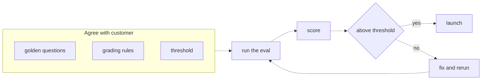

# 25 — Why evals
Source: notes lines 9857–10001; images: Topic 25/Screenshot 2026-10-29 181755.png

## Why it matters
"The demo looked great" is an anecdote, not evidence. The FDE turns "it should be accurate" into a measurable contract: golden questions, grading rules and a threshold, agreed with the customer before much is built. That contract is the definition of done and it protects both sides.

## Process / steps
1. Treat demo impressions as anecdotes. Ask: "on how many questions did we test it, and what was the score?" (L1)
2. Build evidence: a fixed list of test questions with known correct answers, a pass/fail grading method and a trackable score (e.g. "42 out of 50"). (L1)
3. Early in the project (week 1–2), agree three things with the customer (L2):
   1. **The questions**: a fixed set of real questions, collected with the customer (the golden dataset).
   2. **The grading rule**: what a correct answer must contain, written down.
   3. **The threshold**: the score that means "ready", e.g. ≥ 85 percent.
4. Run the eval → get a score → compare it to the threshold. (L2 diagram)
5. Above the threshold → launch. Below it → fix and rerun the eval. (L2 diagram)
6. Run status meetings on the score trend and the failing questions, e.g. "78 last week, 84 this week, six still failing". (L2)

## Diagrams
### 25.1 `../../Geeta or Bible for claude FDE/fde-diagrams-workflows images/Topic 25/Screenshot 2026-10-29 181755.png`

Teaches: the eval is a loop against an agreed bar. The three agreements come first, and launch happens only when the score clears the threshold.

## Rules and numbers
- Never treat a few good demo answers as proof; three questions is noise. (L1)
- Expect demo questions to be friendly and real users to be vague, ask about edge cases and ask out-of-scope questions. A demo-perfect assistant can fail on a third of real traffic. (L1)
- Do not trust "it felt right": LLMs are fluent and confident even when wrong. (L1)
- Evidence is a number you can measure again tomorrow and get a comparable result. (L1)
- Treat the eval like a test suite: never push a change and say "it feels fine". (L1)
- Do not be negative about demos: they show what is possible, but they are the wrong tool for readiness decisions. (L1)
- Agree on questions, grading rule and threshold before building much. Example threshold: 85 percent. (L2)
- Measure on the customer's own questions, not on a vendor benchmark. (L2)
- Without an agreed threshold, the goal silently becomes "perfect". With one: "we agreed on 85, we are at 88, we are done". (L2)
- Neither side moves the goal later without a conversation. (L2)
- Agree all of this in the first week or two. Never negotiate the threshold the day before launch. (L2)
- The customer's SMEs own the truth (expected answers); the FDE owns the machinery (format, runner, schedule). (Q2)
- Public benchmarks measure general ability, not this customer's questions. (Q3)

## Decision rules from quizzes
- **Q1. A VP tries 3 prompts and wants to roll out to 400 dispatchers next week.** Agree the answers look promising, then propose a test set of 15–20 real dispatcher questions with known answers and share the score before the rollout decision. Why: it keeps momentum and goodwill and swaps the anecdote for evidence. The set takes about a day to build. *Hadavin practice (audit F2):* the course calls a 15-20 question set "solid enough to bet a 400 person rollout on". By R326, even 20 of 20 only supports a true rate of at least 83.1%, so this set is a smoke check that starts the conversation within a day. The rollout decision itself needs the contract-sized gating set (R163, R326) and a staged rollout (a pilot group first), never 400 users on a 20-item score. Traps: saying yes gambles the engagement on 3 answers; refusing outright ("not statistically meaningful") damages the relationship; "try ten more live" still grades by feel.
- **Q2. Medical devices company: who writes the expected answers (20 questions, calibration and regulatory wording)?** The customer's SMEs write or approve every expected answer; the FDE builds the dataset format and the runner and keeps the process moving. Why: only the experts know the truth, and their sign-off makes them trust the score. Traps: an FDE-written key inserts your own gaps; an untouched LLM-written key can share bugs with the system under test. LLM draft plus expert review is workable for *large* datasets, but for 20 questions direct expert authorship is cleaner.
- **Q3. "Everyone who tried it says the answers are great."** The problem: a small, friendly sample with no fixed questions, no answer key and no score you can compare over time. Why: it is an anecdote. Seniority, user count and public benchmarks are not the issue.

## Tasks
None in this topic.

## Course → real world
- *Hadavin practice (audit F1):* sample sizes. 10-20 questions is the course's pilot/smoke size and is reported as "smoke, n = ...". A set that gates a contract threshold has 50 or more cases (R163, R326).
- Hadavin writes the three agreements into the SOW/pilot plan as acceptance criteria: the golden set file and its version, the grading rule per question and the numeric threshold. The client's lead signs them in week 1. Hadavin compresses the calendar but never skips this step. (Hadavin practice)
- The golden set is built from the client's real questions (tickets, chat, search logs). Client SMEs author or approve every expected answer, and the sign-off is recorded next to the file. (Hadavin practice)
- The eval runs in CI on every PR. Weekly status reports show score, trend and named failures, not impressions. (Hadavin practice)
- The agreed threshold lives in config as the CI gate value, never as a literal in code. Changing it needs a written client decision. (Hadavin practice)

## Metric menu by system type (names only, no thresholds)
[Hadavin practice, from audit J-06, derived from the architecture book chapters 2-11; tag each metric code / judge / human; pick the two or three highest-signal for the contract]
- **Answering agent:** recall@k, precision@k, MRR, faithfulness, citation support, tool-selection accuracy, argument accuracy, tool success, injection resistance, PII leak, escalation precision and recall, false-deflection rate, resolution rate, pass^k.
- **Permission-scoped research:** add permission-leak rate, ACL-filter correctness, cross-tenant leak (must be zero), citation faithfulness, sub-question coverage, multi-hop convergence.
- **Ask-your-data (text-to-SQL):** schema-linking table and column recall and precision, SQL validity, execution accuracy against a gold query, exact-set match, answer-addresses-question, read-only-block rate, restricted-row leak, abstention precision and recall, false-answer rate, self-correction rate, query cost.
- **Extraction and decisioning:** field accuracy, total-reconciliation rate, confidence calibration, duplicate-catch rate, rule-application accuracy, false approve and false deny (separately), audit completeness, escalation precision and recall, straight-through rate.
- **Event screening:** rule precision and recall, policy-retrieval recall, verdict accuracy, false-positive rate (a budget), false-negative rate, baseline drift, human-queue volume, event-to-decision latency.
- **Coding:** file-localisation recall, patch-apply rate, files-touched precision, iterations-to-green, suite-wide regression rate, resolution rate, pass^k, cost per resolved task, unsafe-command and secret-exposure rate.
- **Outreach and scoring:** field coverage and accuracy, qualification precision and recall, claim faithfulness (fabrications near zero), suppression leak (zero), opt-out element present, edit distance, reply and complaint rates.
- **Voice (only if sold):** WER and entity error rate, endpoint accuracy, false barge-in, response-to-barge-in time, dead air, time-to-first-audio p50/p95.

**Escalation and abstention metrics (audit J-02, proposed R324 addition):** deflects when it should hand off = escalation recall (and false-deflection rate); escalates the easy ones = escalation precision and straight-through rate; answers an unanswerable question = false-answer rate; abstains on an answerable one = false-abstain rate (R191). Measure on a labelled should-answer / should-escalate set.

**Two-sided live rates (audit J-03, proposed R329 addition):** escalation, abstention, referral and handoff rates have a floor and a ceiling. Too high means the system is not helping; too low means it is over-containing. Alarm on both; set the band from the pilot baseline (R250).

## Checklist
- [ ] Golden questions, grading rule and threshold agreed with the customer and written down in week 1–2.
- [ ] Customer SMEs own (wrote or approved) every expected answer; sign-off recorded.
- [ ] The threshold is a number in the agreement, not "accurate".
- [ ] Every readiness claim in meetings is backed by a score on the golden set, not a demo.
- [ ] A loop is in place: run eval → score → compare → launch or fix and rerun.

## Studio addition 2026-11-02 (unverified source, adopt after own test)

- Evals belong in discovery: accepted outcome, acceptance criteria and a regression view before the first feature (R439).
- Say where the grade comes from: human rubric, judge model or the client's downstream decision (R432).
- Builder and reviewer are not the same; someone or something outside the build can say no (R428). Failure layer named per failing case (R427).

Source: Idea from public LinkedIn posts by Moonveil AI quoting others; unverified; we adopt only after our own test.
