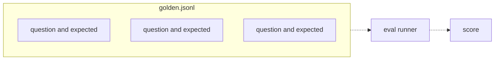

# 26 — Golden datasets
Source: notes lines 10002–10457; images: Topic 26/Screenshot 2026-10-29 181818.png

## Why it matters
The golden dataset is the single most valuable file in the engagement. Its answers are the truth: when the assistant disagrees with them, the assistant is wrong. It must look like real traffic (messy wording, hard cases and traps), or the eval scores high while users suffer.

## Process / steps
1. Store the set as JSONL: one JSON object per line, each with `question` and `expected`. (L1)
2. Keep it to 10–20 questions for a pilot. (L1)
3. Start with clean questions written from the docs (Task 1). (L1, T1)
4. Source real questions from the customer's pile (L2):
   1. Support tickets (the best source; the agent's reply often holds the answer).
   2. Chat and email logs.
   3. Search logs (what people could not find).
   4. The support team's memory ("what do people ask every week?" → top ten).
5. Skim a recent slice (e.g. the last hundred tickets), pull out questions that repeat or look hard, and keep the user's original wording, typos and all. (L2)
6. Pair each with an expected answer confirmed by a domain expert, usually taken from the agent's reply. (L2)
7. Deduplicate: each problem appears once. (T2)
8. Balance three buckets: easy, hard and out-of-scope traps. (L3)
9. Write trap entries whose `expected` field describes the refusal. (L3, T3)
10. Grow the set after launch: every real failure goes in with its correct answer. (L1)

## Diagrams
### 26.1 `../../Geeta or Bible for claude FDE/fde-diagrams-workflows images/Topic 26/Screenshot 2026-10-29 181818.png`

Teaches: the golden file is a list of question+expected lines, and an eval runner streams it into one score.

## Rules and numbers
- Format: JSONL, one object per line, with `question` and `expected`. Line-based tools work on it: `wc -l` counts cases, `grep` finds one, `head -3` samples, and the runner streams it. (L1)
- Size: 10–20 questions for a pilot, not hundreds. Every question costs expert effort plus model calls per run. Twenty well-chosen beat two hundred careless, and you can read all twenty failures. (L1)
- The set grows: every post-launch failure on a real question is added with its correct answer. It is a living record of everything that has gone wrong. (L1)
- Never quietly delete a test case because the assistant keeps failing it. If a question is ambiguous, fix the question or the expected answer *with the customer*. (L1)
- Desk-written questions are the weakest kind ("born from the answer"). Real users phrase from the problem side. (L2)
- A set of only clean, desk-written questions can score 95 percent while real users fare much worse. (L2)
- Keep the original user wording and typos: the assistant must handle the question as typed. (L2)
- Target mix: a few clean doc questions plus a majority of messy real ones. (L2)
- Three buckets (L3):
  - **Easy**: one clear answer in one place; these are smoke tests.
  - **Hard**: vague wording, typos, answers split across sections, or details that change the answer (18 kg bike vs 40 kg machine part).
  - **Out of scope**: the docs do not answer it, so the bot must say so, not guess.
- Trap questions test hallucination, the most expensive failure. With no traps, the eval is blind to it. (L3)
- A trap's `expected` describes the refusal: say the docs do not cover it and it has no information, point the user to support, and never invent a policy, price or schedule. (L3, T3)
- Rough mix for 15–20 questions: about half easy, a third hard, and 3–4 traps. Every bucket gets at least a few entries. (L3)
- Expected answers keep the concrete facts: numbers, names, deadlines, portal names, extensions, durations. (T1, T2)

## Decision rules from quizzes
- **Q1. A 15-question set written one-per-doc-section scores 93 percent, but users complain about wrong and made-up answers.** The gap: only clean desk-written questions, with no messy real wording and no traps. Why: the eval saw only the easy bucket, which matches the complaint profile. Traps: size is not the problem (10–20 is normal), and JSONL is the standard format.

## Tasks
- **T1. Ten Q&A pairs from the docs.** Goal: a first golden set for the SwiftShip courier guide (31.5 kg limit, 3 business days, 6-digit PIN reset in AdminHub via Security → Reset PIN with SMS within a minute, 7 calendar days at the depot, first redelivery free, refunds capped at 500 euros, claims within 30 days, phone support Mon–Fri 8am–6pm, portal chat outside those hours). Method: save the docs exactly as given to `/root/golden-datasets/courier-docs.txt` (seed data: notes lines 10059–10080); write ≥10 lines to `/root/golden-datasets/golden.jsonl`, each with exactly `question` and `expected`, every question answerable from the docs, informal short wording, and expected answers stating the exact facts. Done: `wc -l` ≥ 10 and each line is valid JSON with both fields.
- **T2. Mine questions from a ticket dump.** Goal: golden entries from 6 IT helpdesk tickets. Method: save the dump exactly as given to `/root/golden-datasets/tickets.txt` (seed data: notes lines 10236–10258); take each question verbatim from the user line (typos included) and each expected answer from the agent reply with concrete details (FortiClient UDP→TCP, FacilityOne portal, WifiAdmin voucher valid 24 hours, extension 4357, refill within one business day, replacement in 2 business days). Two tickets (4811, 4824) are the same VPN problem, so keep one. Done: ≥5 entries in `/root/golden-datasets/mined.jsonl`, with no duplicate problem.
- **T3. Add trap questions.** Goal: the out-of-scope bucket for the courier set. Method: write ≥3 realistic customer questions with no answer in the covered topics (e.g. a live animal, packing supplies, lithium batteries or hazardous goods). Each `expected` describes the refusal: no information, point to support, never invent a policy, price or schedule. Done: ≥3 valid lines in `traps.jsonl`. (covered-topics list: notes lines 10394–10400)

## Course → real world
- The golden set lives in the client's repo as versioned JSONL (`evals/golden/*.jsonl`) with a schema check in CI: required `question` and `expected`, plus optional `bucket` (easy/hard/trap) and, for RAG, `expected_chunk`. (Hadavin practice)
- Ticket and chat questions are pulled through the real connector with a least-privilege read-only account, and redaction runs before anything is written to the repo. Keep the typos; strip the personal data. Redaction is a pluggable kind: a regex floor plus a named-entity detector (client-cloud service or self-hosted), then a human read of every mined line by the client reviewer before commit. Raw ticket exports stay in the client's own storage, never in the Hadavin repo, and the data-processing terms in the SOW name the retention period (R228-R233). (Hadavin practice, audit F16)
- SME sign-off is recorded per entry (`approved_by`, date) or per file version. Edits to expected answers go through a PR with the client's reviewer. Deletions need a written reason. (Hadavin practice)
- The bucket mix is checked mechanically: CI fails if any bucket has fewer than 5 items, or if traps are under 3 or under 15% of the set, whichever is larger. (Hadavin practice; audit F17. OPEN-OWNER: 15% is derived from the course's 3-4 traps in 15-20 items and needs the owner's confirmation. R165 says the same proportions hold at 50 or more, and that the floors are coverage, not proof: 8 traps with no failure still allow a true trap-failure rate near 31%.)
- **Sample size (audit F1):** 10-20 entries is the pilot/PoC (smoke) size from the course. Once the set gates CI against a contract threshold it has 50 or more bucketed entries (R163, R326); a verdict word needs at least 50 answered items (R326).
- **Dev and locked-test split (audit F9; R358, the default for every contract threshold; owner yes pending):** split the set once into a dev part (used while tuning prompts, retrieval and rubrics) and a locked test part bucketed the same way and sized by the verdict floor (R326: at least 50 answered, 50 to 75 answerable items by answer rate, with traps and no-answer items added on top: 60 answerable plus 11 traps is a set of 71), not as a third. The launch score and the contract gate are read on the locked part. Add post-launch failures to dev first and move items to the locked part only at the next re-baseline. Never copy a golden question or answer into a prompt as a few-shot example. Costs the client SME extra answers; a client who cannot supply them gets the frozen-set count contract and no "demonstrated" claim.
- **Optional fields (audit J-05):** besides `bucket`, `route` and `expected_chunk`, golden entries may carry `persona` / `user_permissions` (the same question asked by users with different permissions), `expected_route` in {answer, ask_more, escalate, refuse, tool:<name>} and `gold_query` (ask-your-data). `templates\project\golden.jsonl` cannot express these yet (handoff to the templates owner).

### Bucket checklist by system type (audit J-05, proposed R337)
Build the set from failure modes, then check it covers the buckets for the system type, and note which buckets are missing and why. [Hadavin practice, from the architecture book chapters 2-11]
- Answering agent: answerable, partial, unanswerable, action, adversarial.
- Permission-scoped research: single-source, multi-hop, permission-blocked, injection, unanswerable, plus the same question asked by users with different permissions.
- Ask-your-data: easy aggregation, medium filter, hard multi-join, ambiguous, out-of-scope, adversarial, each with a validated gold query.
- Extraction and decision: clean approve, hard deny, high-impact, out-of-policy, duplicate, messy scan, adversarial document.
- Event screening: clear allow, clear block, ambiguous, off-baseline, adversarial, each tagged with its destination.
- Coding: localised fix, multi-file, should-refuse, adversarial.
- Outreach or drafting: strong fit, borderline, poor fit, opted out, injected enrichment.
- After launch, production failures flagged in feedback or traces become new golden entries through a small triage step. (Hadavin practice)

## Checklist
- [ ] `golden.jsonl` exists, one object per line with `question` and `expected`: 10-20 entries for a pilot or PoC (course figure); 50 or more, bucketed, once it gates CI against a contract threshold (R163, R326).
- [ ] Most questions come from real tickets, chats or search logs, in the users' own wording.
- [ ] All three buckets are present: easy, hard, and 3–4 traps with refusal-style expected answers.
- [ ] Expected answers state exact facts and are written or approved by customer SMEs.
- [ ] Duplicates removed; no failing case deleted without a customer conversation.
- [ ] PII redacted from mined questions before they are stored (regex floor plus entity detector plus human read).
- [ ] Bucket checklist for the system type applied; dev and locked-test split made for any contract threshold.

## Studio addition 2026-11-02 (unverified source, adopt after own test)

- No answer key: the eval contract names the ground-truth source (rubric, judge, downstream decision) (R432). Include a known-superseded document for freshness cases (R436).

Source: Idea from public LinkedIn posts by Moonveil AI quoting others; unverified; we adopt only after our own test.
