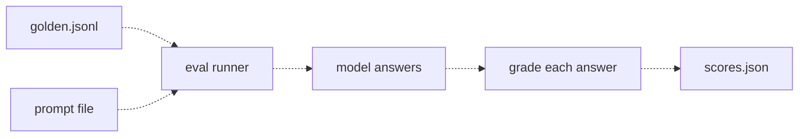
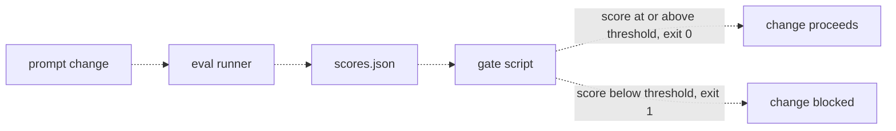

# 28 — Prompt regression testing
Source: notes lines 10802–11149; images: Topic 28/Screenshot 2026-10-29 182007.png, Topic 28/Screenshot 2026-10-29 182017.png

## Why it matters
A prompt change never fails loudly: the model always produces plausible text. Fixing one complaint can quietly break other answers (a regression), and nobody notices for weeks. An eval runner plus an exit-code gate in CI makes "run the tests after every change" automatic, so people do not have to remember to compare files.

## Process / steps
1. Treat every prompt change as code without a compiler: run the eval before and after. (L1)
2. Eval runner: inputs are `golden.jsonl` and a prompt file. For each case, ask the model, grade the answer against `expected` and count passes. (L1)
3. Write one small `scores.json`: `{"total": N, "passed": P, "score": P/N}`. Save one per prompt version. (L1)
4. Compare versions ("v1 scored 0.8, v2 scored 0.6"). (L1, T1)
5. Set the threshold to the customer-agreed contract number (e.g. 0.85). (L2)
6. Gate script: read `scores.json`. Score ≥ threshold → print a pass line and exit 0. Below → print a fail line and exit 1. (L2)
7. Put the gate in CI after the eval, so a drop below threshold fails the build like a failing unit test. (L2)

## Diagrams
### 28.1 `../../Geeta or Bible for claude FDE/fde-diagrams-workflows images/Topic 28/Screenshot 2026-10-29 182007.png`

Teaches: one command turns the golden set plus a prompt version into a comparable score file.

### 28.2 `../../Geeta or Bible for claude FDE/fde-diagrams-workflows images/Topic 28/Screenshot 2026-10-29 182017.png`

Teaches: the score becomes an automatic yes/no via exit codes, and CI blocks any change below the threshold.

## Rules and numbers
- A regression is a change that improves one thing and silently damages another. Example: "keep answers under three sentences" dropped the claim deadline. (L1)
- No prompt change ships without an eval run before and after. (L1)
- `scores.json` shape: `{"total": 10, "passed": 8, "score": 0.8}`; score = passed / total (0.0 if total is 0). (L1, T1)
- The runner makes each run one command, so there is no excuse to skip it. Each run sends every golden question to a model, which is why the course keeps pilot sets at 10–20. (L1) A set that gates a contract threshold has 50 or more cases (R163, R326): see real world.
- When `expected` is the key fact, a case-insensitive "contains" check is enough for grading. (T1) *Hadavin practice (audit F4, proposed R171 wording):* only for non-numeric tokens. A bare substring check on numbers gives false passes: "7" matches "17 days", "30" matches "130 days", "500" matches "5000 euros". Match numbers by value with one locale-aware number grammar and codes as whole tokens (R171), not by substring or a bare boundary regex (read "1,500" as the number fifteen hundred, so it does not count as 500); give cases where a wrong value could appear a `must_not_contain` list, and send sentence answers to the LLM judge. Add CI tests: "You have 17 days" must NOT pass `expected: 7`, "up to 1,500 euros" must NOT pass `expected: 500`, "within 30." MUST pass `expected: 30`, and run them against the old check to show it fails (all listed inputs and the fuzz run: R171; after the number and at most one currency token, any word gives no number, and after ". , ; ! ?" or on the next line only an ASCII capital word outside the union deny set may follow (its meaning is not judged: "EUR 40. Refused." reads 40; words are compared after one Unicode fold, R171 (7)), so "EUR 40 per day" and "EUR 40, thousand" fail closed and go to the judge; a free-text match is evidence only: money is also compared as a typed field (R171); words on the left, such as "refund" or "owed", and the currency identity are not read by the number check).
- Take the human out of the loop: a check a machine runs is a check that always runs. (L2)
- Threshold = the minimum acceptable score, ideally the customer contract number. Example: 0.85. (L2)
- Exit code 0 = success; anything else = failure. Check it in a shell with `echo $?`; in Python, `sys.exit(1)`. (L2)
- The gate prints one clear line either way so the log explains itself. (L2)
- The gate fails (exit 1) when the scores-file argument is missing. (T2)
- Never set the threshold at yesterday's score to make today's build green. The threshold belongs to the customer agreement, and lowering it is a conversation, not a config edit. (L2)

## Decision rules from quizzes
- **Q1. A teammate fixes a formatting complaint, checks only the complaining question and merges without running the eval.** Risk: other answers silently degraded. The process must run the full golden eval and block the merge with a nonzero gate exit below the agreed threshold. Why: protection is mechanical, not personal. Traps: 2–3 manual spot checks are the same anecdote problem; cost estimation is a different problem; "only before major releases" is wrong.

## Tasks
- **T1. Run the eval before and after a change.** Goal: measure what the "brief and friendly" prompt v2 costs against v1. Method: a 6-case golden set where `expected` is the key fact (31.5, 3 business days, 7, 500, 30, AdminHub). Write `/root/regression/run_eval.py <prompt> <out>`: load the prompt file as the system prompt, ask `deepseek-v4-flash` each golden question, apply a case-insensitive contains check and write `{total, passed, score}`. Run it for v1 → `scores-v1.json` and v2 → `scores-v2.json`. (golden: notes lines 10854–10861; prompts v1/v2: lines 10865–10880) Done: both files exist; the lab shows v1 = 6/6 (1.0) and v2 = 0/6 (0.0). The "no numbers" instruction destroyed every fact.
- **T2. A gate that fails when the score drops.** Goal: the CI gate at threshold 0.85. Method: `gate.py <scores>` reads `score`; ≥ 0.85 prints PASS and exits 0; below prints FAIL and exits 1; a missing argument prints FAIL and exits 1. Test it on the fixtures `scores-good.json` (6/6, 1.0) and `scores-bad.json` (3/6, 0.5) (fixtures: notes lines 11049–11055). Done: good → "PASS: score 1.00 meets or exceeds threshold 0.85", exit 0; bad → "FAIL: score 0.50 is below threshold 0.85", exit 1.

The snippet that *is* the lesson (the gate ending):
```python
if score >= THRESHOLD:
    print(f"PASS: score {score:.2f} meets or exceeds threshold {THRESHOLD}")
    sys.exit(0)
print(f"FAIL: score {score:.2f} is below threshold {THRESHOLD}")
sys.exit(1)
```

## Course → real world
- Prompts live as versioned files in the repo, and any PR touching `prompts/`, the model config, retrieval settings or rubrics triggers the eval job. (Hadavin practice)
- The runner is a CLI in the typed package (`evals` module) that calls the pinned model through the client-cloud adapter, e.g. Bedrock. It writes `scores.json` plus per-case results as a CI artifact. (Hadavin practice)
- The gate is a required CI check. The threshold is read from config set to the contract number, never hardcoded and never lowered without the client's written OK. (Hadavin practice)
- Compare against the main-branch baseline as well as the threshold, and post the before/after score and newly failing cases on the PR. (Hadavin practice)
- Evals cost tokens. A 10-20 case set is a smoke check and is reported as "smoke, n = ..." (R326). [Hadavin practice, stricter than the course on size] A set that gates a contract threshold has 50 or more cases, and the full set runs on every PR that touches prompts, model config, retrieval settings or rubrics and blocks the merge below the threshold (R181, R182; course N:11140). A cheaper subset may run on other PRs as an early signal only; it never replaces the full run as the merge gate. Price the full run in `cost-estimate.md` (calls x tokens, twice for before and after); in studio demos every live run counts against the owner's US$189 live-model testing budget. (audit F1; supersedes "keep the PR set at 10-20" on 2026-11-01; changed 2026-11-04 pass 2: the full set gates the merge)
- **Reproducibility (audit F10, proposed R178 extension):** `scores.json` also records golden-set version, prompt hash, model id (a dated snapshot, never a moving alias), temperature and seed where supported, rubric version, judge model id and a UTC timestamp, with per-case results beside it. Set temperature to 0 for gated runs. A red gate within the run-to-run noise band is re-run once and both runs are logged; never re-run until green. (Hadavin practice)
- **Gate integrity (audit F11, proposed R179 addition):** the gate recomputes `passed / total` itself, fails if it disagrees with `score`, and fails if `total` is below the configured minimum (R163), so an empty or truncated run can never pass. (Hadavin practice)
- Model version upgrades (e.g. a new Sonnet id) go through the same gate as prompt edits. (Hadavin practice)

## Checklist
- [ ] Eval runner takes a prompt file plus a golden set and writes `{total, passed, score}`.
- [ ] Before/after scores saved for every prompt version.
- [ ] Gate exits 0 at or above the threshold and nonzero below, printing one clear line; tested on good and bad fixtures.
- [ ] Gate is a required CI check on every prompt, model or rubric change.
- [ ] Threshold equals the customer contract number and is changed only by agreement.
- [ ] `scores.json` records versions, model snapshot, temperature and seed; the gate recomputes the score and enforces a minimum `total`.
- [ ] Number checks compare values from one number grammar (R171) with `must_not_contain`, not bare substrings or boundary regexes; codes match as whole tokens.
