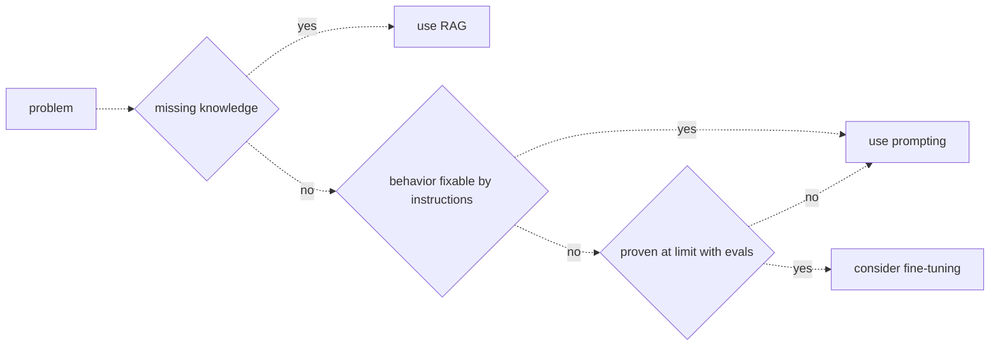

# 30 — The fine-tuning decision
Source: notes lines 11596–11748; images: Topic 30/Screenshot 2026-10-29 182145.png

## Why it matters
Customers often ask to "fine-tune on our data so it knows our company". That is usually the wrong tool: fine-tuning teaches skills and habits, not reliable facts. The FDE walks a cost-ordered path (prompting → RAG → fine-tuning) and climbs only when evals prove that the cheaper step has failed.

## Process / steps
1. Classify the problem. Is the model **missing knowledge** (your policies, prices, internal names)? → use RAG. (L2)
2. If not, is it **behavior fixable by instructions** (tone, format, ignoring rules)? → use prompting. (L2)
3. If prompting is not enough, has it been **proven at its limit with evals**? No → keep using prompting. Yes → consider fine-tuning. (L2 diagram)
4. Fine-tune only when all three hold: the problem is behavior, not knowledge; prompting is pushed to its limit and evals prove the gap remains; and volume or consistency needs justify weeks of work plus a custom model to maintain. (L2)
5. Split mixed requests by problem type: knowledge → RAG, behavior → prompting or fine-tuning. (Q3)

## Diagrams
### 30.1 `../../Geeta or Bible for claude FDE/fde-diagrams-workflows images/Topic 30/Screenshot 2026-10-29 182145.png`

Teaches: try tools in order of cost. Knowledge goes to RAG; behavior goes to prompting; fine-tuning comes only after evals prove prompting is exhausted.

## Rules and numbers
- Fine-tuning = continuing training on your own examples (hundreds or thousands of input → desired-output conversations). It returns a modified model copy whose weights have shifted. (L1)
- It learns patterns, not individual facts. (L1)
- Good at: format/schema/report style; brand tone without long style instructions; specialized tasks (e.g. 40-category ticket classification from thousands of labels); prompt compression (bake in a 3000-token system prompt to make calls cheaper and faster). Summary: skills and habits. (L1)
- Bad at facts: a model trained on policy docs sounds like them, but may state the refund cap right, wrong or blended. There is no lookup. Changed facts stay baked in, so you must retrain or serve stale answers. (L1)
- Facts want retrieval; behavior wants training. With RAG, updating a fact means updating a document. (L1)
- Hidden costs of fine-tuning: collecting and cleaning examples, training runs, evaluating each version and maintaining a custom model forever. It is the heaviest tool. (L1)
- Cost ladder (L2):
  - **Prompting**: minutes; undo by editing text.
  - **RAG**: days; update by updating documents.
  - **Fine-tuning**: weeks, plus a model to maintain forever.
- Careful prompting solves the large majority of behavior problems. (L2)
- Wrong prompt = an edit; wrong RAG = a re-index; wrong fine-tune = training spend, weeks of data work and an eval cycle, possibly discovered only at the end. (L2)
- "Prompting is at its limit" must be measured with eval scores; otherwise it is an opinion. The golden set is the proof. (L2)
- An approved budget is a pressure, not an argument. (Q1)

## Decision rules from quizzes
- **Q1. CTO: fine-tune on 2,000 pages of manuals that update monthly; budget approved.** Recommend RAG over the manuals instead. Explain that fine-tuning learns patterns, not reliable facts; retrieval cites the exact manual section; and monthly updates become a document refresh, not retraining. Why: a knowledge problem goes down the first branch to RAG. Note: the course marks "RAG first, revisit fine-tuning later for proven behavior gaps" as fine (option 4 is best); the trap is option 3, "fine-tune first, add RAG later".
- **Q2. Claims triage into 42 categories, stuck at 81 percent vs the 90 percent target after 3 months; 4,000-token prompt; 50,000 emails/month on a cheap model; 30,000 labeled emails available.** Fine-tune the cheap model on the 30,000 labels. Why: a behavior task, prompting measurably plateaued, training data already exists, and at that volume the baked-in behavior replaces the 4,000-token prompt, cutting cost and latency. Traps: more prompt iteration argues with its own eval history; the largest model is a fair quick experiment but multiplies the cost of every one of 50,000 calls; RAG adds knowledge, and none is missing.
- **Q3. A pricing catalog that changes every two weeks, plus a report template that prompting (eval-proven) cannot hold.** RAG over the catalog, fine-tuning on example reports for the template. Why: changing facts go to retrieval (a re-index takes minutes; a fine-tune is stale on day one of a new price list), and consistent format is what fine-tuning does well. Trap: reversing the tools, or one tool for both jobs.

## Tasks
None in this topic.

## Course → real world
- Default answer to "fine-tune on our data": RAG on the client's cloud (Bedrock Knowledge Bases or pgvector) with citations. Record the decision path, with eval evidence, in an ADR in the client repo. (Hadavin practice)
- Before fine-tuning, try the cheaper behavior levers on the eval: prompt work, few-shot examples, structured output, and a tier change (Haiku 5.5 / Sonnet 5.5 / Opus 5.5). Prompt caching can also reduce the cost of a long stable system prompt (savings and minimum prefix sizes change: verify live; set the cache TTL explicitly, never rely on a default, audit M30). (Hadavin practice; course step "proven at limit with evals" is the gate.)
- *Hadavin practice, ML-engineer hat (audit F8, proposed rule after R289):* for a pure classification task with thousands of labels (such as Q2), first fit a plain classifier on embeddings (logistic regression or gradient boosting) on the same labels and score it on the golden set. It is hours of work and sets the bar a fine-tuned LLM must beat on accuracy, cost and latency. Also try a retrieved few-shot prompt (nearest labelled examples) before tuning. R289 should also carry the volume or consistency condition from R286. (OPEN-OWNER: rule or advice; written here as advice.)
- If all three conditions hold, check live whether the pinned model family can be fine-tuned in the client's cloud (Bedrock, Foundry, Vertex) before quoting. Availability changes and varies by region and cloud (`[unverified 2026-11-01]`; no live check was made). Price the data prep, training, re-eval per version and ongoing maintenance into the fixed price. (Hadavin practice)
- **Single-dependency audit (audit F7):** a fine-tuned model lives in one cloud on one base model, and when the base model is retired the tune is lost. Fine-tuning is a pluggable kind with a neutral default and an alternative: keep the training set as plain JSONL chat files and the training recipe in the repo, so a retrain on another base model (a managed tune in the client's cloud, or an open-weights adapter the client hosts) is a config change. Keep the prompt-only version working as the fallback, gate both through the same eval (R291), and record the base-model end-of-life date in the model card (ROLES). (Hadavin practice)
- Labeled training data comes through least-privilege connectors with PII redaction. Hold out the golden set from training so the eval stays honest. (Hadavin practice)
- A fine-tuned model id is pinned in config, goes through the same CI eval gate as any prompt or model change, and has a named owner in the agent/model registry. (Hadavin practice)

## Checklist
- [ ] Each customer request classified as knowledge (→ RAG) or behavior (→ prompting first).
- [ ] Mixed requests split by problem type.
- [ ] Fine-tuning proposed only with eval history proving prompting has plateaued below target.
- [ ] Volume or consistency need, labeled data and maintenance cost justified in writing.
- [ ] Golden set held out from any training data; fine-tuned model passes the same CI gate.
- [ ] For classification, a classical embedding classifier baseline and a retrieved few-shot prompt were scored first.
- [ ] Training data kept as portable JSONL with the recipe in the repo; prompt-only fallback still passes the gate.
