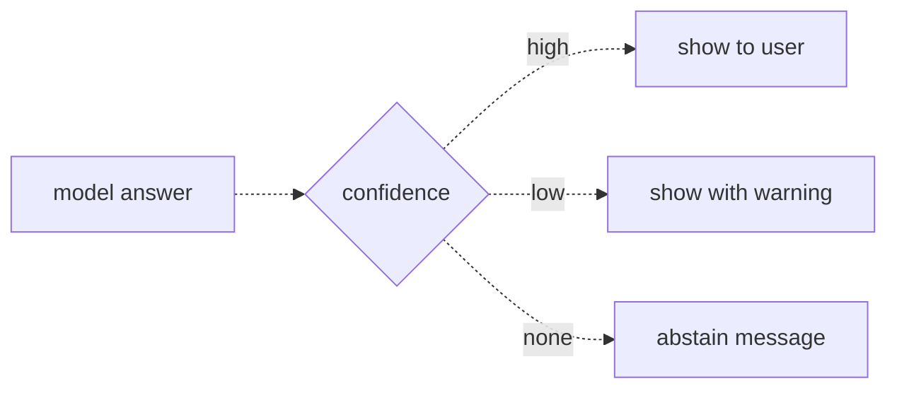

# 32 — Reducing hallucinations
Source: notes lines 12284–12662; images: Topic 32/Screenshot 2026-10-29 182318.png

## Why it matters
One confident wrong answer can end a pilot. The customer then stops trusting every other answer too.
The model has no built-in "I have no idea", so the FDE must give it an exit, make its confidence checkable in code, and measure how often it abstains when it should.

## Process / steps
1. **Give the model permission to refuse (L1).** Restrict it to the provided documents, give an exact refusal phrase, and state that wrong is worse than empty.
2. Say the trade out loud to the customer during the pilot: an assistant allowed to refuse will sometimes refuse questions it could have answered.
3. **Ground the answer (L2).** Every claim must point to a named source document. Treat a sentence without a citation as a guess.
4. **Ask the model to grade itself (L2).** It returns JSON with `answer`, `sources` and `confidence` (`high` / `low` / `none`).
5. **Act on the signal (L2):**
   - high → show to user;
   - low → show with a warning;
   - none → abstain message.
6. **Measure it (T2).** Build a trap set (questions the documents don't answer), run it, and report the abstain rate. A signal you never measure drifts into decoration.

## Diagrams
### `../../Geeta or Bible for claude FDE/fde-diagrams-workflows images/Topic 32/Screenshot 2026-10-29 182318.png` (L2 Grounding and confidence signals)

Teaches: self-reported confidence is a routing signal with three lanes, not the truth.
Text vs image: the ASCII draws "confidence" as a plain box. The image draws it as a decision diamond. The flow is the same.

## Rules and numbers
- Hallucination (made-up but confident output) can't be removed completely. Give the model an exit. (L1)
- Use the abstain prompt (L1):
  ```
  Answer the user's question using only the provided documents.
  If the documents do not contain the answer, reply exactly:
  I do not know based on the available documents.
  Never guess. A wrong answer is worse than no answer.
  ```
- Use an exact refusal phrase so refusals are easy to detect in code and logs. (L1)
- Name the trade during the pilot. Don't hide it. Customers in serious industries (banks, insurance, healthcare, logistics safety) almost always accept it. (L1)
- An answer is grounded when every claim comes from a document you can name. A claim with a citation can be checked; one without can't. (L2)
- Free first signal: does each claim have a citation? No citation = guess. (L2)
- Second signal, the confidence JSON: `{"answer": "...", "sources": ["doc1"], "confidence": "high"}`. (L2)
  - `high` only when the sources state the answer directly;
  - `low` when the model had to combine or interpret;
  - `none` when there are no sources, with an abstain in the answer field.
- Models are reasonably good at telling word-for-word from pieced-together. They are bad at knowing when they're flat wrong. Use confidence for routing, not as truth. (L2)
- Common pilot setup (L2):
  - high goes straight to the user;
  - low gets a visible note like "please verify this against the source document";
  - none returns the abstain phrase.
- Measure abstain behavior with trap questions. `abstain_rate = traps_abstained / trap_questions`. (L2, T2)
- Raising the temperature makes guessing more likely, not less. A bigger model still hallucinates on missing facts. (Quiz)

## Decision rules from quizzes
- **Quiz 1.** The customer complains the assistant refused 3 of 40 questions this week and wants it to always answer.
  - Right move: explain the trade, then check the 3 refusals first. If the documents really lack those answers, the fix is to add the missing content to the document store, not to force guessing.
  - Why: removing the abstain rule trades visible refusals for invisible wrong answers. One confident wrong answer damages trust more than many honest refusals.
  - Traps: raising the temperature (more guessing); "bigger models never need to refuse" (false); "the customer decides, so remove it" (gives up the safety feature).

## Tasks
- **T1: A prompt that abstains without sources.**
  - Goal: `/root/fde-hallucination-mitigation/abstain.py` answers two questions over two fixed documents (damaged-shipment claims within 48 hours with photos; standard pallets stacked at most 2 high in zones A and B). Seed data: notes lines 12325–12328 (the two documents, pasted into the script as a string) and 12333–12334 (the two questions).
  - Method:
    1. Put the abstain instruction in the system prompt.
    2. The user prompt is `Documents:\n…\n\nQuestion: …`.
    3. Make one `deepseek-v4-flash` call per question and save the replies to `answer1.txt` and `answer2.txt`.
  - Done: Q1 gives the 48-hour rule. Q2 (max weight for a type C pallet) returns exactly `I do not know based on the available documents.`
- **T2: Measure the abstain rate on trap questions.**
  - Goal: run 8 questions from `/root/fde-hallucination-mitigation/traps.jsonl`, saved exactly as given (seed data: notes lines 12493–12500). 4 have `should_abstain: true`: type C pallet weight, forklift model for zone B, claims phone number, cold-storage temperature. The other 4 are answerable: damaged-shipment report deadline, standard pallet stacking height in zone A, whether photos are required for a damage claim, and whether pallets can be stacked 2 high in zone B.
  - Method:
    1. Use the same documents and abstain prompt as T1.
    2. Mark `abstained` = the reply contains the abstain phrase (the solution matches case-insensitively).
    3. Write `results.jsonl` with `{question, should_abstain, abstained}`.
    4. Write `report.json` with `trap_questions`, `traps_abstained` and `abstain_rate`.
  - Done: the three files exist. Sample run: `trap_questions` 4, `traps_abstained` 4, `abstain_rate` 1.0, and none of the 4 answerable questions abstained.

## Course → real world
- **Models** (brief): Sonnet 5.5 answers through the client's cloud (Bedrock for AWS clients), and the model id is pinned in config.
- **Abstain phrase as config** (Hadavin practice):
  - keep it in config, versioned with the prompt (topic 9);
  - the API returns it as a typed `abstained: true` field, so the UI and the metrics never string-match free text.
- **Confidence routing in the response contract** (Hadavin practice):
  - the API returns `answer`, `sources`, `confidence`;
  - the UI shows the warning banner for `low`;
  - `none` always maps to the abstain message;
  - a `high` answer with no sources is downgraded to `low` by code.
- **Two measured rates, both CI-gated** (Hadavin practice):
  - trap abstain rate: the course metric, the share of trap questions that abstain;
  - false-abstain rate on answerable questions: the cost side of the trade;
  - both live in the golden dataset (topic 26), and CI fails on a drop;
  - the course topic only has the trap rate. The false-abstain definition, ceiling and gate come from R191 (a Hadavin extension, not course content, 2026-11-01): `false_abstain = answerable_questions_abstained_or_handed_back / answerable_questions`. Never present "correct" as one number that mixes right answers, right hand-backs and answers the gate handed back.
- **Extra grounding check** (Hadavin practice): a grounding scorer can add one more signal behind the guard interface. Neutral default: a second model-kind call or a citation-support check we run ourselves; the Bedrock Guardrails contextual grounding check is one per-cloud backend. The citation and abstain prompt stay primary.
- **Match the abstain exactly** (Hadavin practice, audit G9): the course checks `phrase in answer.lower()`, so a reply with the phrase plus a guess counts as an abstain. Use the typed `abstained` field, and treat a reply that has the phrase plus extra guessing text as a failed abstain.
- **Calibrate the confidence field** (Hadavin practice, audit G10): on the golden set, report accuracy per confidence band. If `high` is not clearly more accurate than `low`, drop the routing. Confidence stays a routing signal, never proof.
- **An empty permitted set abstains like a true miss** (Hadavin practice, audit J-21): when permission filtering leaves nothing, use the same abstain wording as a real miss. Never say that something exists but is hidden (R312).
- **Refusal review loop** (Hadavin practice):
  - pilot refusals are reviewed weekly with the customer;
  - each one is tagged "doc missing" (add content to the corpus) or "retrieval miss" (topic 17);
  - never "remove the rule".

## Checklist
- [ ] The system prompt has the restrict-to-documents rule, the exact abstain phrase, and "wrong is worse than no answer".
- [ ] The customer heard the refusal trade-off in plain words during the pilot.
- [ ] Answers carry sources. Uncited claims are treated as guesses.
- [ ] Confidence JSON drives high/low/none routing in code, and low shows a verify note.
- [ ] A trap set exists, and the abstain rate (and false-abstain rate, R191) is measured and gated in CI.
- [ ] Accuracy per confidence band is reported; abstain is matched exactly, not by substring.
- [ ] Every refusal in the pilot is reviewed: missing doc vs. retrieval miss.
