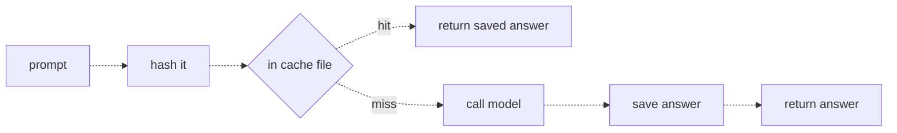
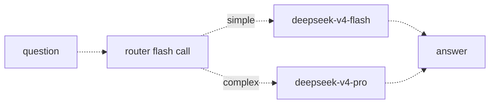
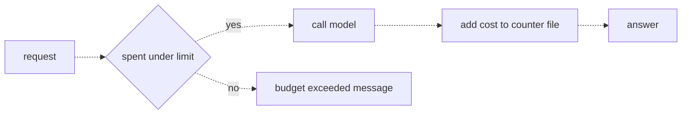

# 33 — Cost control
Source: notes lines 12663–13227; images: Topic 33/Screenshot 2026-10-29 182346.png, 182358.png, 182410.png

## Why it matters
Production traffic is repetitive, and most of it is easy. Paying a fresh, top-tier model call for every request wastes money, and a runaway loop can burn a quarter's budget over a weekend.
The FDE uses two saving levers, cache first and then a classify-first router (the lesson title says "cheap model first": a cheap classifier picks the lane, and the strong lane wins when in doubt), plus a hard daily budget enforced in code from the first live call.

## Process / steps
1. **Cache (L1).** Before calling the model, hash the prompt (SHA-256) and look up the hash in the cache.
   - Hit → return the saved answer.
   - Miss → call the model, save the answer, return it.
2. **Route (L2).** A cheap classifier call reads the question and returns `{"route": "simple"}` or `{"route": "complex"}`. Simple goes to the cheap model, complex to the strong one.
3. Watch routing decisions in the logs. When in doubt, route to complex.
4. **Budget (L3).** Compute each call's cost from the `usage` field and the price sheet.
5. Keep a counter file `{"date", "spent_usd"}`.
   - Check it before every call: at or over the limit → refuse and return a budget message.
   - After the call, add the cost and write the file back.
   - Reset the counter when the date changes.
6. When the budget wall is hit, fail loudly: a clear message, a log line, an alert to someone.

## Diagrams
### `../../Geeta or Bible for claude FDE/fde-diagrams-workflows images/Topic 33/Screenshot 2026-10-29 182346.png` (L1 Caching repeated work)

Teaches: the cache is a lookup before the call, and only a miss spends tokens.
Text vs image: the ASCII draws "in cache file" as a box. The image draws it as a decision diamond.

### `../../Geeta or Bible for claude FDE/fde-diagrams-workflows images/Topic 33/Screenshot 2026-10-29 182358.png` (L2 Model routing: cheap model first)

Teaches: a small cheap call manages traffic for the big models. It is the same shape as the input filter in 31.

### `../../Geeta or Bible for claude FDE/fde-diagrams-workflows images/Topic 33/Screenshot 2026-10-29 182410.png` (L3 Token budgets)

Teaches: check before the call, record after it.
Text vs image: the ASCII draws "spent under limit" as a box. The image draws it as a decision diamond.

## Rules and numbers
- Real traffic is repetitive. In the course example, one exact question was asked 212 times in week one by 400 workers. (L1)
- Cache key = SHA-256 hex of the prompt (`hashlib`), value = saved answer. Prompts make bad dict keys; a hash is short, fixed and stable. (L1)
- A cache hit costs zero tokens and returns in a few milliseconds. (L1)
- Cache value = hit rate × cost of a call: a 30% hit rate cuts the bill by roughly 30%. (L1)
- An exact-match cache only helps exact repeats. Normalizing the text (lowercase, strip punctuation) raises the hit rate; add it later. (L1)
- Never cache answers that depend on who is asking or on changing data (e.g. "what is the status of my claim"). Cache policy answers, not personal ones. (L1)
- Choose the model per request, not once. One model for all traffic means the hard questions suffer (cheap model) or you overpay on the easy 80% (strong model). (L2)
- Router prompt: `{"route": "simple"}` for lookups and single-fact questions; `{"route": "complex"}` for comparison, multi-step reasoning, or combining several rules. (L2)
- Router math: pro = 10× flash and 80% of traffic is simple, so the bill lands at roughly a quarter of the all-pro bill, including one tiny routing call per request. (L2)
- The router will sometimes misroute. Log the decisions, and when in doubt prefer the complex lane: wrong-and-expensive beats wrong-and-cheap. (L2)
- Provider rate limits protect their servers, not your wallet. Build the spending ceiling yourself. (L3)
- `cost = prompt_tokens * input_price + completion_tokens * output_price`. (L3)
- Budget counter: `{"date": "2026-09-03", "spent_usd": 0.4183}`. (L3)
  - At or over the daily limit → refuse.
  - After each call → add its cost.
  - New date → reset to zero.
- Check before (the money is gone after the call). Record after (only then do you have the real `usage`). (L3)
- The design can overshoot by one call (e.g. at 4.99 of 5 dollars, the next call costs 0.03). That is fine for a daily cap; it stops the runaway loop. (L3)
- Fail loudly at the wall: a clear message, a log line, an alert. A silent block creates a mystery outage. (L3)
- Price sheet units: per 1 million tokens. Course flash price: input 0.30, output 1.20. (T3)

## Decision rules from quizzes
- **Quiz 1.** 10,000 requests a day on `deepseek-v4-pro`. 40% are exact repeats, and about 70% of the unique questions are simple lookups.
  - Right move: add an exact-match cache first, then route the remaining simple questions to `deepseek-v4-flash`.
  - Why: a cache hit returns the exact answer already given, so quality risk is zero and 40% of calls disappear. Routing then moves easy lookups to the cheap model, where the quality gap is minimal.
  - Trap: moving all traffic to flash saves the most money but degrades the hard 30%.
  - Prompt trimming and discounts don't touch the two biggest levers (repeats and easy questions).

## Tasks
- **T1: Add a response cache and measure the savings.**
  - Goal: `/root/fde-cost-control/cached_ask.py` processes 6 questions in a fixed order. Three are unique, and "how do I report damaged goods" repeats.
  - Method:
    1. Compute the key with `sha256(q).hexdigest()` and look it up in `cache.json` (create the file if it is missing).
    2. Call `deepseek-v4-flash` only on a miss, and save the cache after each miss.
    3. Count hits and misses, then write `cache_stats.json` with `{total, hits, misses}`.
  - Done: total 6, hits 3, misses 3. Exactly 3 model calls are made, and `cache.json` has 3 keys.
- **T2: Route easy questions to the small model.**
  - Goal: `/root/fde-cost-control/router.py` splits 4 questions across the two models.
  - Method:
    1. Make a router call on flash with the router prompt, then parse the JSON (fences stripped, braces sliced).
    2. Default to `complex` on a parse error, a missing `route` field or any value other than `simple` after trimming spaces and lower-casing (N:12935-12939), then answer with flash for simple and pro for complex.
    3. Write `routes.json` with `{question, model, answer}`.
  - Done: "deadline for expense reports" and "office working hours" go to flash. "compare refund rules… mixed shipment" and "three overlapping discount policies… December" go to pro.
- **T3: Enforce a daily budget in code.**
  - Goal: `/root/fde-cost-control/budgeted.py` tries 10 flash calls under a tiny cap of 0.002 USD. Prices come from `/root/fde-cost-control/prices.json`, saved exactly as given (per 1M tokens: input 0.30, output 1.20; seed data: notes lines 13053–13055).
  - Method:
    1. Load `budget.json`, resetting it if the date is not today.
    2. Before each call, if `spent_usd >= 0.002`, skip the call and log `request i: blocked - budget exceeded`.
    3. Otherwise make the call, compute the cost from `resp.usage`, add it, and save.
    4. Write one line per request (ok or blocked) to `run.log`.
    5. The solution pads the system prompt (a safety-manual sentence ×180) so each call costs enough to trip the cap.
  - Done: the sample run had requests 1–2 ok (0.001845, then a cumulative 0.003776) and requests 3–10 blocked. `budget.json` shows today's date and `spent_usd` ≈ 0.0037761.

## Course → real world
- **Model tiers replace flash/pro** (brief):
  - Haiku 5.5 is the cheap lane and the router;
  - Sonnet 5.5 is the usual complex lane (tier per R278/R279);
  - Opus 5.5 is kept only for the hardest tasks, as a third lane when evals justify it;
  - all ids are pinned in config, through the client's cloud (Bedrock for AWS clients).
- **Response cache store** (Hadavin practice):
  - the cache lives in a shared store behind a kind (neutral default Redis or Postgres with TTL; DynamoDB or a cloud cache service as per-cloud alternatives), not a local JSON file;
  - the exact-match key is the SHA-256 of (tenant id, permission scope or ACL hash, normalized question, model id, prompt version, corpus version), so a prompt, permission or corpus change invalidates old answers. If the key hashes the full prompt including retrieved chunks, still add tenant and corpus version. The course key (question only) leaks one tenant's answer to another in a permissioned RAG (audit G4; R212 extended);
  - invalidate on every corpus update;
  - a cache hit passes the output filter's current rules unchanged, because the rules may have changed since the answer was stored;
  - a TTL makes policy updates show up;
  - an explicit "cacheable" flag is set only for non-personal, non-live-data intents.
- **Provider prompt caching is a different thing** (Hadavin practice): Bedrock/Claude prompt caching cuts input-token cost on repeated long prefixes (system prompt, tool definitions). Use both.
  - Set the cache TTL explicitly (5-minute or 1-hour), never rely on a default. `[research 2026-11-01: platform.claude.com pricing page, seen 2026-11-01]` 5-minute write 1.25x input price, 1-hour write 2x, read 0.1x (0.05x on Opus 5.5 and Sonnet 5.5, 0.025x on Fable 5.1). The default cache lifetime is 5 minutes `[research 2026-11-01: platform.claude.com/docs/en/build-with-claude/prompt-caching, "By default, the cache has a 5-minute lifetime"]`; a third-party claim of a March 2026 change is not confirmed there. Haiku 5.5 is priced per request by prompt length including cached tokens, and effort changes between requests invalidate the cache. Message Batches (50 percent discount) is a Claude API feature: it is not supported on the Bedrock Messages endpoint, so never quote batch savings to a Bedrock client `[research 2026-11-01: platform.claude.com/docs/en/about-claude/pricing and the Claude-in-Amazon-Bedrock page]`.
  - `[research 2026-11-01: platform.claude.com pricing page]` Haiku 5.5 is $0.10/$0.50 per 1M tokens for prompts up to 100K tokens and $0.50/$2.50 above that (cache reads count toward the 100K). Cost models branch on prompt length. Re-check on the day of any quote.
- **Router** (Hadavin practice):
  - a Haiku classifier with JSON output that fails to the strong lane;
  - routing decisions are logged with the model on every call (topic 35);
  - misroutes are sampled into the eval set, and the false-simple rate (hard requests sent to the cheap lane) is measured on a labelled sample;
  - "in doubt" in code: the router reply cannot be parsed, has no `route` field or carries any value other than `simple` after trimming spaces and lower-casing (course code, N:12933-12939), the router call times out, or our code marked the request high-stakes from the workload config (money, approvals, permissions) (R213);
  - no cheap-then-retry cascade: the router decides BEFORE the answer is generated; the course teaches no "cheap model first, strong model on failure" pattern (R213, R280, R290).
- **Budget enforcement** (Hadavin practice):
  - the budget store sits behind a kind: neutral default Postgres (atomic increment keyed by date and client), alternatives DynamoDB or Redis. A file isn't safe with several workers;
  - reserve before the call (audit G18): estimate the worst-case cost (input tokens plus `max_tokens` x output price), atomically reserve it, then reconcile with real usage. An atomic counter fixes the counter race, not the gap between check and call: parallel workers or one very long call can overshoot (the course's own run spent 0.003776 against a 0.002 cap, 89% over);
  - caps exist at three levels: per request (`max_tokens`), per run or agent loop (R102, R110), and per client per day. The daily limit lives in config;
  - hitting the wall sends a page/alert to the owner and the client contact;
  - cloud budget alerts (and budget actions where the cloud offers them) are a slow, coarse backstop, not the enforcement; enforcement is in code. Azure and GCP have equivalents.
- **Prices** (Hadavin practice): the price sheet lives in config with one row per priced token class per pinned model id (input, output, cache read, cache write, reasoning where the API counts it), and cost is recorded at call time from every class returned in `usage` (topic 35). The course formula (input plus output only) mis-states cost exactly after you adopt prompt caching (audit G17, R214/R222). Prices are a 2026-11-01 reading: re-verify before any quote.
- **Model tiers need an alternative** (Hadavin practice): every lane sits behind the model kind; a second backend (another provider on the client's cloud, or an open-weight model the client hosts) is outlined with its trigger.

## Checklist
- [ ] Top repeated questions in the logs are measured. A cache is in place for non-personal intents only, with tenant, permission scope, model, prompt version and corpus version in the key.
- [ ] A router is in front of the model tiers, fails to the strong lane, and its decisions are logged and sampled into evals; its false-simple rate and break-even sum are written with real counts.
- [ ] A per-call cost is computed from `usage` and the config price sheet.
- [ ] A hard daily budget reserves the worst-case cost before the call and reconciles after it, with an atomic shared counter and a reset per date; per-request and per-run caps exist too.
- [ ] Budget hits fail loudly: a user message, a log line and an alert.
- [ ] Expected savings (hit rate × call cost; routing split) are written down and checked against real logs after week one.

## Studio addition 2026-11-02 (unverified source, adopt after own test)

- The back-off or override rate is the real cost metric; promote a cheaper model only after a held-out eval and a hold period (R424).
- Eval harness decides which model earns each request type; report cost per accepted result (R430).
- Measure token burn per task and serve context in the best format (R438).

Source: Idea from public LinkedIn posts by Moonveil AI quoting others; unverified; we adopt only after our own test.
