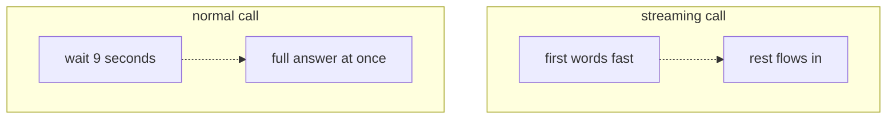
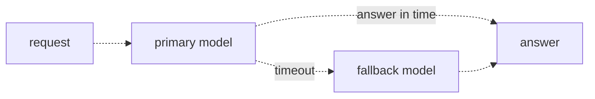

# 34 — Latency and streaming
Source: notes lines 13228–13509; images: Topic 34/Screenshot 2026-10-29 182448.png, 182457.png

## Why it matters
"It feels slow" can kill a demo even when the real latency is normal: a frozen screen feels broken.
Remote model APIs also have bad days. The FDE needs streaming for perceived latency, and timeouts with a fallback so the assistant never hangs.

## Process / steps
1. **Know the two clocks (L1).**
   - Real latency = request to last token (what logs measure).
   - Perceived latency = time until the user sees something (what users measure).
2. **Stream for humans (L1).** Set `stream=True`, iterate the chunks, and print or forward each piece as it arrives. Skip streaming for batch pipelines.
3. **Put a deadline on every call (L2).** Set a timeout on the client or per call, sized from your logs.
4. **Have a plan B (L2).** Wrap the primary call in try/except. On a timeout or error, send the same messages to a different, fast fallback model.
5. Log every fallback, and watch the rate.

## Diagrams
### `../../Geeta or Bible for claude FDE/fde-diagrams-workflows images/Topic 34/Screenshot 2026-10-29 182448.png` (L1 Perceived vs real latency)

Teaches: the same total time, but the streaming user starts reading at once.

### `../../Geeta or Bible for claude FDE/fde-diagrams-workflows images/Topic 34/Screenshot 2026-10-29 182457.png` (L2 Timeouts and fallbacks)

Teaches: a timeout bounds the wait, and the fallback model still gets the user an answer.

The ASCII versions match both images.

## Rules and numbers
- Streaming doesn't make the model faster. The last token arrives at the same moment either way. (L1)
- With streaming, the first words appear in well under a second. Nine seconds of flowing text feels fine; nine seconds of silence feels broken. (L1)
- Python SDK: `stream=True` gives an iterator of chunks. Each chunk carries a small piece of text (`chunk.choices[0].delta.content`). (L1, T1)
- Stream for chat interfaces. Skip it for pipelines: a batch job (e.g. tagging 50,000 reviews) only cares when the last token arrives. (L1)
- Calls can take 2 s, 40 s, or never return. A support assistant that hangs for a minute is worse than one that says "try again" after five seconds. (L2)
- Set a timeout on every call: `client = OpenAI(timeout=10.0)`, or per call with the same parameter. The course says the worst case is then bounded at 10 s. (L2)
  - `[tested 2026-11-01, local stub server, anthropic 2.3.0, openai 3.42.0, boto3 1.43.123]` an SDK `timeout` normally bounds one network wait (connect, read or write), not the whole request. SDKs retry by default. On a stream it is a per-chunk read timeout, so a stalled stream can run far past it. The same holds for boto3 `read_timeout`: an 8-second trickle passed a 2-second timeout in all three clients. Timeouts are retried: 3 attempts (Anthropic, OpenAI), 5 for boto3 legacy mode. Defaults: connect 5 s and read 600 s (Anthropic, OpenAI), 60 s and 60 s (boto3). Streams through the SDK helpers were not tested.
  - Real rule: set an overall deadline in your own code (asyncio timeout or cancel), cap SDK retries explicitly, and for streams add a time-to-first-token timeout and an inter-chunk idle timeout. Worst-case wait = (retries + 1) x timeout + fallback time; compute it and confirm it fits the user budget.
- Size the timeout from the logs for that route: in the course chat example normal calls finish in 3–6 s, so it uses 10 s. Those are the course's numbers, not defaults: reasoning models and long answers on Sonnet-class models routinely run 30 s or more, so long routes get their own timeout and stream. Too tight a timeout turns your busiest hour into a wall of errors. (L2)
- Catch the timeout and retry the same messages against a different model, ideally a fast one (pro primary → flash fallback). (L2)
- Log every fallback. One a day is weather. Two hundred in an hour means the primary model has an outage; learn that from the logs, not from the customer. (L2)

## Decision rules from quizzes
- **Quiz 1.** Chat answers complete in 8 s on average and show nothing until done. A nightly batch job on the same API takes 2 hours. Where does streaming help?
  - Right move: only the chat interface.
  - Why: streaming improves perceived latency for a watching user. It doesn't speed up generation, so the batch runtime doesn't change.
  - Trap: "tell the customer to adjust expectations". That ignores a one-parameter fix.

## Tasks
- **T1: Stream a response token by token.**
  - Goal: `/root/fde-latency-streaming/stream.py` streams "Explain in about 150 words why warehouse safety training matters." from `deepseek-v4-flash`.
  - Method:
    1. Call with `stream=True` and loop over the chunks.
    2. When `chunk.choices` and `delta.content` exist, print the piece with `end="", flush=True` and append it to a list.
    3. After the stream, join the pieces and write `streamed_answer.txt`.
  - Done: text appears right away in the terminal, and the assembled file holds the full answer (about 150 words in the sample).
- **T2: Add a timeout and a fallback model.**
  - Goal: `/root/fde-latency-streaming/fallback.py` makes the primary call to `deepseek-v4-pro` with a 15-second timeout. On any exception, it falls back to `deepseek-v4-flash` with the same messages.
  - Method:
    1. Create the client with `OpenAI(timeout=15.0)` (also passed per call) and wrap the call in try/except.
    2. In the except block, print a fallback notice and call flash.
    3. Write `fallback_result.json` with `{model_used, fell_back, answer}`.
  - Done: the file exists. On a healthy day `model_used` is the pro model and `fell_back` is false; the structure is there for the bad day.

## Course → real world
- **Streaming on Claude** (Hadavin practice):
  - `[research 2026-11-01: platform.claude.com claude-in-amazon-bedrock docs, seen 2026-11-01]` for Opus 4.7 and later (so the 5.5 tiers) Claude on Bedrock is served through the Messages-API endpoint; Converse, `ConverseStream` and `InvokeModelWithResponseStream` are not listed on the 5.5 pages (documented under "Opus 4.6 and earlier"). Use them only after a live test against the pinned model id (`[unverified 2026-11-01]` whether Converse accepts the 5.5 ids). Keep the model kind neutral so either is a config switch. Foundry and Vertex have their own streaming;
  - if a stream breaks after output has started, do not splice in a fallback answer: mark the message interrupted, offer retry, and log `fell_back=false, stream_aborted=true` (audit G13);
  - the API forwards chunks to the UI over SSE;
  - the guard pipeline (topic 31) must still apply, so stream to the UI only after the input filter passes;
  - for strict output policies, buffer per sentence and run the output check before release, or show a "checking" state;
  - batch jobs never stream.
- **Timeouts** (Hadavin practice):
  - set explicit connect and read timeouts in the SDK client config (e.g. boto3 `Config(read_timeout=…, retries=…)`), with values in config sized from p95/p99 in logs (topic 35);
  - every external call has a deadline in our own code as well (see the worst-case formula above).
- **Fallback chain** (Hadavin practice):
  - fallback is for transport errors only (timeout, 5xx, 429 after bounded backoff; R219, R290). On steps where a wrong answer is harmless (workload profile, R278): Sonnet 5.5 primary → Haiku 5.5 fallback. On steps that move money, change an approval or a permission: the same tier on another endpoint (for example a cross-region inference profile where the client allows it), then the strong tier, then a person (R219);
  - fall back only on timeouts, 429, 5xx and overload; fail loudly on 4xx (bad request, bad key, access denied) and on a guard block, because falling back on every exception (the course's `except Exception`) hides bugs (audit G12, R219);
  - on a timeout, fall back at once (SDK retries 0 on routes where a person waits; the user has already waited through one timeout, N:13384); retry the primary with exponential backoff and jitter only on 429, 5xx and overload, and only while the worst-case wait still fits the user budget (R218, R219, R351); never retry a non-idempotent tool call;
  - after N consecutive failures open a circuit breaker and route straight to the fallback for a cool-down, so users stop waiting a full timeout on a dead primary;
  - the fallback model must be on the client's approved model and region list and run the same guards;
  - after the fallback fails, return a clear "try again" message, never a hang;
  - fallback model ids are pinned in config; a second provider or open-weight backend is outlined with its trigger (no single dependency);
  - money, approval and permission steps (stricter than the course, R219): the fallback answer passes the same checks, carries `fell_back=true` to the reviewer screen and the log, never triggers the action by itself, and prefers the same tier on another endpoint, then the strong tier, then a person; the Haiku fallback in the first bullet of this list is only for steps where the workload profile says a simpler answer is harmless.
- **Fallback alarms** (Hadavin practice): each fallback is a structured log event with `fell_back=true`, and the client's monitoring (CloudWatch, Azure Monitor, Cloud Monitoring or Prometheus) fires an alarm on a rate threshold.

## Checklist
- [ ] Chat UI streams. Batch jobs don't.
- [ ] Every model call has a timeout sized from real p95 latency, with values in config, plus an overall deadline in our own code and capped retries.
- [ ] A fallback model (different, faster, on the client's approved list) is wired for retryable errors only, with a circuit breaker, and a final "try again" path exists if the fallback fails.
- [ ] Every fallback is logged, and an alarm on the fallback rate is in place.
- [ ] Guards still run with streaming on (input before the stream, output policy handled).

## Studio addition 2026-11-02 (unverified source, adopt after own test)

- Real-time and voice flows: a latency budget per component that sums to the target (R434).

Source: Idea from public LinkedIn posts by Moonveil AI quoting others; unverified; we adopt only after our own test.
