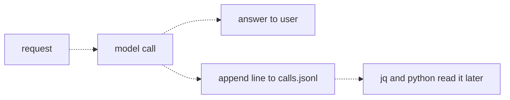
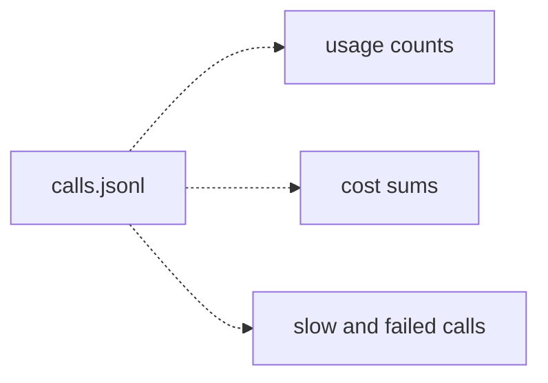
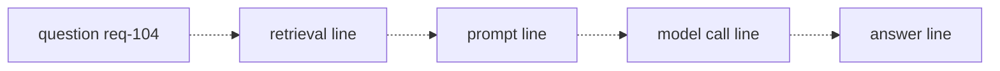

# 35 — Observability
Source: notes lines 13510–13970; images: Topic 35/Screenshot 2026-10-29 182523.png, 182533.png, 182544.png

## Why it matters
"AI costs doubled last week, why?" and "why did it say that?" are questions the engineer who built the system must answer, and "I do not know" is a bad moment.
A per-call metadata log answers usage and cost. A per-request trace answers why one answer went wrong and which stage to fix.

## Process / steps
1. **Log every call (L1).** Every model call appends one JSON line in the same code path as the call: `ts`, `model`, `prompt_tokens`, `completion_tokens`, `latency_ms`, `cost`. No exceptions.
2. **Answer from the log (L2).** Sort questions into three families:
   - usage (count, group);
   - cost (sum, filter by day or model);
   - failures and slowness (filter, sort).
3. Use jq for one-off terminal answers. Use Python when the answer must be a file someone else consumes.
4. **Trace each request (L3).** Generate a `request_id` at the start, pass it to every stage, and write one line per stage: question, retrieval, prompt, model call, answer.
5. **Read the trace backward (L3).** Walk from the bad answer toward the question. At each stage ask: was the input to this stage already wrong? Name the guilty stage, then apply that stage's fix.

## Diagrams
### `../../Geeta or Bible for claude FDE/fde-diagrams-workflows images/Topic 35/Screenshot 2026-10-29 182523.png` (L1 Log every call)

Teaches: logging is part of the call path itself, not an afterthought.

### `../../Geeta or Bible for claude FDE/fde-diagrams-workflows images/Topic 35/Screenshot 2026-10-29 182533.png` (L2 From logs to answers)

Teaches: one file answers all three question families.

### `../../Geeta or Bible for claude FDE/fde-diagrams-workflows images/Topic 35/Screenshot 2026-10-29 182544.png` (L3 Tracing a bad answer end to end)

Teaches: one request id threads every stage line together, so a story can be filtered out and read in order.

The ASCII versions match all three images.

## Rules and numbers
- Every model call writes one log line. No exceptions. (L1)
- Log line shape: `{"ts": "2026-09-02T14:31:07", "model": "deepseek-v4-flash", "prompt_tokens": 412, "completion_tokens": 96, "latency_ms": 1840, "cost": 0.000239}`. (L1)
- Where the fields come from (L1):
  - `ts`: time of the call;
  - `model`: essential once routing exists;
  - token counts: from the response `usage` field;
  - `latency_ms`: measure it yourself around the call;
  - `cost`: tokens × price sheet, computed at log time.
- Record the cost you actually paid. Prices change. (L1)
- Use JSONL, for three reasons: appending is atomic, jq and Python read it natively, and a half-written file still has every complete line valid. (L1)
  - Atomic only for small single-writer appends on a local file. With several workers, large lines, network file systems or container restarts it is not guaranteed. In production write to the platform log stream (audit G21).
- Append in the same code path as the call. Logging that depends on someone remembering leaves holes exactly where the interesting weeks are. (L1)
  - A line written only after a successful call is silent exactly when things fail: log in a `finally` block so failed, timed-out and blocked calls also write a line (audit G15).
- This log records metadata, not prompts and answers (see topic 36). (L1)
- Three question families: usage, cost, failures/slowness. (L2)
- jq recipes (L2):
  - total cost: `jq -s 'map(.cost) | add' calls.jsonl` (`-s` slurps all lines into one array);
  - one day: `jq -s '[.[] | select(.ts | startswith("2026-09-02"))] | map(.cost) | add' calls.jsonl`;
  - slow calls: `jq 'select(.latency_ms > 5000)' calls.jsonl`.
- Python report method: `json.loads` each line, group into a dict by day or model, sum, write JSON. (L2)
- Use jq while exploring a single question. Switch to Python the moment the answer is a file someone else consumes. (L2)
- Sum costs from the log, not from the price sheet. If prices changed mid-month, the log is right. (L2)
- A summary log answers what things cost, not why one answer went wrong. That needs a trace. (L3)
- Trace line: `{"request_id": "req-104", "stage": "...", "detail": "..."}`. The request id is a counter or random string made at request start. (L3)
- Backward reading, stage by stage (L3):
  - answer wrong → keep walking;
  - model call had the right doc but the answer is wrong → prompt/model problem (hallucination or misread);
  - retrieval returned the wrong doc or nothing → retrieval problem.
- Fixes differ (L3):
  - retrieval problem → better chunking or search;
  - hallucination on correct docs → a stronger abstain prompt.
- If you guess the stage instead of tracing it, the bad answer comes back next week. (L3)
- Most common finding: retrieval returned zero or irrelevant documents and the model filled the silence with a confident guess. The answer stage looks guilty, but the cause is two stages earlier. (L3)
- Text slip: L1 says `latency_ms` is "time before the call minus time after". The meaning, and the T1 solution, is after minus before (`perf_counter` around the call).

## Decision rules from quizzes
- **Quiz 1.** Wrong answer about a security policy. The trace shows retrieval returned 2 docs (scores 0.88 and 0.82) from the correct policy file, but the answer contradicts them.
  - Right move: strengthen the prompt with abstain and grounding instructions.
  - Why: the trace cleared retrieval, and the failure is at the model call (a grounding problem).
  - Traps: re-chunking or re-indexing (reworks a healthy stage), lowering the threshold (adds docs to a prompt that already had the right ones), caching (makes the wrong answer consistent).
  - Without the trace, most people would guess retrieval.

## Tasks
- **T1: Add JSONL call logging.**
  - Goal: `/root/fde-observability/logged_ask.py` asks 3 questions on `deepseek-v4-flash` and logs each call.
  - Method:
    1. Time each call with `time.perf_counter()` around it.
    2. Read the tokens from `resp.usage` and compute the cost from the price sheet (input 0.30, output 1.20 per 1M).
    3. Open `calls.jsonl` in append mode and write one `json.dumps` line per call.
  - Done: `calls.jsonl` has exactly 3 lines and `jq` reads every one.
- **T2: Answer what yesterday cost from the logs.**
  - Goal: from 10 seeded lines over two days, answer finance's question for 2026-09-02. Save the log exactly as given to `/root/fde-observability/calls.jsonl` (seed data: notes lines 13728–13737).
  - Method: filter `ts` by date prefix, count, sum `cost`, and group the sum by `model`, rounding sums to avoid float noise. Write `yesterday.json` with `{date, calls, total_cost, by_model}`.
  - Done: `date` 2026-09-02, `calls` 6, `total_cost` 0.03, `by_model` {`deepseek-v4-flash`: 0.004, `deepseek-v4-pro`: 0.026}. The pro model drives the cost.
- **T3: Find the root cause of one bad answer.**
  - Goal: in a seeded `/root/fde-observability/trace.jsonl` (req-101, req-104, req-107; saved exactly as given, seed data: notes lines 13870–13881), find the request with the wrong "90 days" refund answer and its guilty stage.
  - Method:
    1. Pull the request with `jq -c 'select(.request_id == "req-104")'`.
    2. Walk it backward and compare it with the healthy requests: req-101 retrieved 2 docs at 0.89 and 0.71, req-107 retrieved 1 doc at 0.84.
    3. Write `root_cause.json` with `{request_id, failed_stage, evidence}`.
  - Done: `request_id` req-104, `failed_stage` retrieval. Evidence quotes "returned 0 docs, no chunk scored above the 0.60 threshold", leaving the model with 0 docs in the prompt.

## Course → real world
- **Log line fields and time** (Hadavin practice, audit G15/G16; R221 extended):
  - the course line has six fields and cannot answer its own L2 failure and fallback questions. Real fields: `ts` (UTC, ISO-8601 with explicit offset or Z; the course's naive local `datetime.now()` plus date-prefix filters gives wrong daily totals across time zones; report in the client's time zone only at presentation), `request_id`, `tenant`, model id, `route`, `status` (ok / error / timeout / blocked / abstained), error class, `fell_back`, `cache_hit`, `prompt_version`, `prompt_tokens`, `completion_tokens`, cache read and cache write tokens, `latency_ms`, `time_to_first_token_ms`, `cost`;
  - cost uses every priced token class from `usage` (input, output, cache read, cache write, reasoning where counted), with one price row per class per pinned model id (audit G17, topic 33; prices `[unverified 2026-11-01]`, re-check live).
- **Structured logs plus OpenTelemetry** (brief):
  - every module emits structured JSON logs and OTel traces;
  - the per-call metadata line becomes span attributes (model id, token counts, latency, cost, route, `fell_back`, cache hit) on the model-call span;
  - the course's `request_id` is the trace id, and the stages (question, retrieval, prompt, model_call, answer) are child spans.
- **Where it lands** (Hadavin practice):
  - the client's cloud log and trace store (CloudWatch Logs + X-Ray/ADOT on AWS; Azure Monitor; Cloud Logging/Trace on GCP);
  - Logs Insights / KQL queries replace jq for the three question families;
  - a small Python report job produces the weekly cost/usage file for the client.
- **Retrieval stage detail** (Hadavin practice): the trace records doc ids, scores, threshold and count. "0 docs" is its own metric and alarm, because it is the most common root cause.
- **Prompts stay out of default logs** (Hadavin practice): the default log is metadata only. Bedrock model invocation logging (full prompts and answers) stays off unless set up under topic 36's rules: redaction, short retention, restricted access.
- **What a default trace holds** (Hadavin practice, audit G20): the course's root-cause method reads question text, retrieved doc ids and answer text, while topic 36 forbids prompt and answer text in default logs. Resolution: the default trace stores IDs and metrics only (doc ids, scores, threshold, count, prompt version, token counts, hashes and lengths of question and answer, guard verdicts). A full-text debug trace is off by default; turn it on per request id or for a sampled slice, under the topic 36 controls (redaction, short retention, restricted access, client sign-off).
- **Four questions as an acceptance test** (Hadavin practice, audit J-22): for any run, answer from the logs in under five minutes: which customer triggered it, what information the agent accessed, which tools it called, who approved a risky action. Put them in the runbook.
- **Neutral default** (Hadavin practice): logs and traces go through OpenTelemetry to the client's own store; self-hosted collectors (for example Prometheus and an OTel-compatible trace backend) are the vendor-neutral alternative to a cloud-native stack.
- **Cost recorded at call time** (Hadavin practice): cost uses the config price sheet for the pinned model id. Monthly totals come from the log and are reconciled against the cloud bill.
- **Execution scorecards** (brief): each agent or assistant execution gets a scorecard (cost, latency, outcome, guard hits) built from the same traces.

## Checklist
- [ ] Every model call emits one structured metadata record (UTC ts, request_id, tenant, model, route, status, fell_back, cache_hit, prompt_version, every token class, latency, time to first token, cost) from a `finally` block, so failures log too. No exceptions.
- [ ] Every request has a trace id carried through question, retrieval, prompt, model call and answer.
- [ ] Retrieval spans record doc ids, scores, threshold and count. An alarm exists on zero-doc retrievals.
- [ ] Saved queries exist for usage, cost by day/model, and slow/failed/fallback calls.
- [ ] Cost is recorded at call time from config prices, and reports sum from the log.
- [ ] Default logs and traces contain no prompt or answer text (IDs, hashes, lengths and metrics only). Full-text debug traces are off by default and gated.
- [ ] The root-cause method (walk backward, name the stage, fix that stage) is written into the client runbook.
