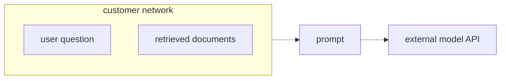
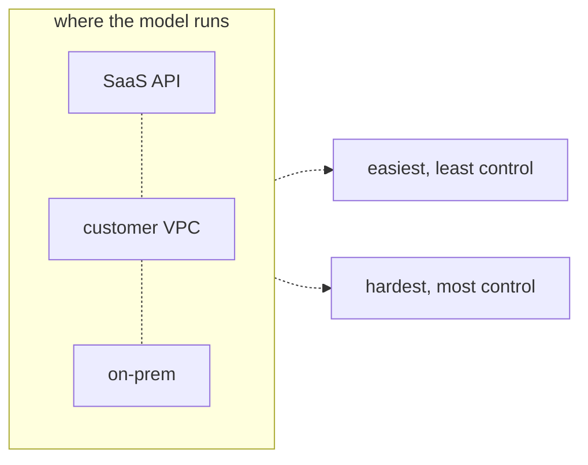
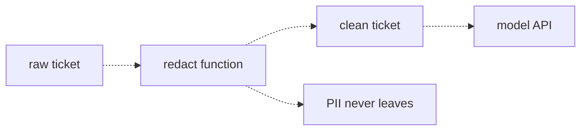

# 36 — Security, PII, and deployment
Source: notes lines 13971–14398; images: Topic 36/Screenshot 2026-10-29 182615.png, 182626.png, 182635.png

## Why it matters
The security review decides whether the project ships at all. Its first question is "show me exactly what data leaves our network".
The FDE walks in with three things: a data-flow answer, a deployment option matched to the data class, and redaction with a log and a check that prove nothing sensitive left.

## Process / steps
1. **Treat every prompt as an outbound data transfer (L1).** The question, the retrieved documents and the conversation history all leave for the model API.
2. **Classify the data (L1)** against the four project-stopping categories: PII, credentials/secrets, regulated data, trade secrets.
3. **Prepare the data-flow answer before the meeting (L1).** What enters a prompt, what is stripped before it leaves, and the log that proves it.
4. **Choose where the model runs (L2):**
   - ask the security team which data classes the assistant will touch, then map: public/internal → SaaS API, regulated → VPC, air-gap → on-prem;
   - common split: pilot on the SaaS API with strict redaction, then VPC for production if the data class demands it.
5. **Answer the training question with a fact and a document (Quiz 1).** API traffic isn't used for training by default, and the data processing terms are in the security review.
6. **Redact before the model (L3).** Run regex `re.sub` with placeholders (`[EMAIL]`, `[PHONE]`, `[ACCOUNT]`) inside the customer's network, before the API call.
7. **Prove it (T2).** Write the exact outbound message to a log before sending. A check script greps the log for the seeded PII strings and exits non-zero if any is found.
8. **Design any new prompt or answer log with the security team (Quiz 2).** Redact what is written, keep a short retention, and restrict access.

## Diagrams
### `../../Geeta or Bible for claude FDE/fde-diagrams-workflows images/Topic 36/Screenshot 2026-10-29 182615.png` (L1 What must never leave the customer)

Teaches: everything in the prompt crosses the customer boundary.

### `../../Geeta or Bible for claude FDE/fde-diagrams-workflows images/Topic 36/Screenshot 2026-10-29 182626.png` (L2 Deployment models)

Teaches: one axis, convenience against control. SaaS API is at the easy end and on-prem at the control end.
Text vs image: in the image, SaaS API, customer VPC and on-prem are joined by plain dashed lines without arrowheads, and both outcome arrows leave the group box. The ASCII uses `|` connectors. The meaning is the same.

### `../../Geeta or Bible for claude FDE/fde-diagrams-workflows images/Topic 36/Screenshot 2026-10-29 182635.png` (L3 PII redaction before the model)

Teaches: redaction sits inside the network, before the API call. The model only ever gets the clean version.
Text vs image (regexes): the .md lost the backslashes, giving `[w.+-]+@[w-]+.[w.]+`, `bd{3}-d{3}-d{4}b` and `bACC-d{7}b`. The image is correct: `[\w.+-]+@[\w-]+\.[\w.]+`, `\b\d{3}-\d{3}-\d{4}\b`, `\bACC-\d{7}\b`. Use the image versions.

## Rules and numbers
- To a security team, a model call is not "using AI". It is an outbound data transfer, reviewed like one. (L1)
- Four categories stop projects (L1):
  - PII: names, emails, phones, account numbers, national IDs;
  - credentials and secrets: passwords, API keys, tokens (they leak into tickets and wikis constantly);
  - regulated data: health records, payment cards, financial records, under GDPR and HIPAA, with real fines;
  - trade secrets: unreleased products, deal terms, confidential source code.
- None of the four categories makes the answer better. The sensitive part is baggage, not signal. (L1)
- Have the data-flow answer ready before they ask. Without a precise answer, the project stops. (L1)
- SaaS API: best quality, zero infrastructure, new models on release day. Prompts go to a third party, under the provider's contract terms. Most companies accept it for non-sensitive workloads with no-training guarantees and retention controls. (L2)
- VPC: the model runs in the customer's private cloud (e.g. their own AWS account), and prompts never cross the public internet. It satisfies most security teams, but costs more, has a smaller model selection, and someone must operate it. (L2)
- On-prem: maximum control, and air-gapped setups are possible. Usually limited to open-weight models, needs GPU hardware, and every upgrade is a manual project. Banks, defense and healthcare ask for it most. (L2)
- Don't walk in selling one option. Map data class to deployment; an air-gap requirement means on-prem, full stop. (L2)
- Major providers don't train on API traffic by default. The proof is the data processing terms. Know the fact and the document before the meeting. (Quiz 1)
- Redact means replace, not delete. Placeholders keep the sentence natural and show that an email existed. (L3)
- Regexes (from the image, L3):
  - email `[\w.+-]+@[\w-]+\.[\w.]+`;
  - phone (this customer's format) `\b\d{3}-\d{3}-\d{4}\b`;
  - account `\bACC-\d{7}\b`.
  - The task solution uses the email variant `[\w.+-]+@[\w-]+\.[\w.-]*\w`, so a sentence-ending dot isn't swallowed.
- Redaction runs inside the customer's network, before the API call. (L3)
- Regex catches structured PII only. It doesn't catch names in plain text, because names have no shape. Dedicated PII tools and model-based detectors cover that layer. (L3)
- Regex is the right first layer everywhere: cheap, fast, deterministic, easy to prove correct. It is near perfect for company-format ids. (L3)
- Ask the customer for their id formats early. A regex is only as good as your knowledge of the shapes. (L3)
- Proof the security team accepts: a log of the exact outbound content, written before sending, plus an automated check that exits non-zero if any seeded PII is present. (T2)
- A full prompt or answer log is a new data store holding user-typed content. Design it with security: redact, short retention, restricted access. (Quiz 2)

## Decision rules from quizzes
- **Quiz 1 (does our data train the model?).** A CTO asks whether maintenance manuals will train the model and show up for competitors.
  - Right move: say API calls don't train the model by default, point to the provider's no-training terms for API traffic, and offer the data processing terms for the security review.
  - Why: a fact plus a document they can verify. Facts without documents sound like sales talk; documents you haven't read sound like stalling.
  - Traps: "I'll research it after the meeting" (stalling); "the model forgets, so training is technically impossible" (inaccurate); "providers are trustworthy" (no proof).
- **Quiz 2 (log full prompts for debugging?).** Two months into production at a bank, the support lead wants full prompts and answers logged. Typed user questions aren't redacted.
  - Right move: propose full logging with safeguards designed together with the security team: the same redaction on the user question, a short retention period, and restricted access.
  - Why: it meets the debugging need without creating an unreviewed PII database, and it survives the next audit.
  - Traps: "do it, it's on their infra" (a new PII store, which risks the security approval); flat refusal (moves the problem to someone less careful); flagged-only logging (doesn't address redaction or controls).
- **Quiz 3 (hospital).** Patient data must never reach a third party, staff will type patient details, the budget is small and results are needed in weeks.
  - Right move: redact patient identifiers from every query before it leaves, run the pilot on the SaaS API over the non-sensitive manuals, and plan a VPC deployment for production.
  - Why: both requirements hold. The manuals aren't patient data, and redaction covers the typed queries.
  - Traps: ignoring the typed queries; demanding on-prem first (kills the timeline and budget); logging raw queries to study them (the very exposure that is forbidden).

## Tasks
- **T1: Redact PII from tickets before sending.**
  - Goal: `/root/fde-security-pii/redact.py` cleans 3 bank tickets (2201, 2202, 2203).
  - Method: a `redact(text)` function applies three `re.sub` calls in order (email → `[EMAIL]`, phone → `[PHONE]`, `ACC-NNNNNNN` → `[ACCOUNT]`), reads `tickets.txt`, and writes `tickets_clean.txt`. Save the raw tickets exactly as given to `/root/fde-security-pii/tickets.txt` first (seed data: notes lines 14149–14156).
  - Done: the text reads naturally, every non-PII word is kept, and no email, phone or account id remains. `mark.webb+work@corpmail.io` is caught thanks to `+` in the class.
- **T2: Prove the redaction with a check script.**
  - Goal: a security-grade proof around one live call (ticket 2210).
  - Method:
    1. `ask_redacted.py` redacts with the same three patterns and builds the outbound message (ticket + "What is the recommended next support step?").
    2. It writes that exact content to `outbound.log` before sending, then calls `deepseek-v4-flash` and saves `model_reply.txt`.
    3. `prove.sh` (bash, `set -e`) fails if the log is missing, greps the log for each seeded string (`rita.cole@oldbank.example`, `ACC-7731092`, `555-882-4410`), exits 1 on any hit, and exits 0 if clean.
  - Done: `prove.sh` prints success and exits 0. The outbound log shows `[EMAIL]`, `[ACCOUNT]`, `[PHONE]`.

## Course → real world
- **Deployment mapping** (brief + Hadavin practice):
  - the default for AWS clients is Claude on Amazon Bedrock in the client's own account and region. It is the closest practical equivalent to the course's "VPC" option, not the same thing (audit G1, R44 amended): private network path (PrivateLink / VPC interface endpoint or the cloud's equivalent), client IAM, client region, client-owned logs. The model itself runs in the cloud vendor's managed environment, not on infrastructure the client controls. Say this plainly in the security review and let the client's security team decide whether it satisfies their "VPC" requirement;
  - Microsoft Foundry on Azure and Vertex AI on GCP are the same pattern;
  - the direct Claude API (the course's "SaaS API") is used only on request;
  - true on-prem/air-gap: Claude isn't offered on-prem, so the honest answer is open-weight models on client GPUs, or decline. Say so in discovery. `[unverified 2026-11-01]` vendor offerings change: verify live and date the check before each pitch;
  - the model kind keeps a second backend outlined with its trigger (an air-gap or a client veto), so no deployment depends on one vendor.
- **Training question** (Hadavin practice): bring the client cloud's current data-privacy terms for the model service (e.g. Bedrock's statement that prompts and outputs aren't used to train models or shared with model providers) and the Anthropic commercial terms if the direct API is used. Re-check the live terms before each review; don't quote from memory.
  - Re-check live which terms govern each channel separately: the client-cloud model service, the direct commercial API, and the studio's own Claude Code account (consumer plan versus commercial). Consumer plans (Free, Pro, Max, Ultra): training on chats and Claude Code sessions follows an account setting; 5-year retention if it is on, 30 days if off (the default value of the setting is `[unverified 2026-11-01]`). Commercial terms (Team, Enterprise, API, Bedrock, Vertex): no training on prompts unless the customer opts in (the Development Partner Program is first-party API only); 30-day standard retention. `/feedback`, `/bug` and `/share` send transcripts kept 5 years; `DISABLE_FEEDBACK_COMMAND=1` turns them off. Session transcripts also sit in plaintext under `~/.claude/projects/` for 30 days by default. `[research 2026-11-01: code.claude.com/docs/en/data-usage]` Never put client data in a channel whose terms allow training or long retention (audit G2).
- **The studio is a data processor too** (Hadavin practice, audit G3; owner decision 2026-11-01 item 10): every prompt is an outbound transfer, including prompts from the studio's own laptop sessions. Standing rule: no real client data in laptop sessions or the Drive backup until a data-handling rule is agreed; demos use synthetic data; work from synthetic or redacted samples; production data stays in the client's cloud. Before any real data is touched: a DPA naming the studio as processor with its sub-processors (model vendor, hosting) listed, and a check of cross-border transfer rules per client country (UK GDPR transfers, Australian APP 8, Canada PIPEDA accountability). `[unverified 2026-11-01]` legal wording; contracts carry "not reviewed by counsel" until a lawyer is engaged.
- **Redaction layers** (brief + Hadavin practice):
  - regex redaction is always on and runs first, with patterns built from the client's own id formats (collected in discovery) and kept in config with tests;
  - ship a tested baseline pattern pack per client country on top of the client's own formats (audit G22, R229 extended): phones in +1, +44 and +61 and bracketed forms, US SSN, UK NI number and postcode, Canadian SIN, Australian TFN and Medicare, card numbers with a Luhn check, IBAN, IP address, dates of birth, street addresses. The course covers only NNN-NNN-NNNN;
  - use numbered placeholders per type (`[EMAIL_1]`, `[EMAIL_2]`) so two different emails stay distinguishable; if the answer must show the original value, keep a reversible token map inside the client network and restore after the call;
  - redaction runs on user text, retrieved chunks, tool results and history, not only on tickets, and it fails closed: if the redactor errors, the call is blocked;
  - second layer behind the PII-detector kind: neutral self-hosted default is an open-source analyzer running in the client network (Presidio is the usual candidate: MIT licence, and since 2026 an independent community project under github.com/data-privacy-stack/presidio, no longer Microsoft-owned, so pin the version and treat it as community-supported `[checked 2026-11-01: github.com/data-privacy-stack/presidio/blob/main/docs/project_transition.md]`; its latest release was not read); cloud backends are Bedrock Guardrails sensitive-information filters or Amazon Comprehend on AWS, Azure AI Language PII or Cloud DLP elsewhere. Each cloud detector is itself a call that receives the raw text unless it runs in the client's cloud;
  - redaction runs in the client's network before any model call.
- **Proof as a CI gate** (Hadavin practice):
  - the T2 pattern becomes a pytest that seeds known PII through the real request path and asserts the outbound payload has none. Capture the payload at the HTTP-client transport layer, the last point before the wire. The course's `outbound.log` is written by the same code that built the message, so it proves what the code intended to send, and `prove.sh` only finds the three PII strings you seeded. Seed many PII shapes including unseeded variants (fuzz and property tests) (audit G23, R230/R233);
  - in production the independent check is the egress proxy or endpoint logs;
  - it runs on every PR;
  - the outbound-payload log exists only in test or with the Quiz 2 controls.
- **Secrets** (brief): API keys and service-account credentials go through the secrets kind (named lookup), never in env files in the repo. Backends per cloud: AWS Secrets Manager or SSM SecureString, Azure Key Vault, GCP Secret Manager, or self-hosted Vault. Ingestion scans documents for leaked credentials before indexing.
- **Logging policy** (Hadavin practice):
  - metadata-only logs by default (topic 35);
  - any content log gets redaction, short retention (the cloud's log retention setting), encryption with the cloud's key service and IAM-restricted read access, signed off by the client's security team in writing.
- **Regulated health data is declined** (Hadavin practice, audit G25; positioning decision 2026-10-30): Quiz 3 (hospital) is exam knowledge and the answer above is right for the exam. The studio declines work that needs PHI or HIPAA-style compliance. Use R232 to answer in discovery and to explain why. Never promise "patient data never leaves" on regex redaction alone: names, free text and dates have no shape.
- **Least privilege** (brief): connectors use least-privilege service accounts, and every agent action is allowlisted, approved when risky, and audited.
- **Identities and masking (R365, R366, R367; owner hard rule 2026-11-01):** the identity table, deny-all start, exact actions and resources, conditions and ceiling, short-lived credentials, over-breadth review and masked listings are in R365. Agents see only their allowlisted tools, tables, documents and hosts, never hold approver or executor credentials, and cannot widen their own scope (R366). Include the audit reader, migrations/DBA and the human roles in the table. The approver is never also the requester or executor. PII and secrets are masked before the model, the logs and the audit trail; masks are tested with canaries. [Hadavin practice, owner 2026-11-01, changing needs the owner's yes]

## Checklist
- [ ] A data-flow diagram is written: what enters each prompt, what is stripped, where the model runs, and the log that proves it.
- [ ] The data classes touched are confirmed with the client's security team and mapped to a deployment (client-cloud Claude by default; on-prem honestly scoped).
- [ ] The current no-training / data-processing terms are read and attached to the security review pack.
- [ ] The client's id formats are collected. Regex redaction (patterns in config, country baseline pack, numbered placeholders, with tests) runs before every model call and fails closed, and a second-layer PII detector covers names.
- [ ] A PII-seeded CI test (many shapes, captured at the transport layer) proves the outbound payload is clean.
- [ ] No real client data is in the studio's laptop sessions or backups; the DPA lists sub-processors.
- [ ] Default logs hold metadata only. Any content log has redaction, short retention, encryption and restricted access, approved by security.
- [ ] Secrets are in the client's secret store, and the corpus is scanned for leaked credentials before indexing.
- [ ] Identity table written and proven (R365, R366): every identity's read and write rights, justification, negative test passed, access-analysis check, listings masked.

## Studio addition 2026-11-02 (unverified source, adopt after own test)

- Agent identity: scoped, short-lived, rotated, audited, never a human's credential (R433).
- Trust cannot be rewritten: carry semantic definitions, permissions and audit history across any rebuild (R422).
- Provider terms with residuals clauses: no core IP or client data at provider office hours; add to the lawyer-later list (R429).
- Privacy transformation with consistent synthetic identities, then verify the twin (R440); not now (studio data rule), and only inside the client's account, never copied out.

Source: Idea from public LinkedIn posts by Moonveil AI quoting others; unverified; we adopt only after our own test.
