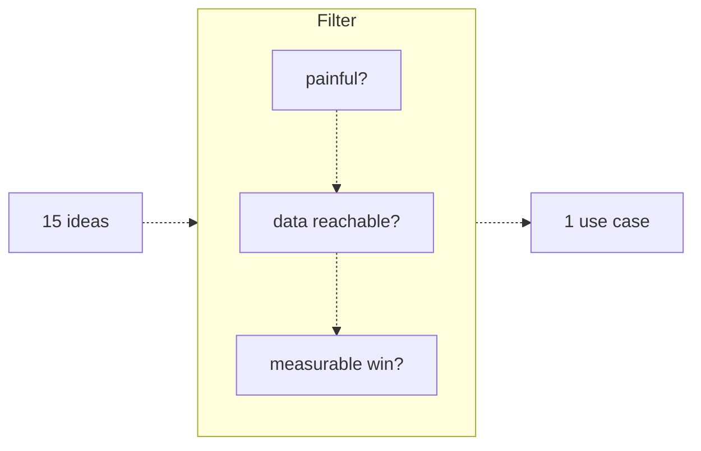

# 37 — Discovery and scoping

Source: notes lines 14399–14644; images: Topic 37/Screenshot 2026-10-29 182710.png

## Why it matters
Discovery is the first stage of the engagement lifecycle, and its exit artifact is a **scoping document**.
The FDE turns a wish list of about 15 ideas into **one** use case that can visibly win in weeks.
The FDE also declines bad fits without losing the sponsor.
Pick wrong here and no later stage can recover.

## Process / steps
Stage order in this topic is L1, Q1, L2, Q2, T1, Q3, so the course's node count is 6 ("Lesson 1 of 6").

**Stage exit artifact: the scoping document**, with four sections in this order:
1. Use case
2. Out of scope
3. Success metric
4. Risks

It is written before any code. (T1)

1. **Collect the wish list.** Ask the customer team what they want the AI to do. Expect about 15 ideas within an hour. (L1)
2. **Filter every idea with three questions**, in this order (L1):
   1. **Painful?** Does someone lose real hours or real money every week?
   2. **Data reachable?** Ask where the data lives and who can grant access, on day one.
   3. **Measurable win?** You must be able to state the number. For example, "cut average ticket handling time from 20 minutes to 8".
3. **Sort the ideas.** An idea that passes all three is a candidate. An idea that fails even one goes to the **parking lot**, politely, with a reason. (L1)
4. **Prefer the boring idea.** Boring, reachable and measurable beats impressive in a first engagement. Pick the idea where AI can visibly win in weeks. (L1)
5. **Screen out bad fits** (L2). The four shapes:
   - no tolerance for error;
   - no data;
   - no measurable outcome;
   - cheaper without AI.
6. **Decline with the three-move "no"** (L2):
   1. Name the real risk out loud.
   2. Reshape the idea into a safe version, where the human keeps the decision.
   3. Offer a path back: prove the safe version first, then revisit "with real numbers".
7. **Write the scoping document** (T1):
   - **Use case:** the idea that passes all three filters.
   - **Out of scope:** at least 2 rejected ideas, each with a reason.
   - **Success metric:** a concrete number from the brief.
   - **Risks:** what could still sink it.

## Diagrams
### Topic 37/Screenshot 2026-10-29 182710.png — "Filter"

What it teaches: every idea passes through all three questions in sequence, and only one use case comes out.

Text vs image: the ASCII joins the three questions with plain lines and points the input arrow at "data reachable?". The image draws dashed arrows top to bottom (painful? → data reachable? → measurable win?), and the in/out arrows attach to the Filter group as a whole. Image wins: the order is sequential and the group is a single gate.

## Rules and numbers
- Build one use case first. You have weeks, not years. (L1)
- Ask "Is it painful?" first. If nobody is suffering, nobody will fight for the project at budget review. (L1)
- Confirm data access on **day one**: where it lives, and who grants access. An assistant over data you cannot access "is a slide, not a product". (L1)
- State the win as a number, not a wish ("make support better" is a wish). If you cannot state the number, you cannot prove success later. (L1)
- An idea that passes all 3 filters is a candidate. If it fails even 1, it goes to the parking lot, politely, with a reason. (L1)
- Do not pick the flashiest idea. The flashiest is rarely the best first build. (L1)
- Do not let an LLM own a decision where one wrong answer means a lawsuit or a regulatory fine. (L2)
- Reject ideas with no data: nothing to retrieve, nothing to evaluate against. (L2)
- Reject ideas with no measurable outcome: you cannot demo them or prove them. (L2)
- Recommend the simpler fix (a database query or a form) when it is cheaper without AI. It builds more trust. (L2)
- Never say "that will not work". Use the three moves: name the risk, reshape, offer a path back. (L2)
- Protect the customer from their own risky ideas. That is what makes you a partner, and partners get renewals. (L2)
- The scoping doc must contain these 4 H2s, spelled exactly: `## Use case`, `## Out of scope`, `## Success metric`, `## Risks`. (T1)
- Out of scope lists at least 2 rejected ideas, each with a reason. (T1)
- The success metric is a concrete number taken from or derived from the brief. (T1)
- Every section has real sentences. A heading with one line under it fails. (T1)

## Decision rules from quizzes
- **Q1. Meridian Logistics (900 staff), 6-week build, four use cases.**
  - Right move: pick the driver-policy assistant over the 80-page ops handbook.
  - Why: it is the only option that passes all three filters. Pain is counted (about 40 supervisor interruptions a day), the data is one PDF available today, and the win is measurable.
  - Traps:
    - The rate-renegotiation agent is the CFO's favourite but unsafe to pilot.
    - The fraud detector has no measurable baseline: "sometimes", and no past examples.
    - The public website chatbot can be built, but it exposes early mistakes to customers instead of forgiving internal users.
  - First projects exist to build trust.
- **Q2. Halbrook Insurance CEO wants automated claim payouts** (regulated, fines, inconsistent history).
  - Right move:
    1. Agree with the goal.
    2. Name the regulatory exposure.
    3. Reshape: the AI drafts a payout recommendation with cited evidence, and a licensed adjuster decides.
    4. Offer to revisit automation once there is pilot accuracy data.
  - Traps:
    - Saying yes puts your name on a failure you predicted.
    - A flat "won't work" makes you the blocker, and the CEO routes around you.
    - "I'll investigate", then silence, only postpones the talk to a moment you do not control.
  - Name the risk in business terms (fines), not "the model is not good enough".
- **Q3. Retail store-miss prediction.** The data is "somewhere in the BI system" and success means "better visibility".
  - Right move: keep it out of the first build.
  - Why: it fails two filters at once. The data is not confirmed reachable, and there is no measurable win.
  - Traps: blaming the technology, the sponsor's seniority or the data size. Prediction can be viable with labelled history, and data volume is solvable engineering.

## Tasks
- **T1. Write a scoping document for a brief (Northgate Medical Group, 1,200 staff).**
  - Goal: a sponsor-ready doc that says what the first build is, what it is not, and how success is known.
  - Method:
    1. Save the brief verbatim to `/root/fde-discovery-scoping/brief.txt` (seed data: notes lines 14527–14539).
    2. Run the three filters on each idea in the brief:
       - IT-policy handbook Q&A: about 60 repeated questions a day, 9 minutes each, a 45-page PDF updated quarterly that IT can share today. Passes.
       - COO's patient-record billing-error AI: the compliance review takes 6+ months. Fails "data reachable".
       - Password resets in Active Directory: no API access approved. Fails.
    3. Write `/root/fde-discovery-scoping/scoping.md` containing the 4 H2s, spelled exactly.
  - Done looks like:
    - **Use case:** an internal RAG assistant over the 45-page IT handbook.
    - **Out of scope:** the billing-error AI and the AD resets, each with its reason.
    - **Success metric:** cut lookup time from 9 minutes to under 2 minutes per ticket across about 60 a day, over the 6 weeks. (The brief gives only 9 minutes and about 60 a day; "under 2 minutes" is the sample solution's own choice, not a course threshold.) (The brief gives only 9 minutes and about 60 a day; "under 2 minutes" is the sample solution's own choice, not a course threshold.)
    - **Risks:** quarterly handbook drift (re-index and re-evaluate on each new version), and adoption friction if accuracy is low (prompt tuning, strict abstain thresholds).
    - Real sentences in every section.

## Course → real world
- **Discovery call (Hadavin practice):** run it as a fixed-price "discovery sprint" with the sponsor.
  - Keep the course's three filters as the gate, in order: painful, data reachable, measurable.
  - Record each of the ~15 ideas with a pass/fail per filter and a reason. The parking lot is a written list, not a memory.
- **"Data reachable" means proven access, not promised (Hadavin practice):**
  - before scoping closes, get a least-privilege service account, or a sample export, from the system of record (the SaaS API, the database, the file drop);
  - store the credentials in the client's secret store through the secrets kind (AWS Secrets Manager or SSM, Azure Key Vault, GCP Secret Manager, or self-hosted Vault), never in env files in the repo;
  - client data location (Hadavin practice, audit I-01; owner decision 2026-11-01 item 10): a sample export stays in the client's environment. It is never saved into the studio folder (`research\`, `projects\`, `memory\`, `egm\`) or anywhere the Drive backup copies, because that backup keeps old versions and never deletes, which breaks the data-flow answer and the delete-on-exit promise. No real client data in laptop sessions until a data-handling rule is agreed; the repo and notes hold only redacted or synthetic samples. Written client approval is needed for any copy to the owner's laptop. (PROJECT-PLAYBOOK step 0.10 is the playbook owner's to add.)
- **Bad-fit screen for typical Hadavin builds (Hadavin practice):**
  - Invoice/PO automation and agents with actions often hit "no tolerance for error".
  - Reshape them into governed actions: an allowlisted, schema-checked tool with a human approval step and an audit trail. This is the course's "human keeps the decision".
  - Payments, approvals and regulated decisions stay with a human.
- **Scoping document = the proposal's scope annex.** The fixed price is pinned to it.
  - Keep the course's 4 sections.
  - Hadavin adds (Hadavin practice): the tool options and the client's written choice for the model provider, the cloud and every other outside tool (owner guardrail 2026-11-04, options first, R446: Claude in the client's cloud with a named second backend in the model kind is one option, never a silent default; nothing is applied until the client has chosen), data sources with their owners, and the engagement calendar.
- **Timeline:** the course uses 6 weeks. Hadavin compresses the calendar but keeps the stage. No build starts without a signed-off scoping doc.

## Checklist
- [ ] Every proposed idea is listed with pass/fail on painful, data reachable and measurable win.
- [ ] Exactly one use case is chosen, and it passes all three filters.
- [ ] Data access is confirmed: who grants it, and a sample or credential in hand, not a promise.
- [ ] Each parked idea has a written reason. Bad fits were declined with risk, reshape and path back.
- [ ] The success metric is a number taken from the customer's own figures.
- [ ] `scoping.md` has Use case / Out of scope / Success metric / Risks in full sentences, and the sponsor has signed off.

## Studio addition 2026-11-02 (unverified source, adopt after own test)

- Recipient test in scoping: recipient, decision, where they already are (R419).
- Write what the client must own: data, definition of done, who signs the outcome count (R431).
- Front-desk test: name the person and the daily step that should go away (R437).
- Graduation bar and production owner before the prototype (R421); evals in the first call (R439).

Source: Idea from public LinkedIn posts by Moonveil AI quoting others; unverified; we adopt only after our own test.
