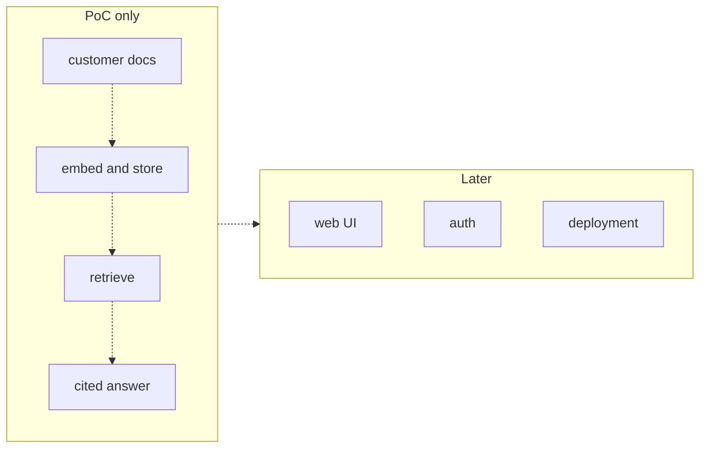

# 38 — Rapid prototyping

Source: notes lines 14645–14940; images: Topic 38/Screenshot 2026-10-29 182748.png

## Why it matters
After scoping, the sponsor's belief fades every day nothing is visible.
The next stage is a **proof of concept (PoC) in days**. It proves the risky part, retrieval plus grounded, cited answers, on the customer's **own data**.
Its exit artifact is a **working cited answer over their documents, run from a script**.
The PoC also produces **early truth**: if retrieval fails on their documents, you learn it while scope can still change.

## Process / steps
Stage order in this topic is L1, Q1, T1, Q2, Q3, so the course's node count is 5 ("Lesson 1 of 5"). The notes label both Q2 and Q3 as "Topic 38 - Quiz 1/2"; this file numbers them in order.

**Stage exit artifact:** a terminal or script demo. A question goes in and a cited answer comes out, over the customer's real documents, backed by a vector store of id + text + embedding.

1. **Pick the risky part.** For a handbook assistant, that is retrieval plus grounded answers. Nobody doubts the login page. (L1)
2. **Build only the core (PoC only)**, in this order (L1, image):
   1. customer docs
   2. embed and store
   3. retrieve
   4. cited answer
3. **Run it from a terminal or a plain script.** No web UI, no user accounts, no deployment pipeline. (L1)
4. **Defer packaging to "Later":** web UI, auth, deployment. (L1, image)
5. **Ship in days.** "A demo in day four says 'these people deliver'." (L1)
6. **Collect feedback.** The customer sees real answers and tells you what matters. That is worth more than a requirements document. (L1)
7. **Turn enthusiasm into a safe path** when the customer wants to ship the PoC as is (Q2):
   - say yes to the goal and no to the timeline;
   - name a hardening plan;
   - run a small pilot group. This hands off to Topic 40.

## Diagrams
### Topic 38/Screenshot 2026-10-29 182748.png — "PoC only" → "Later"

What it teaches: the PoC is only the four-step core pipeline. Web UI, auth and deployment come after it, and they are unordered and unconnected.

Text vs image: they match. The ASCII also shows the four core steps in a chain, and the "Later" box holds three unconnected items.

## Rules and numbers
- A PoC has exactly one job: prove the risky part works on **real customer data**. (L1)
- PoC scope is limited to: their documents embedded and searchable, a question in and a cited answer out, run from a terminal or a plain script. (L1)
- Build no web UI, no user accounts and no deployment pipeline in a PoC. (L1)
- Deliver in days, not weeks. Aim for a demo by about day four. (L1)
- Find out whether retrieval fails on messy PDFs in week one, while scope can still change. (L1)
- Cut everything around the core, never the core itself. Retrieval and citations must genuinely work. (L1)
- Safe to cut: the web interface. (Q1)
- Never cut citations, and never swap the customer's documents for public or clean ones. (Q1)
- Crude fixed chunking (e.g. 500 characters instead of section boundaries) is in-between. It is sometimes acceptable, but it degrades the answer quality being judged. (Q1)
- Never roll a prototype out to all users. If it has no access controls, logging, error handling or tests, and hardcoded paths, harden it first. (Q2)
- Example plan from the course: a two-week hardening plan plus a 10-agent pilot group. (Q2)
- Do not run an as-is pilot without logs. A pilot that cannot teach you anything wastes the point of a pilot. (Q2)
- Do not spend scarce PoC days on polish. Three of five days on UI leaves two for the core, with no time to react. (Q3)
- T1 vector store shape: a JSON array of objects with `id` (the filename), `text` and `embedding`. (T1)
- T1 models: embeddings `text-embedding-3-small`, chat `deepseek-v4-flash`. (T1)
- The answer must name the source document filename. (T1)

## Decision rules from quizzes
- **Q1. Ostrava Rail, one-week PoC over equipment manuals; one item must be dropped by Friday.**
  - Right move: cut the web interface and demo from a terminal script.
  - Why: the interface proves nothing about the risky part.
  - Traps:
    - Dropping citations removes verifiability.
    - Public manuals remove the one question that matters: does it work on our data?
- **Q2. Copperline Bank wants the PoC rolled out to all 200 support agents on Monday.** The PoC has no access control, no logging, no error handling, hardcoded paths, and was tested on about 20 questions.
  - Right move: share the enthusiasm, say the PoC proved the approach but is not safe for 200 users yet, and propose a two-week hardening plan plus a 10-agent pilot.
  - Traps:
    - A Monday rollout gambles the engagement.
    - A flat "a full quarter first" wastes the best relationship moment.
    - An as-is 15-agent pilot without logs cannot teach you anything.
- **Q3. A colleague wants 3 of 5 PoC days on a polished web UI for lawyers.**
  - Wrong because: it spends the time on the part nobody doubts.
  - Prove retrieval and cited answers over the actual contract templates first. A terminal demo with correct cited answers beats a beautiful page with shaky ones.

## Tasks
- **T1. Build a minimal PoC from a brief (Copperline Bank IT policy).**
  - Goal: one script that answers from the customer's documents and names the source.
  - Method:
    1. Save the 3 documents verbatim, with exactly these filenames and contents, as `/root/fde-rapid-prototyping/docs/{vpn,passwords,devices}.txt` (seed data: notes lines 14730–14734, 14739–14742, 14748–14751). vpn: GlobalConnect client, sessions expire after 12 h. passwords: ≥14 characters, change every 180 days, resets at `reset.copperline.internal`, 5 failed logins → 30-minute lock. devices: disk encryption + Sentinel endpoint agent, personal phones use only the managed mail app, lost devices reported within 4 h.
    2. Embed all three texts in one batch call (`text-embedding-3-small`).
    3. Write `/root/fde-rapid-prototyping/store.json` as `[{id, text, embedding}]`.
    4. Embed the question "how do i reset my password if my account is locked".
    5. Rank the documents by cosine similarity and take the top 1.
    6. Call the chat model (`deepseek-v4-flash`) with a system prompt: "answer using ONLY the provided document … name the source document filename". Pass the document with its id in the user turn.
    7. Write the answer to `/root/fde-rapid-prototyping/answer.txt`.
  - Done looks like: `answer.txt` cites `passwords.txt` and gives the self-service portal `reset.copperline.internal`. It also mentions the 30-minute lock after five failed attempts.
  - The core retrieval step is the lesson:
    ```python
    ranked = sorted(store, key=lambda c: cosine(q_emb, c["embedding"]), reverse=True)
    best_doc = ranked[0]
    ```

## Course → real world
- **Same four-step core, client stack (Hadavin practice):**
  - Customer documents go to an S3 bucket (or the client's file drop).
  - Embed and store behind the vector-store kind. Neutral default: pgvector (Postgres the client runs or we host in their cloud). Per-cloud alternatives: Bedrock Knowledge Bases on S3 Vectors on AWS, Azure AI Search, Vertex AI Vector Search. Keep the course's id + text + vector + metadata record shape.
  - Retrieve, then a cited answer from Claude via the client's cloud: Bedrock (recommended on AWS after the client has chosen, R446), Foundry on Azure, Vertex AI on GCP. Sonnet 5.5 is the usual result for hard work (tier per R278/R279); Haiku 5.5 handles cheap or fast steps.
  - The model kind has a neutral default plus at least one alternative (another provider on the client's cloud, or an open-weight model the client hosts), chosen by config. The PoC eval set runs against both before the pilot (audit H-03).
  - Embeddings, e.g. Cohere Embed v4 or Titan on Bedrock. Pin the embedding model id and its dimension in config; changing either means a full re-index.
  - Model ids are pinned in config, never literals in code.
  - `[unverified 2026-11-01]` re-check before each client SOW: Bedrock Knowledge Bases on S3 Vectors availability and regions; Sonnet 5.5 and Haiku 5.5 ids and deprecation dates (also whether the client account has Bedrock model access for those ids, audit M2); Cohere Embed v4 and Titan status; Azure Foundry and Vertex model availability.
- **Name the risky part for this type (Hadavin practice, audit I-11):** the course PoC proves retrieval plus a cited answer because that is the risky part of a handbook assistant. For other types it is different: SQL correct on the client's real schema; extraction field accuracy on real invoices; tool-call correctness on the real API. The PoC proves that one thing on real data from a terminal. Treat the four-step order and the embedder items as "document Q&A" only.
- **The PoC must be able to abstain (Hadavin practice, audit H-08):** the course code takes `ranked[0]` with no threshold, so it can never say "I do not have that in the documents", yet the next topic's demo (39 L1) requires that path. Set a similarity floor tuned on the customer's own documents, and test it with one out-of-scope question. Stage 3's deliberate-limit demo depends on it.
- **Real documents stay in the client's environment (Hadavin practice):** they come through the read-only connector and are not copied into the studio folder or the Drive backup (topic 37, topic 36).
- **The PoC is still a script, but a typed one (Hadavin practice):**
  - a small uv package (config, adapter, core, CLI) with ruff, and pytest on the retrieval and citation core;
  - the real documents come through a least-privilege read-only connector;
  - this lets the PoC grow into the pilot code instead of being thrown away. UI, auth and deploy still wait.
- **Must-not-cut list from the course:** real customer data, citations and decent chunking.
  - Hadavin practice: also keep regex PII redaction on from day one when documents may contain personal data.
- **Timeline:** the course says "days, demo by about day four". Hadavin keeps that or shorter. The stage's exit is the recorded terminal demo on the client's data.
- **"Ship it Monday" reply (Hadavin practice):** answer with the course's hardening-plus-small-pilot move. Hardening means access control, structured logs and OpenTelemetry traces, error handling, config instead of hardcoded paths, an eval set beyond about 20 questions, and CI gates.

## Checklist
- [ ] The PoC runs on the customer's real documents, not public or cleaned copies.
- [ ] Chain works end to end: docs → embed and store → retrieve → cited answer, and one out-of-scope question abstains.
- [ ] Every answer names its source. Citations were not cut.
- [ ] No UI, auth or deploy work was done before the core worked.
- [ ] The demo was shown within days, and retrieval failures on messy documents are noted for scope.
- [ ] If the customer wants to ship: a named hardening plan and a small, logged pilot group were proposed.
