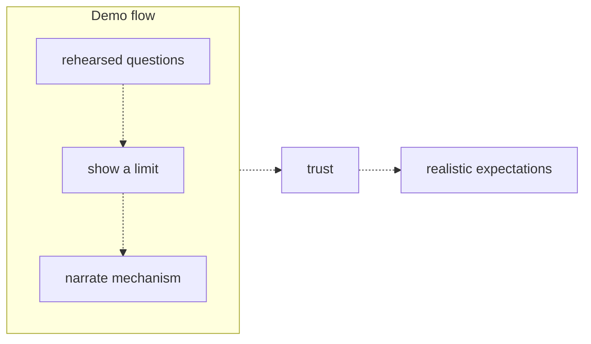
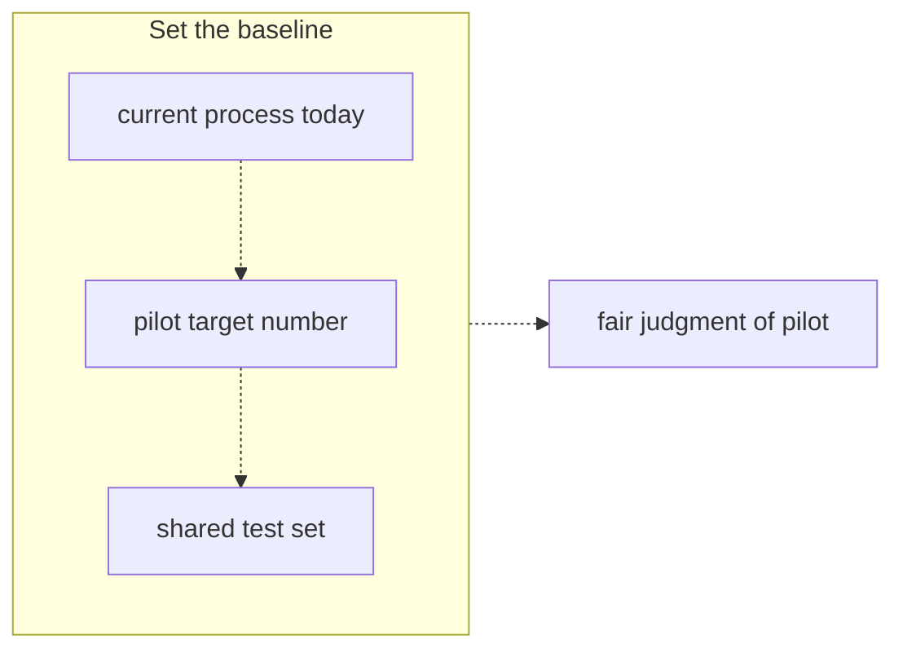

# 39 — Demos and expectations

Source: notes lines 14941–15106; images: Topic 39/Screenshot 2026-10-29 182813.png, Topic 39/Screenshot 2026-10-29 182825.png

## Why it matters
The demo is the moment the whole company forms its impression of AI. What it sees becomes the expectation bar for everything after.
This stage has two exit artifacts:
- **realistic expectations from an honest demo**;
- **an agreed accuracy baseline**: today's process numbers, a pilot target number and a shared test set.

Without them the pilot is judged against perfection and always fails.

## Process / steps
Stage order in this topic is L1, Q1, L2, Q2, Q3, so the course's node count is 5. Image 182825 is "Lesson 3 of 5".

**Stage exit artifacts:**
1. a demo that showed a limit and narrated the mechanism, giving trust and realistic expectations;
2. the baseline: current process today, a pilot target number, and a shared test set built with the customer.

**A. Run the demo ("prepare like a pilot, not like a magician")** (L1)
1. Use real customer data, live.
2. Rehearse the happy path, then keep it. Run your planned questions on the same data, the same day.
3. Show one failure on purpose. Ask something it cannot answer, and let it say "I do not have that in the documents".
4. Narrate the mechanism: "It is now searching the handbook, and here is the section it found."
5. State the boundary as a feature. Never use overpromise sentences.

Image order of the demo flow: rehearsed questions → show a limit → narrate mechanism. That leads to trust, and trust leads to realistic expectations.

**B. If it fails live** (Q1)
1. Thank the person who caught the error.
2. Open the cited source on screen.
3. Explain that this is why every answer carries a citation.
4. Log the question for the eval set.

**C. Set accuracy expectations** (L2). Image order:
1. **Current process today:** ask the customer to estimate today's accuracy and time with you.
2. **Pilot target number:** a number, not an adjective.
3. **Shared test set:** built with the customer, so the score is theirs.

This leads to a fair judgment of the pilot.

Then say the error handling out loud: what happens on the wrong 1 in 10.

**D. In the contract** (Q2): replace any "100%" clause with:
- a target accuracy on a jointly built test set;
- measured monthly;
- remedies below the threshold;
- the human verification workflow written in.

## Diagrams
### Topic 39/Screenshot 2026-10-29 182813.png — "Demo flow"

What it teaches: rehearsed questions, a deliberately shown limit and a narrated mechanism together earn trust, and trust yields realistic expectations.

Text vs image: the ASCII joins the three demo boxes with plain lines. The image draws dashed arrows top to bottom. Otherwise they match. Image wins: the order is sequential.

### Topic 39/Screenshot 2026-10-29 182825.png — "Set the baseline"

What it teaches: measure today's process first, then set a pilot target against it, then fix a shared test set. Only then can the pilot be judged fairly.

Text vs image: the ASCII uses plain connecting lines, and the image uses dashed downward arrows. Otherwise they match.

## Rules and numbers
- Use real customer data, live. A demo over polished fake data gets found out the moment a real user tries it. (L1)
- Rehearse the planned questions on the same data, the same day. Demos are not the place for untried questions. (L1)
- Show one failure on purpose. A system that admits limits is more credible. (L1)
- Narrate the mechanism. "The mechanism builds trust; magic builds suspicion later." (L1)
- Never say "It handles basically any question", "Accuracy is not really an issue" or "This could easily connect to your ERP too". Each one becomes a requirement in someone's notes. (L1)
- State the boundary as a feature: "we would rather it says I do not know than guess". (L1)
- Show the limit before they find it. If you showed it first, you look honest. If they find it first, you look caught. (L1)
- Never compare the AI to perfection. Compare it to the current process. (L2)
- Course example: agents are right about 80% of the time at 9 minutes per answer. The assistant at 90% in 10 seconds with a checkable citation is a large real improvement. (L2)
- Give a number, not an adjective: "9 out of 10", not "very accurate". (L2)
- Build the test set with the customer, so the score is their score. (L2)
- Name the plan for the wrong answers: citations, agents verify before acting, and wrong answers get logged and fixed weekly. (L2)
- Never invent current-process numbers. Estimate them with the customer. (L2)
- Never sign "100% correct" accuracy clauses. (Q2)
- Never redefine "correct" to dodge a clause. It is a trap that detonates at the first dispute. (Q2)
- Never delete the protection without a replacement. That reads as dodging accountability. (Q2)
- Never demo on cleaned-up or rewritten copies of the customer's documents. (Q3)

## Decision rules from quizzes
- **Q1. Vantera Foods COO types her own question; the assistant says "16 weeks fully paid"; HR says 12.**
  - Right move:
    1. Thank the HR director.
    2. Open the cited handbook section on screen.
    3. Explain that citations exist exactly for this.
    4. Log the question for the eval set.
  - Why: it shows the safeguard working, diagnoses the cause live (bad retrieval, a stale document or a model error), and shows that a feedback loop exists. Executives remember composure more than perfection.
  - Traps: defending the answer, calling it a "glitch" and restarting, and a bare apology that names the weakness without showing the safeguard.
- **Q2. Delagua Utilities procurement adds "correct in 100% of cases or terminate without payment".**
  - Right move: reject the clause and substitute a target accuracy on a jointly built test set, measured monthly, with agreed remedies below the threshold, plus the human verification workflow in the contract.
  - Why: the need behind the clause (protection) is legitimate. Procurement accepts measurable clauses; they wrote a vague one because nobody offered a precise one.
  - Traps:
    - Signing it creates a permanent termination trigger.
    - "Correct = has a citation" detonates at the first dispute.
    - Deleting the clause with no commitment reads as dodging.
- **Q3. A colleague wants to swap the messy manuals for a clean rewritten copy for the board demo.**
  - Wrong because: it proves the system on documents the customer does not have. Real users on the real manuals get visibly worse answers in week one, and you look caught.
  - A slightly rougher honest demo beats a polished false one.

## Tasks
None in this topic (only lessons and quizzes).

## Course → real world
- **Demo script (Hadavin practice):**
  - About 5 to 8 rehearsed questions run the same morning on the client's real data in their cloud account.
  - Plus 1 planned out-of-scope question that must return the abstain message.
  - Plus a live "show the citation" step.
  - The narration follows the pipeline: guard, then retrieve, then cite.
- **Synthetic-data exception (Hadavin practice exception, owner 2026-11-01; audit I-14):** the course says use real customer data live (L1). A pre-sales studio demo may use synthetic data if the screen says "Staged on synthetic data". It never counts as the Stage 2 exit (R57, R48). R236 itself is amended by the RULES owner.
- **Permission and NDA check before real data (Hadavin practice, audit H-13):** before ingesting real documents for a live demo, confirm the NDA or DPA is signed and that the demo shows only documents every attendee may see (document-level permission). Rehearse with the audience's real access level. Real client data stays out of laptop sessions and the Drive backup until a data-handling rule is agreed.
- **Recording (Hadavin practice):** save the demo transcript with traces (OpenTelemetry). A live failure gets added to the golden dataset the same day, as the course logs it for the eval set.
- **Baseline worksheet (Hadavin practice):** fill it in with the customer in the meeting after the demo:
  - today's accuracy estimate and time per task, the customer's own numbers;
  - the pilot target;
  - the owner of the shared test set.
- **Contract language (Hadavin practice):** fixed-price SOWs never promise 100%.
  - The quality clause is the course's substitute: a target on a jointly built test set, a monthly measurement, remedies, and human verification.
  - Define "remedies" in the SOW as capped, specific and ours to choose from (audit H-10): re-work at no charge for N weeks, a service credit up to X% of the fee, or termination without further fees. The price pays for delivery plus honest measurement; a missed pilot triggers the remedy ladder, not a refund of delivered work. Contract edits go through EGM first, and contracts carry "not reviewed by counsel" until the owner engages a lawyer (decision 2026-11-01 item 9). The payment schedule is 40/30/30, Net 14 (see `egm\pricing\pilot-fee-recommendation-2026-11-01.md`).
  - For governed actions, the human approval step is written in as part of the operating model.
- **Overpromise guard (Hadavin practice):** the sales and demo copy says only what the scoping doc covers. "Could connect to your ERP" goes to the parking lot, not the pitch.

- **Fair judgment of the pilot (studio addition 2026-11-02, method not measured; R413 to R415):** the baseline is several normal weeks (median), with the "normal" rule written before results and excluded weeks listed; a pass also needs the flagged hard weeks scored separately on harm and hand-back (where load varies by week), with the hard-week definition in numbers, a maximum extension (priced change order) and the buyer-chosen fallback ("go live with the limit written", which does not raise the autonomy level, or "quiet weeks only") signed before day one. A demo or replay score is never presented as a pilot result.

## Checklist
- [ ] Demo questions were rehearsed on the real data the same day.
- [ ] One deliberate limit was shown, and the assistant abstained correctly.
- [ ] The mechanism and citations were narrated and shown on screen. No overpromise sentences were used.
- [ ] Any live failure was handled with: open the source, explain the citation, log it to the eval set.
- [ ] Today's accuracy and time were estimated with the customer, not invented.
- [ ] The pilot target is a number, and the shared test set has an agreed owner.
- [ ] The contract has a measurable accuracy clause plus human verification, and no "100%".

## Studio addition 2026-11-02 (unverified source, adopt after own test)

- A demo with no graduation bar and no production owner is labelled a demo (R421). Recipient test for the demo output (R419). Ship small with a cheap undo (R441).

Source: Idea from public LinkedIn posts by Moonveil AI quoting others; unverified; we adopt only after our own test.
