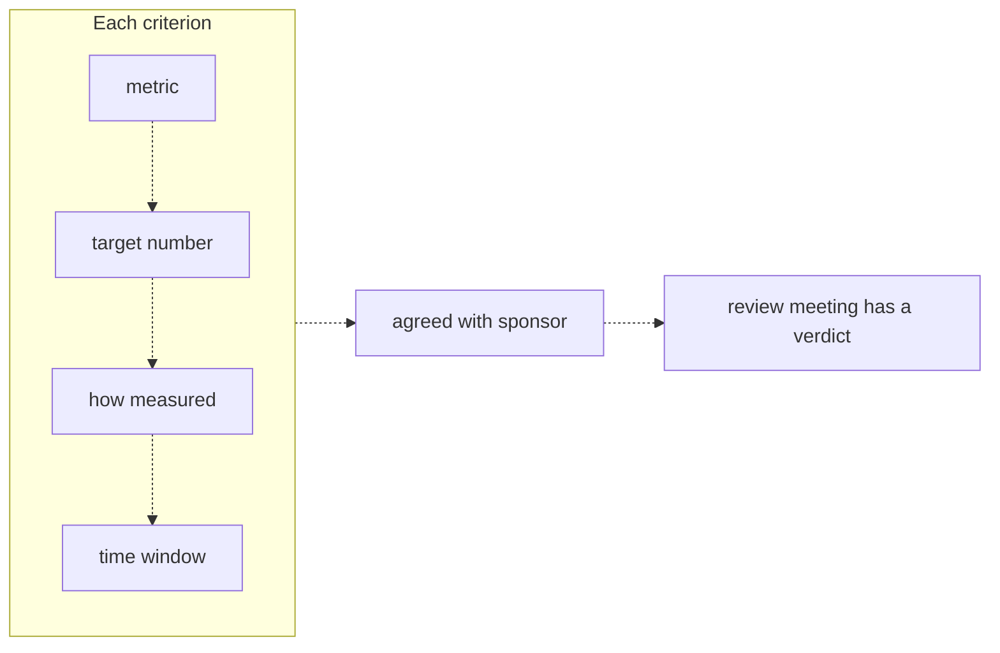
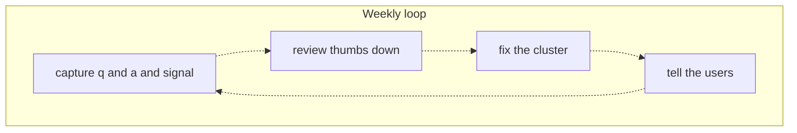
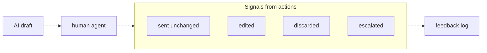

# 40 — Running a pilot

Source: notes lines 15107–15518; images: Topic 40/Screenshot 2026-10-29 182857.png, Topic 40/Screenshot 2026-10-29 182910.png, Topic 40/Screenshot 2026-10-29 182921.png

## Why it matters
The pilot is the stage that produces the verdict.
- **Entry artifact:** a success-criteria file agreed with the sponsor **before the pilot starts**.
- **Running artifacts:** a feedback log, an escalation file, and human-in-the-loop action counts.
- **Exit artifact:** a review-meeting verdict against the agreed numbers.

Without upfront criteria, "the loudest story wins". Without a feedback loop, the pilot wastes its most valuable output.

## Process / steps
Stage order in this topic is L1, T1, L2, L3, T2, Q1, Q2, Q3, so the course's node count is 8. The images show L1 as 1 of 8, L2 as 3 of 8 and L3 as 4 of 8.

**Before the pilot starts** (L1, T1)
1. Write 2 or 3 success criteria. Each one has four parts, in the image's order:
   1. metric
   2. target number
   3. how measured
   4. time window
2. Capture the **baseline** numbers before the pilot.
3. Get the criteria **agreed with the sponsor**, in writing.
4. Exit artifact for this step: `success-criteria.md` with Metrics, Baseline, Measurement and Review date.

**During the pilot: the weekly loop** (L2). Repeat each week:
1. **Capture** the question, the answer and a satisfaction signal (thumbs up or down, one click).
2. **Review** the thumbs-down items only, once or twice a week. About 20 minutes is enough.
3. **Fix the cluster**, not each item.
4. **Tell the users** what was fixed. Then back to Capture.

**During the pilot: human in the loop** (L3)
1. The AI writes a draft. A human agent sends it unchanged, edits it, discards it, or escalates it.
2. Each action goes to the feedback log.
3. Count the actions weekly.
4. **Escalation rule:** do not wait for the weekly review for:
   - a thumbs-down on a safety-related answer;
   - 3 thumbs-downs on the same question.

   These go straight to a file or channel that a human checks daily. (T2 implements a simplified version: every thumbs-down goes to the escalation file.)

**End of the pilot** (L1, Q1–Q3)
1. Hold the review meeting on the agreed time window.
2. Give a verdict against the agreed numbers.
   - On a miss: call it a miss, separate the verdict from the diagnosis, and give the sponsor the options and the decision.
3. Watch for disagreeing metrics. High usage plus a high thumbs-down rate is not success.

## Diagrams
### Topic 40/Screenshot 2026-10-29 182857.png — "Each criterion"

What it teaches: a criterion is complete only with all four parts. It must be sponsor-agreed before the pilot, so the review meeting can reach a verdict.

Text vs image: the ASCII uses plain connecting lines, and the image uses dashed downward arrows. Otherwise they match.

### Topic 40/Screenshot 2026-10-29 182910.png — "Weekly loop"

What it teaches: the loop is a closed cycle. Telling the users feeds back into capture, because it keeps users reporting.

Text vs image: they match. Both close the loop from "tell the users" back to "capture q and a and signal".

### Topic 40/Screenshot 2026-10-29 182921.png — "Signals from actions"

What it teaches: every human action on an AI draft is a free quality signal. The four outcomes all land in the feedback log.

Text vs image: they match. The four signals are unconnected boxes inside the group.

## Rules and numbers
- Write the success criteria down, and get the sponsor to agree, **before** the pilot starts. (L1)
- A criterion has 4 parts: metric, target number, measurement method (who counts it, from what data), and time window. (L1)
- Example metrics: answer accuracy, handling time, deflection rate, weekly active users. (L1)
- Give a target number, e.g. "85 percent of answers rated correct", not "high accuracy". (L1)
- Measurement example: "the 50-question test set we built with the support team, scored weekly". (L1)
- Time window example: "measured over the final two weeks of the pilot", so week-one teething problems do not decide the outcome. (L1)
- Use 2 or 3 criteria: one quality metric, one usage or time metric, maybe one satisfaction metric. "Ten criteria means none of them matter." (L1)
- Capture the baseline before the pilot. You cannot show a drop from 9 minutes if nobody measured the 9. (L1)
- Criteria proposed after the results look chosen to flatter them. (L1)
- Use the written criteria and scope to block moving goalposts, e.g. a new stakeholder in week five. (L1)
- T1 file must contain these 4 H2s, spelled exactly: `## Metrics`, `## Baseline`, `## Measurement`, `## Review date`. (T1)
- T1 needs 2 or 3 metrics, each with a target, and at least one target as a percentage. (T1)
- Measurement may use only data sources named in the brief. (T1)
- T1 needs full sentences. One word under a heading fails. (T1)
- Log every question, every answer and a satisfaction signal. The simplest signal is a thumbs up or down. (L2)
- Review the thumbs-down items once or twice a week. Read only the failures. Even 20 minutes finds the patterns. (L2)
- Fix the cluster, not each item. Typical clusters: a missing document, a bad chunk boundary, a question type outside scope. (L2)
- Always tell the users what was fixed. It is the step people skip, and the one that keeps users reporting. (L2)
- Make capture effortless: one click at the moment of the answer. A 5-field form gets about 3 responses in 6 weeks. (L2)
- Every fixed thumbs-down question becomes an eval-set candidate. "The pilot literally generates your test data." (L2)
- Use the feedback loop as your answer in the review meeting, where the loudest bad story otherwise wins: say when it was logged, the root cause, the fix date and the score since. A managed failure builds more confidence than a hidden one. (L2)
- Human in the loop means a person checks or approves the output before it takes effect. It has two jobs: safety and signal. (L3)
- Human in the loop is what makes it acceptable to pilot at 85% accuracy. The other 15% gets caught by someone qualified. (L3)
- Read the signals:
  - sent unchanged is the strongest thumbs up;
  - edited is a partial success, and the diff shows what was wrong;
  - discarded is a strong thumbs down;
  - escalated marks the edge of scope. (L3)
- Count the actions weekly. Example chart: "sent unchanged" rising from 40 to 70 percent. (L3)
- Escalate immediately on a thumbs-down on a safety-related answer, or on 3 thumbs-downs on the same question. Send it to a file or channel checked daily. (L3)
- Do not read high usage with a high thumbs-down rate as success. Mandated usage is compliance, not adoption; find out which metric tells the truth (cluster the thumbs-downs, fix, report). (Q1)
- Call a missed target a miss. Never reframe it as a win, extend the pilot without a fix for the cause, or lower the bar at the results meeting. (Q2)
- If the baseline is missing mid-pilot: capture what you can now, and get it agreed in writing before the verdict meeting. Never estimate it from memory at the review. (Q3)

## Decision rules from quizzes
- **Q1. Tessari Retail, week 4: usage is over 300 questions a day, above target, but thumbs-down is 38% and climbing.** Agents are "told to" use it, and the sponsor calls it a success.
  - Right move:
    1. Tell the sponsor that usage alone is misleading.
    2. Cluster the thumbs-downs and fix the biggest clusters.
    3. Report the problem and the fixes at the next weekly review.
  - Traps:
    - Agreeing with the sponsor stores up a collapse after the pilot.
    - Steering users away from the failures hides the signal.
    - Pausing for 2 weeks discards live feedback.
- **Q2. Corvend Manufacturing, 8-week pilot.** Targets: 85% accuracy and under 4 minutes lookup. Result: 71%, flat for the last 3 weeks despite fixes, and 3.5 minutes. Root cause: half the knowledge is undocumented and lives in senior technicians' heads.
  - Right move: say the accuracy target was missed and why (a documentation gap, not the AI). Recommend closing the project, or restarting after a documentation effort. The sponsor decides.
  - Why: honesty against agreed criteria keeps credibility, and often produces the next engagement.
  - Traps:
    - "Success with room to grow" destroys trust.
    - A 4-week extension changes nothing when the source material is missing.
    - Lowering the target to 70% is goalpost-moving.
- **Q3. Three weeks in, no pre-pilot baseline was captured; the assistant averages 2 minutes.**
  - Why it matters: with no "before" number, improvement cannot be shown. 2 minutes only impresses next to the 9 it replaced.
  - Right move: capture what you still can now, and get the sponsor to agree it in writing before the verdict.
  - Trap: estimating from memory at the review meeting.

## Tasks
- **T1. Write a pilot success criteria file (Bram Freight, 6-week pilot).**
  - Brief: 12 agents in Rotterdam, about 7 minutes per shipment-status question, about 75% of first answers correct by spot check, about 120 questions a day. Data sources: ticket-system handling times, the assistant's question and user log, and a 50-question test set with the support lead.
  - Method: write `/root/fde-pilot-metrics/success-criteria.md` with the 4 exact H2s (`## Metrics`, `## Baseline`, `## Measurement`, `## Review date`), using only the brief's numbers and sources.
  - Done looks like:
    - **Metrics:** accuracy at least 85% on the test set; handling time from 7 to under 4 minutes; at least 9 of 12 agents active weekly. (The brief gives only 75%, 7 minutes and 12 agents; "85%", "under 4 minutes" and "9 of 12" are the sample solution's own picks, not brief thresholds.)
    - **Baseline:** about 75%, about 7 minutes, 0 users.
    - **Measurement:** the support lead scores the 50-question set weekly; handling time comes from the ticket-system logs; usage comes from the assistant's log of question and user id.
    - **Review date:** the end of week 6, judged on weeks 5 and 6 data so week-1 teething is excluded.
- **T2. Capture thumbs-down feedback and add an escalation rule.**
  - Goal: a working feedback loop and a daily-checked escalation file.
  - Method:
    1. Seed `/root/fde-pilot-metrics/feedback.jsonl` with exactly the 5 given lines: 3 up, 2 down (seed data: notes lines 15354–15358).
    2. `/root/fde-pilot-metrics/log_feedback.py` appends one JSON line with keys `question`, `answer`, `feedback`. Run it once for the new entry: question "which customs form do i need for a UK shipment", answer "You need form CN22 for all UK shipments regardless of value.", feedback "down".
    3. `/root/fde-pilot-metrics/escalate.py` reads the whole log, keeps entries where `feedback == "down"`, and writes their questions, one per line, to `/root/fde-pilot-metrics/escalations.txt`. Up entries must not appear.
  - Done looks like: the log has 6 entries, and `escalations.txt` lists exactly 3 questions (dangerous goods, address change after pickup, UK customs form).
  - The rule is the lesson:
    ```python
    for line in f:
        if not line.strip(): continue
        record = json.loads(line)
        if record.get("feedback") == "down":
            escalated_questions.append(record["question"])
    ```

## Course → real world
- **Sample noise decides a verdict (Hadavin practice, audit H-01):** a hard pass/fail on a 50-item set is noisy. At n=50 a 95% interval is about +-10 points (an observed 83% cannot be told from 85%), about +-5 at 200. Agree before the scoring how a score near the target is judged and sign it with the target at the end of week 1 of the build: the stage-1 size (50 answered items), the target, and the zones as counts of wrong answers from the one-sided 95% upper bound (R361: at 50 answered green 0 or 1, band 2 or 3, not shown 4 or more). A band result allows one extension on a fresh locked set of at least 80 answered items, bought by change order and never pooled. Payment follows the contract count, not the zone. Grow the set from fixed thumbs-downs. Report the interval beside every score. (Owner approval of the SOW wording is open.)
- **Baseline like for like (Hadavin practice, audit H-11):** the course baseline (75%) is a spot-check estimate while the target is scored on a test set. Where history exists, score the baseline on the same test set (past human answers marked by the same reviewer). Record both in `success-criteria.md` and state which one the target compares against.
- **Vocabulary (Hadavin practice, audit I-04):** in client documents the first paid phase is "Week 1 (target setting)", then the "build"; only the course's stage-3 pilot with real users is called a pilot, the "user pilot" (Step 3b). The proposal and SOW alone may add "sometimes called a paid pilot" so a prospect who searches the term recognises it. The accuracy criterion is the contract number on the frozen set (R180); the usage and time criteria are the user pilot's own.
- **Success criteria (Hadavin practice):**
  - the course's 4-part criteria file (Metrics, Baseline, Measurement, Review date) is an annex to the pilot SOW;
  - it is signed by the sponsor before go-live;
  - the baseline is captured from the client's own systems (ticket or ERP timestamps) before day 1.
- **Pilot scoring from the public LinkedIn discussion (studio addition 2026-11-02, method not measured, no pilot run; R413 to R416):**
  - baseline = several normal weeks from the client's history, median not average; the "normal" rule is written before results; excluded weeks listed with reasons; pilot weeks follow the same rule; signed before day one (R413);
  - the pass needs two tests: normal weeks vs baseline, and flagged hard weeks scored separately on harm and hand-back only (zero harmful actions); few hard weeks means no percentage, each incident listed one by one; no hard week means "not tested on hard weeks", never a pass (R414); signed before day one: the hard-week definition in numbers, a maximum extension (a priced change order, R253, R254) and the buyer-chosen fallback ("go live with the limit written", which does not raise the autonomy level, or "quiet weeks only"); where load does not vary by week, write "not applicable" with the reason;
  - pass bar in four parts: zero harmful actions in the final window, correct decisions per hour on the lower interval bound, false-abstain below an agreed ceiling, shadow mode first; early weeks shown and labelled, not counted (R415, R253).
- **Capture (Hadavin practice):**
  - one-click thumbs up or down in the client's channel (e.g. the Slack, Teams or web widget);
  - each event is stored with the question, the answer, the cited sources, the model id and the trace id, as structured logs plus OpenTelemetry;
  - the record lives in the client's cloud, not a JSONL file on a laptop;
  - the feedback log is a full store of employee questions and answers (audit H-09): redact PII before the record is stored (R228 method), restrict access to the reviewer, operator and owner, set a retention period in the pilot SOW, and delete at pilot end unless the client keeps it under its own policy.
- **Escalation rule (Hadavin practice):**
  - implement the full course rule (safety-tagged thumbs-down, or 3 thumbs-down on the same question), not only the task's simplified version;
  - route it to a daily-checked channel with a named human;
  - safety tagging comes from the guardrail kind. Neutral default: topic and keyword rules plus a small classifier we run ourselves. Alternatives: the client cloud's managed guardrail service, or an LLM screen through the model kind. Vendor SDK only inside that kind module (audit H-02);
  - rates have a floor and a ceiling (audit J-03): escalation, abstention, referral and handoff rates that are too high mean the system is not helping, too low mean it is over-containing. Alarm on both, with the band set from the pilot baseline.
- **Human in the loop (Hadavin practice):**
  - for governed-action agents (invoice/PO, support replies), the approval step is the course's human agent;
  - log sent unchanged / edited (with the diff) / discarded / escalated per execution;
  - this feeds the execution scorecards.
  - Weekly chart: % sent unchanged.
- **Golden dataset (Hadavin practice):** every fixed thumbs-down cluster adds cases to the golden set. CI eval gates then stop the bug from coming back.
- **Timeline:** the course uses 6 to 8 weeks. Hadavin may run a shorter calendar, but it keeps:
  - criteria agreed before start;
  - a final-window measurement that excludes the first week. A 2-week pilot with a final-two-week window is the whole pilot, week one included, so the minimum is 3 weeks (week 1 teething, then a final window of at least 2 weeks), 4 weeks if the KPI follows a weekly or monthly cycle (audit I-05; the course calendar pilot is 4 weeks);
  - the weekly loop with "tell the users";
  - an honest verdict meeting.

## Checklist
- [ ] `success-criteria.md` has 2 or 3 metrics with target numbers, a baseline, the measurement owner and source, and a review date. The sponsor agreed it before go-live.
- [ ] Baseline numbers were captured before the pilot started.
- [ ] Baseline weeks (median), the written "normal" rule, excluded weeks with reasons and the hard-week definition were signed before day one; the report scores normal weeks and hard weeks separately and says "not tested on hard weeks" when none occurred, with the signed extension limit and fallback (priced change order for any extension; going live with the limit written does not raise the autonomy level), or "not applicable" with the reason where load does not vary (R413, R414).
- [ ] One-click feedback capture is live, logging the question, the answer and the signal.
- [ ] The weekly thumbs-down review runs, clusters are fixed, and users are told.
- [ ] The escalation rule (safety thumbs-down, or 3 on the same question) routes to a daily-checked place.
- [ ] Human-in-the-loop actions (sent, edited, discarded, escalated) are counted weekly.
- [ ] The verdict was given against the agreed numbers over the agreed window, with the test-set size and interval stated. A miss is called a miss, with a diagnosis and options.
- [ ] The feedback log is redacted, access-restricted and has a retention period.

## Studio addition 2026-11-02 (unverified source, adopt after own test)

- Front-desk test as an acceptance test (R437). Time-to-trusted-answer beside accuracy (R443).
- Failure layer counted per layer in the pilot report (R427).

Source: Idea from public LinkedIn posts by Moonveil AI quoting others; unverified; we adopt only after our own test.
