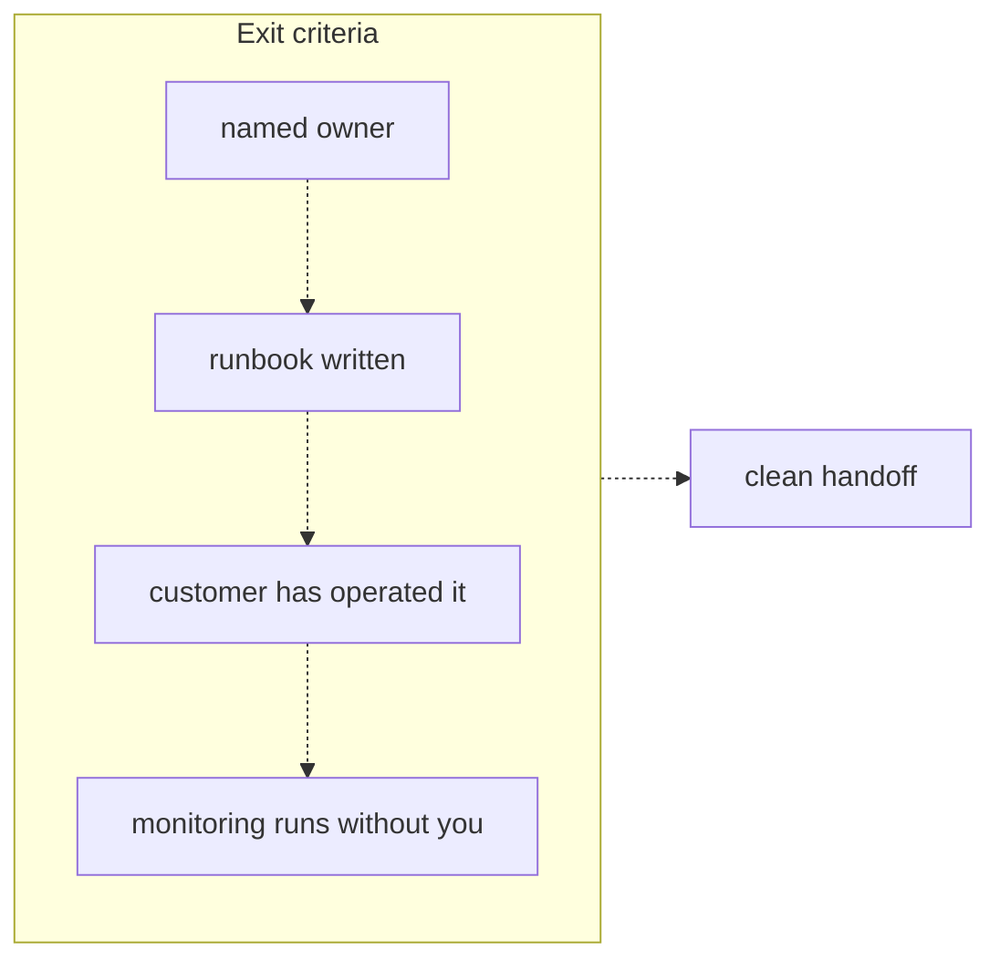
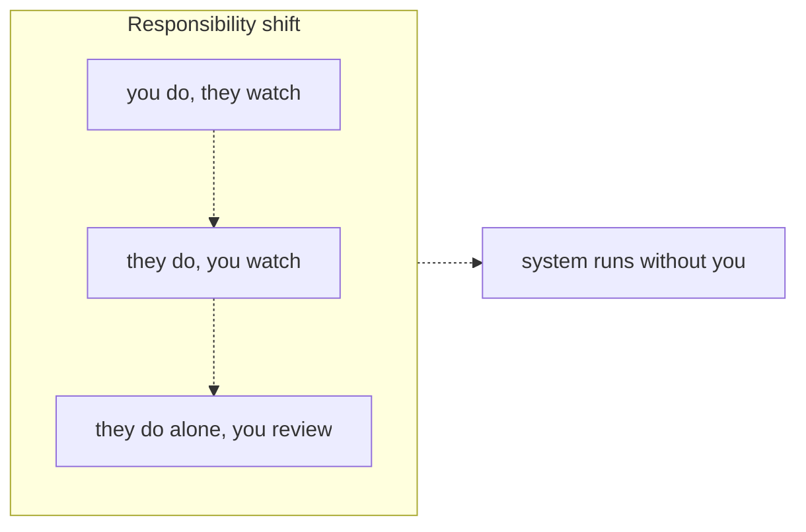

# 41 — Production rollout and handoff

Source: notes lines 15519–15775; images: Topic 41/Screenshot 2026-10-29 183000.png, Topic 41/Screenshot 2026-10-29 183007.png

## Why it matters
The FDE is temporary by design. "A system that only runs while you are in the building is not a success."
This last stage's exit artifacts are:
- **met exit criteria**: a named owner, a runbook, a customer who has operated the system, and monitoring that runs without you;
- **a trained three-role team**.

Exit criteria are written at the **start** of the engagement, so they shape how you build.

## Process / steps
Stage order in this topic is L1, L2, Q1, T1, Q2, so the course's node count is 5. The images show L1 as 1 of 5 and L2 as 2 of 5.

**Stage exit artifact:** a clean handoff. All four exit criteria are true, and `runbook.md` has Owner, Routine operations, Known failure modes and Escalation.

**A. Write the exit criteria in week one** (L1). There are four areas, in the image's order:
1. **Named owner.** A person, not a team, named in writing and agreed by their manager.
2. **Runbook written.** Restart, re-index, API-key rotation, and the top five known failure modes with a fix for each.
3. **Customer has operated it.** Their engineer has re-indexed, handled a bad-answer report, and read the cost dashboard, with you standing by.
4. **Monitoring runs without you.** The eval suite is scheduled, thumbs-downs are reviewed weekly, and someone is alerted on accuracy or cost drift.

These lead to a clean handoff.

**B. Train by a responsibility shift, one duty at a time** (L2). Start about four weeks before the end, in the image's order:
1. **You do, they watch.** Once, to show the shape of the task. This is the only step slides are good for.
2. **They do, you watch.** They re-index, run evals and handle a thumbs-down. You speak only when they are stuck.
3. **They do alone, you review.** For the last two weeks, their team runs the weekly feedback review.

This leads to a system that runs without you.

**C. Train three roles, each with its own session and runbook section** (L2):
- **operator:** the engineer;
- **reviewer:** the support lead or domain expert;
- **owner:** the manager.

**D. Write the runbook** (T1). If an exit criterion is unmet (e.g. no owner), take it to the sponsor with options before your last week (Q1).

## Diagrams
### Topic 41/Screenshot 2026-10-29 183000.png — "Exit criteria"

What it teaches: a clean handoff needs all four criteria. They build on each other: the owner, then the runbook, then customer operation, then monitoring.

Text vs image: the ASCII uses plain connecting lines, and the image uses dashed downward arrows. Otherwise they match.

### Topic 41/Screenshot 2026-10-29 183007.png — "Responsibility shift"

What it teaches: training is a gradual hand-over of the keys, ending with the customer working alone while you review. The last day then changes nothing.

Text vs image: the ASCII uses plain connecting lines, and the image uses dashed downward arrows. Otherwise they match.

## Rules and numbers
- Exit criteria answer one question: what must be true on your last day so the system keeps working without you? (L1)
- Name a single owner, a person and not a team. Write it down and get their manager to agree. The owner watches costs, reviews feedback and applies fixes. (L1)
- The runbook covers: restart, re-index, API-key rotation, and the **top five** known failure modes with a fix for each. (L1)
- The customer must have **operated** the system, not watched you. "Doing is the only proof of ability to do." (L1)
- Monitoring must run without you:
  - the eval suite on a schedule;
  - a weekly thumbs-down review;
  - an alert to someone on accuracy or cost drift;
  - all wired to **their** people. (L1)
- Write the exit criteria in week one. They change how you build. For example: indexing becomes one script with one command, not six manual steps, and you ask "who will own this?" in month one. (L1)
- Agreed exit criteria define "done" and prevent months of unpaid babysitting. (L1)
- Schedule handoff training about 4 weeks before the end. (L2)
- Don't train with a two-hour slide presentation. "Nods are not knowledge." (L2)
- Follow the shift: you do, they watch; then they do, you watch; then they do alone, you review, for the last two weeks. (L2)
- Train at least 3 roles (L2):
  - **Operator:** restart, re-index, rotate keys, read logs, run evals. Deep and hands-on.
  - **Reviewer:** the weekly feedback review, judging quality, deciding escalations to the operator. No code.
  - **Owner:** reads the cost and quality dashboard, knows what normal looks like and who to call. Fifteen minutes a week.
- With all three roles trained, a bad answer has a path: the reviewer catches it, the operator fixes it, the owner sees the trend. (L2)
- If only the engineer is trained, everything routes through one inbox. The system is orphaned when that person leaves. (L2)
- Treat a missing owner as an unmet exit criterion and a sponsor-level decision. Never paper over it. (Q1)
- Do not hand off to "the IT team" as a group. A group handoff assigns the work to nobody. (Q1)
- Do not give unofficial free support after the contract ends. (Q1)
- Do not train an unassigned colleague whose manager has not agreed. (Q1)
- The runbook must contain these 4 H2s, spelled exactly: `## Owner`, `## Routine operations`, `## Known failure modes`, `## Escalation`. (T1)
- Put commands in fenced code blocks. Operators copy commands; they do not retype prose. (T1)
- Never swap the model without running evals first. (T1)
- A runbook and a trained operator cover "can they react". Scheduled monitoring with a named person covers "will anyone notice". Both are required. (Q2)

## Decision rules from quizzes
- **Q1. Solvex Chemicals: the planned owner resigns 3 weeks before the end.** IT says "make it fully automatic". The pilot passed, and the end date is fixed.
  - Right move: tell the sponsor plainly that with no owner the system degrades and the exit criteria cannot be met. Lay out the options and ask them to choose before your last week:
    - assign and train a part-time owner now;
    - buy a support retainer;
    - scale the system down to a minimal footprint.
  - Traps:
    - "Automate it and hand it to the IT team" (automation cannot replace judgment, and a group is nobody).
    - Training an unassigned colleague, which fails at the first priority conflict.
    - Quiet free remote monitoring after the contract ends.
- **Q2. Two months after handoff, quality has silently dropped.** There was a full runbook and a trained operator.
  - Likely gap: quality monitoring was never made someone's scheduled duty. The eval suite and feedback review existed but did not run on a schedule.
  - Trap: blaming the provider's model change. A scheduled eval run is exactly what catches that too.

## Tasks
- **T1. Write a handoff runbook (Larkspur Media policy assistant).**
  - Goal: the document their team operates from after you leave.
  - Method: write `/root/fde-production-handoff/runbook.md` with the 4 exact H2s, using the handoff notes.
    - **Owner:** all three roles and their people.
      - Operator: Dana Okafor, platform engineer.
      - Reviewer: Sam Reyes, support lead, runs the Friday thumbs-down review.
      - Owner: Priya Nair, IT manager, watches monthly cost.
    - **Routine operations:**
      - re-index after any policy-document change, and monthly regardless: `python3 /opt/assistant/reindex.py --docs /opt/assistant/docs`;
      - evals every Monday, with the score recorded in the quality sheet: `python3 /opt/assistant/run_evals.py --dataset /opt/assistant/golden.jsonl`;
      - both commands in fenced code blocks;
      - quarterly key rotation: get a new key from the provider portal, update `OPENAI_API_KEY` in `/opt/assistant/.env`, restart the service.
    - **Known failure modes**, as list items with the symptom and the fix:
      - A retired policy shows up in citations: the index is stale, so re-index.
      - "I do not have that in the documents" for a known question: a document failed to load, and the `reindex.py` log shows the skipped files.
      - Slowdowns or failures near month end: the API budget cap was hit. The owner raises the cap or waits for the reset. Never swap the model without running evals first.
    - **Escalation:**
      - thumbs-down goes to the reviewer at the Friday review, then to the operator if unresolved;
      - a Monday eval score below 80% means the operator investigates the same day and informs the owner;
      - two weeks below 80% means the owner calls the vendor account manager.
    - Full sentences throughout.
  - Done looks like: an operator can run every routine task by copying commands. Each failure mode has a symptom and a fix. The escalation path runs from a thumbs-down to the vendor call, with the 80% threshold.

## Course → real world
- **Exit criteria in the SOW (Hadavin practice):**
  - the four exit criteria (named owner, runbook, customer operated, monitoring without you) go into the fixed-price contract on day one;
  - a fifth exit criterion is ours (Hadavin practice, audit H-04; owner decision 2026-11-01 item 6): Hadavin's own access closed and evidence filed. List every credential, role, service account, webhook, deploy key and repo or console access we held (Access Closure Record Part 1); remove what we control and ask the customer in writing for the rest when the counts show the target is met; the owner signs Part 1 then and Part 2 at hand-over; both are attached to the runbook. Checklist line: "Hadavin access closed and Access Closure Record filed." This also closes the quiet-free-support trap;
  - this is the course's "write them at the start", and it is also how "done" is defined so the engagement does not drift.
- **Owner in the agent registry (Hadavin practice):**
  - every deployed agent or assistant is entered in the agent registry with its named owner, tools and permissions;
  - the three roles (operator, reviewer, owner) are recorded there and in the runbook.
- **The runbook in a real build (Hadavin practice):** it lives in the client's repo next to the code.
  - Commands are real CLI entry points of the typed package, e.g. a re-index command and an eval command; no ad-hoc scripts.
  - Key rotation uses the client's secrets manager (AWS Secrets Manager or SSM, Azure Key Vault, GCP Secret Manager, or self-hosted Vault), never `.env` in the repo. This replaces the course's `.env` step.
  - Model ids are pinned in config. A model change is a PR that must pass the eval CI gate (the course's "never swap the model without evals").
- **Monitoring without you (Hadavin practice):**
  - scheduled evals run in the client's CI or scheduler, with alerts on accuracy and cost drift to the named owner through the client's monitoring (CloudWatch, Azure Monitor, Cloud Monitoring or Prometheus) plus email or Slack;
  - a named client person can switch the user pilot off in one step (feature flag or allowlist), written in the runbook's Escalation table (audit I-18);
  - the weekly thumbs-down review sits on the reviewer's calendar;
  - the cost dashboard comes from the client cloud's billing and budgets.
- **Responsibility shift (Hadavin practice):** the course's three stages are kept, compressed on the calendar.
  - Their engineer runs the re-index, the eval run and one bad-answer report while Hadavin watches.
  - Their team then runs at least one weekly cycle alone before the last day.
- **Deputies (Hadavin practice, audit H-05):** name a deputy for the operator and for the owner. The runbook lists both. The deputy completes the same responsibility-shift cycle (do/watch). If no deputy exists, record that as an open exit criterion to the sponsor (R272). The studio has no deputy; its cover is the key-person clause, the runbook, and the client's own ability to operate the system (the exit criteria of R265). Say this in discovery; never imply a second engineer. The course's own Q1 shows the failure mode: the owner resigns.
- **Exit-test drill (Hadavin practice, audit I-13):** the course's exit test is a full week including one failure. If no real failure occurs, the sponsor and the client manager agree a drill in advance (for example a stale index or an expired test key in the test environment); the customer's operator fixes it using only the runbook; log it.
- **Quiz 2 traps (audit H-07):** "the operator only watched" (a training gap, not the cause here); "the runbook was too long" (not the cause); "the provider changed the model" (a scheduled eval catches this too).
- **No owner? (Hadavin practice):** the course's options become sponsor choices: assign and train a part-time owner, a paid Hadavin support retainer, or scale down. There is never quiet free support. Retainer prices and response times are set in `egm\pricing\pricing-plan.md` section 3.4; proposals state the response window in UTC and the client's zone.

## Checklist
- [ ] A single named owner is agreed in writing by their manager and recorded in the agent registry.
- [ ] The runbook has Owner, Routine operations (fenced commands), Known failure modes (symptom and fix) and Escalation (with thresholds).
- [ ] The customer's engineer has re-indexed, run evals, handled a bad-answer report and read the cost dashboard, with us only watching.
- [ ] Operator, reviewer and owner each had their own session and have their own runbook section.
- [ ] Scheduled evals, the weekly thumbs-down review and drift alerts run and are wired to their people.
- [ ] The customer ran the last two weekly reviews alone.
- [ ] Any unmet exit criterion went to the sponsor with options before the last week.
- [ ] A deputy is named for the operator and the owner.
- [ ] Hadavin access was closed: Part 1 of the Access Closure Record was signed when the target was met, Part 2 at hand-over, and both are attached to the runbook.

## Studio addition 2026-11-02 (unverified source, adopt after own test)

- Handoff names owner, watcher and rollback for every agent output (R418) and carries definitions, permissions and audit history (R422).
- Release says how to undo it and how long that takes (R441). The durable work record is part of the handoff (R444).

Source: Idea from public LinkedIn posts by Moonveil AI quoting others; unverified; we adopt only after our own test.
