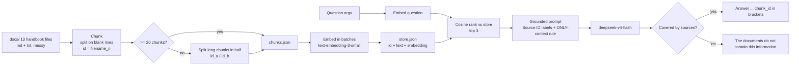

# 42 — Project: Internal docs Q&A bot
Source: notes lines 15776–15988; images: none

## 1. Why it matters
This is the first capstone: the full RAG pipeline end to end for one client. Chunk, embed, store, retrieve, ground, cite, refuse. A docs Q&A bot is one of Hadavin's standard builds, so this project is the template for it. The refusal on an uncovered question matters as much as the right answer.

## 2. Process / steps
The course's order (Task 1, Northwind Robotics handbook):
1. Seed the handbook. This creates `/root/project-1/docs/` with 13 handbook files (mixed markdown and txt, inconsistent formatting).
2. **Chunk** every file. Put the source filename inside each chunk id (`<filename>_<n>`), so answers can cite it. Produce at least 20 chunks, each with `id` and `text`. Save them to `chunks.json`.
3. **Embed** every chunk with `text-embedding-3-small`, in batches.
4. **Store**: one entry per chunk (`id`, `text`, `embedding`) in `store.json`.
5. **Ask** (`ask.py <question>`): embed the question, rank all chunks by cosine similarity, and take the top 3.
6. **Ground**: build a context block that labels each chunk with its Source ID. The system prompt says: answer ONLY from this context, and if the context does not cover the question, say "The documents do not contain this information."
7. **Cite**: the answer ends with the source chunk id in square brackets.
8. **Prove it** with two saved runs: one covered question (expenses) and one trap question (parental leave), which must give the refusal.

## 3. Diagrams
No course images. The flow below is **drawn from the text** of Task 1, not from an image.

What it teaches: the RAG pipeline is a straight line of steps (chunk, embed, store, retrieve, ground, cite, refuse), and refusal is one of its outputs.

## 4. Rules and numbers
- Build the full pipeline: chunk, embed, store, retrieve, ground, cite, refuse. (T1)
- Expect real-world mess: mixed markdown and txt, inconsistent formatting. (T1)
- Make at least 20 chunk objects, each with `id` and `text`. (T1)
- Put the source filename inside each chunk id, so answers can cite it. (T1)
- Make one store entry per chunk, with its embedding from `text-embedding-3-small`. (T1)
- Retrieve by cosine similarity. The solution takes the top 3 chunks. (T1)
- End every answer with the source chunk id in square brackets. (T1)
- When the sources do not cover the question, say the documents do not contain this information. (T1)
- Test with a trap question that nothing in the corpus covers ("What is the parental leave policy?"). It must refuse. (T1)
- Use `deepseek-v4-flash` as the chat model and `text-embedding-3-small` for embeddings. (T1)
- No unbounded loops. (T1)
- In the solution, embedding batches have size 50, chunks split on blank lines (`\n\n`), and only chunks longer than 50 chars per half get split again. (T1 solution)
- In the solution, cosine returns 0.0 when either vector has zero norm. (T1 solution)

## 5. Decision rules from quizzes
No quizzes in this topic.

## 6. Tasks
**Task 1: Build the internal docs Q&A bot**
- **Goal:** Northwind Robotics employees ask the handbook about HR policy, VPN setup, expense rules, on-call and more. They get grounded, cited answers, and a refusal when the handbook is silent.
- **Method:**
  1. Run the seed script: `curl -fsSL https://raw.githubusercontent.com/Esc-Bash/project-init-scripts/main/ai-fde/project-1/init.sh | bash`. It creates `/root/project-1/docs/` with 13 handbook files.
  2. Write one build script:
     - read every file in `docs/`, sorted;
     - split on blank lines, with id `<fname>_<idx>`;
     - if there are under 20 chunks, split each chunk whose half-length is over 50 chars (i.e. over about 100 chars) in half (`_a`/`_b`);
     - write `chunks.json`;
     - embed in batches of 50;
     - write `store.json`;
     - generate `ask.py`.
  3. `ask.py` loads the store, embeds the question, ranks by cosine, and builds the context with `--- Source ID: <id> ---` headers. It calls `deepseek-v4-flash` with the grounding + refusal + citation system prompt and prints the answer.
  4. Run the two questions and redirect the output to the answer files: the covered question "How much can I expense for meals during business travel?" → `answer-expenses.txt`, and the trap "What is the parental leave policy?" → `answer-trap.txt`.
- **Done looks like:** five files in place, at exact paths `/root/project-1/{chunks.json,store.json,ask.py,answer-expenses.txt,answer-trap.txt}`:
  - `chunks.json`;
  - `store.json`;
  - `ask.py`;
  - `answer-expenses.txt`, for example: "up to 40 EUR per day for meals during business travel, and receipts are required. [expenses.md_1]";
  - `answer-trap.txt`, for example: "The documents do not contain this information. [hr-policy.md_1]".

  The solution run produced 35 chunks.

## 7. Deliverables list
This list is the per-engagement deliverables template for a docs Q&A build. Course items come first. Items marked "Hadavin practice" are added for real engagements.

| # | Artifact | Course form | Hadavin real-engagement form |
|---|---|---|---|
| 1 | Source corpus snapshot | `docs/` (13 files) | Connector config + list of the client's sources in scope (Hadavin practice) |
| 2 | Chunk set | `chunks.json`: ≥20 `{id, text}`, filename in id | Chunking module + chunk manifest, with source/section/ACL metadata (Hadavin practice) |
| 3 | Vector store | `store.json` (`id`, `text`, `embedding`) | Vector-store kind: pgvector default, Bedrock Knowledge Base on S3 Vectors or another cloud store as per-cloud backend; same id + text + vector + metadata shape |
| 4 | Ask entry point | `ask.py <question>` | CLI + API endpoint in a typed package (Hadavin practice) |
| 5 | Grounding prompt | System prompt in `ask.py` | Versioned prompt file in config (Hadavin practice) |
| 6 | Covered-question proof | `answer-expenses.txt` | Golden set of covered questions with expected source ids (Hadavin practice) |
| 7 | Refusal proof | `answer-trap.txt` | Trap/out-of-scope items in the golden set, which must refuse (Hadavin practice) |
| 8 | Build/re-index script | `build_all.py` | Re-index job + freshness check, as a runbook step (Hadavin practice) |
| 9 | README | — (not in course) | Hadavin practice. Sections: what it does, sources covered, how to run, how to re-index, how to read citations, known limitations |

## 8. Course → real world
- **Models:** the course uses `deepseek-v4-flash`. **Real:** Claude through the client's own cloud. Bedrock is the recommended option on AWS, Foundry on Azure and Vertex AI on GCP, after the client has chosen (R446). Use Haiku 5.5 for cheap Q&A volume and Sonnet 5.5 as the usual result for hard work (tier per R278/R279). Pin model ids in config.
- **Embeddings:** the course uses `text-embedding-3-small`. **Real:** Cohere Embed v4 or Titan on Bedrock, or the client cloud's own embeddings. Use the same model for chunks and queries.
- **Store:** the course uses `store.json` with a full linear cosine scan. **Real:** the vector-store kind, with pgvector as the neutral default and Bedrock Knowledge Bases on S3 Vectors (or another cloud store) as a per-cloud backend. Keep the id + text + vector + metadata record shape.
- **Corpus:** the course uses a local `docs/` folder. **Real:** connectors to the client's wiki/drive/SharePoint, through least-privilege service accounts with secrets from the secrets kind (AWS Secrets Manager or SSM, Azure Key Vault, GCP Secret Manager, or self-hosted Vault). Real client documents stay in the client's environment, not in the studio folder or the Drive backup. The connectors carry ACL metadata so retrieval is permission-filtered.
- **Code:** the course uses a build script that writes `ask.py` as a string. **Real:** a typed package (uv, ruff, pytest) with these modules: config, adapters (embedder, store, LLM), core (chunk, retrieve, ground), evals, CLI/API. It has structured logs and OTel traces, and CI gates on every PR.
- **Hadavin practice, gaps in the course solution to fix in a real build:**
  - The trap refusal still ends with a citation (`[hr-policy.md_1]`). Real refusals must not cite a chunk, or they must cite nothing. Root cause (audit I-20): the prompt contradicts itself ("every answer must end with the id of the source chunk" and also "refuse"). The refusal text is returned by code when nothing passes the minimum score (R151); the prompt does not ask the model to cite a refusal.
  - Splitting on `\n\n` does not split Windows (CRLF) files: a messy client export becomes one chunk per file and the code falls to the character-midpoint split, which cuts sentences (the 40 EUR fact could be severed). Split on `\r?\n\s*\n`; never cut inside a sentence.
  - `open(..., errors="ignore")` silently drops bytes. Decode strictly and log skipped files.
  - There is no temperature or timeout on the call, so the same question can flip between answer and refusal run to run, which makes `answer-trap.txt` luck. Set a low temperature and a timeout on every model call; the trap item runs 3 times. Root cause (audit I-20): the prompt contradicts itself ("every answer must end with the id of the source chunk" and also "refuse"). The refusal text is returned by code when nothing passes the minimum score (R151); the prompt does not ask the model to cite a refusal.
  - There is no similarity threshold, so the top 3 are always passed, even when they are irrelevant. Add a minimum score, and refuse before calling the LLM when nothing passes it.
  - Splitting on blank lines only gives uneven chunks on messy files. Use structure-aware chunking, with a size cap and overlap.
  - There is no golden set. Two hand-run questions do not count as an eval. Make a golden set with covered and trap items, plus a pass-rate gate in CI.
- **Guards:** the injection screen goes through one interface (neutral default: rules plus a small classifier we run; per-cloud backends Bedrock Guardrails, Azure Prompt Shields, Model Armor; or an LLM screen). Regex PII redaction is always on.
- **Model kind (Hadavin practice, audit I-23):** the model sits behind the LLM adapter kind. Default Claude on the client's cloud; a second backend is outlined with its trigger (an open-weight model on client GPUs, R44; trigger: air-gap or a client veto). Vendor SDK imports only inside the adapter module. The course code is hard-wired to the OpenAI SDK (`from openai import OpenAI`) and must be wrapped in a real build.
- **Live re-check (audit I-24, `[unverified 2026-11-01]`):** Haiku 5.5 availability per cloud and region, Bedrock Knowledge Bases on S3 Vectors, Cohere Embed v4 and Titan, guardrail product names, the embeddings per-request input limit, and any price. Date each check; the course's $0.30/$1.20 per 1M is a lab number.

## 9. Checklist
- [ ] Every chunk id carries its source file (and section), and every answer ends with a resolvable citation.
- [ ] At least one trap question refuses with the exact refusal text and no false citation.
- [ ] Chunks and queries use the same pinned embedding model, set from config.
- [ ] Retrieval has a top-k and a minimum-score rule, so nothing below the threshold reaches the prompt.
- [ ] No unbounded loops. Embedding calls are batched.
- [ ] The deliverables list (section 7) is complete, including the README.
