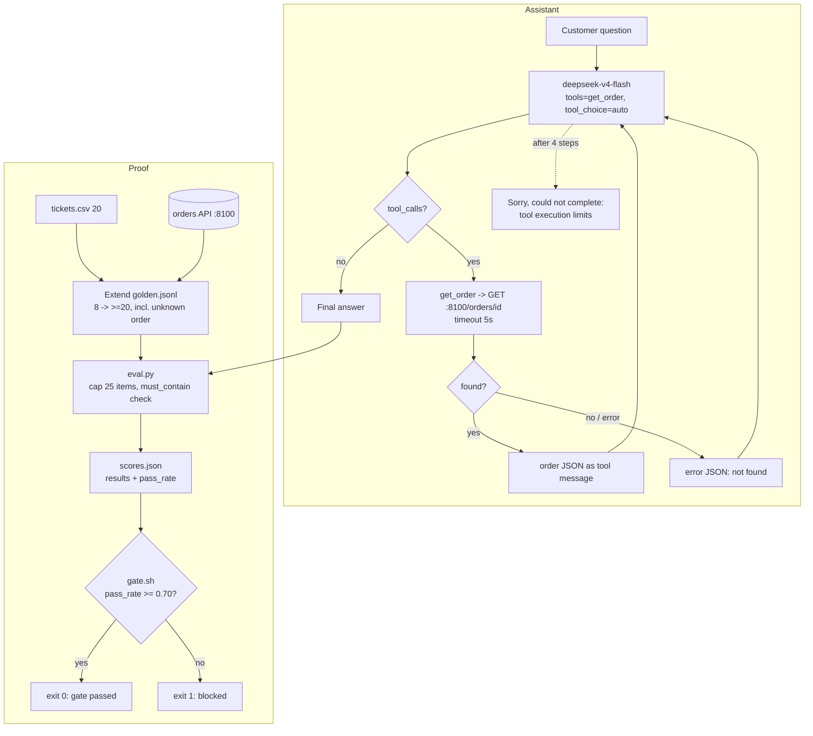

# 43 — Project: Support assistant with evals
Source: notes lines 15989–16351; images: none

## 1. Why it matters
This capstone builds a tool-calling assistant over a real-shaped API, then proves it the way an FDE must: a golden set, an eval script and a pass-rate gate, all before anyone trusts it. The gate is the line between a demo and a deliverable.

## 2. Process / steps
The course's order (Task 1, retailer "where is my order" tickets):
1. Seed the project. It creates `orders_api.py`, `tickets.csv` (20 real tickets) and `golden.jsonl` (8 starter items: `id`, `question`, `must_contain`).
2. Start the orders API in the background on port 8100. It serves `/orders/<order_id>`.
3. **Extend the golden set** to at least 20 items, in the same shape:
   - write the new items from `tickets.csv` and live API data;
   - include at least one unknown order.
4. **Build the assistant**:
   - use `deepseek-v4-flash`, with a `get_order` tool that calls the API;
   - the model decides when to call the tool;
   - orders that do not exist are handled;
   - the tool loop is bounded to a few steps.
5. **Build the eval**:
   - run every golden question (capped at 25) through the assistant;
   - check each `must_contain` string;
   - write `scores.json` with `results` and `pass_rate`.
6. **Build the gate**: `gate.sh` reads `pass_rate` and exits non-zero below the threshold. It must pass on the current scores.

## 3. Diagrams
No course images. The flow below is **drawn from the text** of Task 1, not from an image.

What it teaches: build the assistant and its proof together. The gate, not a demo, decides whether the build ships.

## 4. Rules and numbers
- Prove the assistant with a golden dataset and an eval gate before anyone trusts it. (T1)
- Let the model decide when to call the tool (`tool_choice="auto"`). (T1)
- Handle orders that do not exist. Return an error result to the model, and tell the customer clearly that the order was not found. (T1)
- Bound the tool loop to a few steps. The solution uses max 4 iterations, then a fixed apology. (T1)
- Give the tool HTTP call a timeout. The solution uses 5 s. (T1 solution)
- Return unknown tool names as a `{"error": "Unknown tool"}` tool result; don't crash. (T1 solution)
- Extend the golden set to at least 20 items, in the same shape (`id`, `question`, `must_contain`). (T1)
- Write golden items from real tickets (`tickets.csv`) and real API data. (T1)
- Cover at least one unknown order in the golden set. (T1)
- Cap the eval loop at 25 items. (T1)
- Check every `must_contain` string, case-insensitively, in the solution. An item passes only if all of them are present. (T1)
- Write `scores.json` with a `results` list and a `pass_rate` number. The solution rounds it to 4 places. (T1)
- Catch assistant exceptions inside the eval and score them as failures. Don't abort the run. (T1 solution)
- The gate exits non-zero below the threshold and must pass on the current scores. The solution threshold is 0.70. (T1)
- Use `deepseek-v4-flash` only. No unbounded loops. (T1)
- Solution result: the golden set was extended to 29 items, the eval ran 25 of them (cap), and the pass rate was 72.0% (18/25). That is ≥ 0.70, so the gate passed. (T1 output)

## 5. Decision rules from quizzes
No quizzes in this topic.

## 6. Tasks
**Task 1: Build the support assistant and prove it with evals**
- **Goal:** a tool-calling assistant answers "where is my order" tickets from the orders API, and an eval gate proves the quality.
- **Method:**
  1. Seed the project: `curl -fsSL https://raw.githubusercontent.com/Esc-Bash/project-init-scripts/main/ai-fde/project-2/init.sh | bash`. It creates `/root/project-2/`. Start `orders_api.py &` after killing any old instance; the API is at `http://localhost:8100/orders/<order_id>`. All deliverables live in `/root/project-2/` (`assistant.py`, `golden.jsonl`, `eval.py`, `scores.json`, `gate.sh`).
  2. Extend the golden set with a script:
     - load the existing items;
     - for each ticket row, call the API for its `order_id` and use the `status` (and `shipping_date` if present) as `must_contain`;
     - use "not found" when there is no order id;
     - add `Where is order ORD-99999?` → `["not found"]`;
     - top up to 20.
  3. `assistant.py`:
     - a system prompt that says when to use `get_order` and what to say for not-found orders;
     - a tools schema with `order_id` as a required string;
     - a 4-step loop that appends each tool result as a `role: tool` message with its `tool_call_id`.
  4. `eval.py`:
     - load the golden set and cap it at 25;
     - call `ask_assistant` and do the `must_contain` check;
     - write `scores.json`.
  5. `gate.sh`:
     - fail if `scores.json` is missing;
     - read `pass_rate` and compare it to `THRESHOLD=0.70` as floats;
     - exit 0 or 1.
- **Done looks like:**
  - the API is running;
  - `assistant.py`, `golden.jsonl` (≥20), `eval.py`, `scores.json` and `gate.sh` are in place;
  - the gate prints "SUCCESS: Quality gate passed!". The course run: 0.72 vs 0.70.

## 7. Deliverables list
This list is the per-engagement deliverables template for a tool-calling assistant build. Course items come first. Items marked "Hadavin practice" are added for real engagements.

| # | Artifact | Course form | Hadavin real-engagement form |
|---|---|---|---|
| 1 | Backend under test | `orders_api.py` running on :8100 | Connector to the client's orders system via a least-privilege service account; secrets from the secrets kind (Hadavin practice) |
| 2 | Assistant | `assistant.py` (tool schema, bounded loop, not-found handling) | Typed package: tool allowlist + schema, bounded loop, audit log per tool call (Hadavin practice) |
| 3 | Real ticket sample | `tickets.csv` (20) | Anonymised, PII-redacted ticket export from the client (Hadavin practice) |
| 4 | Golden set | `golden.jsonl` ≥20 items, `{id, question, must_contain}`, incl. unknown order | Same shape, versioned in the repo, with edge cases (unknown, ambiguous, multi-order, out-of-scope) reviewed by a client SME (Hadavin practice) |
| 5 | Eval runner | `eval.py` (cap 25) | Eval module run in CI on every PR (Hadavin practice) |
| 6 | Scores | `scores.json` (`results`, `pass_rate`) | Same, kept per run as a CI artifact for trend lines (Hadavin practice) |
| 7 | Gate | `gate.sh`, threshold 0.70 | CI required check; threshold agreed with the client in the success criteria (Hadavin practice) |
| 8 | README | — (not in course) | Hadavin practice. Sections: what it does, tools and their permissions, how to run, how to run evals, the gate threshold and why, known limitations |

## 8. Course → real world
- **Models:** the course uses `deepseek-v4-flash`. **Real:** Claude on the client's cloud (Bedrock recommended for AWS, after the client has chosen, R446). Haiku 5.5 suits high-volume "where is my order" traffic. Sonnet 5.5 is the usual result when routing is hard (tier per R278/R279). Pin model ids in config.
- **Tools:** the course uses one `get_order` over a stdlib mock API. **Real:** a governed action with an allowlist, a JSON schema and validated args. Read-only tools run freely. Anything that changes an order needs a human approval step. Every call is audited, and the agent is listed in the agent registry with its owner, tools and permissions.
- **Evals:** the course uses substring `must_contain` scoring. **Real (Hadavin practice):** keep the deterministic `must_contain` checks as the cheap first layer, and add a judge for tone/correctness where substrings can't decide. Run the gate in CI on every PR.
- **Hadavin practice, gaps in the course solution to fix in a real build:**
  - The solution pads the golden set to 20 with synthetic `ORD-100{idx}` items whose `must_contain` is just `["status"]`, and it falls back to `["order"]` on API errors. Those items are weak or always pass. Real golden items are hand-checked against real expected answers.
  - The golden set has 29 items, but the eval silently runs only the first 25. Make the cap explicit in the report, or keep the set within the cap.
  - Failing items (7 of 25) were not triaged. Log a reason for each failure before raising or accepting the threshold.
  - The assistant does not validate the order id format before calling the API. Validate tool args against the schema.
  - The course sets the gate after seeing the score (the task says it "must pass with your current scores": 72.0% against a 0.70 threshold). Ours is fixed in `eval-contract.md` first (R180).
  - n=25 is too small to gate: a 72% result (18/25) has a 95% interval of roughly 52% to 86% (Wilson, audit I-21 arithmetic), so the gate can flip on a rerun. Report the interval (R326). The gating set is 50 items or more (R182); fewer only if the client has fewer, then report the exact interval and mark the gate advisory. 20 is the course's capstone minimum, not a gate (audit I-10).
  - The unknown-order check is circular: the prompt dictates the phrase "not found" and the test then looks for it, so a correct "I couldn't find it" would fail. Judge not-found items on meaning (several accepted phrasings), not on the phrase the prompt dictates.
  - The solution guessed the `tickets.csv` columns (`ticket_id`/`id`) and a `shipping_date` field it never showed. Read the real file schema before writing items; never guess columns.
  - Golden sets cover more than answerable items (audit J-05): add `expected_route` (answer / ask_more / escalate / refuse / tool:name) and, for permissioned data, a user-permissions field, with answerable, partial, unanswerable, action and adversarial cases.
- **Guards:** customer-facing input goes through the injection screen. PII (names, addresses in the order JSON) is redacted in logs.
- **Model kind (Hadavin practice, audit I-23):** the model sits behind the LLM adapter kind. Default Claude on the client's cloud; a second backend is outlined with its trigger (an open-weight model on client GPUs, R44; trigger: air-gap or a client veto). Vendor SDK imports only inside the adapter module. The course code is hard-wired to the OpenAI SDK (`from openai import OpenAI`) and must be wrapped in a real build.
- **Live re-check (audit I-24, `[unverified 2026-11-01]`):** Haiku 5.5 availability per cloud and region, Bedrock Knowledge Bases on S3 Vectors, Cohere Embed v4 and Titan, guardrail product names, the embeddings per-request input limit, and any price. Date each check; the course's $0.30/$1.20 per 1M is a lab number.

## 9. Checklist
- [ ] The tool loop is bounded, has a timeout on every external call, and has a clear message when it hits the limit.
- [ ] Not-found and API errors return a structured error to the model and a clear message to the user.
- [ ] The golden set has real-derived items, including unknown-order and out-of-scope cases, and no filler items. The gating set is 50 or more (R182); ≥20 is the course capstone minimum only.
- [ ] The eval writes `results` + `pass_rate`, and failures are triaged with reasons.
- [ ] The gate threshold is agreed with the client and frozen in `eval-contract.md` before any score is seen, runs in CI, and blocks merges below it; the score is reported with its interval.
- [ ] The deliverables list (section 7) is complete, including the README.
