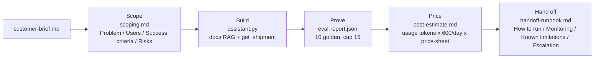
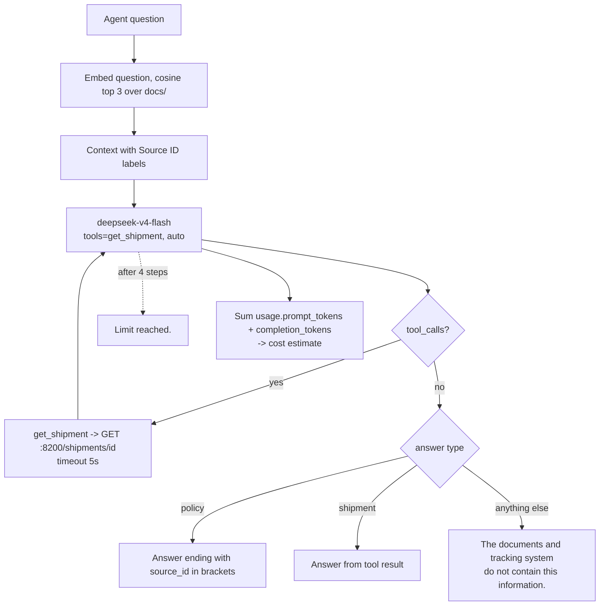

# 44 — Project: Full engagement simulation
Source: notes lines 16352–16649; images: none

## 1. Why it matters
This is the whole FDE job in one project: scope it, build it, prove it, price it, hand it off. Every Hadavin engagement follows this arc. Its five deliverables are the minimum handover set for every build.

## 2. Process / steps
The course's order (Task 1, Velora Freight, an internal assistant for support agents):
1. Seed the engagement. It creates:
   - `customer-brief.md`;
   - `docs/` (5 policy files);
   - `tracking_api.py` (a mock, port 8200);
   - `golden.jsonl` (10 golden questions);
   - `price-sheet.md`.
2. **Scope**: read the customer brief and write `scoping.md` with H2s `## Problem`, `## Users`, `## Success criteria`, `## Risks`.
3. **Build** one assistant with two sources:
   - retrieval over `docs/` (`text-embedding-3-small`, cite the source id);
   - a `get_shipment` tool that calls the tracking API.

   Routing rule: policy answers cite, shipment answers use the tool, and anything else is refused.
4. **Prove**: start the tracking API, and run all 10 golden questions (eval loop capped at 15). Save `eval-report.json` with `results` and `pass_rate`.
5. **Price**: write `cost-estimate.md` as a monthly estimate, using:
   - tokens per question from the `usage` field of a real response;
   - 600 questions/day from the brief;
   - the prices in `price-sheet.md`.

   Name the models priced.
6. **Hand off**: write `handoff-runbook.md` with H2s `## How to run`, `## Monitoring`, `## Known limitations`, `## Escalation`.

The solution writes the docs first (scoping, cost, runbook), then `assistant.py`, then the eval run. The task lists them in the order above.

## 3. Diagrams
No course images. The flows below are **drawn from the text** of Task 1, not from an image.

Engagement arc:

Assistant routing:

What it teaches: the engagement is five stages, and each stage has a named exit artifact. One assistant routes between cited retrieval, a tool, and refusal.

## 4. Rules and numbers
- Follow the arc: scope it, build it, prove it, price it, hand it off. (T1)
- The scoping doc must have the H2s `## Problem`, `## Users`, `## Success criteria`, `## Risks`. (T1)
- Build one assistant, two sources: docs retrieval with source-id citation, plus the `get_shipment` tool. (T1)
- Policy answers cite. Shipment answers use the tool. Anything else is refused. (T1)
- Embed with `text-embedding-3-small`. The chat model is `deepseek-v4-flash`. (T1)
- Keep the tool loop bounded. The solution uses 4 steps, then "Limit reached.". (T1)
- Cap the eval loop at 15 items. Run all 10 seeded golden questions. (T1)
- The tracking API must be running for the shipment questions. (T1)
- `eval-report.json` holds a `results` list plus a `pass_rate` number. (T1)
- Take tokens per question from the `usage` field of a real response, not from a guess. (T1)
- Use the 600 questions per day from the brief, and the prices from `price-sheet.md`. Name the models you priced. (T1)
- In the solution, cost = 18,000 requests/month (600/day × 30 days). `deepseek-v4-flash` is priced at Input $0.30/1M and Output $1.20/1M. Total $6.48/month. (T1 solution)
- The runbook must have the H2s `## How to run`, `## Monitoring`, `## Known limitations`, `## Escalation`. It is the doc the customer's team keeps after you leave. (T1)
- In the solution, the success criteria are:
  - ≥85% pass rate;
  - handling time under 3 minutes;
  - ≥80% weekly active usage. (T1 solution)
- In the solution, the risks are index staleness, API downtime and scope creep. (T1 solution)
- In the solution runbook:
  - monitoring = check `eval-report.json` weekly;
  - known limitation = static docs need re-indexing;
  - escalation = notify engineering if accuracy drops below 80%. (T1 solution)
- The tracking API is started for the eval and terminated after it. (T1 solution)

## 5. Decision rules from quizzes
No quizzes in this topic.

## 6. Tasks
**Task 1: Run a full engagement end to end**
- **Goal:** take Velora Freight from brief to handover with five deliverables.
- **Method:**
  1. Seed the engagement: `curl -fsSL https://raw.githubusercontent.com/Esc-Bash/project-init-scripts/main/ai-fde/project-3/init.sh | bash`. It creates `/root/project-3/`; all five deliverables live there. Kill any old `tracking_api.py` (the eval step starts it); the tracking API is at `http://localhost:8200/shipments/<id>`.
  2. Write `scoping.md` from the brief, with the four H2s. Make each success criterion a number.
  3. Write `assistant.py`:
     - build the docs store (split on blank lines, id `<fname>_<idx>`, embed);
     - embed the question, take the top 3 by cosine, and add the Source ID context;
     - the system prompt says: cite policy answers with `[source_id]`, use `get_shipment` for tracking, and give a fixed refusal otherwise;
     - run a 4-step tool loop that adds up `usage.prompt_tokens` and `usage.completion_tokens`;
     - return `answer` plus the token counts.
  4. Run the eval:
     - start the tracking API as a subprocess;
     - run up to 15 golden items, with a case-insensitive `must_contain` check;
     - write `eval-report.json` with `pass_rate` and `results`;
     - terminate the API.
  5. Write `cost-estimate.md`: monthly volume × tokens per question from `usage` × the price-sheet prices, with the model named.
  6. Write `handoff-runbook.md` with the four H2s.
- **Done looks like:** all five deliverables are in place:
  - `scoping.md`;
  - `assistant.py`;
  - `eval-report.json`;
  - `cost-estimate.md`;
  - `handoff-runbook.md`.

  The run prints "Engagement simulation completed successfully!". The course output does not show the pass rate.

## 7. Deliverables list
**This is the Hadavin per-engagement deliverables template.** Every engagement hands over all of these. Course items come first. Items marked "Hadavin practice" are added for real engagements.

| # | Stage | Artifact | Required content (course) | Hadavin additions (Hadavin practice) |
|---|---|---|---|---|
| 1 | Scope | `scoping.md` | `## Problem`, `## Users`, `## Success criteria` (numeric), `## Risks` | Add in-scope / out-of-scope, data sources and access, the pilot plan, and client sign-off |
| 2 | Build | Assistant (`assistant.py`) | Docs retrieval with source-id citation, `get_shipment` tool, refusal for anything else, bounded loop, usage capture | Typed package (config, adapters, core, evals, CLI/API), governed tools (allowlist, schema, approval, audit), guards, OTel traces |
| 3 | Prove | Golden set (`golden.jsonl`) | Seeded questions with `must_contain` | Covered, tool, trap and out-of-scope items, versioned, SME-reviewed |
| 4 | Prove | `eval-report.json` | `results` list + `pass_rate` | Per-item failure reasons; CI gate script with the threshold taken from the success criteria |
| 5 | Prove | Gate | (Topic 43 `gate.sh`) | CI required check on every PR |
| 6 | Price | `cost-estimate.md` | Monthly cost from real `usage` tokens × volume from the brief × price sheet; models named | Per-tier pricing (Haiku/Sonnet/Opus 5.5) from the client cloud's price list, embeddings + vector store + hosting lines, ±range, budget alarm |
| 7 | Hand off | `handoff-runbook.md` | `## How to run`, `## Monitoring`, `## Known limitations`, `## Escalation` | Add re-index procedure, secret rotation, model-id pin/upgrade steps, dashboards and alarms, on-call contacts, rollback |
| 8 | Hand off | README | — (not in course) | What it does, architecture sketch, setup, run, evals, config keys, links to the runbook and scoping doc |
| 9 | Hand off | Demo / walkthrough record | — (not in course) | Recorded demo against the success criteria (Hadavin practice) |

## 8. Course → real world
- **Timeline:** the course does the stages in one sitting. **Hadavin practice:** keep every stage and its exit artifact (scoping → build → eval gate → cost → runbook), and compress the calendar. Never skip a stage. Run several engagements in parallel.
- **Models and pricing:** the course prices `deepseek-v4-flash` from `price-sheet.md`. **Real:** price Claude tiers on the client's cloud (Bedrock recommended for AWS after the client has chosen (R446); Foundry/Vertex otherwise; direct API only on request), using the live price list on the day of the estimate. Keep the course method: real `usage` tokens × volume × price. Pin model ids in config.
- **Retrieval:** the course uses an in-memory store built from `docs/`. **Real:** the vector-store kind (pgvector default; Bedrock Knowledge Bases on S3 Vectors or another cloud store as a backend), filled by a re-index job, with a freshness check. This covers the "index staleness" risk.
- **Tool:** the course has `get_shipment` against a mock. **Real:** a governed read-only action on the client's tracking system, through a least-privilege service account. It has a schema, an allowlist, an audit log and a registry entry. Executions get scorecards.
- **Hadavin practice, gaps in the course solution to fix in a real build:**
  - `assistant.py` rebuilds and re-embeds the whole docs store on every question. That adds cost and latency. Build the index once and query it.
  - `pass_rate` divides by the full item count, not by the number of items actually run. Divide by the items evaluated.
  - The eval report has no `must_contain` or failure reason per item. Record both.
  - The cost estimate shows no tokens-per-question figure. Always show the `usage` numbers the total came from, so the client can re-check it.
  - The routing between policy, shipment and refusal is left to the prompt alone. Add golden items for each route, plus a trap item.
  - The runbook's "How to run" only starts the API. A real runbook covers the whole system.
  - The course writes `cost-estimate.md` in a heredoc before `assistant.py` or the eval exist ($6.48), and the eval loop stores only `passed`, throwing away the `prompt_tokens`/`completion_tokens` the assistant returns. That breaks the task's own rule ("use the `usage` field from a real response"). Cost comes from `usage` logged per eval item, not from typed text (audit I-22).
  - `item.get("must_contain", [])` with `all(...)` makes an item with no check pass vacuously. An item with no check fails the build (empty `must_contain` is an error).
  - One unbatched `embeddings.create(input=texts)` for all paragraphs fails on a real corpus (limits: verify live). Batch embeddings.
  - The scoping criteria ("85% ... 3 minutes ... 80%") and prices were written without opening `customer-brief.md` or `price-sheet.md`. Copy every number from the brief and the price sheet and cite the line (R25, R244). Use working days from the brief: 600 per day x 30 days overstates a support team that works about 22 days.
- **Guards:** injection screen interface + always-on regex PII redaction. Permission filtering on retrieval, if docs carry ACLs.
- **Model kind (Hadavin practice, audit I-23):** the model sits behind the LLM adapter kind. Default Claude on the client's cloud; a second backend is outlined with its trigger (an open-weight model on client GPUs, R44; trigger: air-gap or a client veto). Vendor SDK imports only inside the adapter module. The course code is hard-wired to the OpenAI SDK (`from openai import OpenAI`) and must be wrapped in a real build.
- **Live re-check (audit I-24, `[unverified 2026-11-01]`):** Haiku 5.5 availability per cloud and region, Bedrock Knowledge Bases on S3 Vectors, Cohere Embed v4 and Titan, guardrail product names, the embeddings per-request input limit, and any price. Date each check; the course's $0.30/$1.20 per 1M is a lab number.

## 9. Checklist
- [ ] `scoping.md` has the four H2s, and every success criterion is a number the eval or telemetry can measure.
- [ ] The assistant routes three ways (cite / tool / refuse), and the golden set has items for each route.
- [ ] `eval-report.json` was produced with the live backend running. The pass rate meets the agreed threshold, and a gate enforces it.
- [ ] `cost-estimate.md` is computed from `usage` logged by the eval run (not typed), shows the real `usage` tokens per question, the volume from the brief and the price source, and names every model priced.
- [ ] `handoff-runbook.md` has the four H2s, and the client team ran "How to run" themselves.
- [ ] Every artifact in the section 7 deliverables list is handed over.
